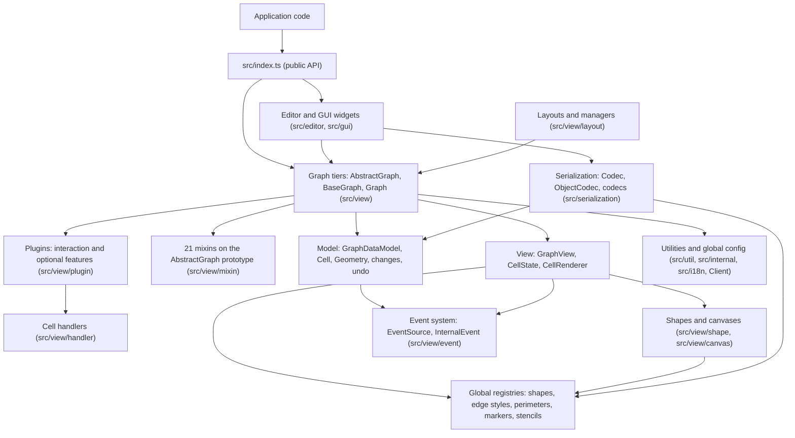
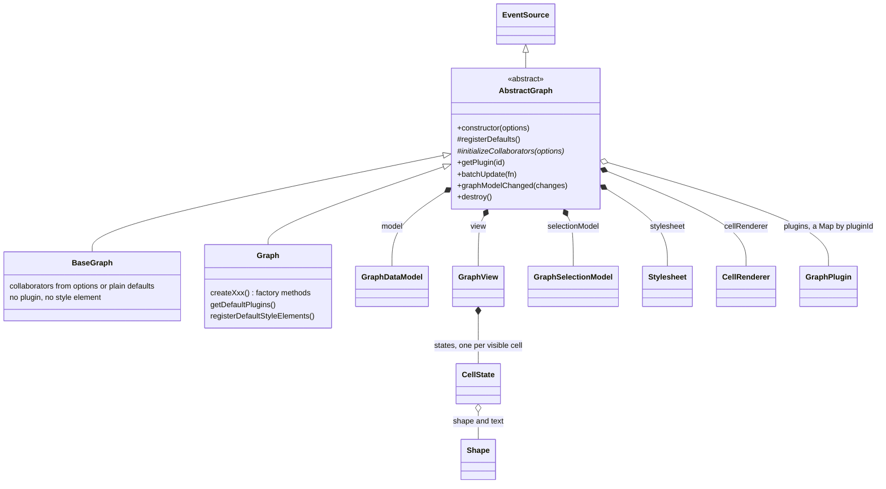
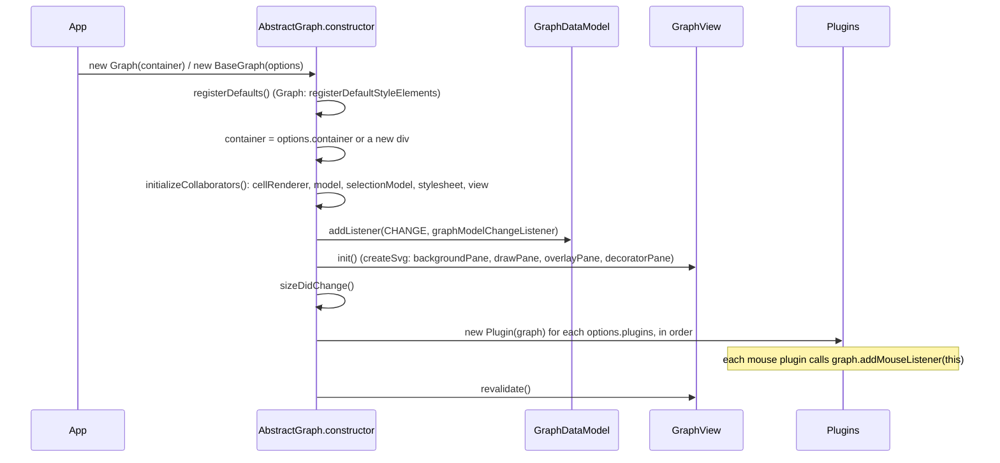
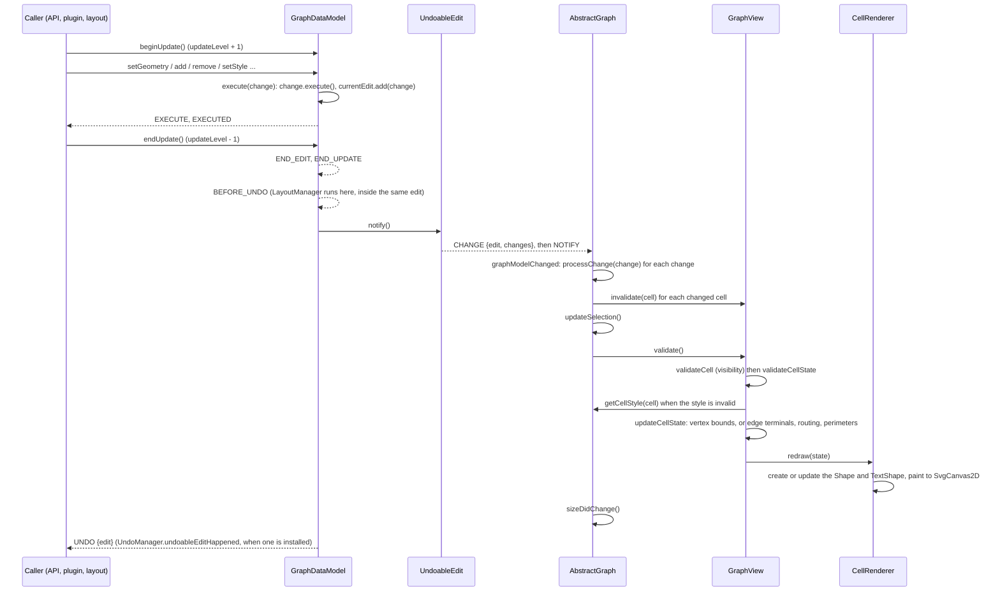
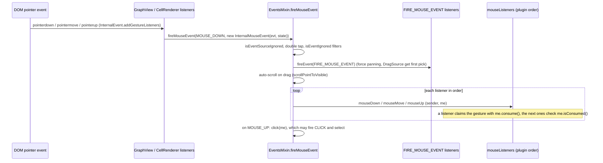
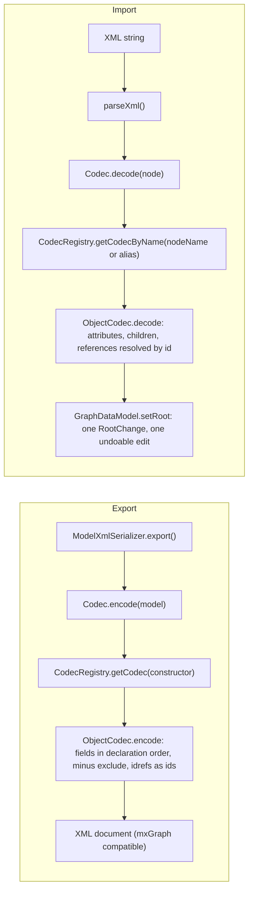

# Architecture of the core package

This document describes how `@tensormorph/tensordiagramcore` (`packages/core`) is built: its layers, the `Graph` class
hierarchy with its mixins and plugins, the global state it relies on, and the main workflows from a model change to the
pixels on screen. It is the entry point for contributors preparing the next phase of development.

- **Basis**: commit `a2e1bd3`, version `0.25.2`. References name a symbol and a file relative to `packages/core`, so
  they survive line changes.
- **Where to go next**:
  - [`COMPONENTS.md`](COMPONENTS.md) maps every source file to its role.
  - [`docs/spec/`](docs/spec/README.md) specifies each subsystem: contract, invariants, events, traps and open items.
  - [`docs/adr/`](docs/adr/README.md) records why the structure is what it is, and
    [`docs/analyses/`](docs/analyses/README.md) records the evaluations of changes that were considered.
- **Out of scope**: the showcase app (`apps/web`), the Storybook (`packages/html`), the examples and the website. They
  consume the built package like any application.

## 1. The package in one paragraph

The core package is a client-side diagramming library, written in TypeScript, the successor of `mxGraph`. It has
**zero runtime dependencies** and renders in SVG, with HTML labels through `foreignObject`. The tsc build emits ESM in
`lib/esm` and CJS in `lib/cjs`. A single barrel, `src/index.ts`, exports the public API. It is about 44 000 lines of
code in 267 files under `src/`. Most of the design is inherited from `mxGraph`: a cell model with transactions and
undoable changes, a view that caches one state per visible cell, renderers and shapes painting through a canvas
abstraction, and handlers turning mouse gestures into model changes. The modernisation work has added three things on
top: a split of the old `mxGraph` God object into **mixins**, opt-in **plugins**, and global **registries** of style
elements that make tree-shaking possible.

## 2. Layers



| Layer | Directories | Role | Spec |
|---|---|---|---|
| Graph | `src/view/AbstractGraph.ts`, `Graph.ts`, `BaseGraph.ts`, `src/view/mixin/` | Facade owning the collaborators, the plugins and the bulk of the API | [graph-lifecycle](docs/spec/graph-lifecycle.md) |
| Model | `src/view/GraphDataModel.ts`, `src/view/cell/Cell.ts`, `src/view/geometry/`, `src/view/undoable-change/` | Cell tree, transactions, undoable changes, undo history, selection model | [model-and-transactions](docs/spec/model-and-transactions.md) |
| View and rendering | `src/view/GraphView.ts`, `src/view/cell/`, `src/view/shape/`, `src/view/canvas/`, `src/view/image/`, `src/view/animate/` | One `CellState` per visible cell, routing, painting to SVG, export | [view-and-rendering](docs/spec/view-and-rendering.md) |
| Style | `src/view/style/`, `src/view/shape/ShapeRegistry.ts`, `src/view/shape/stencil/` | Stylesheet, style resolution, the global registries of named style elements | [style-and-registries](docs/spec/style-and-registries.md) |
| Interaction | `src/view/event/`, `src/view/plugin/`, `src/view/other/` | Event bus, mouse dispatch, plugins, drag and drop, panning | [events-and-interaction](docs/spec/events-and-interaction.md) |
| Cell handlers | `src/view/handler/`, `src/view/cell/VertexHandle.ts` | Resize, rotate, bend and reconnect handles of the selected cells, keyboard, connection validation | [cell-handlers](docs/spec/cell-handlers.md) |
| Serialization | `src/serialization/` | XML codecs, `mxGraph` compatible | [serialization](docs/spec/serialization.md) |
| Layout | `src/view/layout/` | Layout algorithms, layout and swimlane managers | [layout](docs/spec/layout.md) |
| Editor, GUI, utilities | `src/editor/`, `src/gui/`, `src/i18n/`, `src/util/`, `src/internal/`, `src/Client.ts` | Application controller, widgets, i18n, global configuration, helpers | [editor-gui-and-utilities](docs/spec/editor-gui-and-utilities.md) |

Dependencies point downwards. The graph, the view and the model all inherit from `EventSource`, and they talk to each
other through events in one direction: model → graph → view. Code under `src/internal/` is private and not exported.

## 3. The Graph class hierarchy



Three tiers, chosen by the application:

| Class | Collaborators | Plugins | Style elements | Intended use |
|---|---|---|---|---|
| `AbstractGraph` | abstract `initializeCollaborators` | from `options.plugins` | none (`registerDefaults` does nothing) | base for custom tiers |
| `BaseGraph` | `GraphCollaboratorsOptions`, or new defaults | only those passed | none | production, tree-shakable |
| `Graph` | `createCellRenderer`, `createGraphDataModel`, `createGraphView`, `createSelectionModel`, `createStylesheet` | `getDefaultPlugins()` unless given | all, via `registerDefaultStyleElements()` | prototyping, evaluation |

`AbstractGraph` is a facade. Its own members are the collaborators, the plugin map, the model-to-view dispatch, the
lifecycle and a set of members still waiting to move out (see [section 8](#8-next-phase-backlog)). Most of the API
comes from the mixins.

## 4. Extension mechanisms

The codebase has five ways of adding or changing behaviour. Knowing which one a feature uses explains its cost, its
scope and whether it is tree-shakable.

| Mechanism | Where | Scope | Per instance | Tree-shakable | Add a new one? |
|---|---|---|---|---|---|
| **Mixins** | `src/view/mixin/`, applied by `applyGraphMixins` at module scope of `AbstractGraph.ts` | every graph | no: prototype members, a mutable default is shared | no: all 21 always bundled | **no**, see [ADR 0003](docs/adr/0003-move-members-out-of-abstract-graph.md) D1 |
| **Plugins** | `src/view/plugin/`, `GraphPlugin` and `GraphPluginConstructor` in `src/types.ts` | one graph | yes | yes, if not referenced | **yes**, the default for any new feature, see [ADR 0002](docs/adr/0002-use-plugins-for-optional-and-new-features.md) |
| **Registries** | `ShapeRegistry`, `StencilShapeRegistry`, `EdgeStyleRegistry`, `PerimeterRegistry`, `EdgeMarkerRegistry` | the whole page | no: global | yes, register only what is used | yes, for named style elements |
| **Subclass hooks** | overridable methods of the graph, view, renderer, handlers, layouts | one subclass | yes | n/a | the `mxGraph` way, still everywhere |
| **Global config objects** | `GlobalConfig`, `StyleDefaultsConfig` (`src/util/config.ts`), `HandleConfig`, `VertexHandlerConfig`, `EdgeHandlerConfig` (`src/view/handler/config.ts`), connector configs (`src/view/style/config.ts`), `StencilShapeConfig`, `TranslationsConfig`, `GuiConfig` | the whole page | no | n/a | each comes with a `reset*` function |

### Mixins

A mixin is an object literal in `XxxMixin.ts`, with its type declarations and TSDoc in `XxxMixin.type.ts`, merged into
the `AbstractGraph` interface with `declare module '../AbstractGraph'`. `mixInto` in `src/internal/utils.ts` copies each
member onto `AbstractGraph.prototype` with `Object.defineProperty`, `writable` and **not enumerable**. Three
consequences shape every refactoring:

- An object or array default would be shared by every graph. Such properties live in the "per-instance" block at the
  top of `AbstractGraph`, guarded by `__tests__/view/no-global-state-for-mixin-properties.ts`.
- Mixin members are skipped by the codecs, whereas class fields are serialized, in declaration order.
- Since the `.type.ts` files declare members as function-typed properties, a subclass must override them as properties,
  not as methods (TypeScript error TS2425). The same applies to the arrow-function members of `AbstractGraph`.

### Plugins

```typescript
export interface GraphPlugin { onDestroy: () => void; }
export interface GraphPluginConstructor { pluginId: PluginId; new (graph: AbstractGraph): GraphPlugin; }
```

| Class | `pluginId` | Default in `Graph` | Role |
|---|---|---|---|
| `CellEditorHandler` | `'CellEditorHandler'` | yes | In-place label editing |
| `TooltipHandler` | `'TooltipHandler'` | yes (disabled until `setTooltips(true)`) | Tooltips |
| `SelectionCellsHandler` | `'SelectionCellsHandler'` | yes | One cell handler per selected cell, handler factories |
| `PopupMenuHandler` | `'PopupMenuHandler'` | yes | Context menu |
| `ConnectionHandler` | `'ConnectionHandler'` | yes (disabled until `setConnectable(true)`) | Creating edges by dragging |
| `SelectionHandler` | `'SelectionHandler'` | yes | Selecting, moving, cloning, dropping cells |
| `PanningHandler` | `'PanningHandler'` | yes (disabled until `setPanning(true)`) | Panning and pinch zoom |
| `FitPlugin` | `'fit'` | yes | Fit and center the graph |
| `ImageBundlePlugin` | `'image-bundle'` | yes | Resolves `style.image` keys through image bundles |
| `RubberBandHandler` | `'RubberBandHandler'` | **no**, opt-in even on `Graph` | Rubber-band selection |

The legacy `*Handler` ids predate the naming rule of `.claude/rules/architecture/coding-practices.md`. New plugins use
a kebab-case id and a `*Plugin` class name.

## 5. Workflows

### 5.1 Construction and destruction



The order matters in three places:

- The plugins are built after the view, so they can install listeners on it.
- The order of the `plugins` array is the order of the mouse listeners, and therefore the order in which they compete
  for a gesture.
- Subclass field initializers run only after this whole sequence.

`AbstractGraph.destroy` runs the steps the other way round:

1. `onDestroy()` on every plugin.
2. `view.destroy()`.
3. The model listener is removed and `container` is set to `null`.
4. `EventSource.destroy`.

It destroys neither the model nor the selection model.

### 5.2 From a model change to the screen

Every change to the model goes through a transaction. `graph.batchUpdate(fn)` is the documented entry point, and the
`mixin` methods (`addCells`, `moveCells`, `resizeCells`, `setCellStyles`, ...) open their own nested transaction.



Facts this sequence relies on, detailed in [model-and-transactions](docs/spec/model-and-transactions.md) and
[view-and-rendering](docs/spec/view-and-rendering.md):

- Each change class is self-inverse. It stores the value to apply in `previous` and swaps on every `execute()`, which
  is how `UndoableEdit.undo` and `redo` replay a transaction. Undo and redo fire `CHANGE` again, so the view follows
  the same path.
- A transaction batches notifications, nothing more: there is no rollback. An exception inside `batchUpdate` still
  dispatches the partial edit.
- `GraphView` never listens to the model, only `AbstractGraph` does. `validate()` walks the whole tree from the root
  on every change, and only invalid states are recomputed.
- Neither `Graph` nor `BaseGraph` creates an `UndoManager`. Only `Editor` wires one.
- View coordinates are `(model + translate) * scale`, applied in `GraphView.updateCellState`. A zoom or a pan therefore
  revalidates every state.

### 5.3 Style resolution

A cell carries a `CellStyle` object, not the `mxGraph` style string. `CellsMixin.getCellStyle` asks
`Stylesheet.getCellStyle` to merge, in this order: the default vertex or edge style (unless `ignoreDefaultStyle`), each
entry of `baseStyleNames`, then the cell's own properties. It then calls `postProcessCellStyle`, which resolves image
bundle keys through `ImageBundlePlugin`, and silently skips that step when the plugin is absent. The result is
`CellState.style`.

Names are resolved into implementations only when they are used:

| Style key | Resolved by | Registry | Fallback when the name is not registered |
|---|---|---|---|
| `shape` | `CellRenderer.createShape` | `StencilShapeRegistry`, then `ShapeRegistry` | `RectangleShape` or `ConnectorShape` |
| `edgeStyle`, `loopStyle` | `GraphView.getEdgeStyle` | `EdgeStyleRegistry` | straight edge (a string is evaluated only when `allowEval` is on) |
| `perimeter` | `GraphView.getPerimeterFunction` | `PerimeterRegistry` | the terminal's center point |
| `startArrow`, `endArrow` | `ConnectorShape` through `EdgeMarkerRegistry.createMarker` | `EdgeMarkerRegistry` | no marker |

Edge style metadata (`isOrthogonal`, the handler kind, intermediate handles) is keyed by the **function**, so an
unregistered function routes correctly but gets the default edge handler. See
[style-and-registries](docs/spec/style-and-registries.md).

### 5.4 Mouse dispatch



The listeners come from two places. `GraphView.installListeners` forwards the events on the container background, and
`CellRenderer.installListeners` forwards those on each shape. With the defaults of `Graph`, the listener order is the
view's popup-hiding listener, `TooltipHandler`, `SelectionCellsHandler`, `PopupMenuHandler`, `ConnectionHandler`,
`SelectionHandler`, `PanningHandler`, then `PanningManager`. Every gesture ends in one transaction on mouse up, for
instance `SelectionHandler.moveCells` → `graph.moveCells`, or `ConnectionHandler.connect` → `graph.insertEdge`, so a
gesture is one undoable edit. See [events-and-interaction](docs/spec/events-and-interaction.md) and
[cell-handlers](docs/spec/cell-handlers.md).

### 5.5 Serialization



Codecs are registered explicitly, so an application that does not serialize bundles none of them:

- `ModelXmlSerializer` calls `registerModelCodecs` itself. It is the only code that registers codecs.
- `registerCoreCodecs`, `registerEditorCodecs` and `registerAllCodecs` in
  `src/serialization/register-other-codecs.ts` must be called by the application before `Editor.configure`,
  `getViewXml`, or a graph, view or stylesheet encode.

Model XML is flat. Every cell is a sibling under `root`, and the tree is carried by the `parent`, `source` and `target`
id references. Encoding walks the enumerable fields in declaration order, which is why mixin state is not exported
(`mixInto` makes it non-enumerable) and why reordering class fields changes the output.

`mxGraph` and draw.io documents can be imported, not exported. The import goes through the `mxGraphModel` and `mxPoint`
aliases and the `mxCellCodec` and `mxGeometryCodec` codecs, and `convertStyleFromString` turns their style strings into
`CellStyle` objects. See [serialization](docs/spec/serialization.md).

### 5.6 Automatic layout

`LayoutManager` listens to the model's `BEFORE_UNDO` event. It does not listen to `CHANGE`. It collects the cells
touched by the edit and runs the layout of each parent that has one. Because this runs inside the closing outer
`endUpdate`, the layout changes join the same undoable edit, and the view is notified once. `SwimlaneManager` keeps
sibling swimlanes the same size. See [layout](docs/spec/layout.md).

## 6. Global state

Several objects are shared by every graph on the page. This matters for applications that show more than one graph,
for tests, and for any future isolation work.

| State | Where | Effect |
|---|---|---|
| The five style registries | `src/view/style/`, `src/view/shape/` | Registering once, for instance by creating one `Graph`, makes the elements available to every `BaseGraph` created later |
| `GlobalConfig` (logger, i18n provider) | `src/util/config.ts` | Read at call time through `log()` and `translate()` in `src/internal/` |
| `StyleDefaultsConfig`, handler configs, connector configs, `StencilShapeConfig`, `TranslationsConfig`, `GuiConfig` | see [section 4](#4-extension-mechanisms) | Page-wide defaults, restored with their `reset*` function |
| `CodecRegistry` | `src/serialization/CodecRegistry.ts` | Static map of codecs |
| `Clipboard` | `src/util/Clipboard.ts` | Static clipboard, shared by every graph |
| `Client` | `src/Client.ts` | Browser flags, `basePath`, `imageBasePath` |
| Mixin members | `AbstractGraph.prototype` | A mutable default assigned there would be shared, see [section 4](#mixins) |

## 7. Bundle and tree-shaking

- The package declares `sideEffects: ["**/*.css"]`. The only deliberate import-time side effect in the JavaScript is
  `applyGraphMixins(AbstractGraph)`, so importing any graph class pulls in **all 21 mixins**.
- `BaseGraph` brings no plugin, no style element and no codec. An application registers only what it uses, for
  instance `registerDefaultShapes`, single `register*EdgeStyle` functions, or `registerModelCodecs`. `Graph` brings
  everything.
- A plugin that is never referenced is never bundled. That is why plugins are the extension mechanism of choice.
- Size budgets of the examples are enforced by their builds, see `.claude/rules/tooling/bundle-size-budgets.md`, and
  their history is in [`docs/examples-bundle-size`](docs/examples-bundle-size/README.md).
- Three hidden pulls make a bundle larger than the imports suggest:
  - `Outline.createGraph` calls `getDefaultPlugins()`.
  - Registering codecs instantiates their templates. `registerCoreCodecs` builds a `Graph`, a `BaseGraph` and a
    `GraphView`, and `registerEditorCodecs` builds a whole `Editor`, none of which is ever destroyed.
  - `registerDefaultStyleElements` registers every builtin.

## 8. Next-phase backlog

The specs list the open items found while reading the source, each under its own **Open items** section. The table
below groups the structural ones and points at the most serious defects. It is an inventory, not a plan: each item still
needs an issue and its own decision.

### Structure

| Item | State | Reference |
|---|---|---|
| Move the remaining members out of `AbstractGraph` (viewport translation, cells, validation, labels, order, page, drill-down) | steps 3 to 5 of ADR 0003 not done in this repository, `AbstractGraph.ts` at 1234 lines | [ADR 0003](docs/adr/0003-move-members-out-of-abstract-graph.md#status-in-this-repository), [graph-lifecycle](docs/spec/graph-lifecycle.md) |
| Rename `PageBreaksMixin` to `PageMixin` | not done | ADR 0003 D5 |
| Convert mixins to plugins (issue #762) | `ImageMixin` and the handler factories done, 21 mixins remain | [ADR 0002](docs/adr/0002-use-plugins-for-optional-and-new-features.md), analyses [001](docs/analyses/001-extract-SelectionMixin-to-plugin.md) and [002](docs/analyses/002-extract-PanningMixin-to-plugin.md) |
| Plugin lifecycle hook `onConfigure` (issue #1149), so that plugin order stops mattering | not implemented | analysis 001 |
| Rename the legacy `*Handler.ts` plugin files to `*Plugin.ts` | not done | ADR 0002 |
| Write the facade rule: when a plugin keeps delegating methods on the graph | not written | analysis 001, step 3 |
| Tests for `SelectionMixin` and `PanningMixin` before any extraction | placeholders only | analyses 001 and 002 |
| A `CHANGELOG.md` for the breaking changes the ADRs require to record | absent from the repository | [ADR 0002](docs/adr/0002-use-plugins-for-optional-and-new-features.md#status-in-this-repository) |

### Defects found while writing the specs

Each row was found by reading the source and checked again against it while writing this document. The spec named
describes it, with its file, under Open items. Confirm each one with a failing test before fixing it.

| Area | Defect | Spec |
|---|---|---|
| Security | The value of an HTML label (`html` style) reaches `innerHTML` with no sanitization, as in `mxGraph`, and the escaping branch of `TextShape.paint` is dead code (`!realHtml && fmt === 'html'` can never hold). Applications must sanitize label values, nothing in the core does | [view-and-rendering](docs/spec/view-and-rendering.md) |
| Security | `EditorPopupMenu` evaluates the text of its XML nodes with `doEval` on every open, with no switch to turn it off | [editor-gui-and-utilities](docs/spec/editor-gui-and-utilities.md) |
| Security | `ObjectCodec.processInclude` runs on every decode, a model import included, and makes a synchronous request to the URL of any `<include name>` node | [serialization](docs/spec/serialization.md) |
| Serialization | Booleans come back as numbers, `ObjectCodec.decodeAttribute` ignores `mapping`, `ModelXmlSerializer.import(element)` decodes the owner document instead of the element | [serialization](docs/spec/serialization.md) |
| Interaction | `PanningHandler.isActive()` always returns `true` (`initialScale` is a number compared with `null`) | [events-and-interaction](docs/spec/events-and-interaction.md) |
| Interaction | Listener leaks on destroy in `ConstraintHandler`, `CellEditorHandler`, `ConnectionHandler`, `SelectionHandler`, `SelectionCellsHandler` | [events-and-interaction](docs/spec/events-and-interaction.md), [cell-handlers](docs/spec/cell-handlers.md) |
| Interaction | A duplicate `pluginId` replaces the first plugin in the map, but the first one stays a mouse listener and is never destroyed | [graph-lifecycle](docs/spec/graph-lifecycle.md) |
| Selection | `singleSelection`, `doneResource`, `updatingSelectionResource` are declared on the graph but never implemented (issue #1210) | [model-and-transactions](docs/spec/model-and-transactions.md) |
| Rendering | `CellRenderer.redrawShape` throws when the `indicatorShape` of an existing shape changes, since `CellState.node` is never assigned | [view-and-rendering](docs/spec/view-and-rendering.md) |
| Style | A `BaseGraph` with the default stylesheet but no registered perimeter or marker silently draws edges to the center and without arrows | [style-and-registries](docs/spec/style-and-registries.md) |
| Layout | `LayoutManager` reads `previous` where `resizeCells` fires `prev`, and `SwimlaneLayout` does nothing under `LayoutManager` | [layout](docs/spec/layout.md) |
| Editor | `Editor.setGraphContainer` does nothing, `Editor.showOutline` throws, `Editor.addVertex` inverts its parent fallback | [editor-gui-and-utilities](docs/spec/editor-gui-and-utilities.md) |
| i18n | Only the default bundle loads: with the default `TranslationsConfig`, `languages` is `[]`, so no language is reported as supported and no language-specific bundle loads | [editor-gui-and-utilities](docs/spec/editor-gui-and-utilities.md) |

## 9. Where to start for common tasks

| Task | Start from | Checklist |
|---|---|---|
| Add a feature | `src/view/plugin/` | A plugin class with a kebab-case `pluginId`, its export in `src/view/plugin/index.ts`, the id in `BuiltinPluginId` (`src/types.ts`), `getDefaultPlugins()` only if `Graph` should have it, the plugin table of `packages/website/docs/usage/plugins.md`. Degrade gracefully when the plugin is absent |
| Add a shape | `src/view/shape/` | A `Shape` subclass, its registration in `src/view/shape/register-shapes.ts` when it is a builtin |
| Add an edge style, perimeter or marker | `src/view/style/` | The function, its `register*` function with metadata in `src/view/style/register.ts`, the namespace in `builtin-style-elements.ts` |
| Add a codec | `src/serialization/codec/` | An `ObjectCodec` subclass, its registration in `register-model-codecs.ts` or `register-other-codecs.ts` |
| Move a member out of `AbstractGraph` | [ADR 0003](docs/adr/0003-move-members-out-of-abstract-graph.md) | No new mixin. Keep mutable defaults in the per-instance block. Expect the XML child order to change. An arrow-function property turned into a method changes its binding |
| Change a subsystem contract | the matching spec in `docs/spec/` | Update the spec in the same pull request |

Validation commands are listed in `CLAUDE.md`, section "CI Validation".
