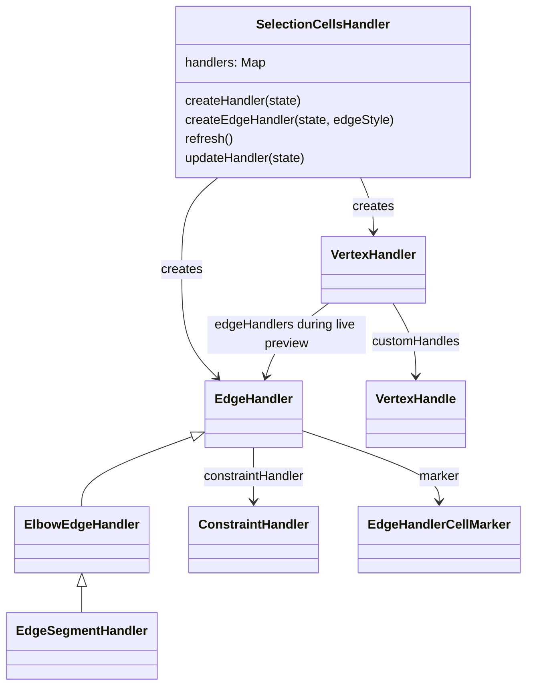
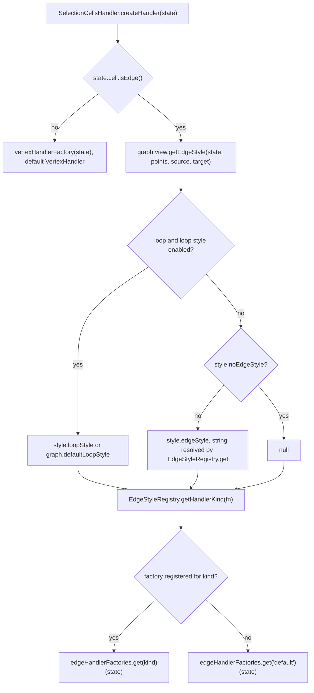
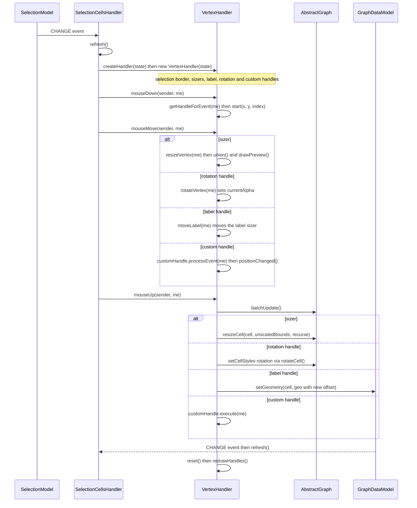
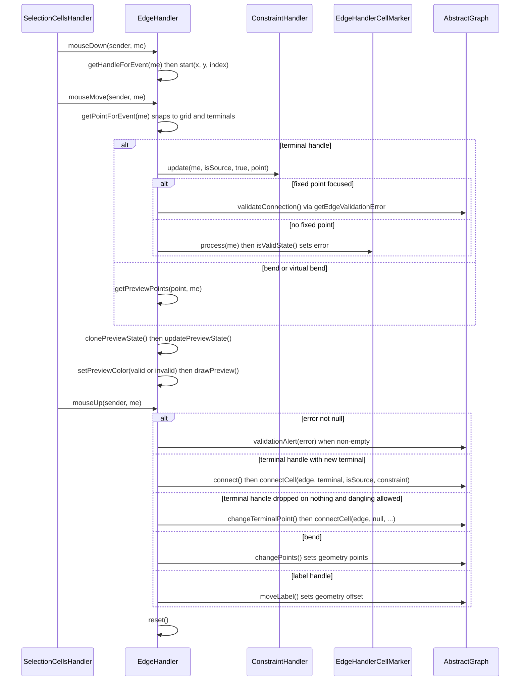

# Cell Handlers

- **Basis**: commit `a2e1bd3`, version `0.25.2`
- **Files**: `src/view/handler/config.ts`, `src/view/handler/ConstraintHandler.ts`, `src/view/handler/EdgeHandler.ts`,
  `src/view/handler/EdgeSegmentHandler.ts`, `src/view/handler/ElbowEdgeHandler.ts`, `src/view/handler/KeyHandler.ts`,
  `src/view/handler/VertexHandler.ts`, `src/view/cell/VertexHandle.ts`, `src/view/other/ConnectionConstraint.ts`,
  `src/view/other/Multiplicity.ts`, `src/view/plugin/SelectionCellsHandler.ts` (handler creation and refresh only),
  `src/view/style/edge/EdgeStyleRegistry.ts` (handler kind only), `src/view/mixin/ConnectionsMixin.ts` and `.type.ts`,
  `src/view/mixin/ValidationMixin.ts` and `.type.ts`

A cell handler is the per-cell interactive overlay shown while a cell is selected: the selection border, the resize,
rotation, label and custom handles of a vertex, the bends and terminal handles of an edge. The
`SelectionCellsHandler` plugin owns one handler per selected cell, creates it from the selection, refreshes it on view
changes and forwards every graph mouse event to it. A handler turns a drag on one of its handles into a preview, then
into a single model transaction on mouse up (`graph.resizeCell`, `graph.connectCell`, geometry changes). Edge
reconnection relies on `ConstraintHandler` for fixed connection points and on the validation mixin, with its
`Multiplicity` rules, to accept or reject the new terminal. `KeyHandler` is the unrelated, standalone keystroke
dispatcher that lives in the same folder.

## Purpose and scope

In scope:

- The handler classes: `VertexHandler`, `EdgeHandler`, `ElbowEdgeHandler`, `EdgeSegmentHandler`, and the custom handle
  base class `VertexHandle`.
- How `SelectionCellsHandler` chooses, creates, refreshes, recreates and destroys handlers, and how the edge style of
  an edge selects the edge handler class through `EdgeStyleRegistry.getHandlerKind`.
- The global handler configuration objects of `src/view/handler/config.ts`.
- Connection constraints (`ConnectionConstraint`, `ConstraintHandler`, the constraint members of `ConnectionsMixin`)
  and `connectCell` / `cellConnected`.
- Connection validation (`ValidationMixin`, `Multiplicity`).
- `KeyHandler`.

Out of scope, covered elsewhere: the mouse event dispatch that reaches `SelectionCellsHandler`, `SelectionHandler`
(moving cells), `ConnectionHandler` (creating new edges, which also uses `ConstraintHandler`), `CellMarker`, the edge
style functions themselves and the shapes.

The handler factories are not in `src/view/mixin`: an `rg` for `createHandler`, `createEdgeHandler` and similar over
`src/view` only matches `SelectionCellsHandler`. The graph mixins hold no factory; `SelectionCellsHandler.createHandler`
and `SelectionCellsHandler.createEdgeHandler` are the only ones.

## Concepts

| Term | Meaning |
|---|---|
| Handler | An object implementing `MouseListenerSet` that decorates one selected `CellState`. Typed as `CellHandler = EdgeHandler \| VertexHandler` in `src/types.ts`. |
| Handle index | The integer identifying the handle under the pointer, stored in `handler.index` for the duration of a gesture. See the table below. |
| Active handler | A handler with a non-nullish `index`, see `SelectionCellsHandler.isHandlerActive`. It is not redrawn by `refresh`. |
| Sizer | A resize handle of `VertexHandler`, held in `VertexHandler.sizers`. |
| Bend | A handle of `EdgeHandler` placed on an absolute point of the edge, held in `EdgeHandler.bends`. Index 0 is the source terminal handle, the last index the target terminal handle. |
| Virtual bend | A semi-transparent handle in the middle of each segment of an `EdgeHandler`, dragged to insert a waypoint (`EdgeHandler.virtualBends`). |
| Custom handle | A `CellHandle` (interface in `src/types.ts`) returned by `createCustomHandles`, typically a `VertexHandle` subclass driving a style value. |
| Handler kind | An `EdgeStyleHandlerKind` (`'default'`, `'elbow'`, `'segment'` or any string) attached to an edge style function in `EdgeStyleRegistry`. |
| Connection constraint | A `ConnectionConstraint`: a relative `point` (0..1 in both axes) on the terminal, whether to project it on the `perimeter`, an optional `name` and `dx`/`dy` offsets. A constraint with `point === null` means floating. |
| Multiplicity | A `Multiplicity` rule bounding the number and the type of the connections of a source or target terminal. |

Handle indexes, from `InternalEvent` in `src/view/event/InternalEvent.ts`:

| Index | Meaning | Used by |
|---|---|---|
| `>= 0` | A sizer (vertex) or a bend (edge). Vertex sizer order: `nw`, `n`, `ne`, `w`, `e`, `sw`, `s`, `se`, then the label sizer. | both |
| `InternalEvent.LABEL_HANDLE` (`-1`) | Label handle | both |
| `InternalEvent.ROTATION_HANDLE` (`-2`) | Rotation handle | `VertexHandler` |
| `InternalEvent.CUSTOM_HANDLE - i` (`-100 - i`) | Custom handle `i` | both |
| `InternalEvent.VIRTUAL_HANDLE - i` (`-100000 - i`) | Virtual bend `i` | `EdgeHandler` |

Class relationships:

## Contract

All the classes below are public, exported from `src/index.ts`: `ConstraintHandler`, `EdgeHandler`,
`EdgeSegmentHandler`, `ElbowEdgeHandler`, `KeyHandler`, `VertexHandler`, `VertexHandle`, `ConnectionConstraint`,
`Multiplicity`, every export of `src/view/handler/config.ts`, `EdgeStyleRegistry`, and `SelectionCellsHandler` through
`src/view/plugin/index.ts`. The mixins are not exported; their members are public through `AbstractGraph`.
`EdgeHandlerCellMarker` (in `EdgeHandler.ts`) and `EdgeStyleRegistryImpl` are module-private.

### Handler creation (`SelectionCellsHandler` in `src/view/plugin/SelectionCellsHandler.ts`)

Plugin id `'SelectionCellsHandler'`, part of `getDefaultPlugins` in `src/view/plugin/index.ts`.

| Member | Contract |
|---|---|
| `createHandler(state)` | `@since 0.25.0`. For an edge, resolves the edge style with `graph.view.getEdgeStyle(state, geo?.points, sourceState, targetState)` using the visible terminal states, then calls `createEdgeHandler`. For a vertex, calls the vertex factory. |
| `createEdgeHandler(state, edgeStyle)` | `@since 0.25.0`. `EdgeStyleRegistry.getHandlerKind(edgeStyle)`, then the factory registered for that kind, else the `'default'` factory. |
| `setVertexHandlerFactory(factory)` | `@since 0.25.0`. Replaces the vertex factory (default `new VertexHandler(state)`). Only affects handlers created afterwards. |
| `setEdgeHandlerFactory(kind, factory)` | `@since 0.25.0`. Sets the factory of one kind. Defaults: `'default'` to `EdgeHandler`, `'elbow'` to `ElbowEdgeHandler`, `'segment'` to `EdgeSegmentHandler`. Custom kinds are allowed. |
| `setEdgeHandlerFactoryForAllKinds(factory)` | `@since 0.25.0`. Clears every factory, then sets `'default'`, which then serves every kind. |
| `getHandler(cell)`, `isHandled(cell)` | Lookup in `handlers`. |
| `refresh()` | Rebuilds `handlers` from `graph.getSelectionCells()`, see Workflows. |
| `updateHandler(state)` | Destroys and recreates the handler of `state.cell`, carrying a gesture in progress over with `start(startX, startY, index)`. Called by `CellRenderer.redraw` in `src/view/cell/CellRenderer.ts` when a shape is created or its style changes. |
| `reset()` | Calls `reset()` on every handler. |
| `isHandlerActive(handler)` | `!isNullish(handler.index)`. |
| `mouseDown`, `mouseMove`, `mouseUp` | Forwarded to every handler when both the graph and the plugin are enabled. |
| `enabled`, `isEnabled`, `setEnabled` | Default `true`. Disabling stops both the forwarding and the refresh. |
| `maxHandlers` | Default `100`, declared but never read. |
| `onDestroy()` | Removes the mouse listener and the selection model, data model and view listeners. |

### Edge style to handler kind (`EdgeStyleRegistry` in `src/view/style/edge/EdgeStyleRegistry.ts`)

| Member | Contract |
|---|---|
| `add(name, edgeStyle, metaData?)` | Registers the function; `handlerKind`, `isOrthogonal` and `allowIntermediateHandles` are stored in maps keyed by the function itself. |
| `getHandlerKind(edgeStyle)` | Registered kind, or `'default'` for an unregistered function, a function registered without kind, or `null`. |
| `allowsIntermediateHandles(edgeStyle)` | Registered value, or `true`. Read by `EdgeHandler.isHandleVisible`. |
| `isOrthogonal(edgeStyle)` | Registered value, or `false`. |

Built-in kinds, as registered by the helpers of `src/view/style/register.ts`:

| Edge style name | Function | `handlerKind` | Handler |
|---|---|---|---|
| `elbowEdgeStyle` | `EdgeStyle.ElbowConnector` | `elbow` | `ElbowEdgeHandler` |
| `loopEdgeStyle` | `EdgeStyle.Loop` | `elbow` | `ElbowEdgeHandler` |
| `sideToSideEdgeStyle` | `EdgeStyle.SideToSide` | `elbow` | `ElbowEdgeHandler` |
| `topToBottomEdgeStyle` | `EdgeStyle.TopToBottom` | `elbow` | `ElbowEdgeHandler` |
| `manhattanEdgeStyle` | `EdgeStyle.ManhattanConnector` | `segment` | `EdgeSegmentHandler` |
| `orthogonalEdgeStyle` | `EdgeStyle.OrthConnector` | `segment` | `EdgeSegmentHandler` |
| `segmentEdgeStyle` | `EdgeStyle.SegmentConnector` | `segment` | `EdgeSegmentHandler` |
| `entityRelationEdgeStyle` | `EdgeStyle.EntityRelation` | unset (`default`), `allowIntermediateHandles: false` | `EdgeHandler` |
| none, `noEdgeStyle`, unregistered name | `null` | `default` | `EdgeHandler` |

### Global configuration (`src/view/handler/config.ts`)

All three objects are `@experimental`, module-global and shared by every graph of the page. Each has a reset function
restoring a snapshot taken at module load (`resetEdgeHandlerConfig`, `resetHandleConfig`, `resetVertexHandlerConfig`,
all `@since 0.14.0`). Constant values come from `src/util/Constants.ts`.

`HandleConfig` (`@since 0.14.0`), used by `VertexHandler`, `EdgeHandler` and its subclasses, and `VertexHandle`:

| Option | Default | Used for |
|---|---|---|
| `fillColor` | `HANDLE_FILLCOLOR` (`'#00FF00'`) | Fill of sizers, bends, rotation and custom handles |
| `labelCursor` | `'default'` (`@since 0.20.0`) | Cursor of the label handle |
| `labelFillColor` | `LABEL_HANDLE_FILLCOLOR` (`'yellow'`) | Fill of the label handle |
| `labelSize` | `LABEL_HANDLE_SIZE` (`4`) | Size of the label handle |
| `size` | `HANDLE_SIZE` (`6`) | Size of the handles; the rotation handle uses `size + 3` |
| `strokeColor` | `HANDLE_STROKECOLOR` (`'black'`) | Stroke of the handles |

`VertexHandlerConfig` (`@since 0.12.0`):

| Option | Default | Used for |
|---|---|---|
| `cursorMovable` | `'move'` (`@since 0.20.0`) | Cursor of the selection border of a movable vertex |
| `rotationEnabled` | `false` | Read by `VertexHandler.isRotationEnabled` |
| `selectionColor` | `VERTEX_SELECTION_COLOR` (`'#00FF00'`) | Selection border and preview |
| `selectionStrokeWidth` | `VERTEX_SELECTION_STROKEWIDTH` (`1`) | Selection border and preview |
| `selectionDashed` | `VERTEX_SELECTION_DASHED` (`true`) | Selection border and preview |

`EdgeHandlerConfig` (type `EdgeHandlerConfigType`, `@since 0.14.0`), used by `EdgeHandler` and its subclasses:

| Option | Default | Used for |
|---|---|---|
| `addBendOnShiftClickEnabled` | `false` (`@since 0.15.0`, experimental) | Shift-click outside handles adds a waypoint (`addPoint`) |
| `connectFillColor` | `CONNECT_HANDLE_FILLCOLOR` (`'#0000FF'`) | Fill of a terminal handle connected to a disconnectable terminal |
| `cursorBend` | `'crosshair'` (`@since 0.20.0`) | Cursor of an inner bend |
| `cursorMovable` | `'move'` (`@since 0.20.0`) | Cursor of the selection shape |
| `cursorTerminal` | `'pointer'` (`@since 0.20.0`) | Cursor of a terminal handle |
| `cursorVirtualBend` | `'crosshair'` (`@since 0.20.0`) | Cursor of a virtual bend |
| `handleShape` | `'square'` | `'circle'` makes bends `EllipseShape` instead of `RectangleShape` |
| `removeBendOnShiftClickEnabled` | `false` (`@since 0.15.0`, experimental) | Shift-click on a bend removes it (`removePoint`) |
| `selectionColor` | `EDGE_SELECTION_COLOR` (`'#00FF00'`) | Selection shape stroke, also the colour restored by `reset` |
| `selectionDashed` | `EDGE_SELECTION_DASHED` (`true`) | Selection shape |
| `selectionStrokeWidth` | `EDGE_SELECTION_STROKEWIDTH` (`1`) | Selection shape, divided by `scale²` in `drawPreview` |
| `virtualBendOpacity` | `20` (`@since 0.15.0`) | Opacity of virtual bends and of the straight-edge segment handles |
| `virtualBendsEnabled` | `false` (`@since 0.15.0`) | Enables virtual bends, see `EdgeHandler.isVirtualBendsEnabled` |

### `VertexHandler` (`src/view/handler/VertexHandler.ts`)

Constructor `new VertexHandler(state)`. Instance options, all plain fields:

| Field | Default | Effect |
|---|---|---|
| `singleSizer` | `false` | Only the `se` sizer |
| `livePreview` | `false` | Resize the cell state in place during the drag; only for cells without children (`start`) |
| `movePreviewToFront` | `false` | Move the live preview DOM nodes to the front |
| `manageSizers` | `false` | Offset handles and hide corner sizers of small vertices (`getHandlePadding`, `redrawHandles`) |
| `constrainGroupByChildren` | `false` | Compute `minBounds` from the children so `union` cannot shrink below them |
| `parentHighlightEnabled` | `false` | Draw a border on the parent vertex when it is not selected |
| `rotationRaster` | `true` | Snap the angle to 15, 5 or 1 degrees depending on the distance, when the grid is enabled for the event |
| `rotationCursor` | `'crosshair'` | Rotation handle cursor |
| `rotationHandleVSpacing` | `-16` | Vertical offset of the rotation handle (`getRotationHandlePosition`) |
| `tolerance` | `0` | Hit tolerance for non-mouse events in `getHandleForEvent` |
| `allowHandleBoundsCheck` | `true` | Hit-test on bounds in addition to the event source |
| `handleImage` | `null` | `ImageBox` replacing the handle shapes |

Groups of methods:

| Concern | Methods |
|---|---|
| Hooks to override | `isRotationEnabled` (protected), `isRotationHandleVisible`, `isConstrainedEvent` (shift or `aspect: 'fixed'`), `isCenteredEvent` (`false`), `isRecursiveResize`, `isSizerVisible`, `isGhostPreview` (cell has children), `isLivePreviewBorder`, `isCustomHandleEvent`, `isCustomHandleVisible`, `isParentHighlightVisible`, `createCustomHandles` (`[]`), `rotateClick` (empty), `updateHint` / `removeHint` (empty), `roundAngle`, `roundLength` |
| Shapes | `createSelectionShape`, `createParentHighlightShape`, `createSizer`, `createSizerShape`, `createGhostPreview`, `getSelectionBounds`, `getSelectionBorderBounds`, `getSizerBounds`, `getHandlePadding`, `getRotationHandlePosition` |
| Gesture | `getHandleForEvent`, `mouseDown`, `start`, `mouseMove`, `checkTolerance`, `mouseUp`, `reset` |
| Preview | `resizeVertex`, `rotateVertex`, `moveLabel`, `union`, `updateLivePreview`, `drawPreview`, `moveToFront` |
| Commit | `resizeCell` (calls `graph.resizeCell` or sets the label offset), `rotateCell` (sets `rotation` style recursively), `moveChildren` |
| Drawing | `redraw`, `redrawHandles`, `setHandlesVisible`, `hideSizers`, `moveSizerTo`, `updateParentHighlight`, `updateMinBounds` |
| Lifecycle | `isDestroyed`, `onDestroy` |

### `EdgeHandler` (`src/view/handler/EdgeHandler.ts`)

Constructor `new EdgeHandler(state)`; `state.shape` must exist, since `createSelectionShape` instantiates
`state.shape.constructor`. Instance options:

| Field | Default | Effect |
|---|---|---|
| `cloneEnabled` | `true` | Clone the edge when `graph.isCloneEvent` and `graph.isCellsCloneable()` on mouse up |
| `dblClickRemoveEnabled` | `false` | Double click on a bend removes it |
| `mergeRemoveEnabled` | `false` | Declared, not read in this file |
| `straightRemoveEnabled` | `false` | Remove a waypoint when its segment becomes straight; alt overrides |
| `parentHighlightEnabled` | `false` | Border on the parent vertex |
| `snapToTerminals` | `false` | Snap the dragged point to the terminal routing centres and to the other points, unless alt |
| `outlineConnect` | `false` | Allow connecting to any point of the outline of the highlighted terminal (`getOutlineConstraint`) |
| `manageLabelHandle` | `false` | Move the label handle away from intersecting handles (`checkLabelHandle`) |
| `tolerance` | `0` | Hit tolerance for non-mouse events |
| `allowHandleBoundsCheck` | `true` | Hit-test on bounds |
| `handleImage`, `labelHandleImage` | `null` | Images for the handles |
| `preferHtml` | computed | `true` when the edge or a terminal has an HTML label in the container; puts bends in the container |

Groups of methods:

| Concern | Methods |
|---|---|
| Hooks to override | `createConstraintHandler` (protected, `@since 0.21.0`), `createMarker`, `createCustomHandles`, `isVirtualBendsEnabled`, `isCellEnabled`, `isConnectableCell`, `isAddPointEvent` / `isRemovePointEvent` (shift), `isAddVirtualBendEvent`, `isCustomHandleEvent`, `isHandleEnabled`, `isHandleVisible`, `isSnapToTerminalsEvent`, `isOutlineConnectEvent`, `isParentHighlightVisible`, `isCustomHandleVisible`, `clonePreviewState`, `getSnapToTerminalTolerance`, `validateConnection`, `updateHint` / `removeHint`, `roundLength` |
| Shapes | `getSelectionPoints`, `createSelectionShape`, `createParentHighlightShape`, `createBends`, `createVirtualBends`, `createHandleShape`, `createLabelHandleShape`, `initBend`, `getHandleFillColor` |
| Gesture | `getHandleForEvent`, `mouseDown`, `start`, `mouseMove`, `mouseUp`, `reset` |
| Preview | `getPointForEvent`, `getPreviewTerminalState`, `getPreviewPoints`, `updatePreviewState`, `setPreviewColor`, `drawPreview` |
| Commit | `connect`, `changeTerminalPoint`, `changePoints`, `moveLabel`, `addPoint`, `addPointAt`, `removePoint` |
| Drawing | `redraw`, `redrawHandles`, `redrawInnerBends`, `checkLabelHandle`, `setHandlesVisible`, `refresh`, `updateParentHighlight` |
| Lifecycle | `isDestroyed` (`shape == null`), `destroyBends`, `onDestroy` |

Terminal handle colour (`getHandleFillColor`): `LOCKED_HANDLE_FILLCOLOR` (`'#FF0000'`) when the terminal cannot be
disconnected or the dangling end cannot move, `EdgeHandlerConfig.connectFillColor` when connected and disconnectable,
`HandleConfig.fillColor` otherwise.

### `ElbowEdgeHandler` and `EdgeSegmentHandler`

| Class | Differences from its parent |
|---|---|
| `ElbowEdgeHandler extends EdgeHandler` | `createBends` makes exactly three handles: source, one virtual middle bend, target. `flipEnabled` (default `true`) makes a double click on the middle bend call `graph.flipEdge`. `getCursorForBend` returns `'row-resize'` for `topToBottomEdgeStyle` or a vertical `elbowEdgeStyle`, `'col-resize'` otherwise. `getTooltipForNode` returns the translated `doubleClickOrientationResource` on the middle bend (read by `TooltipHandler`). `convertPoint` subtracts `state.origin` instead of the parent origin. `redrawInnerBends` keeps the middle bend on the routed shape. |
| `EdgeSegmentHandler extends ElbowEdgeHandler` | One handle per segment of the routed points (`getCurrentPoints`, which turns a straight edge into four points with a doubled middle). `getPreviewPoints` moves the dragged segment along its normal. `updatePreviewState` re-runs the edge style and merges collinear points. `connect` merges collinear waypoints before calling the parent. `redraw` calls `refresh` first. `getTooltipForNode` returns `null`. |

### Custom handles (`VertexHandle` in `src/view/cell/VertexHandle.ts`)

Implements `CellHandle`. Constructor `(state, cursor = 'default', image = null, shape = null)` calls `init`.
Subclasses override `getPosition(bounds)`, which returns the handle position in unscaled graph coordinates,
`setPosition(bounds, pt, me)`, which writes into `state.style`, and optionally `execute(me)`, which typically calls
`copyStyle(key)` to persist a style value with `graph.setCellStyles`. `processEvent` converts the pointer into
unscaled coordinates, applies rotation, grid (`ignoreGrid`) and flip, then calls `setPosition` and `redraw`.
`positionChanged` re-applies the state to the shape and text and redraws the cell. `reset` restores the style from
`graph.getCellStyle` and repaints.

### Connection constraints (`ConnectionsMixin` in `src/view/mixin/ConnectionsMixin.ts`)

| Member | Contract |
|---|---|
| `getAllConnectionConstraints(terminal, source)` | Returns `terminal.shape.stencil.constraints`, else `null`. `source` is ignored. The only built-in source of fixed points, so ports are declared through stencils or by overriding this method. |
| `getConnectionConstraint(edge, terminal, source)` | Reads `exitX`/`exitY` (source) or `entryX`/`entryY` (target), `exitPerimeter`/`entryPerimeter` (default `true`, coerced to boolean) and `exitDx`/`exitDy`/`entryDx`/`entryDy` from the edge state style. Always returns a constraint; its `point` is `null` when the style holds no fixed point. `terminal` is ignored. |
| `setConnectionConstraint(edge, terminal, source, constraint)` | No-op for a `null` constraint. A constraint with `point === null` clears the five style keys; otherwise sets them. Wrapped in `batchUpdate`. |
| `getConnectionPoint(vertex, constraint, round = true)` | Absolute point of the constraint on the perimeter bounds, handling `anchorPointDirection`, `direction`, `perimeter` projection (`view.getPerimeterPoint`), flips and `rotation`. `null` when `constraint.point` is `null`. |
| `getOutlineConstraint(point, terminalState, me)` | Converts an absolute point into a non-perimeter constraint relative to the perimeter bounds, with rotation, direction and flips. `null` without shape. |
| `connectCell(edge, terminal, source, constraint)` | `batchUpdate` around `cellConnected`, then fires `InternalEvent.CONNECT_CELL`. Returns `edge`. |
| `cellConnected(edge, terminal, source, constraint)` | `setConnectionConstraint`; with ports enabled, replaces a port terminal by `getTerminalForPort` and stores its id in `sourcePort`/`targetPort`; `model.setTerminal`; `resetEdge` when `isResetEdgesOnConnect()`; fires `InternalEvent.CELL_CONNECTED`. |
| `disconnectGraph(cells)` | Turns the terminals not in `cells` into terminal points. |
| `isCellDisconnectable(cell, terminal, source)` | `isCellsDisconnectable() && !isCellLocked(cell)`. `cellsDisconnectable` defaults to `true`. |
| `isValidSource(cell)`, `isValidTarget(cell)`, `isValidConnection(source, target)` | `null` is valid only when dangling edges are allowed; an edge is valid only with `isConnectableEdges()`; the cell must be connectable. `isValidTarget` delegates to `isValidSource`. |
| `setConnectable`, `isConnectable` | Delegate to the `ConnectionHandler` plugin; `isConnectable` is `false` without it. |
| `constrainChildren` (`true`), `constrainRelativeChildren` (`false`), `disconnectOnMove` (`true`) and their accessors, `isConstrainChild`, `getConnections` | Containment and move settings, not used by the handlers except `isConstrainChild` in `VertexHandler.resizeVertex`. |

### `ConstraintHandler` (`src/view/handler/ConstraintHandler.ts`)

Constructor `new ConstraintHandler(graph)`. Created by `EdgeHandler.createConstraintHandler` (one per edge handler)
and by `ConnectionHandler`.

| Member | Contract |
|---|---|
| `update(me, source, existingEdge, point)` | Main entry, called on each move. Finds the cell under the pointer (`getCellForEvent`, falling back to the connectable parent, ignoring locked cells), moves the focus with `setFocus` unless `isKeepFocusEvent` (shift) or the pointer is still in `currentFocusArea`, then picks the nearest focus icon intersecting the pointer (or the grid-snapped `point`) as `currentConstraint` / `currentPoint` and draws `focusHighlight` around it. |
| `setFocus(me, state, source)` | `constraints = graph.getAllConnectionConstraints(state, source) ?? []` for a connectable, non-ignored state; `[]` when the handler is disabled; `null` otherwise. Creates one `ImageShape` icon (`pointImage`, `point.gif` 5x5 under `Client.imageBasePath`) per constraint in the decorator pane, at `graph.getConnectionPoint`. |
| `currentFocus`, `currentConstraint`, `currentPoint`, `currentFocusArea`, `constraints`, `focusIcons`, `focusPoints` | Public state read by `EdgeHandler`. |
| `redraw()` | Re-positions the icons after a view or model change. |
| `reset()` | Destroys icons and highlight, clears the state. |
| Hooks | `getTolerance` (`graph.getEventTolerance()`), `getImageForConstraint`, `isEventIgnored` (`false`), `isStateIgnored` (`false`), `isKeepFocusEvent`, `getCellForEvent`, `createHighlightShape`, `intersects` |
| `enabled`, `isEnabled`, `setEnabled`, `highlightColor` | Default `true` and `DEFAULT_VALID_COLOR` (`'#00FF00'`). |
| `onDestroy()` | `reset`, removes the model, view and graph listeners. |

### Validation (`ValidationMixin` in `src/view/mixin/ValidationMixin.ts`, `Multiplicity`)

| Member | Contract |
|---|---|
| `getEdgeValidationError(edge, source, target)` | Returns `null` when valid, `''` when invalid without message, a non-empty string when invalid with a message to display. See Workflows for the order of the checks. |
| `isEdgeValid(edge, source, target)` | `!getEdgeValidationError(...)`, so `''` counts as invalid. |
| `validateEdge(edge, source, target)` | Hook, returns `null`. Its result is appended to the error. |
| `validateGraph(cell?, context?)` | Recursive validation from `cell` or the root. Sets or clears a warning overlay on every child with `setCellWarning` (newlines turned into ` `). Returns the warning or `null`. Calls `view.validate()` at the root. A valid root (`isValidRoot`) starts a fresh context. |
| `getCellValidationError(cell)` | Checks `min` and `max` of every rule against the out (source rules) or in (target rules) edge count. |
| `validateCell(cell, context)` | Hook, returns `null`. |
| `validationAlert(message)` | `window.alert(message)`. |
| `multiplicities` | `Multiplicity[]` declared on `AbstractGraph`, default `[]`. |

`Multiplicity` constructor: `(source, type, attr, value, min, max, validNeighbors, countError, typeError,
validNeighborsAllowed = true)`. `min` defaults to `0`, `max` to `Number.MAX_VALUE`, `validNeighbors` to `[]`; both
messages go through `translate()` once, at construction, and default to `''`.

| Method | Contract |
|---|---|
| `check(graph, edge, source, target, sourceOut, targetIn)` | When the rule applies to the source (or target) terminal: appends `countError + '\n'` if `max === 0` or the count is already `>= max`, and `typeError + '\n'` if `validNeighbors` is non-empty and `checkNeighbors` fails. Returns the accumulated string or `null`. |
| `checkTerminal(graph, terminal, edge)` | `checkType(graph, terminal.getValue(), type, attr, value)`. |
| `checkNeighbors(graph, edge, source, target)` | `true` when the opposite terminal value matches one of `validNeighbors` and `validNeighborsAllowed`, or matches none and not `validNeighborsAllowed`. |
| `checkType(graph, value, type, attr?, attrValue?)` | DOM node value: `isNode(value, type, attr, attrValue)`. Any other value: `value === type`. |

### `KeyHandler` (`src/view/handler/KeyHandler.ts`)

Not a plugin. Constructor `new KeyHandler(graph, target = null)` installs a `keydown` listener on `target`, or on
`document.documentElement`. The only constructor call in the source is `EditorKeyHandler` in
`src/editor/EditorKeyHandler.ts`. It ships no binding.

| Member | Contract |
|---|---|
| `bindKey(code, fn)` | `normalKeys[code]`, used without control nor shift |
| `bindShiftKey(code, fn)` | `shiftKeys[code]`, shift only |
| `bindControlKey(code, fn)` | `controlKeys[code]`, control without shift |
| `bindControlShiftKey(code, fn)` | `controlShiftKeys[code]`, control and shift |
| `getFunction(evt)` | Picks the map from control (`isControlDown`) and shift; returns `null` whenever alt is pressed. Keys are `evt.keyCode`. |
| `keyDown(evt)` | When `isEnabledForEvent`: keyCode 27 calls `escape(evt)`; otherwise, unless `isEventIgnored`, calls the bound function and consumes the event. |
| `isEnabledForEvent(evt)` | Graph enabled, event not consumed, `isGraphEvent`, handler enabled. |
| `isGraphEvent(evt)` | Source is the target, a direct child of it, the in-place editor (`CellEditorHandler.isEventSource`), or inside `graph.container`. |
| `isEventIgnored(evt)` | `graph.isEditing()`. |
| `escape(evt)` | `graph.escape(evt)` when `graph.isEscapeEnabled()`, which fires `InternalEvent.ESCAPE`. |
| `isControlDown(evt)` | Hook, used to add the Mac command key. |
| `enabled`, `isEnabled`, `setEnabled` | Default `true`. |
| `onDestroy()` | Removes the listener and clears `target`. |

## Invariants

- At most one handler exists per selected cell, in `SelectionCellsHandler.handlers`, and every entry has a view state:
  `refresh` skips selected cells without state.
- A handler is bound to one `CellState` instance. When `graph.view.getState(cell)` returns another instance, `refresh`
  destroys the old handler and creates a new one; `refresh` never re-targets a handler.
- The handler class is fixed at creation. A change of edge style reaches the handler only through `updateHandler`,
  which `CellRenderer.redraw` calls when the shape is created or its style differs from the state style.
- During a gesture `index` is non-null, and `refresh` leaves the handler untouched (no `refresh()`, no `redraw()`).
- Nothing reaches the model before mouse up. Previews work on a clone of the edge state (`clonePreviewState`) or on
  overlay shapes; the live preview of `VertexHandler` mutates the state and restores it with `setState` at the end of
  each `updateLivePreview`.
- Each committed gesture is one transaction: `VertexHandler.mouseUp` wraps the commit in `graph.batchUpdate`;
  `EdgeHandler.mouseUp` uses `model.beginUpdate`/`endUpdate` or the `batchUpdate` of `connect`,
  `changeTerminalPoint` and `changePoints`.
- A mouse up at the same client position as the mouse down commits nothing on an edge (`EdgeHandler.mouseUp`). On a
  vertex, `checkTolerance` ignores the drag while within `graph.getEventTolerance()` for non-mouse events.
- An edge terminal handle starts a gesture only when the terminal is disconnectable (`isCellDisconnectable`), or, for a
  dangling end, when `isTerminalPointMovable` is true (`EdgeHandler.start`).
- A connection is committed only when `error` is `null`. A non-empty `error` is passed to `graph.validationAlert`;
  `''` cancels silently.
- `getEdgeValidationError` excludes the edge being changed from the counts given to `Multiplicity.check`
  (`getDirectedEdgeCount(outgoing, edge)`) and from the multigraph check.
- Handlers and constraint handlers register a listener on `InternalEvent.ESCAPE` or model and view events in their
  constructor and remove it in `onDestroy` (see Traps for the exception).

## Workflows

### Selection to handlers

1. A change of the selection model, the data model, or a view `SCALE`, `TRANSLATE`, `SCALE_AND_TRANSLATE`, `DOWN` or
   `UP` event calls `SelectionCellsHandler.refreshHandler`, which calls `refresh()` when enabled.
2. `refresh` sorts the selection cells (`sortCells`), keeps an old handler whose state is unchanged and, when inactive,
   calls its `refresh()` if it has one (only `EdgeHandler` and subclasses) and `redraw()`.
3. Old handlers no longer selected fire `InternalEvent.REMOVE` and are destroyed with `onDestroy`.
4. Selected cells without handler get one from `createHandler` and fire `InternalEvent.ADD`; existing handlers get
   `updateParentHighlight()`.

### Vertex resize, rotate and custom handle

Details:

- Sizers are created only when the `SelectionHandler` plugin exists and the selection holds fewer than its `maxCells`
  (default `50`) cells, or `maxCells <= 0`. Without resize permission (`isCellResizable`), only the label sizer exists,
  for a movable label on a vertex at least 2x2 that is neither relative nor a swimlane.
- `resizeVertex` rotates the pointer delta into the vertex frame, calls `union` with scale `1`, clamps the result to
  `graph.getMaximumGraphBounds()` and to the containment area when `isConstrainChild` (grown by `getOverlap`), and
  computes `childOffsetX` / `childOffsetY` to keep children in place when the top-left corner moves.
- `union` flips the rectangle when a side is dragged over the opposite one, keeps the aspect ratio when
  `isConstrainedEvent`, keeps the centre when `isCenteredEvent`, snaps to the grid when enabled, and honours
  `minBounds`.
- `VertexHandler.resizeCell` moves the children by the child offset (`moveChildren`) before `graph.resizeCell`.
  `recurse` comes from `isRecursiveResize`, which returns `graph.isRecursiveResize(this.state)`.
- Rotation: `start` measures `startAngle` with `atan2` from the rounded bounds; `rotateVertex` computes `currentAlpha`
  relative to it; `mouseUp` applies `currentAlpha - style.rotation` with `rotateCell`, which adds the angle to the
  `rotation` style of the vertex and rotates the geometry of the children around the parent centre, recursively. A
  click without drag calls `rotateClick`.
- Live preview (`livePreview` and no child): `start` hides the other handles and collects the edge handlers of the
  connected edges; `updateLivePreview` writes the bounds into the state, redraws the cell, revalidates the view and
  redraws those edge handlers, then restores the state.
- A custom handle on a cell with children uses a ghost preview (`isGhostPreview`, `createGhostPreview`) instead of
  repainting the cell.

### Edge bend, terminal and label

Details:

- Bends are created only when the `SelectionHandler` plugin exists and the selection is below its `maxCells`. Inner
  bends need `graph.isCellBendable(cell)` and `isHandleVisible(i)`, which hides them when the edge style is registered
  with `allowIntermediateHandles: false`.
- Virtual bends require `EdgeHandlerConfig.virtualBendsEnabled`, an edge without edge style (`edgeStyle` unset or
  `'none'`, or `noEdgeStyle`), a shape other than `'arrow'`, and a bendable cell. Dragging one inserts a waypoint at
  `VIRTUAL_HANDLE - index` in `getPreviewPoints`.
- Dropping a bend on another bend removes it; with `straightRemoveEnabled`, a bend whose neighbours make it collinear
  within the event tolerance is removed.
- Shift during a drag constrains the point to the horizontal or vertical of the original bend (`snapPoint`).
- `getPreviewTerminalState` prefers the focused constraint of `ConstraintHandler`: it hides the marker highlight,
  validates the pair with `validateConnection`, and resets the constraint handler on error or when `isCellEnabled`
  is false. Otherwise the `EdgeHandlerCellMarker` finds the terminal: it never returns the edge itself, one of its
  descendants, an edge unless `graph.connectableEdges`, a non-connectable cell (falling back to a connectable parent
  vertex), or a swimlane whose content is hit.
- With `outlineConnect`, `isOutlineConnectEvent` makes `updatePreviewState` compute a constraint with
  `getOutlineConstraint` and push it into the constraint handler.
- `updatePreviewState` writes the constraint into `exitX`/`exitY` or `entryX`/`entryY` of the cloned state style,
  recomputes the fixed terminal points, the routed points and the floating terminal points on the clone. An end not
  over a terminal sets `error` to `''` unless `graph.isAllowDanglingEdges()`.
- `connect` passes `constraintHandler.currentConstraint` or a `new ConnectionConstraint(null)` to `connectCell`, so a
  reconnection without fixed point clears the previous `exit*`/`entry*` styles.
- With a clone event, the edge is cloned and added to the same parent first, the other end is connected, and the
  selection moves to the clone after `reset`.
- With `graph.isResetEdgesOnConnect()`, moving a terminal handle empties the previewed points (`getPreviewPoints`) and
  `cellConnected` calls `resetEdge`.
- A mouse up without move on a toggle event toggles the selection of the edge.
- Shift-click outside a handle adds a point with `addPoint` / `addPointAt` (inserted in the nearest segment via
  `findNearestSegment`) when `addBendOnShiftClickEnabled`; shift-click on a bend removes it when
  `removeBendOnShiftClickEnabled`. Both call `model.setGeometry` directly, outside any explicit `batchUpdate`.

### Validation of an edge

`getEdgeValidationError(edge, source, target)` in `src/view/mixin/ValidationMixin.ts`, in order:

1. `edge` set, dangling edges not allowed, and `source` or `target` missing: `''`.
2. `edge` set and the edge currently has no terminal at all in the model: `null`.
3. Loops not allowed and `source === target`: `''`.
4. `!isValidConnection(source, target)`: `''`.
5. Both terminals set: start an empty error; if not a multigraph and `model.getEdgesBetween(source, target, true)`
   holds another edge, append the translated `alreadyConnectedResource`; compute `sourceOut` and `targetIn` without
   `edge`; append each non-null `Multiplicity.check`; append `validateEdge`. Return the error, or `null` when empty.
6. Otherwise `null` when dangling edges are allowed, `''` if not.

`validateGraph` walks the tree depth first, calls `getEdgeValidationError` for each edge with its model terminals and
`getCellValidationError` for each vertex, appends `validateCell`, adds `containsValidationErrorsResource` to a
collapsed cell with invalid children, and shows the result as cell warnings.

### Constraint focus during an edge drag

1. `EdgeHandler.getPreviewTerminalState` calls `constraintHandler.update(me, isSource, true, point)`; `point` is
   `null` when the pointer is on the marker highlight.
2. `update` lazily installs a container `mouseleave` listener, then calls `setFocus` with the state under the pointer.
3. `setFocus` asks `graph.getAllConnectionConstraints` and paints one icon per constraint at
   `graph.getConnectionPoint`.
4. The nearest intersecting icon becomes `currentConstraint` and `currentPoint`, highlighted by `focusHighlight`.
5. `EdgeHandler.mouseMove` replaces `currentPoint` with `constraintHandler.currentPoint`; `mouseUp` connects to
   `constraintHandler.currentFocus.cell` with `currentConstraint`.

### Escape

`KeyHandler.escape` calls `graph.escape(evt)` (in `src/view/mixin/EventsMixin.ts`), which fires
`InternalEvent.ESCAPE`. `EdgeHandler.escapeHandler` resets and, when a gesture was active, redraws the edge with
`cellRenderer.redraw`. `VertexHandler.escapeHandler` redraws the cell and revalidates the view when a live preview
was active, then calls `reset`.

### Destruction

`SelectionCellsHandler.refresh` and `updateHandler` call `onDestroy` on the handlers they drop.
`VertexHandler.onDestroy` removes the escape listener and destroys the preview, parent highlight, ghost preview,
selection border, sizers and custom handles. `EdgeHandler.onDestroy` removes the escape listener and destroys the
marker, selection shape, parent highlight, label handle, constraint handler, bends, virtual bends and custom handles,
setting most references to `null`.

## Events

| Event | Fired by | Properties | When |
|---|---|---|---|
| `InternalEvent.ADD` | `SelectionCellsHandler.refresh` | `state` | A handler was created for a newly handled cell |
| `InternalEvent.REMOVE` | `SelectionCellsHandler.refresh` | `state` | A handler of a cell that left the selection was destroyed |
| `InternalEvent.CONNECT_CELL` | `ConnectionsMixin.connectCell` | `edge`, `terminal`, `source`, `previous` | After `cellConnected`, inside the transaction |
| `InternalEvent.CELL_CONNECTED` | `ConnectionsMixin.cellConnected` | `edge`, `terminal`, `source`, `previous` | After the terminal is set, inside the transaction; `terminal` is the resolved terminal when a port was given |
| `InternalEvent.ESCAPE` | `graph.escape`, called by `KeyHandler.escape` | `event` | Escape key; listened to by `VertexHandler` and `EdgeHandler` |

Events listened to: `SelectionCellsHandler` listens to `CHANGE` (selection and data model) and to the view events
`SCALE`, `TRANSLATE`, `SCALE_AND_TRANSLATE`, `DOWN`, `UP`. `ConstraintHandler` listens to the model `CHANGE`, the view
`SCALE_AND_TRANSLATE`, `TRANSLATE`, `SCALE` and the graph `ROOT`, and to the DOM `mouseleave` of the container. The
handlers themselves fire no event.

## Extension points

- **Factories** on `SelectionCellsHandler`: `setVertexHandlerFactory`, `setEdgeHandlerFactory(kind, factory)`,
  `setEdgeHandlerFactoryForAllKinds`. Preferred over subclassing the plugin. `createHandler` and `createEdgeHandler`
  remain overridable.
- **Custom handler kinds**: register an edge style with `EdgeStyleRegistry.add(name, fn, { handlerKind: 'my-kind' })`
  and a factory for `'my-kind'`.
- **`allowIntermediateHandles: false`** in the edge style metadata hides inner bends (`@since 0.24.0`).
- **Custom handles**: override `createCustomHandles` on `VertexHandler` or `EdgeHandler` and return `CellHandle`
  objects, usually `VertexHandle` subclasses implementing `getPosition`, `setPosition` and `execute`.
- **Constraint handler**: override `EdgeHandler.createConstraintHandler` to plug a `ConstraintHandler` subclass,
  whose hooks are `getImageForConstraint`, `isStateIgnored`, `isEventIgnored`, `isKeepFocusEvent`, `getTolerance`,
  `intersects` and `createHighlightShape`.
- **Fixed connection points**: override `graph.getAllConnectionConstraints`, or give the terminal shape a stencil with
  constraints.
- **Validation**: push `Multiplicity` rules into `graph.multiplicities`; override `validateEdge`, `validateCell`,
  `getEdgeValidationError`, `isValidSource`, `isValidTarget`, `isValidConnection`, or `validationAlert` to replace the
  `window.alert`.
- **Handler hooks** listed in the Contract tables: `union` (minimum sizes, wrapped text), `isConstrainedEvent`,
  `isCenteredEvent`, `isRecursiveResize`, `isSizerVisible`, `rotateClick`, `updateHint` / `removeHint`,
  `isCellEnabled`, `isConnectableCell`, `isHandleVisible`, `validateConnection`, `createMarker`.
- **Global look**: `HandleConfig`, `VertexHandlerConfig`, `EdgeHandlerConfig` and their reset functions.
- **Keys**: `KeyHandler.bindKey` and siblings, `getFunction` and `isControlDown` for the Mac command key.

## Traps

- **No handles without `SelectionHandler`.** `VertexHandler` creates no sizer and `EdgeHandler` no bend when the
  `SelectionHandler` plugin is missing, because both constructors gate on it. `VertexHandler.isRotationHandleVisible`
  treats a missing plugin as allowed, so a `BaseGraph` without that plugin can show a rotation handle and nothing else.
- **`maxCells` of `SelectionHandler`, not `maxHandlers`.** The handles disappear beyond `SelectionHandler.maxCells`
  (default `50`) selected cells. `SelectionCellsHandler.maxHandlers` is never read.
- **Global config is page-wide and partly read once.** `HandleConfig` sizes and colours and the cursors are read when
  the shapes are created, while `getSelectionColor` and siblings read the config on every redraw. Changing a value
  affects existing handlers only in part, and affects every graph of the page.
- **Handler kind is keyed by function identity.** `EdgeStyleRegistry` maps the function, not the name. A loop edge
  resolves to `style.loopStyle` or `graph.defaultLoopStyle` (`GraphView.getEdgeStyle`), so it gets the kind of the
  loop style (`'elbow'` for `Loop`), whatever its `edgeStyle`. A second `add` of the same function without metadata
  keeps the previous kind.
- **`ElbowEdgeHandler.getCursorForBend` compares style strings.** It only recognises `'topToBottomEdgeStyle'` and
  `'elbowEdgeStyle'` names, not a function value nor a style registered under another name.
- **`EdgeSegmentHandler.redraw` rebuilds the bends.** It calls `refresh()` on every redraw, destroying and recreating
  every bend; `SelectionCellsHandler.refresh` calls `refresh()` then `redraw()`, so twice per refresh.
- **Reconnecting without fixed point clears the old one.** `EdgeHandler.connect` always passes a constraint, possibly
  `new ConnectionConstraint(null)`, so `setConnectionConstraint` removes the `exit*` or `entry*` styles.
- **Validation of a fully dangling edge is skipped.** Step 2 of `getEdgeValidationError` returns `null` as soon as the
  edge has no terminal in the model, before the loop, multigraph and multiplicity checks. It inspects the current
  terminals, not the proposed ones, so connecting such an edge with `EdgeHandler` is never checked.
- **`''` versus message.** `getEdgeValidationError` returns `''` to refuse silently. A `Multiplicity` built with a
  `null` `countError` or `typeError` stores `''`, and `check` still appends `'\n'`, so the error is `'\n'`: non-empty,
  hence passed to `validationAlert` as a blank alert.
- **Multiplicity `min` is not enforced while editing.** `check` only tests `max` (`max === 0 || count >= max`). `min`
  is only checked by `getCellValidationError`, during `validateGraph`.
- **`validateGraph` ignores string-valued cells.** `getCellValidationError` matches rules with `isNode`, which only
  accepts DOM nodes, while `Multiplicity.checkType` also matches a string value equal to `type`. A rule on cells whose
  value is a string is enforced at edit time but never reported by `validateGraph`, and a `checkTerminal` override is
  not used there.
- **Messages are translated at construction.** `Multiplicity` calls `translate` in its constructor, so i18n must be
  configured before the rules are created.
- **`validationAlert` is `window.alert`.** Blocking, and unsuitable in tests or embedded applications.
- **Escape is special in `KeyHandler`.** keyCode 27 bypasses `isEventIgnored`, so it works while editing, but it does
  nothing unless `graph.isEscapeEnabled()`. Alt disables every binding (`getFunction` returns `null`).
- **`updateHandler` swaps handlers silently.** It fires neither `ADD` nor `REMOVE`, and `refresh` destroys a handler
  whose state instance changed without firing `REMOVE` before firing `ADD` for its replacement, so listeners cannot
  pair the two events.
- **`VertexHandler.isRecursiveResize` ignores its arguments.** It passes `this.state`, and
  `AbstractGraph.isRecursiveResize` ignores its own `state` parameter and returns `recursiveResize`.
- **Mouse-up validation colour.** `EdgeHandler.mouseUp` connects to the marker cell only when the highlight stroke is
  neither `'transparent'` nor `'white'`; code that restyles the marker highlight changes whether a drop connects.
- **`isParentHighlightVisible` documentation.** Both handlers document "always returns true", but the code returns
  `!graph.isCellSelected(parent)`, and `null` (edge) or `false` (vertex) without parent.
- **`ConstraintHandler.isKeepFocusEvent` documentation** says shift and alt; the code tests shift only.

## Open items

- `ConstraintHandler.update` registers `this.resetHandler` on the container `mouseleave`, but stores and later removes
  `this.mouseleaveHandler` in `onDestroy`, so the registered listener is never removed. Since every `EdgeHandler`
  builds its own `ConstraintHandler`, each edge whose terminal was dragged leaves one container listener behind, which
  keeps the destroyed constraint handler and its graph reachable.
- `VertexHandler.reset` reads `this.sizers[this.index].node` whenever `index` is non-null. `index` can be negative
  (label `-1`, rotation `-2`, custom `<= -100`) when `escapeHandler` calls `reset` in the middle of a gesture, so
  `sizers[index]` is `undefined`. To verify with a test (escape during a rotation drag); the code reads as a
  `TypeError`.
- `VertexHandler.isDestroyed` tests `selectionBorder == null`, but `onDestroy` destroys the border without nulling it,
  so `isDestroyed` stays `false` after destruction and `updateParentHighlight` keeps running.
- `SelectionCellsHandler.onDestroy` removes its listeners but does not destroy the handlers left in `handlers`, whose
  DOM nodes and escape listeners remain.
- `SelectionCellsHandler.refresh` calls `handler.refresh` under `@ts-ignore`; `CellHandler` should declare an optional
  `refresh`, or `VertexHandler` should implement one.
- `VertexHandle.initShape` skips `shape.init` when `cursor` is falsy, then reads `shape.node`; unverified whether a
  handle built with an empty cursor fails.
- `EdgeHandler.mergeRemoveEnabled` and `SelectionCellsHandler.maxHandlers` are declared and never read.
- `EdgeHandler.addPoint`, `addPointAt` and `removePoint` call `model.setGeometry` without `batchUpdate`, unlike the
  rest of the commits.
- `VertexHandler.updateLivePreview` carries two `TODO`s: the child offset is not applied in live preview, and child
  edges are not redrawn. `VertexHandler.reset` carries `TODO: Reset and redraw cell states for live preview`.
- `KeyHandler` uses the deprecated `KeyboardEvent.keyCode` and types bound functions as `Function`.
- `EdgeHandler.drawPreview` swallows every exception in an empty `catch`.
- `getAllConnectionConstraints` and `getConnectionConstraint` ignore their `source` and `terminal` parameters, and
  `Multiplicity.checkNeighbors` and `checkTerminal` ignore `edge`; they exist for overrides only.
- Inherited `mxGraph` references remain in the JSDoc: VML and IE comments (`dialect = 'svg'` "for event transparency
  in IE"), `mxVertexHandlerRedrawHandles` in `VertexHandler.redrawHandles`, `mxGraph.tolerance` and `mxMouseEvent` in
  `ConstraintHandler`.
- The positional `Multiplicity` constructor takes ten arguments, a candidate for an object parameter as done for
  `insertVertex`.
