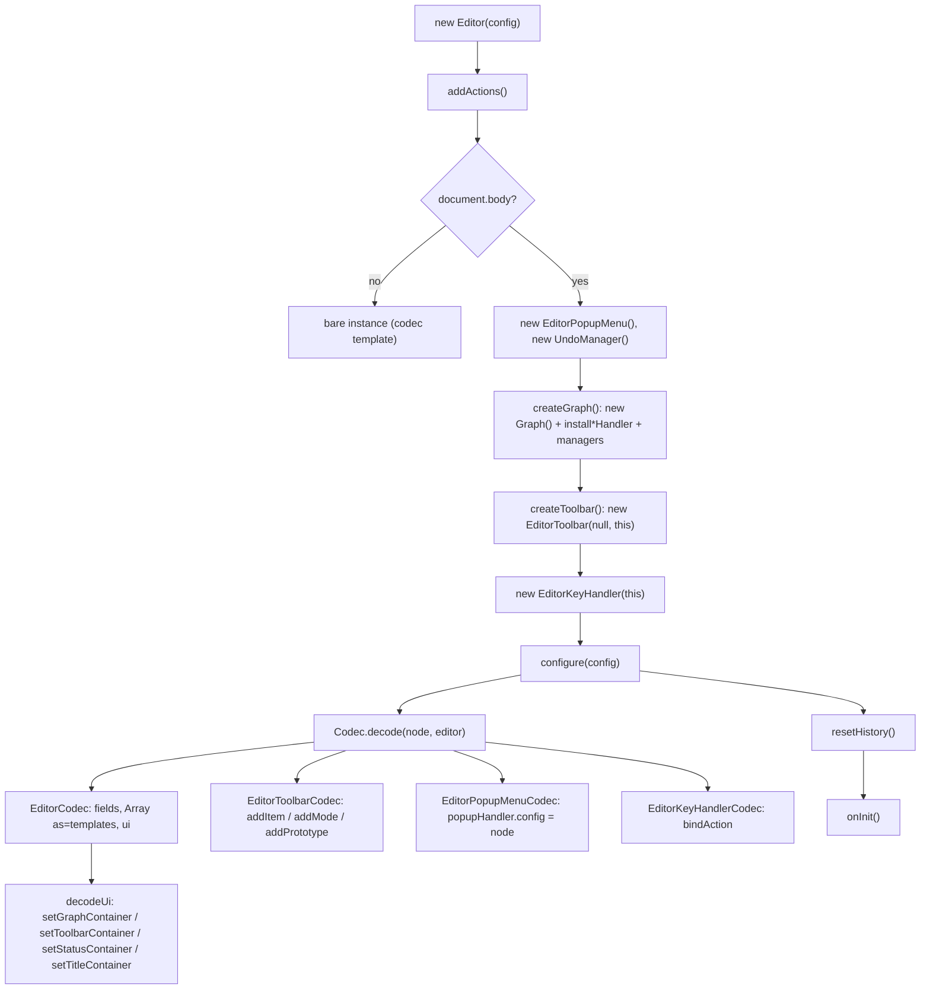
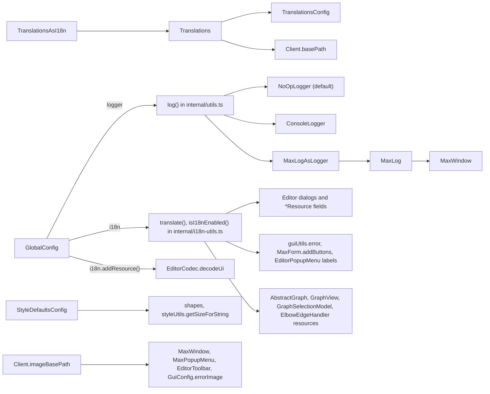

# Editor, GUI and Utilities

- **Basis**: commit `a2e1bd3`, version `0.25.2`
- **Files**: `src/editor/Editor.ts`, `src/editor/EditorKeyHandler.ts`, `src/editor/EditorPopupMenu.ts`,
  `src/editor/EditorToolbar.ts`, `src/gui/guiUtils.ts`, `src/gui/MaxForm.ts`, `src/gui/MaxLog.ts`,
  `src/gui/MaxLogAsLogger.ts`, `src/gui/MaxPopupMenu.ts`, `src/gui/MaxToolbar.ts`, `src/gui/MaxWindow.ts`,
  `src/i18n/config.ts`, `src/i18n/provider.ts`, `src/i18n/Translations.ts`, `src/Client.ts`, `src/util/config.ts`,
  `src/util/logger.ts`, `src/util/Constants.ts`, `src/util/domUtils.ts`, `src/util/domHelpers.ts`,
  `src/util/mathUtils.ts`, `src/util/StringUtils.ts`, `src/util/printUtils.ts`, `src/util/arrayUtils.ts`,
  `src/util/styleUtils.ts`, `src/view/other/PrintPreview.ts`, `src/view/other/Outline.ts`,
  `src/view/other/AutoSaveManager.ts`, `src/internal/i18n-utils.ts`, `src/internal/utils.ts`,
  `src/internal/time-utils.ts`

This spec covers the application layer that sits on top of the graph: the `mxEditor`-style `Editor` controller and
its three helpers, the legacy DOM widgets of `src/gui` (window, toolbar, popup menu, form, console), the global
configuration objects read by the whole package (logger, i18n provider, style defaults, browser flags), the
translation system, and the stand-alone helpers built on a graph (print preview, outline, autosave). It ends with a
catalog of the utility modules of the slice. Most of this code is ported from mxGraph with few changes; several
regressions introduced during the port are listed under Traps, since a developer relying on the documented mxGraph
behaviour will hit them.

## Purpose and scope

| Area | Responsibility | Files |
|---|---|---|
| Editor | Application controller: named actions, templates, undo history, auto-layout, file IO, dialogs, configured from XML through codecs | `src/editor/*` |
| GUI widgets | Plain DOM widgets with no framework: floating window, toolbar, popup menu, form, log console, error and popup dialogs | `src/gui/*` |
| Global configuration | Process-wide mutable objects: `GlobalConfig` (logger, i18n), `StyleDefaultsConfig`, `TranslationsConfig`, `GuiConfig`, `Client` | `src/util/config.ts`, `src/i18n/config.ts`, `src/gui/guiUtils.ts`, `src/Client.ts` |
| Logging | `Logger` implementations and the internal `log()` accessor | `src/util/logger.ts`, `src/gui/MaxLogAsLogger.ts`, `src/internal/utils.ts`, `src/internal/time-utils.ts` |
| I18n | `I18nProvider` implementations, `Translations` resource bundles, internal `translate()` | `src/i18n/*`, `src/internal/i18n-utils.ts` |
| Graph companions | Print preview across pages, outline (minimap), autosave trigger | `src/view/other/PrintPreview.ts`, `Outline.ts`, `AutoSaveManager.ts` |
| Utilities | DOM, string, math, print, array, style helpers and the constants module | `src/util/*` of the slice |

Out of scope, covered elsewhere: the codecs that configure the editor (`src/serialization/codec/editor/*`, see
[serialization.md](serialization.md)) are only described here as far as they drive the `Editor`; the style helpers of
`styleUtils` are only listed (see [style-and-registries.md](style-and-registries.md)); `UndoManager`,
`LayoutManager`, `SwimlaneManager` and the plugins are described in their own specs.

## Concepts

- **Editor**: an `EventSource` that owns a `Graph`, an `UndoManager`, an `EditorToolbar`, an `EditorPopupMenu` and an
  `EditorKeyHandler`. It maps action names to functions (`Editor.actions`) and executes them by name. It is the
  successor of `mxEditor` and keeps its XML configuration format.
- **Action**: a function `(editor, cell?, evt?) => void` registered under a name with `Editor.addAction` and invoked
  with `Editor.execute`. Toolbar items, popup menu items, key bindings and the double click all resolve to actions.
- **Template**: a prototype `Cell` stored in `Editor.templates` under a name, cloned when inserted from the toolbar.
  `Editor.defaultEdge` and `Editor.defaultGroup` are templates used to create edges and groups.
- **Mode**: the interaction mode of the graph set by `Editor.setMode`: `select`, `connect` or `pan`.
- **Config node**: an XML element whose node names match registered codecs (`Editor`, `EditorToolbar`,
  `EditorPopupMenu`, `EditorKeyHandler`). `Editor.configure` decodes it into the existing editor instance.
- **Global configuration object**: a module-level object mutated in place by the application, read lazily by the
  package. Each one has a reset function except `Client` and `GuiConfig`.
- **Logger / I18nProvider**: interfaces of `src/types.ts`. The package never calls an implementation directly; it goes
  through `log()` (`src/internal/utils.ts`) and `translate()` / `isI18nEnabled()` (`src/internal/i18n-utils.ts`), which
  read `GlobalConfig` at call time.
- **Resource bundle**: a `key=value` text file loaded by `Translations.add`, as a default bundle
  (`basename + extension`) and an optional language bundle (`basename + '_' + lan + extension`).

## Contract

All the classes and functions below are public (exported from `src/index.ts`) unless stated otherwise.

### Editor (`src/editor/Editor.ts`)

| Group | Members |
|---|---|
| Construction | `constructor(config: Element)`, `onInit`, `configure(node)`, `destroy()` |
| Actions | `actions`, `addActions()`, `addAction(name, funct)`, `execute(name, cell?, evt?)`, `dblClickAction` (default `'edit'`) |
| Graph creation hooks | `createGraph()`, `createSwimlaneManager(graph)`, `createLayoutManager(graph)`, `createDiagramLayout()`, `createSwimlaneLayout()`, `createToolbar()`, `createPopupMenu(menu, cell, evt)`, `createEdge(source, target)`, `createGroup()`, `getEdgeStyle()` |
| Graph listeners installed by `createGraph` | `installDblClickHandler`, `installUndoHandler`, `installDrillHandler`, `installChangeHandler`, `installInsertHandler` |
| Containers | `setGraphContainer`, `setToolbarContainer`, `setStatusContainer`, `setStatus`, `setTitleContainer`, `getTitle`, `getRootTitle` |
| Templates | `templates`, `addTemplate`, `getTemplate`, `defaultEdge`, `defaultEdgeStyle`, `defaultGroup`, `groupBorderSize`, `insertFunction`, `forcedInserting`, `swimlaneRequired` |
| Layout | `layoutDiagram`, `layoutSwimlanes`, `maintainSwimlanes`, `swimlaneSpacing`, `horizontalFlow`, `treeLayout(cell, horizontal)` |
| History | `undoManager`, `undo()`, `redo()`, `resetHistory()`, `modified`, `isModified()`, `setModified()`, `validating` |
| File IO | `open(filename)`, `readGraphModel(node)`, `save(url?, linefeed?)`, `postDiagram(url, data)`, `writeGraphModel(linefeed?)`, `getUrlPost()`, `getUrlImage()`, `urlPost`, `urlImage`, `postParameterName` (`'xml'`), `escapePostData` (`true`), `linefeed`, `filename` |
| Editing helpers | `addVertex(parent, vertex, x, y)`, `groupCells()`, `setMode(modename)`, `swapStyles(first, second)`, `cycleAttribute(cell)`, `consumeCycleAttribute(cell)`, `cycleAttributeName` (`'fillColor'`), `cycleAttributeValues`, `cycleAttributeIndex` |
| Dialogs | `showProperties`, `hideProperties`, `isPropertiesVisible`, `createProperties`, `showTasks`, `refreshTasks`, `createTasks` (empty hook), `showHelp`, `showOutline`, `resetFirstTime` |
| Resource keys | `askZoomResource`, `lastSavedResource`, `currentFileResource`, `propertiesResource`, `tasksResource`, `helpResource`, `outlineResource` |

Built-in actions registered by `Editor.addActions`:

| Kind | Actions |
|---|---|
| File and output | `save`, `print` (`PrintPreview` at scale 1), `show` (`printUtils.show`), `exportImage` (posts `getViewXml` to `urlImage` with `requestUtils.submit`, falls back to `show` when no URL or `Client.IS_LOCAL`), `refresh` |
| Clipboard and structure | `cut`, `copy`, `paste` (`Clipboard`), `delete`, `group`, `ungroup`, `removeFromParent`, `toBack`, `toFront` |
| History | `undo`, `redo` |
| Zoom | `zoom` (prompt), `zoomIn`, `zoomOut`, `actualSize`, `fit` (through the `'fit'` plugin, no-op when absent) |
| Selection and navigation | `selectAll`, `selectNone`, `selectVertices`, `selectEdges`, `selectPrevious`, `selectNext`, `selectParent`, `selectChild`, `enterGroup`, `exitGroup`, `home` |
| Editing | `edit`, `showProperties`, `collapse`, `collapseAll`, `expand`, `expandAll` |
| Text style | `bold`, `italic`, `underline` (`toggleCellStyleFlags` on `fontStyle`), `alignFontLeft`, `alignFontCenter`, `alignFontRight`, `alignFontTop`, `alignFontMiddle`, `alignFontBottom` |
| Alignment | `alignCellsLeft`, `alignCellsCenter`, `alignCellsRight`, `alignCellsTop`, `alignCellsMiddle`, `alignCellsBottom` |
| Windows | `toggleTasks`, `toggleHelp`, `toggleOutline`, `toggleConsole` (`MaxLog`) |

The JSDoc of `addActions` omits `removeFromParent`, `toBack`, `toFront`, `collapseAll` and `expandAll`.

### Editor helpers

| Class | Members | Notes |
|---|---|---|
| `EditorKeyHandler` (`src/editor/EditorKeyHandler.ts`) | `constructor(editor?)`, `editor`, `handler: KeyHandler`, `bindAction(code, action, control?)`, `destroy()` | Wraps a `KeyHandler` on the editor graph; overrides `handler.escape` to also call `Editor.hideProperties` and fire `ESCAPE` on the editor |
| `EditorPopupMenu` (`src/editor/EditorPopupMenu.ts`) | `constructor(config?)`, `config`, `imageBasePath`, `createMenu(editor, menu, cell?, evt?)`, `addItems(...)`, `addAction(...)`, `createConditions(editor, cell?, evt?)` | Holds the XML description and replays it into a `MaxPopupMenu` each time the menu opens |
| `EditorToolbar` (`src/editor/EditorToolbar.ts`) | `constructor(container?, editor?)`, `init(container)`, `toolbar: MaxToolbar`, `addItem`, `addSeparator`, `addCombo`, `addActionCombo`, `addActionOption`, `addOption`, `addMode`, `addPrototype`, `drop`, `insert`, `connect`, `installDropHandler`, `spacing` (4), `connectOnDrop` (false), `destroy()` | Builds a `MaxToolbar` and binds its items to editor actions, modes and templates |

Popup menu configuration (`EditorPopupMenu.createMenu`): children `add` (attributes `as`, `action`, `icon`,
`iconCls`, `if`, `enabled-if`, text content evaluated as a function), `separator`, and `condition` (attribute `name`,
text content evaluated as a predicate). Built-in conditions computed by `createConditions`: `nocell`, `ncells`,
`notRoot`, `cell`, `nonEmpty`, `expandable`, `collapsable`, `validRoot`, `emptyValidRoot`, `swimlane`.

### GUI widgets (`src/gui`)

| Class | DOM created | Main API | Events fired | `destroy()` |
|---|---|---|---|---|
| `MaxWindow` | `div.<style>` > `table.<style>` > title `td.<style>Title` (with an absolutely positioned buttons `div`) and content `td.<style>Pane` > `div.<style>Pane` wrapping `content`; minimize, maximize, close images; optional resize image. Default `style` is `mxWindow`. Appended to `document.body` or replaces `replaceNode` | `setTitle`, `setVisible`, `show`, `hide`, `isVisible`, `activate`, `setLocation`, `getX`, `getY`, `setSize`, `fit`, `setResizable`, `setMinimizable`, `setMaximizable`, `setClosable`, `setScrollable`, `setImage`, `getElement`, `destroyOnClose` (true), `minimumSize` | `MOVE_START`, `MOVE`, `MOVE_END`, `RESIZE_START`, `RESIZE`, `RESIZE_END`, `MAXIMIZE`, `MINIMIZE`, `NORMALIZE`, `ACTIVATE` (`previousWindow`), `SHOW`, `HIDE`, `CLOSE` (`event`), `DESTROY` | Fires `DESTROY`, releases listeners of `div`, removes it, nulls `div`, `title`, `content`, `contentWrapper`, then `EventSource.destroy` |
| `MaxToolbar` | Children appended to the given `container`: `img` or `button` items (class `mxToolbarItem` / `mxToolbarMode`), `select` in `div.mxToolbarComboContainer`, `hr`, `br`; a lazily created `MaxPopupMenu` | `addItem`, `addCombo`, `addActionCombo`, `addOption`, `addSwitchMode`, `addMode`, `selectMode`, `resetMode`, `addSeparator`, `addBreak`, `addLine`, `enabled`, `noReset`, `updateDefaultMode` | `SELECT` (property `function` when fired by `selectMode`, none when fired by a switch-mode click) | Releases listeners of `container` (the container is not removed), nulls mode references, destroys the menu |
| `MaxPopupMenu` | `div.mxPopupMenu` > `table.mxPopupMenu` > `tbody`; rows `tr.mxPopupMenuItem` with icon, label and submenu columns; submenus are extra absolutely positioned `div`s attached to `document.body` | `popup(x, y, cell, evt)`, `addItem`, `addSeparator`, `addCheckmark`, `createSubmenu`, `showSubmenu`, `hideSubmenu`, `showMenu`, `hideMenu`, `isMenuShowing`, `isPopupTrigger`, `factoryMethod`, `useLeftButtonForPopup`, `autoExpand`, `smartSeparators`, `labels`, `zIndex` (10006) | `SHOW` (after `popup` added items), `HIDE` (in `hideMenu`) | Releases listeners of `div`, removes it, then `EventSource.destroy` |
| `MaxForm` | `table.<className>` > `tbody`, one `tr` with two `td` per field | `addText`, `addCheckbox`, `addTextarea`, `addCombo`, `addOption`, `addField`, `addButtons(ok, cancel)`, `getTable` | None | No `destroy` |
| `MaxLog` (static singleton) | On first `setVisible`, a `MaxWindow` titled `Console - mxGraph <VERSION>` holding a read-only `textarea` and buttons Info, DOM, Trace, Copy, Show, Clear | `init`, `show`, `setVisible`, `isVisible`, `write`, `writeln`, `debug`, `trace`, `warn`, `info`, `enter`, `leave`, `addButton`, flags `TRACE` (false), `DEBUG` (true), `WARN` (true), `buffer`, `consoleName` | None of its own; its window has `destroyOnClose = false` | No `destroy`; closing hides the window |
| `MaxLogAsLogger` | None | `Logger` implementation delegating to `MaxLog` | None | Not applicable |

`PopupMenuHandler` (`src/view/plugin/PopupMenuHandler.ts`) extends `MaxPopupMenu`, so the popup menu widget is also
the base of the graph context menu plugin.

`guiUtils` namespace (`src/gui/guiUtils.ts`, public as `guiUtils`):

| Export | Behaviour |
|---|---|
| `popup(content, isInternalWindow = false)` | Shows text in a 640x480 `MaxWindow` or in a new browser window (`window.open`); throws when the browser refuses the popup |
| `error(message, width, close, icon?)` | Shows an error `MaxWindow` titled `translate(GuiConfig.errorResource) \|\| GuiConfig.errorResource`, with an optional close button; returns the window |
| `GuiConfig` | `{ errorResource: 'error', closeResource: 'close', errorImage: Client.imageBasePath + '/error.gif' }` |

### Global configuration

| Object | File | Fields | Reset | Read by |
|---|---|---|---|---|
| `GlobalConfig` | `src/util/config.ts` | `i18n: I18nProvider` (default `NoOpI18n`), `logger: Logger` (default `NoOpLogger`) | `resetGlobalConfig()` restores the original instances | `log()`, `translate()`, `isI18nEnabled()`; `EditorCodec.decodeUi` calls `GlobalConfig.i18n.addResource` directly |
| `StyleDefaultsConfig` | `src/util/config.ts` | `arrowSize`, `arrowSpacing`, `arrowWidth`, `fontFamily`, `fontSize`, `imageSize`, `lineArcSize`, `markerSize`, `roundingFactor`, `shadowColor`, `shadowOffsetX`, `shadowOffsetY`, `shadowOpacity`, `startSize`, each defaulting to a `Constants.ts` value | `resetStyleDefaultsConfig()` | Shapes, style code, `styleUtils.getSizeForString` |
| `TranslationsConfig` | `src/i18n/config.ts` | Accessors over a private record: `getLanguage` / `setLanguage` (default `navigator.language`, or `'en'` without `window`), `getLanguages` / `setLanguages` (default `[]`), `getDefaultLanguage` / `setDefaultLanguage` (default `'en'`), `isEnabled()` (`language !== 'none'`) | `resetTranslationsConfig()` | `Translations`, `TranslationsAsI18n.isEnabled` |
| `GuiConfig` | `src/gui/guiUtils.ts` | `errorResource`, `closeResource`, `errorImage` | None | `guiUtils.error` |
| `Client` | `src/Client.ts` | `basePath` (`'.'`), `setBasePath`, `imageBasePath` (`'.'`), `setImageBasePath`; browser flags `IS_EDGE`, `IS_NS`, `IS_SF`, `IS_ANDROID`, `IS_IOS`, `IS_GC`, `IS_CHROMEAPP`, `IS_FF`, `IS_MT`, `IS_SVG`, `NO_FO`, `IS_WIN`, `IS_MAC`, `IS_CHROMEOS`, `IS_TOUCH`, `IS_POINTER`, `IS_LOCAL` | None | GUI image URLs, `Translations.loadResources`, `PrintPreview.writeHead`, browser workarounds everywhere |

`Client` has no `language` field in this version: the language lives in `TranslationsConfig`.

### Logging and i18n

| Symbol | File | Public | Behaviour |
|---|---|---|---|
| `Logger` | `src/types.ts` | yes | `enter`, `leave`, `show`, `trace`, `debug`, `info`, `warn`, `error(message, ...optionalParams)` |
| `NoOpLogger` | `src/util/logger.ts` | yes | Every method does nothing; `enter` returns `undefined` |
| `ConsoleLogger` | `src/util/logger.ts` | yes | `debugEnabled`, `infoEnabled`, `traceEnabled` all `false`; `warn` and `error` always reach the console; `enter` / `leave` use `console.trace` and report the elapsed time |
| `MaxLogAsLogger` | `src/gui/MaxLogAsLogger.ts` | yes | `info` → `MaxLog.writeln` (unfiltered), `debug` → `MaxLog.debug`, `trace` → `MaxLog.trace`, `warn` → `MaxLog.warn`, `error` → `MaxLog.writeln('[ERROR] ' + message, ...String(params))`, `show` → `MaxLog.show` |
| `log()` | `src/internal/utils.ts` | no | Returns `GlobalConfig.logger` at call time |
| `isNullish(v)` | `src/internal/utils.ts` | no | `v == undefined`, type guard |
| `doEval`, `isElement`, `mixInto`, `matchBinaryMask` | `src/internal/utils.ts` | no | Only `eval` of the package; node type check; prototype mixin; bit mask test |
| `getElapseMillisecondsMessage(base?)` | `src/internal/time-utils.ts` | no | `' (<n> ms)'` or `''` when `base` is falsy |
| `I18nProvider` | `src/types.ts` | yes | `isEnabled()`, `get(key?, params?, defaultValue?)`, `addResource(basename?, language?, callback?)` |
| `NoOpI18n` | `src/i18n/provider.ts` | yes | `isEnabled()` false, `get()` null, `addResource()` no-op |
| `TranslationsAsI18n` | `src/i18n/Translations.ts` | yes, `@experimental` | Delegates to `TranslationsConfig.isEnabled`, `Translations.get`, `Translations.add` |
| `translate(key?, params?, defaultValue?)`, `isI18nEnabled()` | `src/internal/i18n-utils.ts` | no | Read `GlobalConfig.i18n` at call time |
| `Translations` | `src/i18n/Translations.ts` | yes | Static: `resources`, `extension` (`'.txt'`), `resourcesEncoded` (false), `loadDefaultBundle` (true), `loadSpecialBundle` (true), `isLanguageSupported`, `getDefaultBundle`, `getSpecialBundle`, `add`, `parse`, `get`, `replacePlaceholders`, `loadResources` |

### Graph companions

| Class | File | Members | Notes |
|---|---|---|---|
| `PrintPreview` | `src/view/other/PrintPreview.ts` | `constructor(graph, scale?, pageFormat?, border?, x0, y0, borderColor?, title, pageSelector?)`, `open(css?, targetWindow?, forcePageBreaks, keepOpen)`, `appendGraph`, `print(css?)`, `close()`, `renderPage`, `addGraphFragment`, `getCoverPages`, `getAppendices`, `writeHead`, `writePostfix`, `createPageSelector`, `addPageBreak`, `closeDocument`, `getRoot`, `getLinkForCellState`, `insertBackgroundImage`, `useCssTransforms`, `getWindow`, `getDoctype`; options `autoOrigin` (true), `clipping` (true), `printOverlays`, `printControls`, `printBackgroundImage` (false), `backgroundColor`, `marginTop`, `marginBottom`, `targetWindow`, `pageCount` | Not an `EventSource` |
| `Outline` | `src/view/other/Outline.ts` | `constructor(source, container?)`, `init(container)`, `update(revalidate)`, `refresh()`, `createGraph(container)`, `createSizer()`, `setEnabled`, `setZoomEnabled`, `getSourceContainerSize`, `getOutlineOffset` (returns null), `getSourceGraphBounds`, `getTranslateForEvent`, `mouseDown`, `mouseMove`, `mouseUp`, `destroy()`; options `enabled`, `showViewport`, `border` (10), `sizerSize` (8), `sizerImage`, `labelsVisible` (false), `updateOnPan` (false), `minScale`, `suspended` | Implements `MouseListenerSet`, not an `EventSource` |
| `AutoSaveManager` | `src/view/other/AutoSaveManager.ts` | `constructor(graph)`, `setGraph`, `save()` (empty hook), `graphModelChanged(changes)`, `reset()`, `setEnabled`, `isEnabled`, `destroy()`; options `autoSaveDelay` (10 s), `autoSaveThrottle` (2 s), `autoSaveThreshold` (5) | `EventSource`, fires nothing |

### Utility catalog

Namespaces exported from `src/index.ts` (the slice files are detailed, the others are listed for orientation):

| Namespace | File | Most used exports |
|---|---|---|
| `domUtils` | `src/util/domUtils.ts` | `write`, `writeln`, `br`, `para`, `isNode`, `isAncestorNode`, `getChildNodes`, `getTextContent`, `setTextContent`, `extractTextWithWhitespace`, `getInnerHtml`, `getOuterHtml`, `importNode`, `clearSelection`, `createImage`, `addLinkToHead` |
| `DomHelpers` | `src/util/domHelpers.ts` | `link`, `linkAction(parent, text, editor, action)`, `linkInvoke(parent, text, editor, functName, arg)`, `button` |
| `mathUtils` | `src/util/mathUtils.ts` | `toRadians`, `toDegree`, `arcToCurves`, `getBoundingBox`, `getRotatedPoint`, `getPortConstraints`, `reversePortConstraints`, `findNearestSegment`, `getDirectedBounds`, `getPerimeterPoint`, `rectangleIntersectsSegment`, `contains`, `intersects`, `intersectsHotspot`, `isNumeric`, `isInteger`, `mod`, `intersection`, `ptSegDistSq`, `ptLineDist`, `relativeCcw` |
| `stringUtils` | `src/util/StringUtils.ts` | `ltrim`, `rtrim`, `trim`, `getFunctionName`, `replaceTrailingNewlines`, `removeWhitespace`, `htmlEntities`, `toString` |
| `printUtils` | `src/util/printUtils.ts` | `getScaleForPageCount`, `show`, `printScreen` |
| `styleUtils` | `src/util/styleUtils.ts` | DOM: `removeCursors`, `getCurrentStyle`, `parseCssNumber`, `setPrefixedStyle`, `hasScrollbars`, `getDocumentSize`, `fit`, `getOffset`, `getDocumentScrollOrigin`, `getScrollOrigin`, `convertPoint`, `setOpacity`, `getSizeForString`; cells: `setCellStyles`, `setCellStyleFlags`, `setStyleFlag`, `sortCells`, `getAlignmentAsPoint` (see [style-and-registries.md](style-and-registries.md)) |
| `constants` | `src/util/Constants.ts` | See below |
| `guiUtils` | `src/gui/guiUtils.ts` | `popup`, `error`, `GuiConfig` |
| `cellArrayUtils`, `cloneUtils`, `eventUtils`, `gestureUtils`, `treeTraversalUtils`, `xmlUtils`, `xmlViewUtils`, `requestUtils` | `src/util/*` | Outside this slice |

`src/util/arrayUtils.ts` (`remove`, `equalPoints`, `equalEntries`, `removeDuplicates`) is **not** exported from
`src/index.ts`; it is internal.

`src/util/Constants.ts`, grouped by kind:

| Kind | Constants |
|---|---|
| Identity | `VERSION` (`'0.25.2'`, rewritten by `scripts/update-versions.mjs` at release), `IDENTITY_FIELD_NAME` (`'mxObjectId'`), `NONE` (`'none'`) |
| Namespaces | `NS_SVG`, `NS_XLINK` |
| Hotspot | `DEFAULT_HOTSPOT`, `MIN_HOTSPOT_SIZE`, `MAX_HOTSPOT_SIZE` |
| Shadow defaults | `SHADOWCOLOR`, `SHADOW_OFFSET_X`, `SHADOW_OFFSET_Y`, `SHADOW_OPACITY` |
| Highlight and validity colors | `DEFAULT_VALID_COLOR`, `DEFAULT_INVALID_COLOR`, `OUTLINE_HIGHLIGHT_COLOR`, `OUTLINE_HIGHLIGHT_STROKEWIDTH`, `HIGHLIGHT_STROKEWIDTH`, `HIGHLIGHT_SIZE`, `HIGHLIGHT_OPACITY`, `HIGHLIGHT_COLOR`, `CONNECT_TARGET_COLOR`, `INVALID_CONNECT_TARGET_COLOR`, `DROP_TARGET_COLOR`, `VALID_COLOR`, `INVALID_COLOR` |
| Selection and handles | `EDGE_SELECTION_COLOR`, `VERTEX_SELECTION_COLOR`, `VERTEX_SELECTION_STROKEWIDTH`, `EDGE_SELECTION_STROKEWIDTH`, `VERTEX_SELECTION_DASHED`, `EDGE_SELECTION_DASHED`, `HANDLE_SIZE`, `LABEL_HANDLE_SIZE`, `HANDLE_FILLCOLOR`, `HANDLE_STROKECOLOR`, `LABEL_HANDLE_FILLCOLOR`, `CONNECT_HANDLE_FILLCOLOR`, `LOCKED_HANDLE_FILLCOLOR` |
| Guides and outline | `GUIDE_COLOR`, `GUIDE_STROKEWIDTH`, `OUTLINE_COLOR`, `OUTLINE_STROKEWIDTH`, `OUTLINE_HANDLE_FILLCOLOR`, `OUTLINE_HANDLE_STROKECOLOR` |
| Tooltip | `TOOLTIP_VERTICAL_OFFSET` |
| Text | `DEFAULT_FONTFAMILY`, `DEFAULT_FONTSIZE`, `DEFAULT_TEXT_DIRECTION`, `LINE_HEIGHT`, `WORD_WRAP`, `ABSOLUTE_LINE_HEIGHT`, `DEFAULT_FONTSTYLE` |
| Shape geometry defaults | `DEFAULT_STARTSIZE`, `DEFAULT_MARKERSIZE`, `DEFAULT_IMAGESIZE`, `ENTITY_SEGMENT`, `RECTANGLE_ROUNDING_FACTOR`, `LINE_ARCSIZE`, `ARROW_SPACING`, `ARROW_WIDTH`, `ARROW_SIZE` |
| Page formats | `PAGE_FORMAT_A4_PORTRAIT`, `PAGE_FORMAT_A4_LANDSCAPE`, `PAGE_FORMAT_LETTER_PORTRAIT`, `PAGE_FORMAT_LETTER_LANDSCAPE` (arrays `[x, y, w, h]`) |
| Bit masks and enums (`as const` objects) | `FONT_STYLE_MASK` (`BOLD`, `ITALIC`, `UNDERLINE`, `STRIKETHROUGH`), `DIRECTION_MASK` (`NONE`, `WEST`, `NORTH`, `SOUTH`, `EAST`, `ALL`), `NODE_TYPE` (DOM node types) |

Many of these constants are now only the default values of a configuration object (`StyleDefaultsConfig`, the handler
configs exported from `src/view/handler/config.ts`). They are `const` exports and cannot be reassigned: change the
configuration object to alter the behaviour at runtime.

## Invariants

- `Editor.actions` is created and filled by the constructor before anything else, so `execute` works even when the
  constructor ran without `document.body` (the case of the codec template instance).
- When `document.body` exists, the `Editor` constructor always creates, in this order: `cycleAttributeValues`,
  `popupHandler`, `undoManager`, `graph` (a full `Graph`), `toolbar` (without container), `keyHandler`, then decodes
  `config`, assigns `graph.swimlaneIndicatorColorAttribute = cycleAttributeName` and calls `onInit`.
- `Editor.configure` and `Editor.readGraphModel` both end with `resetHistory`: the undo history is cleared, `modified`
  is false, `lastSnapshot` is now and `ignoredChanges` is 0.
- Every model `UNDO` event and every view `UNDO` event of the editor graph is recorded in `Editor.undoManager`; every
  model `CHANGE` event sets `Editor.modified` to true.
- `Editor.execute` always calls the action with `this` bound to the editor and the arguments `[editor, cell, evt]`;
  extra arguments are not forwarded.
- `Editor.destroy` is idempotent (`destroyed` flag).
- The package reads `GlobalConfig.logger` and `GlobalConfig.i18n` at call time through `log()` and `translate()`, so
  replacing them takes effect immediately for later calls. Values derived at construction time do not follow, see
  Traps.
- `MaxWindow` keeps a single module-level `activeWindow`; `activate` gives the active window the z-index of the
  previously active one plus one.
- `MaxPopupMenu.popup` clears and rebuilds the items through `factoryMethod` on every call, and shows the menu only if
  at least one item was added.
- `MaxToolbar` has at most one selected mode; the first mode added with click handling becomes `defaultMode` and is
  selected immediately.
- `Translations.add` with no callback is synchronous (`requestUtils.load`), with a callback it is asynchronous
  (`requestUtils.get`); a language of `'none'` disables loading entirely.
- `Outline` uses a `BaseGraph` sharing the data model and the stylesheet of the source graph, with folding disabled,
  `autoScroll` off and the graph disabled; the outline graph is repainted only when not `suspended`.
- `PrintPreview.open` always restores the original `cellRenderer.initializeOverlay` and the view panes, container,
  translate and enabled state after rendering each page.

## Workflows

### Editor construction and configuration

1. `Editor.constructor` in `src/editor/Editor.ts` calls `addActions`, then, with a document body, builds the
   collaborators (see Invariants).
2. `Editor.createGraph` creates `new Graph()` with tooltips and panning enabled, installs the five listeners
   (`installDblClickHandler`, `installUndoHandler`, `installDrillHandler`, `installChangeHandler`,
   `installInsertHandler`), redirects `PopupMenuHandler.factoryMethod` to `Editor.createPopupMenu` and
   `ConnectionHandler.factoryMethod` to `Editor.createEdge` when those plugins exist, and creates a `SwimlaneManager`
   (enabled by `maintainSwimlanes`, orientation by `horizontalFlow`) and a `LayoutManager` whose `getLayout` returns
   the lazily created `createSwimlaneLayout()` (`CompactTreeLayout`) for swimlanes when `layoutSwimlanes`, or
   `createDiagramLayout()` (`StackLayout` that ignores non-swimlanes) for top-level cells when `layoutDiagram`.
3. `Editor.configure` creates `new Codec(node.ownerDocument)` and calls `decode(node, this)`. `Codec.decode` in
   `src/serialization/Codec.ts` looks the codec up by node name in `CodecRegistry`; without
   `registerEditorCodecs()` (or `registerAllCodecs()`) from `src/serialization/register-other-codecs.ts`, it only
   logs a warning and the editor stays unconfigured.
4. `EditorCodec.decodeChild` in `src/serialization/codec/editor/EditorCodec.ts` routes `Array as="templates"` to
   `decodeTemplates` (fills `editor.templates`, creating it if null) and `ui` to `decodeUi`, which handles `add`
   (look up `element` by id or wrap a new `div` in a `MaxWindow`, then call the matching `set*Container`), `resource`
   (`GlobalConfig.i18n.addResource(basename)`) and `stylesheet` (`domUtils.addLinkToHead`). `afterDecode` resolves
   the `defaultEdge` and `defaultGroup` attributes against `templates`. Nested `EditorToolbar`,
   `EditorPopupMenu` and `EditorKeyHandler` nodes are decoded into the existing `toolbar`, `popupHandler` and
   `keyHandler` by their own codecs.

### Executing an action

1. A trigger resolves to an action name: `EditorToolbar.addItem` click, `EditorToolbar.addActionOption` change,
   `EditorPopupMenu.addAction` click (optional inline function first, then the action), `EditorKeyHandler.bindAction`
   key, or the graph `DOUBLE_CLICK` listener of `Editor.installDblClickHandler` (runs `dblClickAction` and consumes the
   event when a cell is hit and the graph is enabled).
2. `Editor.execute` looks the function up in `actions`. A missing name shows `guiUtils.error('Cannot find action ...')`
   and returns. A throwing action shows `guiUtils.error('Cannot execute ...')` and rethrows.
3. The action calls the graph API (`removeCells`, `alignCells`, `setCellStyles`, `Clipboard.*`, ...). The resulting
   model `UNDO` event reaches `UndoManager.undoableEditHappened` and the `CHANGE` event sets `modified`, runs
   `graph.validateGraph()` when `validating`, and fires `ROOT` on the editor when the change is a `RootChange` or a
   value/attribute change of the model root.
4. `Editor.undo` / `redo` delegate to the `UndoManager`, whose `UNDO` / `REDO` events reselect the affected cells
   through `graph.getSelectionCellsForChanges`.

### Inserting from the toolbar

1. `EditorToolbarCodec` calls `EditorToolbar.addPrototype(title, icon, template, pressed, insert, toggle)`, which adds
   a `MaxToolbar.addMode` item whose click handler builds the cell (`ptype()` or `graph.cloneCell(ptype)`) and calls
   the custom `insert` or `EditorToolbar.drop`.
2. Selecting the item fires `SELECT` with the handler; `EditorToolbar.init` stores a wrapper in
   `Editor.insertFunction`.
3. `Editor.installInsertHandler` calls `insertFunction` on a graph mouse down on empty space (or anywhere when
   `forcedInserting`), consumes the whole gesture, and the wrapper resets the toolbar mode.
4. `EditorToolbar.drop` either connects the new vertex to the target (`connect`, when `connectOnDrop` and the target
   is a connectable vertex) or walks up to a valid drop target and calls `insert`, which splits a target edge when
   allowed or calls `Editor.addVertex`.
5. `Editor.addVertex` snaps the geometry, applies `cycleAttribute`, fires `BEFORE_ADD_VERTEX`, adds the cell in a
   transaction (firing `ADD_VERTEX`), then selects it, scrolls to it and fires `AFTER_ADD_VERTEX`.

See Traps: steps 2 to 4 do not behave as described in the current source.

### Modes

`Editor.setMode` in `src/editor/Editor.ts`: `select` sets `PanningHandler.useLeftButtonForPanning = false` and
`graph.setConnectable(false)`, `connect` sets panning false and connectable true, `pan` sets panning true and
connectable false. Unknown names are ignored. `EditorToolbar.addMode` binds a `MaxToolbar.addSwitchMode` item to it.

### File IO

1. `Editor.open(filename)` loads the file synchronously with `requestUtils.load(filename).getXml()`, calls
   `readGraphModel(xml.documentElement)` (`new ModelXmlSerializer(model).import(node)` then `resetHistory`), sets
   `filename` and fires `OPEN`.
2. `Editor.save(url?, linefeed?)` uses `url || getUrlPost()`. With a URL it calls `writeGraphModel` (`ModelXmlSerializer
   .export({ pretty: false })`), then `postDiagram`, which URI-encodes the data when `escapePostData` and sends
   `postParameterName=data` with `requestUtils.post` (the `MaxXmlRequest` wrapper), firing `POST` on response. It
   then clears `modified`. `SAVE` is fired in every case, also without a URL.
3. `Editor.setStatusContainer` listens to `SAVE` and `OPEN` to write the last saved time and the current file name.

### Global configuration readers

Enabling translations:

1. `GlobalConfig.i18n = new TranslationsAsI18n()`, before constructing any object that captures resource keys.
2. Optionally `TranslationsConfig.setLanguage(...)`, `setLanguages([...])`, `setDefaultLanguage(...)`; set
   `Client.setBasePath(...)` for `Translations.loadResources`.
3. Load bundles: `Translations.loadResources(callback)` loads `<basePath>/resources/editor` then
   `<basePath>/resources/graph`; `Translations.add(basename, lan?, callback?)` loads any other bundle; a `<resource>`
   element in an editor `ui` section goes through `GlobalConfig.i18n.addResource`.
4. `Translations.add` resolves the language (`TranslationsConfig.getLanguage().toLowerCase()`), requests the default
   bundle (`getDefaultBundle`) then the language bundle (`getSpecialBundle`), and `Translations.parse` stores each
   `key=value` line (lines starting with `#` and lines without `=` are skipped; `\uXXXX` and `%XX` decoded when
   `resourcesEncoded`). Later files override earlier keys.
5. `Translations.get(key, params, default)` returns the value or `default`, replacing `{1}`..`{n}` with `params`.

### Print preview

`PrintPreview.open` in `src/view/other/PrintPreview.ts`: optionally redirects overlays and controls to the draw pane,
reuses `targetWindow` / `wnd` or opens a new window and writes the head (`writeHead`: title, `common.css` from
`Client.basePath`, print and screen rules, extra `css`), computes horizontal and vertical page counts from the graph
bounds, the scale and `pageFormat` minus `border`, adds the cover pages, then one page per tile through `renderPage`
and `addGraphFragment` (temporarily points the graph container at the page `div`, recreates the SVG, scales with a CSS
transform when `useCssTransforms`, skips states outside the clip when `clipping`, renders with
`TemporaryCellStates`, then restores the view), adds the appendices, closes the document and writes the page selector
when the window is new and not `keepOpen`, and focuses the window. `print` calls `open` then `window.print()`.

`printUtils` offers lighter alternatives: `show` clones the current DOM of the graph container into a new document,
`printScreen` shows then prints it (with a 500 ms delay on Chrome), and `getScaleForPageCount` computes the scale that
fits the graph in a given number of pages.

### Outline

`Outline.init` in `src/view/other/Outline.ts` creates the outline graph (`createGraph`), wraps its
`graphModelChanged` to honour `suspended`, listens to the source model `CHANGE`, the source view `SCALE`, `TRANSLATE`,
`SCALE_AND_TRANSLATE`, `DOWN`, `UP`, the source container `scroll`, the source `PAN` (only when `updateOnPan`) and
the source `REFRESH` (copies the stylesheet and refreshes), draws the viewport rectangle and the sizer in the overlay
pane, and calls `update(false)`. `update` fits the source graph bounds plus the visible area into the outline
container, mirrors the current root and translation, and repositions the viewport and sizer. Dragging the viewport
previews with `source.panGraph` and applies with `view.setTranslate` on mouse up; dragging the sizer zooms the source
with `zoomTo` on mouse up.

### Autosave

`AutoSaveManager` in `src/view/other/AutoSaveManager.ts` listens to the model `CHANGE` of its graph. On each change,
when enabled, `graphModelChanged` calls `save()` and `reset()` if more than `autoSaveDelay` seconds passed since the
last snapshot, or if at least `autoSaveThreshold` changes were ignored and more than `autoSaveThrottle` seconds
passed; otherwise it increments `ignoredChanges`. `lastSnapshot` starts at 0, so the first change always saves.

## Events

| Source | Event | Properties | When |
|---|---|---|---|
| `Editor` | `OPEN` | `filename` | After `open` read the file |
| `Editor` | `SAVE` | `url` (may be null) | End of `save`, with or without posting |
| `Editor` | `POST` | `request`, `url`, `data` | Response of the post request in `postDiagram` |
| `Editor` | `ROOT` | none | View `DOWN` / `UP` (drill), or a model change touching the root |
| `Editor` | `BEFORE_ADD_VERTEX` | `vertex`, `parent` | Before the transaction of `addVertex` |
| `Editor` | `ADD_VERTEX` | `vertex` | Inside the transaction of `addVertex` |
| `Editor` | `AFTER_ADD_VERTEX` | `vertex` | After selection and scroll in `addVertex` |
| `Editor` (fired by `EditorKeyHandler`) | `ESCAPE` | `event` | Escape key, after `KeyHandler.escape` and `hideProperties` |
| `MaxWindow` | see Contract table | `event` for gesture events, `previousWindow` for `ACTIVATE` | Window interactions |
| `MaxToolbar` | `SELECT` | `function` (from `selectMode`) | Mode selection |
| `MaxPopupMenu` | `SHOW`, `HIDE` | none | `popup` with items, `hideMenu` |

Events listened to:

| Listener | Source and events |
|---|---|
| `Editor.installUndoHandler` | Model and view `UNDO`; `UndoManager` `UNDO` and `REDO` |
| `Editor.installChangeHandler` | Model `CHANGE` |
| `Editor.installDrillHandler` | View `DOWN`, `UP` |
| `Editor.installDblClickHandler` | Graph `DOUBLE_CLICK` |
| `Editor.installInsertHandler` | Graph mouse listener (`mouseDown`, `mouseMove`, `mouseUp`) |
| `Editor.showTasks` | Model `CHANGE`, selection model `CHANGE`, graph `ROOT` |
| `Editor.showOutline` | Outline window `RESIZE_END` |
| `EditorToolbar.init` | Toolbar `SELECT`, graph `DOUBLE_CLICK`, editor `ESCAPE` |
| `Outline.init` | Source model `CHANGE`; source view `SCALE`, `TRANSLATE`, `SCALE_AND_TRANSLATE`, `DOWN`, `UP`; source `PAN`, `REFRESH`; container `scroll` |
| `AutoSaveManager.setGraph` | Model `CHANGE` |
| `MaxLog.init` | Its window `RESIZE_END`, `MAXIMIZE`, `NORMALIZE` (Firefox workaround only) |

## Extension points

- **Actions**: `Editor.addAction(name, funct)` adds or replaces any action, built-in ones included; `dblClickAction`
  picks the double click action.
- **Editor hooks** meant to be overridden: `createGraph`, `createSwimlaneManager`, `createLayoutManager`,
  `createDiagramLayout`, `createSwimlaneLayout`, `createToolbar`, `createProperties`, `createTasks`, `createEdge`,
  `createGroup`, `getEdgeStyle`, `getUrlPost`, `getUrlImage`, `postDiagram`, `writeGraphModel`, `consumeCycleAttribute`,
  `onInit`.
- **XML configuration**: the `Editor`, `EditorToolbar`, `EditorPopupMenu` and `EditorKeyHandler` sections decoded by
  the editor codecs; custom popup conditions and inline functions in `EditorPopupMenu`; `EditorToolbarCodec.allowEval`
  gates the evaluation of inline toolbar functions.
- **Popup menus**: `MaxPopupMenu.factoryMethod`, `EditorPopupMenu.createConditions`.
- **Logger and i18n**: assign any `Logger` to `GlobalConfig.logger` and any `I18nProvider` to `GlobalConfig.i18n`.
- **Translations hooks**: `Translations.isLanguageSupported`, `getDefaultBundle`, `getSpecialBundle` are static arrow
  properties and can be reassigned.
- **PrintPreview hooks**: `getCoverPages`, `getAppendices`, `renderPage`, `writeHead`, `writePostfix`, `getDoctype`,
  `getLinkForCellState`, `useCssTransforms`.
- **Outline hooks**: `createGraph` (to choose the plugins of the outline graph), `createSizer`, `getOutlineOffset`,
  `getTranslateForEvent`, `getSourceGraphBounds`.
- **AutoSaveManager**: `save` is the hook to implement.
- **MaxWindow**: `setLocation` and the `MOVE` event to constrain movement; `getMinimumSize` for the minimized size.

## Traps

Editor:

- **`setGraphContainer` is a no-op.** It only acts when `!this.graph.container`, but `new Graph()` gets a detached
  `div` from `AbstractGraph.constructor` (`options?.container ?? document.createElement('div')`), so the container is
  never adopted, `graph.init(container)` (which does not exist on `AbstractGraph`, hence the `@ts-ignore`) is never
  reached, no `RubberBandHandler` is installed and the context menu is not disabled. The graph renders in a detached
  element. `__tests__/editor/Editor.test.ts` calls it and passes only because nothing happens.
- **`showOutline` throws on first use.** It stores the outline in `this.outline.Outline` but then calls
  `this.outline.outline.update(true)`, which is undefined. `toggleOutline` therefore fails.
- **`addVertex` inverts the parent fallback.** `if (parent) { parent = this.graph.getDefaultParent(); }` replaces a
  found parent (drop target or swimlane) with the default parent, after the coordinates were made relative to that
  parent. Vertices are never added inside swimlanes or groups from this path.
- **`EditorToolbar.init` drops the insertion arguments.** The `insertFunction` wrapper calls
  `funct.apply(this, [container])`, so the prototype click handler receives the toolbar container as the event and no
  cell, instead of the mouse event and the cell passed by `installInsertHandler`.
- **`EditorToolbar.installDropHandler` never installs anything.** It defines a `load` listener that calls
  `gestureUtils.makeDraggable` but never registers it on the sprite, so toolbar prototypes cannot be dragged onto the
  graph.
- **`MaxToolbar.addMode` defaults `toggle` to false**, then `toggle != null ? toggle : true` keeps it false, so without
  an explicit `true` no click handler is installed. `EditorToolbar.addPrototype` passes `true` by default.
- **`MaxToolbar.addItem` popup override binds the wrong `this`.** The replacement `hideMenu` is an arrow function that
  calls `hideMenu.apply(this)` with `this` being the toolbar, so the original menu is not hidden through it; a new
  wrapper is also stacked each time the menu opens.
- **The codec template builds a full editor.** `EditorCodec`'s constructor calls `new Editor(undefined)`. The
  constructor comment assumes no `document.body` at that time, but in a browser the body exists when
  `registerEditorCodecs()` runs, so a complete `Graph`, toolbar and `KeyHandler` (listening to `keydown` on
  `document.documentElement`) are created and kept alive by the registry.
- **Resource fields are frozen at construction.** `askZoomResource` and the other `*Resource` fields are initialised to
  `isI18nEnabled() ? key : ''`. With the default `NoOpI18n`, they are empty strings, so the zoom prompt and the
  properties, tasks, help and outline windows have empty titles. Set `GlobalConfig.i18n` before `new Editor`.
- **`writeGraphModel` ignores `linefeed`**, and `save` still passes it. The test documents that the parameter should
  be removed.
- **`Editor` always uses `Graph`**, the full-featured class with every default plugin and style element, regardless of
  tree-shaking needs. Override `createGraph` to change it, keeping the five `install*Handler` calls.
- `templates` defaults to `null`: `addTemplate` throws until `EditorCodec.decodeTemplates` (or the application) has
  created it.
- `isPropertiesVisible` returns true whenever the properties window exists, not when it is visible.
- `showTasks` listens to `ROOT` on the graph, but `ROOT` is fired by the editor, so drilling does not refresh the tasks
  window.
- `alignFontLeft` is the only alignment action that does not check `graph.isEnabled()`.
- `cycleAttribute` mutates `cell.getStyle()` in place, which is only safe before the cell is added to the model.
- `destroy` does not destroy the help window, the `Outline` instance stored on the outline window, the
  `popupHandler` nor the `undoManager`.
- `onInit` is called, but the `mxgraph=seen` cookie described in the class JSDoc is never set; only `resetFirstTime`
  touches it.
- `EditorPopupMenu` evaluates the text content of every `add` and `condition` node with `doEval` each time the menu
  opens, with no switch equivalent to `EditorToolbarCodec.allowEval`: the configuration XML is executable code. Its
  JSDoc names a `notEmpty` condition, the code computes `nonEmpty` (and an undocumented `emptyValidRoot`).
- `EditorKeyHandler.destroy` throws when the handler was built without an editor (the codec template instance).

GUI and configuration:

- `GuiConfig.errorImage` is computed once at module load from `Client.imageBasePath`; calling `setImageBasePath` later
  does not update it. The image fields of `MaxWindow` and `MaxPopupMenu` are computed per instance and do follow.
- `Client.setImageBasePath` with an empty value sets `<basePath>/images`, not the `'.'` default; its comment says
  "Adds a trailing slash" while the code removes one. `Client` has no reset function and its browser flags are
  computed once at import.
- `MaxWindow` with a `null` content creates nothing: every DOM field stays undefined and most methods throw. The
  constructor fires a `HIDE` event from `init` before any listener can be attached.
- `MaxLog`'s window title still reads `mxGraph`; `MaxLogAsLogger.info` is not filtered by any flag while
  `ConsoleLogger.info` is off by default, so switching logger changes what is shown.
- `MaxPopupMenu.zIndex` is documented as 1006 and set to 10006; `HIDE` is fired but not documented.
- `resetGlobalConfig` restores the original `NoOpI18n` and `NoOpLogger` instances; a mutated instance stays mutated.

I18n:

- **With the default `TranslationsConfig`, language bundles are never loaded.** `languages` defaults to `[]`, which is
  truthy, so `Translations.isLanguageSupported` returns `false` for every language and `getSpecialBundle` returns
  null; only the default bundle is requested. Call `TranslationsConfig.setLanguages([...])` with the languages served.
  In mxGraph the list defaulted to `null`.
- The class JSDoc of `Translations` describes `name[-en].properties`, the code builds `basename + '_' + lan +
  extension` with `extension = '.txt'`.
- `setLanguages(null)` and `setLanguages(undefined)` are ignored rather than clearing the list.
- Synchronous `Translations.add` swallows every loading error.

Companions and utilities:

- `Outline.mouseDown` calls `intersects`, which `Outline.ts` does not import: a touch or pen gesture (non-mouse event
  with a positive `tolerance`) on the outline throws a `ReferenceError`.
- `Outline.createGraph` passes `getDefaultPlugins()` to its `BaseGraph`, which pulls every default plugin into the
  bundle of any application using `Outline` (a `TODO` says so). `graphRenderHint` is documented as `faster`, set to
  `'exact'` and unused.
- `PrintPreview.open` swallows every exception without logging; it does not restore `cellRenderer.initControl`
  overridden by `printControls`; it adds `marginTop + marginBottom` to `pageFormat.height` on every call, so repeated
  calls grow the page.
- `PrintPreview` and `printUtils.show` rely on `document.writeln` in a new window and fail silently when popups are
  blocked (`PrintPreview`) or throw (`printUtils.show` dereferences the result of `window.open`).
- `domUtils.getInnerHtml` and `getOuterHtml` are identical: both serialize the node itself with `XMLSerializer`.
- `domHelpers` imports `Editor` with a value import used only as a type; it relies on type elision to stay out of the
  bundle.
- `Constants.ts` JSDoc defaults disagree with values: `DEFAULT_VALID_COLOR` and `VALID_COLOR` are `#00FF00` while their
  comments say `#0000FF` and `#FF0000`.

## Open items

- `Editor.setGraphContainer`: `@ts-ignore  TODO: FIXME!!` on `this.graph.init(container)`, a method that no longer
  exists; the guard on `graph.container` also needs rethinking since a graph always has a container.
- `Editor.outline`: `TODO should be CustomMaxWindow | null`; fix together with the `Outline` / `outline` property
  mismatch in `showOutline`.
- `Editor.createProperties`: `@ts-expect-error FIXME - style is no longer a string` when applying the style text field
  with `model.setStyle`; the form edits the style as a string while styles are objects.
- `Editor.writeGraphModel` and `Editor.save`: remove the unused `linefeed` parameter (stated in
  `__tests__/editor/Editor.test.ts`).
- `Editor.swapStyles` reads `stylesheet.styles` directly, "as there is no public API to get styles"; it is unused in
  the repository.
- `Editor.addVertex`, `EditorToolbar.init`, `EditorToolbar.installDropHandler`, `MaxToolbar.addItem` and
  `Outline.mouseDown`: the regressions listed under Traps.
- `MaxToolbar.addItem`: `TODO the removal of the init method in the MaxPopupMenu class changed the behavior here`.
- `EditorCodec.decodeUi`: `TODO: Make more generic`; the `map` key throws `Unimplemented`.
- `EditorCodec.decodeTemplates`: `LATER` note, a template is a single cell.
- `Outline.createGraph`: `TODO review the list of plugins for the Graph of an Outline`; `Outline.sizer`:
  `TODO: Document me!!`; `getOutlineOffset`: `TODO: Should number -> mxPoint?`.
- `Constants.ts`: `HIGHLIGHT_COLOR` and `CONNECT_TARGET_COLOR` are marked `TODO ... unused ... remove it`.
- `mixInto` in `src/internal/utils.ts`: properties are not enumerable, so codecs do not serialize mixin properties;
  complex values would be shared between instances (issue #762 referenced in the source).
- Everything in `GlobalConfig`, `StyleDefaultsConfig`, `TranslationsConfig`, `TranslationsAsI18n`, `NoOpI18n`, the
  loggers and `MaxLogAsLogger` is tagged `@experimental`.
- The only tests in this slice cover `Editor.writeGraphModel`, `readGraphModel`, `cycleAttribute`, the double click
  handler and `destroy`, the `destroy` of `MaxWindow`, `MaxToolbar`, `MaxPopupMenu` and `AutoSaveManager`, and
  `Translations.parse`; none exercises the toolbar insertion, the outline, the print preview or the editor
  configuration from XML.
