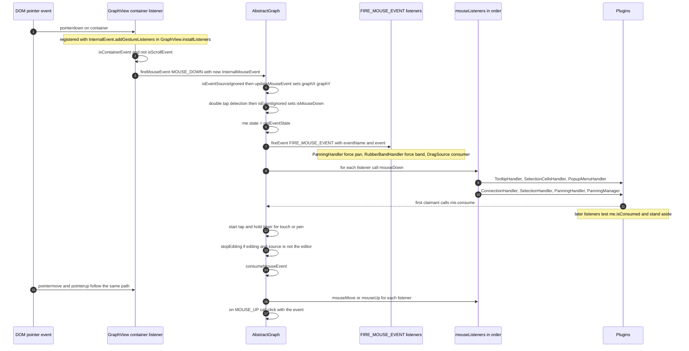
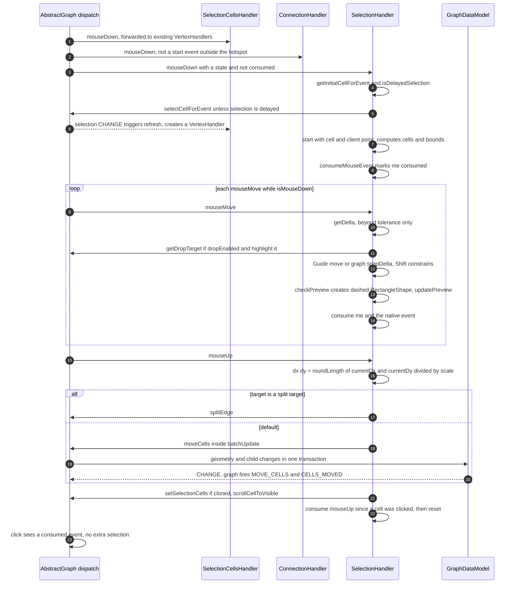
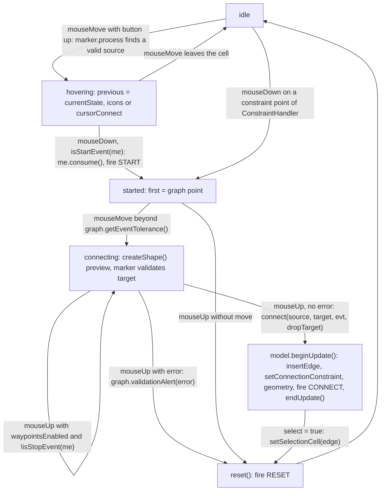
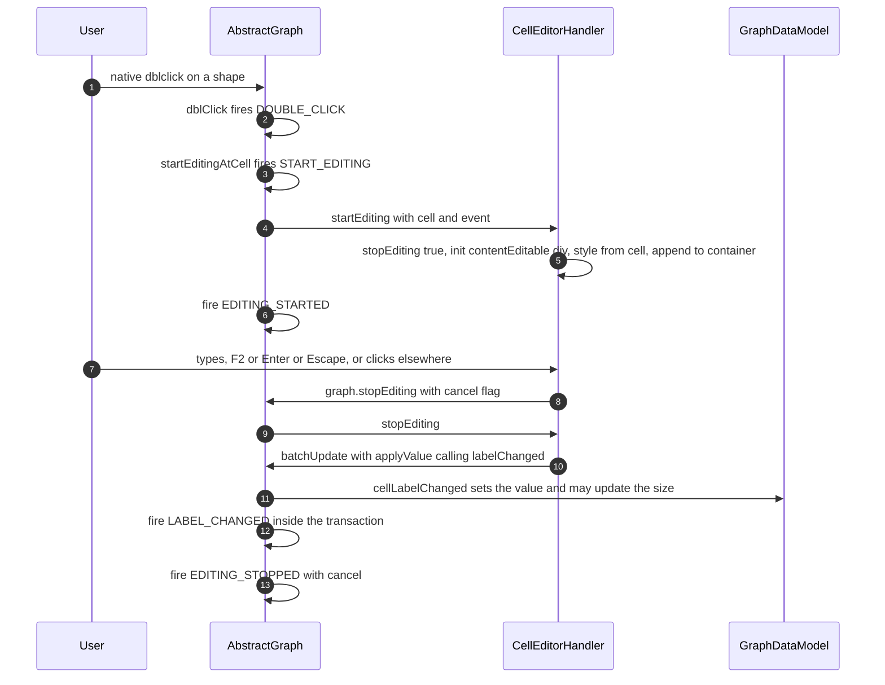
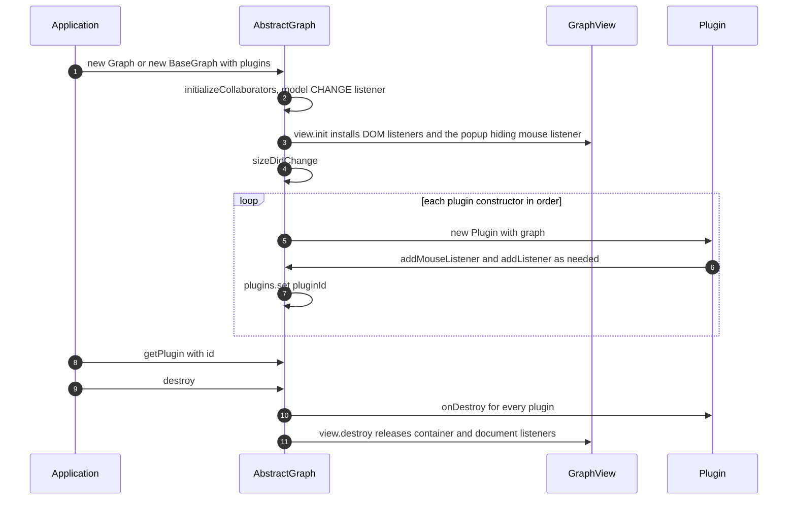

# Events and Interaction

- **Basis**: commit `a2e1bd3`, version `0.25.2`
- **Files**: `src/view/event/EventSource.ts`, `src/view/event/EventObject.ts`, `src/view/event/InternalEvent.ts`,
  `src/view/event/InternalMouseEvent.ts`, `src/view/mixin/EventsMixin.ts`, `src/view/mixin/EventsMixin.type.ts`,
  `src/view/plugin/index.ts`, `src/view/plugin/CellEditorHandler.ts`, `src/view/plugin/ConnectionHandler.ts`,
  `src/view/plugin/FitPlugin.ts`, `src/view/plugin/ImageBundlePlugin.ts`, `src/view/plugin/PanningHandler.ts`,
  `src/view/plugin/PopupMenuHandler.ts`, `src/view/plugin/RubberBandHandler.ts`,
  `src/view/plugin/SelectionCellsHandler.ts`, `src/view/plugin/SelectionHandler.ts`,
  `src/view/plugin/TooltipHandler.ts`, `src/view/cell/CellMarker.ts`, `src/view/cell/CellTracker.ts`, `src/view/other/DragSource.ts`,
  `src/view/other/Guide.ts`, `src/view/other/PanningManager.ts`, `src/util/EventUtils.ts`, `src/util/gestureUtils.ts`,
  `src/view/mixin/DragDropMixin.ts` (+ `.type.ts`), `src/view/mixin/PanningMixin.ts` (+ `.type.ts`),
  `src/view/mixin/ZoomMixin.ts` (+ `.type.ts`), `src/view/mixin/EditingMixin.ts` (+ `.type.ts`). Read for context
  only: `src/view/GraphView.ts` (`installListeners`, `isContainerEvent`), `src/view/cell/CellRenderer.ts`
  (`installListeners`), `src/view/AbstractGraph.ts` (constructor, `getPlugin`, `destroy`), `src/types.ts`.

TensorDiagram has two event systems that meet in one place. The first is a synchronous, named, in-process event
bus: every `EventSource` (the graph, its model, its view, several plugins) dispatches `EventObject`s to listeners
registered by name. The second is the DOM: pointer, mouse and touch events are captured on the container and on each
shape node, wrapped into an `InternalMouseEvent`, and pushed through `AbstractGraph.fireMouseEvent`, which filters
them and then calls every registered mouse listener in registration order. The interaction plugins (selection, move,
connect, pan, popup menu, tooltip, rubber band, in-place editor) are such mouse listeners; they cooperate only through
the `consumed` flag of the shared `InternalMouseEvent` and through a few graph-level fields such as `isMouseDown`.
Everything a user does with the mouse eventually ends in a `GraphDataModel` transaction issued by one of these plugins.

## Purpose and scope

This spec describes:

- the named-event bus (`EventSource`, `EventObject`) and the catalogue of event name constants in `InternalEvent`;
- the DOM helpers of `InternalEvent` and `src/util/EventUtils.ts`;
- the graph mouse dispatch loop of `EventsMixin` (`fireMouseEvent`, click, double click, double tap, tap and hold,
  gestures) and its configuration;
- every plugin of `src/view/plugin/`: id, inputs, state machine, model change produced, enable flags, events, cleanup;
- the helpers used by those plugins: `CellMarker`, `CellTracker`, `Guide`, `PanningManager`, `DragSource`,
  `gestureUtils.makeDraggable`;
- the graph-level mixins that the plugins drive or that drive the plugins: `DragDropMixin`, `PanningMixin`,
  `ZoomMixin`, `EditingMixin`.

Out of scope: the per-cell handlers `VertexHandler`, `EdgeHandler`, `ElbowEdgeHandler`, `EdgeSegmentHandler`,
`ConstraintHandler` and `KeyHandler` (see [cell-handlers.md](./cell-handlers.md)); only how `SelectionCellsHandler`
creates and drives them is covered here. Model transactions, the view and rendering are covered by their own specs.

## Concepts

| Concept | Definition |
|---|---|
| Named event | An `EventObject` with a `name` (one of the `InternalEvent` string constants or any string) and a `properties` record, fired by an `EventSource` to the listeners registered for that name. Synchronous. |
| Sender | First argument of a named-event listener. `EventSource.fireEvent` uses, in order: the explicit `sender`, `getEventSource()`, then the source itself. |
| Mouse event | An `InternalMouseEvent` wrapping one native `MouseEvent`/`PointerEvent`/`TouchEvent`, plus the `CellState` under the pointer and graph coordinates (`graphX`, `graphY`). |
| Mouse listener | Any object implementing `MouseListenerSet` (`mouseDown`, `mouseMove`, `mouseUp`, each `(sender, me)`), registered with `graph.addMouseListener`. Stored in `AbstractGraph.mouseListeners`. |
| Dispatch loop | `EventsMixin.fireMouseEvent`: filtering, coordinate update, double tap detection, `FIRE_MOUSE_EVENT` pre-dispatch, then every mouse listener in order, then click, tap-and-hold timer, editing stop. |
| Consumed (three distinct flags) | `EventObject.consumed` (named event), `InternalMouseEvent.consumed` (graph dispatch), and the non-standard `isConsumed` property set on the native DOM event by `InternalEvent.consume` and read by `eventUtils.isConsumed`. They are independent: consuming one does not set the others, except `InternalMouseEvent.consume` which may call native `preventDefault`. |
| Claiming a gesture | A plugin claims the gesture by calling `me.consume()` in `mouseDown`. Later listeners see `me.isConsumed()` and stand aside for the rest of the gesture by their own convention (they test `isConsumed()` in each phase). There is no capture/ownership object. |
| Plugin | A class with a static `pluginId` and a constructor `(graph)` implementing `GraphPlugin` (`onDestroy()`). Instantiated once per graph from the `plugins` option, retrieved with `graph.getPlugin<T>(id)`. |
| Legacy plugin id | The ids `'CellEditorHandler'`, `'ConnectionHandler'`, `'PanningHandler'`, `'PopupMenuHandler'`, `'RubberBandHandler'`, `'SelectionCellsHandler'`, `'SelectionHandler'`, `'TooltipHandler'` (class name as id). New plugins use kebab-case ids: `'fit'` (`FitPlugin`), `'image-bundle'` (`ImageBundlePlugin`). All are in the `BuiltinPluginId` union of `src/types.ts`. |
| Container event | A DOM event whose target is the container or one of the view panes (`GraphView.isContainerEvent`). Only those reach the dispatch loop through the container listeners; events on cell shapes reach it through the listeners `CellRenderer.installListeners` puts on each shape node. |
| Marker | `CellMarker`: finds the cell under the pointer (optionally inside a hotspot), validates it, highlights it with a `CellHighlight`, and fires `MARK`. |
| Preview pan | `graph.panGraph(dx, dy)`: a temporary visual shift (scroll or SVG transform) recorded in `panDx`/`panDy`, as opposed to the persistent `view.setTranslate`. |

## Contract

All references are relative to `packages/core`. "Public" means exported from `src/index.ts`. All classes and helpers
of this slice are public: `EventSource`, `EventObject`, `InternalEvent`, `InternalMouseEvent`, `CellMarker`,
`ConnectionHandlerCellMarker`, `CellTracker`, `Guide`, `DragSource`, `PanningManager`, every plugin and
`getDefaultPlugins` (via `export * from './view/plugin/index.js'`), `FitOptions` and `FitCenterOptions`, and the
namespaces `eventUtils` and `gestureUtils`. The mixin members are public through the `AbstractGraph` type.

### EventSource (`src/view/event/EventSource.ts`)

| Member | Contract |
|---|---|
| `constructor(eventSource: EventTarget \| null = null)` | Sets the optional sender override. |
| `eventListeners: { funct, name }[]` | Flat registration list, in insertion order. Duplicates allowed. |
| `eventsEnabled = true`, `isEventsEnabled()`, `setEventsEnabled(v)` | When `false`, `fireEvent` is a no-op (nothing queued, nothing replayed). |
| `eventSource`, `getEventSource()`, `setEventSource(v)` | Default sender passed to listeners. |
| `addListener(name: string, funct)` | Appends. A registration whose `name` is `null` receives every event (the signature types `name` as `string`, so this needs a cast). |
| `removeListener(funct)` | Removes **every** registration of `funct`, whatever its name. There is no way to remove a function for a single name only. |
| `fireEvent(evt, sender = null)` | If enabled: substitutes `new EventObject('')` for a falsy `evt`, resolves the sender, then calls `funct.apply(this, [sender, evt])` for each matching registration, synchronously, in order. Exceptions are not caught. Does not check `evt.isConsumed()`, so all listeners run even after one consumes. |
| `destroy()` | Empties `eventListeners`. Subclasses with their own cleanup must call `super.destroy()`. |

Subclasses in this slice: `ConnectionHandler`, `PanningHandler`, `SelectionCellsHandler`, `PopupMenuHandler` (through
`MaxPopupMenu`), `CellMarker` (and so `ConnectionHandlerCellMarker`, `CellTracker`). `AbstractGraph`, `GraphView` and
`GraphDataModel` are the other major emitters.

### EventObject (`src/view/event/EventObject.ts`)

| Member | Contract |
|---|---|
| `constructor(name = '', ...args)` | If `args[0]` is a plain object literal (`constructor === Object`), its entries become `properties` (null values kept). Otherwise `args` is read as `key, value, key, value, ...` pairs and **pairs whose value is `null` are skipped**. |
| `name`, `getName()` | Event name. |
| `properties`, `getProperties()`, `getProperty(key)` | Payload; a missing key yields `undefined`. |
| `consumed = false`, `isConsumed()`, `consume()` | Convention flag read by the code that fired the event after `fireEvent` returns (for example `graph.click`, `graph.dblClick`, `graph.tapAndHold`). |

### InternalEvent (`src/view/event/InternalEvent.ts`)

All members are static. The module probes passive-listener support once at load time.

| Group | Member | Contract |
|---|---|---|
| DOM listeners | `addListener(element, eventName, funct)` | `addEventListener` with `{ passive: false }` when supported, and records `{ name, f }` in `element.mxListenerList`. |
| | `removeListener(element, eventName, funct)` | `removeEventListener(..., false)` and removes the first matching record (by function only). |
| | `removeAllListeners(element)` | Removes every recorded listener of the element. |
| | `release(element)` | `removeAllListeners` on the element and, recursively, all its `childNodes`; errors are swallowed. Only listeners added through `addListener` are known. |
| | `disableContextMenu(element)` | Adds a `contextmenu` listener calling `preventDefault`. |
| Gestures | `addGestureListeners(node, start?, move?, end?)` | Registers `pointerdown/pointermove/pointerup` when `Client.IS_POINTER`, otherwise `mousedown/mousemove/mouseup`; additionally `touchstart/touchmove/touchend` when not `IS_POINTER` and `Client.IS_TOUCH`. A `null` listener is skipped. |
| | `removeGestureListeners(node, start, move, end)` | Exact inverse, using the same `Client` flags. |
| | `redirectMouseEvents(node, graph, state?, down?, move?, up?, dblClick?)` | Installs gesture listeners on `node` that call the given override, or else `graph.fireMouseEvent(MOUSE_*, new InternalMouseEvent(evt, getState(evt)))` unless the native event is already consumed. `state` is a `CellState`, a function `(evt) => CellState \| null`, or `null`. Also adds a `dblclick` listener calling `graph.dblClick(evt, state?.cell)`. Used for preview shapes and connect icons so they stay transparent to the dispatch loop. |
| Consume | `consume(evt, preventDefault = true, stopPropagation = true)` | Calls `stopPropagation()` and `preventDefault()` (when `preventDefault`), and always sets the non-standard `evt.isConsumed = true` read by `eventUtils.isConsumed`. |
| Wheel | `addMouseWheelListener(funct, target)` | Adds a `wheel` listener on `target` (default `window`) calling `funct(evt, up)` when `|deltaX|` or `|deltaY|` exceeds 0.5; `up` is `-deltaY > 0`, or `-deltaX > 0` when `deltaY` is 0. `ctrlKey` wheel events (trackpad pinch) get `preventDefault`. On Safari without touch, `gesturestart/change/end` produce `funct(evt, diff < 0, true)` when the scale changes by more than 0.2. Elsewhere, two-pointer pinches tracked through gesture listeners produce `funct(evt, zoomIn, true, cx, cy)` when the distance changes by more than `PINCH_THRESHOLD`. No remover is returned. Nothing in `src` calls it: wheel zoom is opt-in application code. |
| Handle indices | `LABEL_HANDLE = -1`, `ROTATION_HANDLE = -2`, `CUSTOM_HANDLE = -100`, `VIRTUAL_HANDLE = -100000` | Reserved negative handle indices used by the cell handlers. |
| Threshold | `PINCH_THRESHOLD = 10` | Pixels, see wheel. |
| Names | about one hundred string constants | See [Events](#events). |

### InternalMouseEvent (`src/view/event/InternalMouseEvent.ts`)

| Member | Contract |
|---|---|
| `constructor(evt, state = null)` | Stores the native event, `state` and `sourceState` (both the given state); `graphX = graphY = 0` until `graph.updateMouseEvent` fills them. |
| `evt`, `getEvent()` | Native event. |
| `getSource()` | `evt.target`. |
| `isSource(shape)` | `true` if the event target is `shape.node` or one of its descendants; `false` for a `null` shape. |
| `getX()`, `getY()` | Client coordinates through `eventUtils.getClientX/Y` (first touch for touch events). |
| `graphX`, `graphY`, `getGraphX()`, `getGraphY()` | Container coordinates minus the preview pan (`panDx`, `panDy`), set by `updateMouseEvent`. Not divided by scale nor translated: these are screen-space coordinates of the view. |
| `state`, `getState()`, `getCell()` | State used by the listeners, after `graph.getEventState(state)`. `getCell()` is `state?.cell ?? null`. |
| `sourceState` | The state given to the constructor, before `getEventState` and before the hit-detection fallback of `updateMouseEvent`. |
| `isPopupTrigger()` | `eventUtils.isPopupTrigger(evt)`. |
| `consumed`, `isConsumed()` | Dispatch-loop claim flag. |
| `consume(preventDefault?)` | Sets `consumed = true` and calls native `preventDefault()` when `preventDefault` is truthy **or, if it is falsy, when the native event is a `TouchEvent` or a mouse-type event**. See [Traps](#traps). |

### Graph dispatch API (`src/view/mixin/EventsMixin.ts`, declared in `EventsMixin.type.ts`)

| Member | Contract |
|---|---|
| `addMouseListener(l)` | Appends to `mouseListeners`. No de-duplication. |
| `removeMouseListener(l)` | Removes the first occurrence. |
| `fireMouseEvent(evtName, me, sender = this)` | The dispatch loop, see [Workflows](#workflows). `evtName` is `InternalEvent.MOUSE_DOWN`, `MOUSE_MOVE` or `MOUSE_UP`. Listeners are called whatever the consumed state; respecting it is each listener's job. |
| `updateMouseEvent(me, evtName)` | Fills `graphX/graphY`. During a press (`isMouseDown`) on `MOUSE_MOVE` without a state, searches the cell with `getCellAt` (for shapes whose native hit detection is off) and sets `me.state`. |
| `getEventState(state)` | Hook, returns `state`. Lets an application redirect an event to another state (for example a parent). |
| `isEventIgnored(evtName, me, sender)` | Filter with side effects, see Workflows. |
| `isSyntheticEventIgnored(evtName, me, sender)` | Drops the compatibility mouse events following a touch gesture in Firefox. |
| `isEventSourceIgnored(evtName, me)` | `true` for a `MOUSE_DOWN` (left button or non-mouse) on `select`, `option`, or an `input` that is not checkbox, radio, button, submit or file; also `true` when the event has no target. |
| `consumeMouseEvent(evtName, me, sender)` | Called at the very end; calls `me.consume(false)` for touch `MOUSE_DOWN` events (duplicate click workaround). |
| `click(me)` | Fires `CLICK`, then selects or clears, see Workflows. Returns `false`. |
| `dblClick(evt, cell = null)` | Fires `DOUBLE_CLICK`, then starts in-place editing, see Workflows. |
| `tapAndHold(me)` | Fires `TAP_AND_HOLD`, then may start a connection, see Workflows. |
| `fireGestureEvent(evt, cell = null)` | Resets `lastTouchTime` (cancels double-tap detection) and fires `GESTURE`. Called by `GraphView` for `gesturestart/change/end` on touch clients. |
| `escape(evt)` | Fires `ESCAPE` with `{ event }`. Called by the key handler. |
| `sizeDidChange()` | Recomputes the SVG minimum size and page breaks, fires `SIZE` `{ bounds }`. Not an interaction method; it lives here for historical reasons (see the comment in the source). |
| `getStateForTouchEvent(evt)` | State under the client point of `evt` via `getCellAt`. |
| `getPointForEvent(evt, addOffset = true)` | Model-space point of a native event, snapped to the grid, offset by `gridSize / 2` when `addOffset`. |
| `getCursorForMouseEvent(me)` | `getCursorForCell(me.getCell())` or `null`. |
| Modifier predicates | `isCloneEvent` (Ctrl), `isToggleEvent` (Meta on Mac, Ctrl elsewhere), `isGridEnabledEvent` (not Alt), `isConstrainedEvent` (Shift), `isTransparentClickEvent` (`false`), `isIgnoreTerminalEvent` (`false`). All are hooks to override. |
| Config (defaults) | `tolerance = 4` (`getEventTolerance`, `setEventTolerance`), `nativeDblClickEnabled = true`, `doubleTapEnabled = true`, `doubleTapTimeout = 500`, `doubleTapTolerance = 25`, `tapAndHoldEnabled = true`, `tapAndHoldDelay = 500`, `escapeEnabled = true`, `invokesStopCellEditing = true`, `enterStopsCellEditing = false` (with `is*`/`set*` accessors). |
| Gesture state | `isMouseDown`, `isMouseTrigger`, `lastEvent`, `lastMouseX/Y`, `ignoreMouseEvents`, `mouseMoveRedirect`, `mouseUpRedirect`, `lastTouchEvent`, `lastTouchCell`, `lastTouchX/Y`, `lastTouchTime`, `doubleClickCounter`, `fireDoubleClick`, `tapAndHoldThread`, `tapAndHoldInProgress`, `tapAndHoldValid`, `initialTouchX/Y`. All public and mutable; `isMouseDown` is read by many plugins and written by `DragSource`. |

### Plugins (`src/view/plugin/*`)

Plugins are created by the `AbstractGraph` constructor, after `view.init()` and `sizeDidChange()`, in the order of the
`plugins` option: `options.plugins.forEach((p) => plugins.set(p.pluginId, new p(this)))`. A later plugin with the same
id replaces the earlier one in the map, but the earlier instance is not destroyed and stays registered as a mouse
listener. `Graph` defaults the option to `getDefaultPlugins()`; `BaseGraph` and `AbstractGraph` use only what is
passed. `graph.destroy()` calls `onDestroy()` on every plugin, then `view.destroy()`.

`getDefaultPlugins()` returns a new array each call, in this order: `CellEditorHandler`, `TooltipHandler`,
`SelectionCellsHandler`, `PopupMenuHandler`, `ConnectionHandler`, `SelectionHandler`, `PanningHandler`, `FitPlugin`,
`ImageBundlePlugin`. **`RubberBandHandler` is exported but not a default plugin**; it must be appended explicitly.

| Plugin | `pluginId` | Default | Mouse listener | `EventSource` | Enable flag (default) | Graph switch | Events fired | Model change |
|---|---|---|---|---|---|---|---|---|
| `CellEditorHandler` | `'CellEditorHandler'` | yes | no | no | none (gated by `graph.isCellEditable`) | `setCellsEditable` | none (the graph fires the editing events) | `graph.labelChanged` and `setCellStyles('align', ...)` in one `batchUpdate` |
| `TooltipHandler` | `'TooltipHandler'` | yes | yes | no | `enabled` (`false`) | `setTooltips` | none | none |
| `SelectionCellsHandler` | `'SelectionCellsHandler'` | yes | yes, forwards to cell handlers | yes | `enabled` (`true`) | none | `ADD`, `REMOVE` `{ state }` | none itself; the cell handlers resize, reshape, reconnect |
| `PopupMenuHandler` | `'PopupMenuHandler'` | yes | yes | yes (`MaxPopupMenu`) | `enabled` (`true`) | none | `SHOW`, `HIDE` (from `MaxPopupMenu`) | none (selection only) |
| `ConnectionHandler` | `'ConnectionHandler'` | yes | yes | yes | `enabled` (`false`) | `setConnectable`, `isConnectable` | `START` `{ state }`, `CONNECT`, `RESET` | inserts an edge (and optionally a target vertex) in one `beginUpdate/endUpdate` |
| `SelectionHandler` | `'SelectionHandler'` | yes | yes | no | `enabled` (`true`), `moveEnabled`, `cloneEnabled`, `selectEnabled` (all `true`) | none | none | `graph.moveCells`, `graph.splitEdge`, `removeCells` of empty parents, or `ConnectionHandler.connect` (connect on drop) |
| `PanningHandler` | `'PanningHandler'` | yes | yes (plus its `PanningManager`) | yes | `panningEnabled` (`false`), `pinchEnabled` (`true`) | `setPanning` | `PAN_START`, `PAN`, `PAN_END` `{ event }` | none (view translate and scale only) |
| `FitPlugin` | `'fit'` | yes | no | no | none | none | none | none (view scale/translate, container scroll) |
| `ImageBundlePlugin` | `'image-bundle'` | yes | no | no | none | none | none | none |
| `RubberBandHandler` | `'RubberBandHandler'` | **no** | yes | no | `enabled` (`true`) | none | none | none (selection via `graph.selectRegion`) |

Note that `TooltipHandler` and `ConnectionHandler` are disabled by default even when registered; `PanningHandler` is
registered but `panningEnabled` is `false`, so it only reacts to force-panning (multi-touch, or `ignoreCell`).

### Mixins driven by or driving the plugins

| Mixin | Members (defaults) | Contract |
|---|---|---|
| `DragDropMixin` | `dropEnabled = false`, `splitEnabled = true`, `autoScroll = true`, `autoExtend = true`, `isDropEnabled`, `setDropEnabled`, `isSplitEnabled`, `setSplitEnabled`, `isAutoScroll`, `isAutoExtend`, `isSplitTarget(target, cells = [], evt)` | `isSplitTarget` is `true` when `target` is an edge, exactly one connectable cell is dropped, `getEdgeValidationError(target, source, cell)` is falsy, and the cell is not an ancestor of either terminal. Read by `SelectionHandler` and `DragSource`. |
| `PanningMixin` | `useScrollbarsForPanning = true`, `timerAutoScroll = false`, `allowAutoPanning = false`, `panDx = panDy = 0`, `shiftPreview1/2 = null`, accessors, `panGraph(dx, dy)`, `scrollCellToVisible(cell, center = false)`, `scrollRectToVisible(rect)`, `setPanning(enabled)` | `panGraph` scrolls the container when it has scrollbars and `useScrollbarsForPanning`, otherwise sets an SVG `transform` on the canvas and moves the sibling HTML nodes into two absolutely positioned shift DIVs; then records `panDx/panDy` and fires `PAN`. `panGraph(0, 0)` undoes the shift. `scrollRectToVisible` returns `true` when it changed the translate (no scrollbars case), in which case it refreshes the view and `SelectionCellsHandler`. `setPanning` writes `PanningHandler.panningEnabled`; no-op without the plugin. |
| `ZoomMixin` | `zoomFactor = 1.2`, `keepSelectionVisibleOnZoom = false`, `centerZoom = true`, `zoomIn`, `zoomOut`, `zoomActual`, `zoomTo(scale, center = false)`, `zoom(factor, center?)`, `zoomToRect(rect)` | `zoom` rounds the new scale to 2 decimals and changes the view through `setScale` or `scaleAndTranslate`, adjusting scroll position when the container has scrollbars. Note that `zoomTo` defaults `center` to `false`, while `zoom` defaults it to `centerZoom`. Events come from the view (`SCALE`, `SCALE_AND_TRANSLATE`). |
| `EditingMixin` | `cellsEditable = true`, `startEditing(evt)`, `startEditingAtCell(cell = null, evt)`, `getEditingValue`, `stopEditing(cancel = false)`, `labelChanged`, `cellLabelChanged`, `isEditing(cell = null)`, `isCellEditable`, `isCellsEditable`, `setCellsEditable` | The graph-side facade of `CellEditorHandler`, see the editing workflow. `isEditing` is `false` without the plugin. |

### Helpers

| Class / function | Contract |
|---|---|
| `CellMarker(graph, validColor = DEFAULT_VALID_COLOR, invalidColor = DEFAULT_INVALID_COLOR, hotspot = DEFAULT_HOTSPOT)` | `process(me)` returns the state from `getState(me)` (that is `getCell(me)` → `getStateToMark` → `intersects`) and calls `setCurrentState`, which stores `validState` when `isValidState` is true and (re)marks `markedState` when the state or the color from `getMarkerColor` changed. A color of `NONE` unmarks. `mark()` and `unmark()` both fire `MARK` `{ state: markedState }` (`unmark` simply calls `mark` after `markedState` was set to `null`). `hotspotEnabled = false` by default; `intersects` uses `intersectsHotspot` with `MIN_HOTSPOT_SIZE`/`MAX_HOTSPOT_SIZE` when enabled. `destroy()` destroys the highlight and the listeners. `createCellHighlight(graph)` is a protected hook. |
| `ConnectionHandlerCellMarker` (in `ConnectionHandler.ts`) | `hotspotEnabled = true`. `getCell` falls back to the cell at `currentPoint`, climbs to a connectable parent, rejects swimlane content and cells failing `isConnectableCell`, and sets `connectionHandler.error` from `validateConnection` while connecting (an empty-string error rejects the cell silently) or rejects invalid sources otherwise. `isValidState` is `!error` while connecting. `getMarkerColor` is `NONE` when a `connectImage` is used and not connecting. `intersects` is always `true` with a connect image or while connecting. |
| `CellTracker(graph, color, funct = null)` | A `CellMarker` that registers itself as mouse listener and calls `process(me)` on every `mouseMove` when enabled; `funct` replaces `getCell`. Never consumes. `destroy()` is idempotent and removes the mouse listener. Not a plugin. |
| `Guide(graph, states)` | `move(bounds, delta, gridEnabled = false, clone = false)` snaps `delta` so that the left/center/right and top/middle/bottom of `bounds` align with the `states` (within `getGuideTolerance`: `gridSize / 2` when grid is on, else `tolerance = 2` px, times scale), then calls `graph.snapDelta`, draws dashed `PolylineShape` guides in the overlay pane and returns the new delta (it also mutates the given one). Hooks: `isEnabledForEvent`, `isStateIgnored`, `createGuideShape`, `getGuideColor`, `getDelta`. `setVisible`, `hide`, `destroy`. |
| `PanningManager(graph)` | Auto-scroll engine. Registers a mouse listener and a `document` `mouseup` listener that call `stop()`. `panTo(x, y, w = 0, h = 0)` computes a speed from the distance to the container edge (`border = 0`, `handleMouseOut = true`, `damper = 1/6`) and starts a `setInterval` (`delay = 10` ms) that calls `graph.panGraph`. `stop()` clears the interval and commits the preview pan to `view.setTranslate` (or resets `panDx/panDy` with scrollbars and fires `PAN`). `destroy()` stops and removes both listeners. Created by `PanningHandler`, driven by `AbstractGraph.scrollPointToVisible` when `allowAutoPanning` is on and the container has no scrollbars. |
| `DragSource(element, dropHandler)` | Makes a DOM element draggable onto a graph, see the drag-and-drop workflow. `getGraphForEvent` returns `null` by default, so a bare `DragSource` never finds a target graph: override it or use `makeDraggable`. Flags: `enabled`, `autoscroll`, `guidesEnabled` (`true`), `gridEnabled` (`true`), `highlightDropTargets` (`true`), `checkEventSource` (`true`), `dragElementZIndex = 100`, `dragElementOpacity = 70`, `dragOffset`, `previewOffset`. |
| `gestureUtils.makeDraggable(element, graphF, funct, dragElement = null, dx = null, dy = null, autoscroll = null, scalePreview = false, highlightDropTargets = true, getDropTarget = null)` | Builds a `DragSource`: `dragOffset = (dx ?? 0, dy ?? TOOLTIP_VERTICAL_OFFSET)`, **guides disabled**, `getGraphForEvent` returns `graphF` or `graphF(evt)`, `createDragElement` clones `dragElement`, and with `scalePreview` a scaled clone becomes the in-graph preview. Returns the `DragSource`. |
| `eventUtils` (`src/util/EventUtils.ts`) | `getMainEvent` (first touch of touch events), `getClientX/Y`, `getSource` (`evt.target`), `isConsumed`, `isTouchEvent`, `isPenEvent`, `isMouseEvent` (pointer type, then `mozInputSource`, then event type prefix), `isMultiTouchEvent` (touch event with more than one touch), `isLeftMouseButton` (uses `buttons === 1` for `mousedown/mousemove`), `isMiddleMouseButton` (`button === 4`), `isRightMouseButton` (`button === 2`), `isPopupTrigger` (right button, or Ctrl alone on Mac), `isShiftDown`, `isAltDown`, `isControlDown`, `isMetaDown`. |

## Invariants

1. Mouse listeners are called in registration order. With `new Graph(container)` the order is: the anonymous listener
   added by `GraphView.installListeners` (hides the popup menu on mouse down), `TooltipHandler`,
   `SelectionCellsHandler`, `PopupMenuHandler`, `ConnectionHandler`, `SelectionHandler`, `PanningHandler`, then the
   listener of `PanningHandler.panningManager`. `CellEditorHandler`, `FitPlugin` and `ImageBundlePlugin` are not mouse
   listeners. A plugin appended to the plugin list (for example `RubberBandHandler`) comes last.
2. `FIRE_MOUSE_EVENT` listeners always run before any mouse listener of the same event, which is how
   `PanningHandler` (force panning), `RubberBandHandler` (force rubber band with Alt) and `DragSource` (swallow all
   non-down events during an external drag) get first pick.
3. Every listener sees every event that passes the filters, consumed or not. A plugin that wants to stand aside tests
   `me.isConsumed()` itself. `PopupMenuHandler.mouseDown/mouseUp`, `TooltipHandler`, `PanningHandler.mouseMove/mouseUp`
   and `SelectionCellsHandler` do not test it.
4. `graph.click(me)` is invoked after the listeners for every `MOUSE_UP` that reached the listener loop, consumed or
   not; a consumed mouse up only pre-consumes the `CLICK` event object, which disables the default selection.
5. `graph.isMouseDown` is `true` between an accepted `MOUSE_DOWN` and the next accepted `MOUSE_UP`; it is maintained by
   `isEventIgnored` (and forced by `DragSource.dragEnter/dragExit` and the double-tap branch).
6. Native mouse down and up events with `detail === 2` (second click of a double click) never reach the listeners
   unless they are popup triggers; the double click is handled by the native `dblclick` listeners instead.
7. `me.graphX/graphY` are in the coordinate space of `view.translate`/`view.scale` applied, offset by the preview pan.
   Model coordinates are `graphX / scale - translate.x`.
8. A plugin that registered listeners on the graph, model, view, document or window removes them in `onDestroy()`
   (exceptions listed in [Traps](#traps)).
9. Each DOM event is dispatched at most once: `isEventIgnored` drops an event identical to `lastEvent`.
10. Every model change produced by an interaction plugin is wrapped in one transaction (`batchUpdate` or
    `beginUpdate/endUpdate`), so a user gesture produces one undoable edit.

## Workflows

### Mouse dispatch end to end

Entry points into `fireMouseEvent`:

- `GraphView.installListeners` (from `view.init()` in the `AbstractGraph` constructor): gesture listeners on the
  container, forwarding container events only (`isContainerEvent`); `MOUSE_DOWN` skips scrollbar clicks on Chrome and
  Safari (`isScrollEvent`) and remembers the `pointerId` so that `MOUSE_MOVE` is forwarded for that pointer only; a
  `dblclick` listener calling `graph.dblClick(evt)`; and gesture listeners on `document` forwarding moves and ups that
  happen outside the container while `graph.isMouseDown` (when `view.captureDocumentGesture`).
- `CellRenderer.installListeners`: gesture listeners on every shape node, firing with the shape's state (or, on touch
  clients, the state under the pointer for move and up), plus a `dblclick` listener calling
  `graph.dblClick(evt, state.cell)`.
- `InternalEvent.redirectMouseEvents`: preview shapes and connect icons of `ConnectionHandler`.
- Plugins that capture outside the container: `RubberBandHandler` on Firefox, `EventsMixin` redirects on touch.

`fireMouseEvent(evtName, me, sender)` step by step:

1. `isEventSourceIgnored(evtName, me)`: if `true`, hide the tooltip and return.
2. `me = updateMouseEvent(me, evtName)`.
3. Double-tap branch, only when native double click detection is off (`!nativeDblClickEnabled` and not a popup
   trigger) or for touch/pen events when `doubleTapEnabled && Client.IS_TOUCH`. On `MOUSE_DOWN`, a second tap within
   `doubleTapTimeout` ms and `doubleTapTolerance` px sets `fireDoubleClick`; the next `MOUSE_MOVE` while pressed or the
   next `MOUSE_UP` then resets `isMouseDown`, calls `dblClick(evt, lastTouchCell)` (or consumes the native event if
   the tap is not valid) and **returns before the listeners**.
4. `isEventIgnored(evtName, me, sender)`; if ignored, stop here. Its side effects:
   - drops a repeat of `lastEvent`, then stores the event in `lastEvent`;
   - touch gesture source tracking: for a non-mouse, non-pen `MOUSE_DOWN` on a touch client, calls
     `graph.setEventSource(me.getSource())` and installs `mouseMoveRedirect`/`mouseUpRedirect` on that DOM node so
     the gesture keeps flowing even if the node leaves the DOM; any later non-move event removes them and resets the
     event source; except on Chrome, moves whose target differs from the tracked source are dropped;
   - `isSyntheticEventIgnored` (Firefox compatibility mouse events after touch);
   - returns `true` for non-move events with `detail === 2` (not popup triggers);
   - updates `isMouseDown` and `isMouseTrigger`, and drops out-of-sequence events: a down while already down, an up
     while not down, and (except mouse moves on Firefox) any event whose input type (mouse or not) differs from the
     one that started the press;
   - records `lastMouseX/Y` for an accepted `MOUSE_DOWN`.
5. `me.state = getEventState(state)`, then `fireEvent(FIRE_MOUSE_EVENT, { eventName, event: me })`.
6. Only when `Client.IS_SF || Client.IS_GC || evt.target !== container`:
   - `MOUSE_MOVE` while pressed with `isAutoScroll()` and not multi-touch: `scrollPointToVisible(graphX, graphY,
     isAutoExtend())` (which may start `PanningManager.panTo`);
   - `MOUSE_UP` with `ignoreScrollbars` and `translateToScrollPosition`: converts the container scroll into a view
     translate;
   - calls `mouseDown`, `mouseMove` or `mouseUp` on every listener;
   - on `MOUSE_UP`, calls `click(me)`.
7. Tap and hold: on a touch or pen `MOUSE_DOWN` with `tapAndHoldEnabled` and none in progress, records the start point
   and arms a `tapAndHoldDelay` timer; moves beyond `tolerance` invalidate it; `MOUSE_UP` cancels it logically (the
   timer still fires but does nothing). When the timer fires while valid, `tapAndHold(me)` runs.
8. On `MOUSE_DOWN` while editing, unless the event comes from the editor (`CellEditorHandler.isEventSource`):
   `stopEditing(!isInvokesStopCellEditing())`, that is, apply the value by default.
9. `consumeMouseEvent(evtName, me, sender)`.

### Click, double click and popup trigger

- **Click** (`click(me)`, after every `MOUSE_UP`): fires `CLICK` `{ event, cell }`, pre-consumed if `me` was consumed.
  When the graph is enabled and neither the native event nor the `EventObject` is consumed: with a cell, optionally
  resolves the cell behind it (`isTransparentClickEvent`) and calls `selectCellForEvent(cell, evt)`; without a cell,
  with `isSwimlaneSelectionEnabled()`, selects the swimlane under the point (walking selected ancestor swimlanes);
  otherwise `clearSelection()` unless it is a toggle event. In practice `SelectionHandler` consumes the mouse up of a
  gesture that started on a cell (`cellWasClicked`), so `click` selects only on the background or when no plugin took
  the gesture.
- **Double click**: the native `dblclick` listeners call `dblClick(evt, cell)`. It fires `DOUBLE_CLICK`
  `{ event, cell }`; when the graph is enabled, nothing consumed, the cell exists, `isCellEditable(cell)` and the cell
  is not already being edited, it calls `startEditingAtCell(cell, evt)` and consumes the native event. A listener of
  `DOUBLE_CLICK` that calls `evt.consume()` prevents editing. The mouse down and up of the second click are filtered
  when the browser reports `detail === 2` on them (invariant 6). Touch clients get the same effect through the
  double-tap branch.
- **Tap and hold** (`tapAndHold(me)`): fires `TAP_AND_HOLD` `{ event, cell }`. If consumed, resets
  `PanningHandler.panningTrigger`. Otherwise, if `ConnectionHandler` is enabled and its marker finds a cell, marks the
  cell and starts a connection from it (`first`, `edgeState`, `previous`) and fires `START` on the handler.
- **Popup trigger** (`eventUtils.isPopupTrigger`: right button, or Ctrl alone on Mac; `MaxPopupMenu.isPopupTrigger`
  adds `useLeftButtonForPopup`): `PopupMenuHandler.mouseDown` hides any open menu and records the trigger position and
  whether it is a trigger; `mouseMove` cancels it once the pointer moves more than `tolerance` screen pixels;
  `mouseUp`, if still a trigger within tolerance, selects the cell (`selectOnPopup`, only if not already selected) or
  clears the selection on the background (`clearSelectionOnBackground`), hides the tooltip, calls
  `popup(x + 1, y + 1, cell, evt)` (which only shows something when a `factoryMethod` is set) and consumes. Meanwhile
  `PanningHandler` treats the same popup trigger as a panning trigger (`usePopupTrigger = true`) when panning is
  enabled: a right-drag pans, a right-click opens the menu.

### Moving a cell (SelectionHandler)

States: idle → pressed (`cell`, `first` set, possibly `delayedSelection`) → dragging (`shape` or live preview active,
`currentDx/Dy`) → idle (`reset()`). Escape (`ESCAPE` graph event) resets at any time.

Details:

- `mouseDown` acts only when not consumed, enabled, graph enabled, a state is under the pointer and the event is not
  multi-touch. `getInitialCellForEvent` climbs to the topmost unselected vertex or edge ancestor allowed by
  `isPropagateSelectionCell`. `isDelayedSelection` is `true` when the cell or an ancestor already has a cell handler
  (and is not being edited), or for a toggle event without Alt; then the selection happens on mouse up
  (`selectDelayed`), which lets a drag move the whole current selection. The move starts only when `moveEnabled`, the
  cell has a geometry, is movable and, for an edge, the edge is free enough to move (several selected cells, control
  points, a missing terminal, `isAllowDanglingEdges()`, or a clone gesture). The event is consumed whenever
  `moveEnabled` is on, even when the move did not start.
- `start(cell, x, y, cells?)` stores `first` (container point), `cells` (`getCells`: the cell alone if it is movable and
  the selection is not delayed, else `graph.getMovableCells(graph.getSelectionCells())`), `bounds`, `pBounds`, and
  collects all states of the moved subtrees in `allCells`. With `guidesEnabled` (default `false`) it creates a `Guide`
  over `getGuideStates()` with an `isStateIgnored` that skips the moving cells.
- Preview: live preview of the real shapes is used when `maxLivePreview >= cellCount` (default `0`, so off) and
  `allowLivePreview`; otherwise a dashed `RectangleShape` (`previewColor`, `htmlPreview`). Ctrl (clone) toggles live
  preview off. A `document` `keydown/keyup` listener re-evaluates the clone state during the drag.
- Drop target: with `graph.isDropEnabled()` and `highlightEnabled`, `graph.getDropTarget(cells, evt, cell, clone)`;
  valid if cloning or `isValidDropTarget` (not the current parent). With `connectOnDrop`, hovering a single connectable
  vertex highlights it with `VALID_COLOR` or `INVALID_CONNECT_TARGET_COLOR`, and the drop calls
  `ConnectionHandler.connect(this.cell, cell, evt)` instead of moving.
- `moveCells(cells, dx, dy, clone, target, evt)`: with `removeCellsFromParent` and no target, cells dropped outside a
  vertex parent move to the default parent; cloning into a locked target is turned into a move; then, in one
  `batchUpdate`, `graph.moveCells(...)` and, with `removeEmptyParents`, removal of parents left empty and transparent.
- Remote model changes and `REFRESH` during a drag re-compute bounds on a 0 ms timer (`refreshHandler`); `PAN` (from
  auto-scroll) repaints the preview.

### Creating an edge (ConnectionHandler)

The handler is disabled until `graph.setConnectable(true)`. States: idle → hovering (`previous`/`currentState` set,
icons or connect cursor shown) → started (`first` set at mouse down, event consumed) → connecting (`shape` created after
moving more than `tolerance`; `isConnecting()` is `first && shape`) → idle (`reset()`, fires `RESET`). Escape,
`START_EDITING`, view `UP`/`DOWN`, and the source state disappearing from the view all reset it.

Details:

- Hover (button up, or `ignoreMouseDown`): `updateCurrentState` runs `ConstraintHandler.update` first; if a fixed
  connection point has the focus, that point wins; otherwise `marker.process(me)` (a `ConnectionHandlerCellMarker` with
  hotspot) selects the state. With a `connectImage`, `createIcons` draws an `ImageShape` icon whose mouse events are
  redirected to the graph; the connection can then only start by pressing the icon (`isStartEvent` requires `icon`).
  Without an icon, the state's cursor becomes `cursorConnect` and the move is consumed so that `SelectionHandler`
  does not set the move cursor.
- Consequence of the listener order: `ConnectionHandler` runs before `SelectionHandler`, so a press inside the hotspot
  of a hovered vertex starts a connection and consumes the mouse down; `SelectionHandler` does not move or select. If
  the pointer does not move, the mouse up is not consumed and `graph.click` selects the cell.
- While connecting: grid snapping (`isGridEnabledEvent`), `snapToPreview` (aligns with the source center or the first
  point within half a grid unless Alt), Shift aligns horizontally or vertically with the source center, outline
  connection with `outlineConnect`, the optional preview `edgeState` from `createEdgeState(me)` (default `null`) and
  `livePreview`, and `movePreviewAway`. Moves are consumed both on the `InternalMouseEvent` and natively.
- `connect(source, target, evt, dropTarget)` runs only when there is a target, `isCreateTarget(evt)` or
  `graph.isAllowDanglingEdges()`. Inside one `model.beginUpdate()/endUpdate()`: optionally `createTargetVertex` (clone
  of the source, aligned within `getAlignmentTolerance`) added to `graph.getDropTarget(...)`; parent is the common
  parent of source and target when it is not a top-level layer, else the default parent; `insertEdge` uses
  `graph.insertEdge({ parent, id, value, source, target, style })`, or `createEdge` + `graph.addEdge` when a
  `factoryMethod` is set; connection constraints, preview geometry, `insertBeforeSource` ordering, waypoints
  (unscaled, untranslated) and a dangling terminal point are applied; `CONNECT` is fired inside the transaction.
  Exceptions in that block are logged with `log().debug` and swallowed. After `endUpdate`, `selectCells(edge, ...)`
  when `select`.
- Self-connections to the same fixed point (`checkConstraints`) and validation errors do not insert anything; a
  non-empty error is shown with `graph.validationAlert`, an empty one is silent.

### Rubber band selection (RubberBandHandler, opt-in)

`mouseDown` on the background (no state, not consumed, enabled, not multi-touch), or any mouse down with Alt through
the `FIRE_MOUSE_EVENT` force handler, calls `start(x, y)` and `me.consume(false)`. `mouseMove` beyond `tolerance`
creates the `div.mxRubberband` (CSS from the package is required), clears the DOM text selection and consumes.
`mouseUp` resets and, if the band was visible, calls `graph.selectRegion(rect, evt)` and consumes. On Firefox, move and
up are also captured on `document`. `PAN` repaints the band, `GESTURE` resets it. Optional `fadeOut`.

### Panning (PanningHandler, PanningManager, PanningMixin)

- Start: on `mouseDown` when `panningEnabled`, not consumed, not active, and `isPanningTrigger(me)`: left button on
  the background with `useLeftButtonForPanning`, Ctrl+Shift, or a popup trigger with `usePopupTrigger`. Also forced
  through `FIRE_MOUSE_EVENT` for `isForcePanningEvent(me)` (`ignoreCell` or multi-touch), which fires `PAN_START`
  immediately. `start(me)` records the scroll origin and client point and sets `panningTrigger`; the trigger event is
  consumed (`consumePanningTrigger`).
- `mouseMove`: once moved more than `graph.getSnapTolerance()`, becomes `active` and fires `PAN_START`; while active,
  previews with `graph.panGraph(dx + dx0, dy + dy0)` (snapped with `useGrid`) when `previewEnabled` and fires `PAN`.
  Consumes while triggered or active.
- `mouseUp`: when active and both `dx` and `dy` are non-zero, resets the preview with `panGraph(0, 0)` and commits
  with `view.setTranslate(t.x + dx / scale, t.y + dy / scale)` unless scrollbars did the panning; fires `PAN_END`;
  `reset()`. A `document` `mouseup` listener also resets.
- Pinch: on `GESTURE` events with `pinchEnabled`, `gesturestart` records `initialScale` and forces panning, then
  `zoomGraph` calls `graph.zoomTo(round(initialScale * evt.scale, 2))` clamped to `[minScale = 0.01, maxScale = 8]`.
- Auto-scroll during other gestures goes through `AbstractGraph.scrollPointToVisible`, which uses the container
  scrollbars, or `panningHandler.getPanningManager().panTo(...)` when `allowAutoPanning` and no scrollbars. The manager
  is stopped by any mouse up.

### Zoom (ZoomMixin) and fit (FitPlugin)

- `zoomIn`/`zoomOut` call `zoom(zoomFactor)` / `zoom(1 / zoomFactor)`; `zoomTo(scale, center = false)`;
  `zoomActual()` resets to scale 1 and translate 0. `zoom` keeps the selection visible (`keepSelectionVisibleOnZoom`),
  or zooms around the container center (`centerZoom`, no scrollbars: `scaleAndTranslate`), or around the scroll
  position. `zoomToRect(rect)` expands `rect` to the container aspect ratio then scales and translates or scrolls.
- No wheel binding exists in core; an application installs one with `InternalEvent.addMouseWheelListener` and calls
  `zoomIn`/`zoomOut`.
- `FitPlugin.fit(options)` (`border = graph.getBorder()`, `keepOrigin = false`, `margin = 0`, `enabled = true`,
  `ignoreWidth`, `ignoreHeight`, `maxHeight = null`) computes the scale that fits the graph bounds (and background
  image) in the container minus CSS borders, clamps it to `[minFitScale = 0.1, maxFitScale = 8]` (`null` means
  unbounded), and applies it with `scaleAndTranslate`, or `setScale` plus scroll when the container has scrollbars;
  with `enabled = false` it only returns the computed scale. It returns early with the current scale when there is no
  container or empty bounds. `fitCenter({ margin = 2 })` fits and centers, rounding the scale to 2 decimals and the
  translate to integers so repeated calls are stable. `onDestroy` is a no-op.

### In-place editing (EditingMixin and CellEditorHandler)

- `startEditingAtCell(cell = null, evt)` ignores multi-touch events, falls back to the editable selection cell, fires
  `START_EDITING` `{ cell, event }`, calls `CellEditorHandler.startEditing(cell, evt)` when the plugin exists, then
  fires `EDITING_STARTED` `{ cell, event }`, even when the plugin is absent.
- `CellEditorHandler.startEditing` stops any current edit (cancelling it), lazily creates a `div.mxCellEditor
  .mxPlainTextEditor` (`contentEditable`), copies font, color, alignment and text direction from the cell style, fills
  it with `getInitialValue` (HTML-escaped `graph.getEditingValue`), shows `emptyLabelText` for empty labels, appends
  it to the container, hides the label node (`isHideLabel`), sizes it with `resize()` (now and on a 0 ms timer),
  focuses it and selects all text (`selectText`).
- Keys handled on the editor: F2, or Enter without Ctrl/Shift when `graph.isEnterStopsCellEditing()`, apply the value;
  Escape calls `graph.stopEditing(isCancelEditingKeyEvent(evt))` (cancels when `escapeCancelsEditing`, default
  `true`). `dragstart` applies; `blur` applies only with `blurEnabled` (default `false`). A mouse down anywhere else
  in the graph applies the value (dispatch step 8). Zoom (`SCALE`, `SCALE_AND_TRANSLATE`) resizes; removal of the
  edited cell from the view cancels.
- `CellEditorHandler.stopEditing(cancel = false)` restores the label, removes the editor, and, when not cancelled and
  the content or the temporary `align` changed, runs `applyValue` (`graph.labelChanged(cell, value, trigger)`) and
  `setCellStyles('align', ...)` in one `batchUpdate`. It then releases the editor's DOM listeners and drops the element
  so the next edit gets a fresh one (resets the browser undo history).
- `graph.stopEditing(cancel)` delegates to the plugin and always fires `EDITING_STOPPED` `{ cancel }`, even when
  nothing was being edited.
- `labelChanged(cell, value, evt)` runs `cellLabelChanged(cell, value, isAutoSizeCell(cell))` (sets the value, then
  `cellSizeUpdated` when auto-sizing) and fires `LABEL_CHANGED` `{ cell, value, old, event }` inside one
  `batchUpdate`. Override `cellLabelChanged` to map the text to a structured user object.

### Selection handles (SelectionCellsHandler)

`refresh()` runs on selection model `CHANGE`, model `CHANGE`, view `SCALE`, `TRANSLATE`, `SCALE_AND_TRANSLATE`, `UP` and
`DOWN` (when enabled). It keeps the handler of each still-selected cell whose state is unchanged (refreshing and
redrawing it unless a gesture is active, `handler.index` non-nullish), destroys handlers of deselected cells or
replaced states (firing `REMOVE` `{ state }`), and creates handlers for new selection cells (firing `ADD`
`{ state }`) with `createHandler(state)`: for an edge, `EdgeStyleRegistry.getHandlerKind(view.getEdgeStyle(...))`
picks a factory among `'default'` (`EdgeHandler`), `'elbow'` (`ElbowEdgeHandler`), `'segment'` (`EdgeSegmentHandler`)
or custom kinds, falling back to `'default'`; for a vertex, the vertex factory (`VertexHandler`). Factories are
replaced with `setVertexHandlerFactory`, `setEdgeHandlerFactory(kind, f)` and `setEdgeHandlerFactoryForAllKinds(f)`
(which discards previous per-kind factories). `updateHandler(state)` re-creates one handler and transfers an active
gesture (`index`, `startX`, `startY`). Mouse events are forwarded to every handler when the graph and the plugin are
enabled. The handlers themselves are specified in [cell-handlers.md](./cell-handlers.md).

### Tooltips (TooltipHandler)

Enabled with `graph.setTooltips(true)`. On each mouse move that changes the client position, it restarts a `delay`
(500 ms) timer for the state under the pointer, and hides the current tooltip when the state, node or shape/label part
changed (or always with `hideOnHover`). Down and up hide it. When the timer fires, and the graph is not editing, no
popup menu is shown and the mouse is not down, `getTooltip(state, node, x, y)` resolves, in order: the folding icon
resource, an overlay tooltip, the cell handler's optional `getTooltipForNode(node)`, then `getTooltipForCell(cell)`
(a `getTooltip()` method on the cell, else `graph.convertValueToString(cell)`). The `div.mxTooltip` is created lazily
on `document.body`. Touch and pen events are ignored (`ignoreTouchEvents`).

### Drag and drop from outside (DragSource, gestureUtils, DragDropMixin, Guide)

1. `makeDraggable(element, graph, dropHandler, ...)` creates a `DragSource`, which listens for gesture starts and
   `dragstart` (native drag is suppressed) on `element`.
2. `mouseDown(evt)`: when enabled and not already dragging, `startDrag` builds the floating `dragElement`
   (`createDragElement`), and move/up listeners are installed on `document` (and on the touch source node).
3. `mouseMove(evt)`: `getGraphForEvent(evt)` restricted by `graphContainsEvent` (target inside the container when
   `checkEventSource`, and point inside its bounds). Entering a graph calls `dragEnter`: sets `graph.isMouseDown`,
   creates the optional in-graph preview (`createPreviewElement`), a `Guide` (only with a preview and
   `guidesEnabled`), a `CellHighlight` (`highlightDropTargets`), and registers `eventConsumer` on `FIRE_MOUSE_EVENT`
   so the graph's own listeners see every non-down event as consumed. `dragOver` auto-scrolls, highlights
   `getDropTarget(graph, x, y, evt)` (default `graph.getCellAt`) when `graph.isDropEnabled()`, positions the preview
   with guides or grid, and records `currentPoint`. Leaving calls `dragExit`, which undoes all of this.
4. `mouseUp(evt)`: if over a graph with a `currentPoint` and a visible (or no) preview, converts the point to model
   coordinates and calls `drop` → `dropHandler(graph, evt, currentDropTarget, x, y)`, then focuses the container;
   then `dragExit`, `stopDrag`, `removeListeners`. The model change is entirely the `dropHandler`'s responsibility
   (typically `insertVertex` in a `batchUpdate`).

Note that `currentDropTarget` is only computed when `highlightDropTargets` is on and `graph.isDropEnabled()`, which
is `false` by default, so the `cell` argument of the drop handler is `null` unless drop is enabled.

### Plugin lifecycle

## Events

Payload properties are given for the events fired by the files of this slice. Emitters outside the slice were
located with a search for `new EventObject(InternalEvent.X` and are listed for orientation only; their payloads are
in the matching specs.

### Dispatch names (not fired through `EventSource`)

| Constant | Value | Use |
|---|---|---|
| `MOUSE_DOWN`, `MOUSE_MOVE`, `MOUSE_UP` | `'mouseDown'`, `'mouseMove'`, `'mouseUp'` | `evtName` of `fireMouseEvent`, and the `eventName` property of `FIRE_MOUSE_EVENT`. |

### Fired by `AbstractGraph` from this slice

| Constant | Value | Fired by | Properties |
|---|---|---|---|
| `FIRE_MOUSE_EVENT` | `'fireMouseEvent'` | `fireMouseEvent`, before the listeners | `eventName`, `event` (`InternalMouseEvent`) |
| `CLICK` | `'click'` | `click`, after each `MOUSE_UP` | `event`, `cell` |
| `DOUBLE_CLICK` | `'doubleClick'` | `dblClick` | `event`, `cell` |
| `TAP_AND_HOLD` | `'tapAndHold'` | `tapAndHold` | `event`, `cell` |
| `GESTURE` | `'gesture'` | `fireGestureEvent` | `event`, `cell` |
| `ESCAPE` | `'escape'` | `escape` | `event` |
| `SIZE` | `'size'` | `sizeDidChange` | `bounds` |
| `PAN` | `'pan'` | `PanningMixin.panGraph` (no-scrollbar branch), `PanningManager` thread and `stop` (scrollbar branch) | none |
| `START_EDITING` | `'startEditing'` | `startEditingAtCell` | `cell`, `event` |
| `EDITING_STARTED` | `'editingStarted'` | `startEditingAtCell` | `cell`, `event` |
| `EDITING_STOPPED` | `'editingStopped'` | `stopEditing` | `cancel` |
| `LABEL_CHANGED` | `'labelChanged'` | `labelChanged`, inside the transaction | `cell`, `value`, `old`, `event` |

### Fired by plugins and helpers of this slice

| Emitter | Constant | Value | Properties |
|---|---|---|---|
| `ConnectionHandler` | `START` | `'start'` | `state` (source state, may be `null` when starting from a point); also fired by `graph.tapAndHold` on the handler |
| `ConnectionHandler` | `CONNECT` | `'connect'` | `cell` (new edge), `terminal`, `event`, `target` (drop target), `terminalInserted`. Built with key/value pairs, so `terminal` and `target` are **absent** (not `null`) when null |
| `ConnectionHandler` | `RESET` | `'reset'` | none |
| `PanningHandler` | `PAN_START`, `PAN`, `PAN_END` | `'panStart'`, `'pan'`, `'panEnd'` | `event` (`InternalMouseEvent`) |
| `SelectionCellsHandler` | `ADD`, `REMOVE` | `'add'`, `'remove'` | `state` |
| `CellMarker` (and subclasses) | `MARK` | `'mark'` | `state` (marked state or `null`) |
| `PopupMenuHandler` (from `MaxPopupMenu`) | `SHOW`, `HIDE` | `'show'`, `'hide'` | none |

`CellEditorHandler`, `SelectionHandler`, `TooltipHandler`, `RubberBandHandler`, `FitPlugin`, `ImageBundlePlugin`,
`Guide`, `DragSource` and `CellTracker` (beyond `MARK`) fire no named events.

### Events listened to by this slice

| Listener | Source and events |
|---|---|
| `ConnectionHandler` | model `CHANGE`; view `SCALE`, `TRANSLATE`, `SCALE_AND_TRANSLATE` (redraw icons, reset if the source vanished); graph `START_EDITING`, view `UP`, `DOWN`, graph `ESCAPE` (reset) |
| `SelectionHandler` | graph `PAN`, `ESCAPE`, `REFRESH`; model `CHANGE`; `document` `keydown`/`keyup` |
| `SelectionCellsHandler` | selection model `CHANGE`; model `CHANGE`; view `SCALE`, `TRANSLATE`, `SCALE_AND_TRANSLATE`, `UP`, `DOWN` |
| `CellEditorHandler` | view `SCALE`, `SCALE_AND_TRANSLATE`; model `CHANGE` |
| `PanningHandler` | graph `FIRE_MOUSE_EVENT`, `GESTURE`; `document` `mouseup` |
| `PopupMenuHandler` | graph `GESTURE` |
| `RubberBandHandler` | graph `FIRE_MOUSE_EVENT`, `PAN`, `GESTURE` |
| `DragSource` | graph `FIRE_MOUSE_EVENT` (only while dragging over that graph) |
| `PanningManager` | `document` `mouseup` |

### Other emitters (outside the slice)

| Emitter | Constants |
|---|---|
| `AbstractGraph` core and mixins | `ROOT`, `REFRESH` (`AbstractGraph.ts`); `ALIGN_CELLS`, `ADD_CELLS`, `CELLS_ADDED`, `REMOVE_CELLS`, `CELLS_REMOVED`, `TOGGLE_CELLS`, `UPDATE_CELL_SIZE`, `RESIZE_CELLS`, `CELLS_RESIZED`, `MOVE_CELLS`, `CELLS_MOVED` (`CellsMixin`); `CONNECT_CELL`, `CELL_CONNECTED` (`ConnectionsMixin`); `FLIP_EDGE`, `SPLIT_EDGE` (`EdgeMixin`); `FOLD_CELLS`, `CELLS_FOLDED` (`FoldingMixin`); `GROUP_CELLS`, `UNGROUP_CELLS`, `REMOVE_CELLS_FROM_PARENT` (`GroupingMixin`); `ORDER_CELLS`, `CELLS_ORDERED` (`OrderMixin`); `ADD_OVERLAY`, `REMOVE_OVERLAY` (`OverlaysMixin`) |
| `GraphDataModel` | `CHANGE`, `NOTIFY`, `UNDO`, `EXECUTE`, `EXECUTED`, `BEGIN_UPDATE`, `START_EDIT`, `END_EDIT`, `END_UPDATE`, `BEFORE_UNDO` |
| `GraphView` | `SCALE`, `TRANSLATE`, `SCALE_AND_TRANSLATE`, `UNDO`; `UP`, `DOWN` (fired on the view by `CurrentRootChange`) |
| `GraphSelectionModel` | `UNDO`; `CHANGE` (fired by `SelectionChange`) |
| `UndoManager`, `UndoableEdit` | `CLEAR`, `UNDO`, `REDO`, `ADD`; `START_EDIT`, `EXECUTED`, `END_EDIT` |
| `LayoutManager` | `LAYOUT_CELLS` |
| `CellOverlay` (via `CellRenderer.installCellOverlayListeners`) | `CLICK` `{ event, cell }` |
| `Animation` | `EXECUTE`, `DONE` |
| `Editor`, `EditorKeyHandler` | `ROOT`, `OPEN`, `SAVE`, `POST`, `BEFORE_ADD_VERTEX`, `ADD_VERTEX`, `AFTER_ADD_VERTEX`; `ESCAPE` |
| `MaxWindow`, `MaxToolbar`, `MaxPopupMenu` | `ACTIVATE`, `RESIZE_START`, `RESIZE`, `RESIZE_END`, `MINIMIZE`, `NORMALIZE`, `MAXIMIZE`, `MOVE_START`, `MOVE`, `MOVE_END`, `CLOSE`, `SHOW`, `HIDE`, `DESTROY`; `SELECT`; `SHOW`, `HIDE` |

Constants defined in `InternalEvent` but never referenced elsewhere in `src`: `FIRED`, `GET`, `RECEIVE`, `DISCONNECT`,
`SUSPEND`, `RESUME`, `CELLS_TOGGLED` (the graph fires `TOGGLE_CELLS` only).

## Extension points

| Where | Hook | Purpose |
|---|---|---|
| Graph construction | `plugins` option, `getDefaultPlugins()` | Choose, order, replace plugins. Order defines the mouse listener order. A custom plugin is any `GraphPluginConstructor` (static `pluginId`, `new (graph)`, `onDestroy()`), with a kebab-case id. |
| Dispatch | `graph.addMouseListener(MouseListenerSet)` | Observe or claim gestures; claim by `me.consume()` in `mouseDown`. |
| Dispatch | `graph.addListener(InternalEvent.FIRE_MOUSE_EVENT, ...)` | Pre-dispatch interception, runs before all mouse listeners. |
| Dispatch | `getEventState`, `isEventIgnored`, `isEventSourceIgnored`, `isSyntheticEventIgnored`, `consumeMouseEvent`, `updateMouseEvent` | Override on the graph instance or a subclass to change filtering and hit testing. |
| Modifiers | `isToggleEvent`, `isCloneEvent`, `isGridEnabledEvent`, `isConstrainedEvent`, `isTransparentClickEvent`, `isIgnoreTerminalEvent` | Change key bindings of gestures. |
| Clicks | `click`, `dblClick`, `tapAndHold`, or listeners on `CLICK`, `DOUBLE_CLICK`, `TAP_AND_HOLD` calling `evt.consume()` | Replace selection on click or editing on double click. |
| SelectionHandler | `getInitialCellForEvent`, `isDelayedSelection`, `isPropagateSelectionCell`, `getCells`, `getPreviewBounds`, `getBoundingBox`, `createPreviewShape`, `createGuide`, `getGuideStates`, `isValidDropTarget`, `useGuidesForEvent`, `snap`, `getDelta`, `updateHint`, `removeHint`, `roundLength`, `moveCells`, `shouldRemoveCellsFromParent`, `shouldRemoveParent`, `consumeMouseEvent`; flags `guidesEnabled`, `maxLivePreview`, `connectOnDrop`, `removeEmptyParents`, `scrollOnMove`, `htmlPreview`, `previewColor`, `minimumSize`, `scaleGrid`, `maxCells` (read by the cell handlers) | Moving and cloning behaviour. |
| ConnectionHandler | constructor `factoryMethod`, `createEdge`, `insertEdge`, `createEdgeState`, `createMarker`, `createConstraintHandler` (protected), `createShape`, `createIcons`, `getConnectImage`, `getIconPosition`, `updateIcons`, `isStartEvent`, `isStopEvent`, `isValidSource`, `isValidTarget`, `validateConnection`, `isConnectableCell`, `isCellEnabled`, `isImmediateConnectSource`, `isCreateTarget`, `createTargetVertex`, `getAlignmentTolerance`, `isInsertBefore`, `selectCells`, `getEdgeColor`, `getEdgeWidth`, `checkConstraints`; flags `connectImage`, `targetConnectImage`, `createTarget`, `waypointsEnabled`, `outlineConnect`, `livePreview`, `movePreviewAway`, `insertBeforeSource`, `select`, `cursor`, `cursorConnect`, `moveIconFront`, `moveIconBack`, `connectIconOffset`, `ignoreMouseDown` | Edge creation. |
| SelectionCellsHandler | `setVertexHandlerFactory`, `setEdgeHandlerFactory`, `setEdgeHandlerFactoryForAllKinds`, `createHandler`, `createEdgeHandler`, `getHandledSelectionCells` | Custom cell handlers without subclassing the plugin. |
| CellEditorHandler | `getInitialValue`, `getCurrentValue`, `applyValue`, `getEditorBounds`, `getMinimumSize`, `getBackgroundColor`, `getEmptyLabelText`, `isHideLabel`, `isStopEditingEvent`, `isCancelEditingKeyEvent`, `installListeners`, `init`, `prepareTextarea`, `focusLost`; flags `autoSize`, `selectText`, `emptyLabelText`, `escapeCancelsEditing`, `blurEnabled`, `zIndex`, `wordWrapPadding`; graph side `getEditingValue`, `cellLabelChanged`, `isCellEditable` | Editor look and value mapping. |
| PanningHandler | `isPanningTrigger`, `isForcePanningEvent`, `consumePanningTrigger`, `panGraph`, `zoomGraph`; flags `useLeftButtonForPanning`, `usePopupTrigger`, `ignoreCell`, `previewEnabled`, `useGrid`, `minScale`, `maxScale` | Panning triggers. |
| PopupMenuHandler | `factoryMethod` (from `MaxPopupMenu`), `isSelectOnPopup`, `getCellForPopupEvent`, `isPopupTrigger`; flags `selectOnPopup`, `clearSelectionOnBackground`, `useLeftButtonForPopup` | Context menu content and trigger. |
| TooltipHandler | `getTooltip`, `getTooltipForCell`, `getStateForEvent`, `show`; flags `delay`, `hideOnHover`, `ignoreTouchEvents`, `zIndex` | Tooltip content. |
| RubberBandHandler | `isForceRubberbandEvent`, `createShape`, `execute`; flags `defaultOpacity`, `fadeOut` | Region selection. |
| CellMarker | `getCell`, `getStateToMark`, `intersects`, `isValidState`, `getMarkerColor`, `createCellHighlight` (protected) | Custom highlighting. |
| Guide | `isEnabledForEvent`, `isStateIgnored`, `createGuideShape`, `getGuideColor`, `getDelta`, `getGuideTolerance`; flags `horizontal`, `vertical`, `rounded`, `tolerance` | Snapping lines. |
| DragSource | `getGraphForEvent`, `getDropTarget`, `createDragElement`, `createPreviewElement`, `getElementForEvent`, `graphContainsEvent`, `drop`, `dragEnter`, `dragOver`, `dragExit` | External palettes. |
| FitPlugin | `minFitScale`, `maxFitScale` | Fit bounds. |
| ImageBundlePlugin | `addImageBundle`, `removeImageBundle`, `getImageFromBundles` | Resolve `style.image` keys; consulted by `postProcessCellStyle` (CellsMixin) when registered, first match wins in insertion order. |

## Traps

- **`InternalMouseEvent.consume(false)` still calls `preventDefault()` for mouse events.** The argument is only used
  when truthy; a falsy value is replaced by "is a `TouchEvent` or a mouse-type event". So `RubberBandHandler` and
  `EventsMixin.consumeMouseEvent`, which pass `false` to keep the default action, only achieve that for touch and pen
  pointer events. To mark an event consumed without `preventDefault`, set `me.consumed = true` directly.
- **Three unrelated `consumed` flags.** `me.consume()` does not make `eventUtils.isConsumed(me.getEvent())` true, and
  `InternalEvent.consume(evt)` does not make `me.isConsumed()` true. Several plugins call both on purpose.
- **Consuming does not stop dispatch.** Neither `EventSource.fireEvent` nor `fireMouseEvent` stops at a consumed
  event; listeners that forget to test `isConsumed()` still act (for example `PopupMenuHandler` records a popup trigger
  even when the mouse down was consumed).
- **`removeListener(funct)` removes all registrations of `funct`.** Sharing one function across several event names
  and removing it for one of them removes it for all.
- **`EventObject` key/value constructor drops null values.** `getProperty('terminal')` on a `CONNECT` with no target
  returns `undefined`, not `null`. The object-literal form keeps `null`.
- **The graph's `eventSource` changes during touch gestures.** `isEventIgnored` calls `graph.setEventSource(domNode)`
  for a touch mouse down on touch clients, so every named event the graph fires during that gesture (including
  `FIRE_MOUSE_EVENT`, `CLICK`, `CELLS_MOVED`) passes the DOM node, not the graph, as `sender`. Do not rely on the
  sender being the graph.
- **On Firefox, events whose target is the container element itself skip the listeners and `click`.** The listener
  block of `fireMouseEvent` only runs when `Client.IS_SF || Client.IS_GC || target !== container`; `FIRE_MOUSE_EVENT`
  still fires.
- **`RubberBandHandler` is not a default plugin** and needs the `.mxRubberband` CSS from the package.
  `ConnectionHandler` (`enabled = false`), `TooltipHandler` (`enabled = false`) and `PanningHandler`
  (`panningEnabled = false`) are registered by `Graph` but inactive until `setConnectable(true)`, `setTooltips(true)`
  and `setPanning(true)`.
- **`BaseGraph` without `plugins` has no interaction at all**: no selection, no move, no editing (`isEditing()` is
  `false`, `startEditingAtCell` fires its events and does nothing), no tooltips. Every graph method that delegates to
  a plugin uses `getPlugin(...)?.` and silently does nothing when it is missing (`setPanning`, `setConnectable`,
  `setTooltips`, `stopEditing`).
- **Duplicate `pluginId`s leak.** The second instance replaces the first in the map, but the first keeps its mouse
  and graph listeners and is never `onDestroy`ed.
- **Mouse listener order is plugin order.** Putting `SelectionHandler` before `ConnectionHandler` in a custom list
  changes which one wins a press on a vertex hotspot. The `GraphView` listener always comes first because the view is
  initialized before the plugins.
- **`DragSource` alone never drops.** `getGraphForEvent` returns `null`; use `gestureUtils.makeDraggable` or
  override it. `makeDraggable` disables guides; enable them only if the drop handler uses the `x`, `y` arguments,
  because the guide-snapped preview position is only reported through them. The drop target is `null` unless
  `graph.setDropEnabled(true)`.
- **`zoomTo(scale)` does not center by default** (`center = false`) whereas `zoomIn`, `zoomOut` and `zoom` default to
  `centerZoom = true`.
- **`stopEditing` always fires `EDITING_STOPPED`**, and every mouse down on the graph while editing applies the
  edited value (not cancels) because `invokesStopCellEditing` defaults to `true`.
- **Cleanup gaps found in `onDestroy`:**
  - `CellEditorHandler.installListeners` adds a `window` `resize` listener for each editor element; `stopEditing` and
    `onDestroy` release only the element's own listeners, so one `window` listener is left behind per editing session.
  - `ConnectionHandler.onDestroy` neither destroys the connect icons nor calls `super.destroy()` (its own named-event
    listeners stay attached to the handler object).
  - `SelectionHandler.onDestroy` does not clear a pending `refreshThread` timer.
  - `SelectionCellsHandler.onDestroy` does not destroy the cell handlers it holds.
  - `TooltipHandler` adds a `mouseleave` listener on the container that `onDestroy` does not remove (it is released by
    `GraphView.destroy` through `InternalEvent.release(container)`, which only happens when the whole graph is
    destroyed).
  - `InternalEvent.addMouseWheelListener` returns no handle; remove it with `InternalEvent.release(target)` or
    `removeAllListeners`, which removes every listener installed through `InternalEvent` on that target.
- **Mixin state is on the prototype.** All `EventsMixin`, `PanningMixin`, `ZoomMixin`, `DragDropMixin` and
  `EditingMixin` fields are primitives, so per-instance writes shadow the prototype safely; adding an object or array
  default to one of these mixins would be shared by all graphs (see the comment block in `AbstractGraph`).

## Open items

- `PanningHandler.isActive()` returns `this.active || this.initialScale !== null`; `initialScale` is a number
  initialized to `0` and never `null`, so it always returns `true`. Probably meant `!== 0`.
- `PanningHandler.mouseUp` commits the pan only when `dx !== 0 && dy !== 0`. A perfectly horizontal or vertical pan
  without scrollbars keeps the preview shift (`panDx`/`panDy`, canvas transform) and never updates `view.translate`.
  Likely intended `||`; behaviour not verified in a browser.
- In the double-tap branch of `fireMouseEvent`, the test `evtName === MOUSE_UP` sits inside
  `if (evtName === MOUSE_DOWN)` and is therefore dead code; the double tap is actually fired later through
  `fireDoubleClick`.
- `SelectionCellsHandler.maxHandlers` (100) is declared but not read anywhere in `src`.
- `CellEditorHandler.minResize` is declared but only referenced in commented-out code.
- `DragSource.dragOver` tests `graph.isAutoScroll() && (!this.autoscroll || this.autoscroll)`, so the `autoscroll`
  flag set by `makeDraggable` has no effect.
- `ConnectionHandler.connect` swallows exceptions thrown inside the transaction (logged at debug level), which can hide
  application errors raised by `factoryMethod` or listeners of `CONNECT`.
- `sizeDidChange` lives in `EventsMixin` although it is a sizing concern; the source comment explains why it cannot
  move to a plugin and suggests `AbstractGraph` as its next home.
- `EventSource.addListener` documents a catch-all registration with no name, but its signature requires a `string`.
- Unused event constants (`FIRED`, `GET`, `RECEIVE`, `DISCONNECT`, `SUSPEND`, `RESUME`, `CELLS_TOGGLED`) could be
  deprecated, or documented as reserved for applications.
