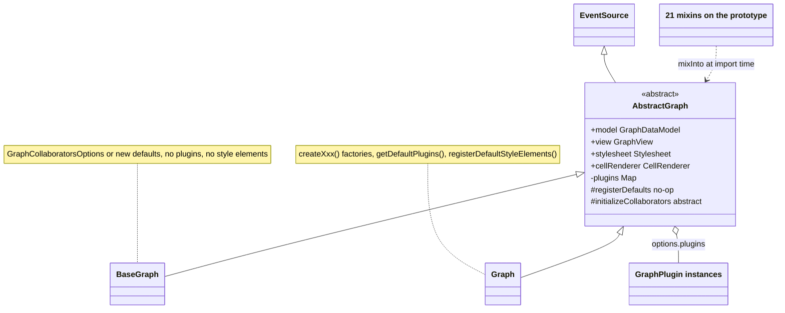
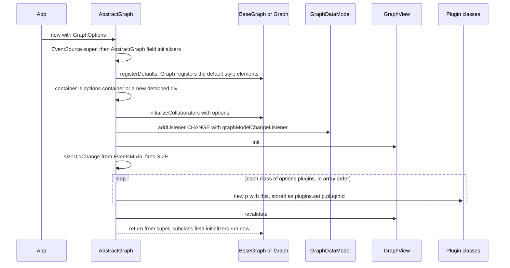

# Graph Lifecycle, Mixins and Plugins

- **Basis**: commit `a2e1bd3`, version `0.25.2`
- **Files**: `src/view/AbstractGraph.ts`, `src/view/Graph.ts`, `src/view/BaseGraph.ts`, `src/view/mixin/*` (21 mixin
  `.ts` + `.type.ts` pairs, `_graph-mixins-apply.ts`, `_graph-mixins-types.ts`, `_README.md`), `src/internal/*`,
  `src/view/plugin/index.ts`, the plugin and option types of `src/types.ts`, and the tests
  `__tests__/view/no-global-state-for-mixin-properties.ts`, `__tests__/view/Graph.test.ts`,
  `__tests__/view/BaseGraph.test.ts` (all paths relative to `packages/core`).

The graph object of TensorDiagram is one abstract class, `AbstractGraph`, whose prototype is completed at import time
by 21 mixins copied onto it, and whose instances are extended at construction time by plugins. Two concrete classes
choose how the collaborators (data model, view, renderer, stylesheet, selection model) and the built-ins are sourced:
`Graph` registers everything by default, `BaseGraph` registers nothing. This page specifies that construction and
destruction sequence, the mixin mechanics and their traps, the plugin contract, and the inventory of members that
still live directly in `AbstractGraph`, as input for moving them out.

## Purpose and scope

In scope: the class hierarchy `AbstractGraph` / `BaseGraph` / `Graph`, the constructor and `destroy()` sequences, how
mixins are applied and typed, the `GraphPlugin` contract and the list of built-in plugins, the model-change to view
pipeline owned by `AbstractGraph`, and the events fired by `AbstractGraph` and its mixins.

Out of scope: the internals of each plugin class (only `src/view/plugin/index.ts` and the `pluginId` and
`onDestroy` declarations were read), `GraphView`, `GraphDataModel`, `GraphSelectionModel`, `CellRenderer`,
`Stylesheet`, and the style registries, which are documented by their own specs. `src/internal/*` is covered only as
far as the graph depends on it, plus a one-line inventory.

## Concepts

| Concept | Definition | Where |
|---|---|---|
| Graph tier | `AbstractGraph` (abstract base, no defaults), `BaseGraph` (options-driven, no built-ins), `Graph` (factory methods, all built-ins) | `src/view/AbstractGraph.ts`, `src/view/BaseGraph.ts`, `src/view/Graph.ts` |
| Collaborators | `model`, `view`, `stylesheet`, `cellRenderer` fields and the `selectionModel` mixin field, assigned by `initializeCollaborators` | `AbstractGraph.initializeCollaborators` |
| Mixin | A plain object literal typed `Pick<AbstractGraph, ...>`, whose own keys are copied onto `AbstractGraph.prototype` | `src/view/mixin/*Mixin.ts` |
| Mixin type | A `declare module '../AbstractGraph.js'` augmentation of the `AbstractGraph` interface, merged with the class | `src/view/mixin/*Mixin.type.ts` |
| Plugin | A class with a static `pluginId` and an `onDestroy()` method, instantiated once per graph in the constructor | `GraphPluginConstructor`, `GraphPlugin` in `src/types.ts` |
| Built-in plugin id | One of the ten ids of the `BuiltinPluginId` union; any other string is accepted by `PluginId` | `src/types.ts` |
| Default plugins | The nine plugin classes returned by `getDefaultPlugins()`, used by `Graph` only | `src/view/plugin/index.ts` |
| Built-in style elements | Edge styles, perimeters, markers and shapes registered globally by `registerDefaultStyleElements()` | called from `Graph.registerDefaults` |
| Per-instance block | Object and array fields declared in `AbstractGraph` instead of a mixin, so that each graph gets its own value | `AbstractGraph` first field group |



## Contract

### Constructors

| Class | Signature | Plugins when omitted | Style elements | Collaborator sourcing |
|---|---|---|---|---|
| `AbstractGraph` | `constructor(options?: GraphOptions)` (abstract) | none | none, `registerDefaults()` is a no-op | delegated to `initializeCollaborators` |
| `BaseGraph` | inherits `constructor(options?: GraphOptions)` | none, `options?.plugins` is `undefined` | none | `options.cellRenderer ?? new CellRenderer()`, `options.model ?? new GraphDataModel()`, `options.selectionModel?.(this) ?? new GraphSelectionModel(this)`, `options.stylesheet ?? new Stylesheet()`, `options.view?.(this) ?? new GraphView(this)` |
| `Graph` | `constructor(container?, model?, plugins = getDefaultPlugins(), stylesheet?: Stylesheet \| null)` | `getDefaultPlugins()` | `registerDefaultStyleElements()` in `Graph.registerDefaults` | `createCellRenderer()`, `options.model ?? createGraphDataModel()`, `createSelectionModel()`, `options.stylesheet ?? createStylesheet()`, `createGraphView()` |

Option types, from `src/types.ts`:

| Type | Shape |
|---|---|
| `GraphOptions` | `{ container?: HTMLElement; plugins?: GraphPluginConstructor[] } & GraphCollaboratorsOptions` |
| `GraphCollaboratorsOptions` | `cellRenderer?: CellRenderer`, `model?: GraphDataModel`, `selectionModel?: (graph) => GraphSelectionModel`, `stylesheet?: Stylesheet`, `view?: (graph) => GraphView` |
| `GraphFoldingOptions` | `foldingEnabled`, `collapsedImage`, `expandedImage`, `collapseToPreferredSize`; the type of `AbstractGraph.options` |
| `GraphPluginConstructor` | `{ pluginId: PluginId; new (graph: AbstractGraph): GraphPlugin }` |
| `GraphPlugin` | `{ onDestroy: () => void }` |
| `BuiltinPluginId` | `'CellEditorHandler' \| 'ConnectionHandler' \| 'fit' \| 'image-bundle' \| 'PanningHandler' \| 'PopupMenuHandler' \| 'RubberBandHandler' \| 'SelectionCellsHandler' \| 'SelectionHandler' \| 'TooltipHandler'` |
| `PluginId` | `BuiltinPluginId \| (string & Record<never, never>)`, any string with completion for the built-ins |
| `MouseListenerSet` | `mouseDown`, `mouseMove`, `mouseUp`, each `(sender: EventSource, me: InternalMouseEvent) => void` |

`selectionModel` and `view` are factories rather than instances because both constructors take the graph.
`cellRenderer`, `model` and `stylesheet` are instances and may therefore be shared between graphs. `Graph` passes only
`container`, `model`, `plugins` and `stylesheet` to `super`, so its `cellRenderer`, selection model and view can only
be customised by overriding the factory methods. Its `stylesheet` parameter accepts `null`, converted to `undefined`.

### Constructor sequence of `AbstractGraph`



1. `EventSource` constructor, then the `AbstractGraph` field initializers: the per-instance block (`alternateEdgeStyle`,
   `cells`, `mouseListeners`, `multiplicities`, `options`, `pageFormat`, `warningImage`), the scalar settings, the
   `plugins` `Map` and every arrow-function property (`getContainer`, `getPlugin`, ...). The folding images and the
   warning image are built from `Client.imageBasePath` at this moment.
2. `this.registerDefaults()`, a protected hook. `Graph` calls `registerDefaultStyleElements()`, which registers into
   global registries.
3. `this.container = options?.container ?? document.createElement('div')`.
4. `this.initializeCollaborators(options)`, abstract. It must assign `cellRenderer`, `model`, the selection model (via
   `setSelectionModel`), `stylesheet` and `view`. Both concrete classes assign them in that order, the view last
   because `new GraphView(this)` receives the graph.
5. `graphModelChangeListener` is created and added to `getDataModel()` for `InternalEvent.CHANGE`; it calls
   `graphModelChanged(evt.getProperty('edit').changes)`.
6. `this.view.init()`.
7. `this.sizeDidChange()` (`EventsMixin`): computes the size from `getGraphBounds()`, `border`, the minimum
   container and graph sizes and the page settings, sets the minimum size of the SVG root, calls
   `updatePageBreaks`, fires `InternalEvent.SIZE`.
8. `options?.plugins?.forEach((p) => this.plugins.set(p.pluginId, new p(this)))`.
9. `this.view.revalidate()`.

### `destroy()` sequence

`AbstractGraph.destroy()` overrides `EventSource.destroy()` and is idempotent:

1. Returns at once when `destroyed` is already `true`, otherwise sets it to `true`.
2. Calls `onDestroy()` on every plugin, in insertion order of the `plugins` map.
3. `this.view.destroy()`.
4. When `model` and `graphModelChangeListener` are set, removes the listener from the model and nulls the field.
5. Sets `container` to `null` (typed non-null, hence a `@ts-expect-error`).
6. `super.destroy()`, which empties `eventListeners`.

`__tests__/view/BaseGraph.test.ts` pins steps 2, 5 and 6. Nothing else is released, see [Open items](#open-items).

### Model change pipeline

`graphModelChanged(changes)` calls `processChange` for each change, then `updateSelection()` (`SelectionMixin`),
`view.validate()` and `sizeDidChange()`. `processChange(change)` dispatches on the change class:

| Change | Effect |
|---|---|
| `RootChange` | `clearSelection()`, `setDefaultParent(null)`, `removeStateForCell(previous)`, resets `view.scale` and `view.translate` when `resetViewOnRootChange`, fires `InternalEvent.ROOT` |
| `ChildChange` | invalidates the child; if the new parent is missing, outside the model or collapsed, removes its states and calls `home()` when it was `view.currentRoot`; invalidates old and new parent when they differ |
| `TerminalChange`, `GeometryChange` | `view.invalidate(cell)`, for a `GeometryChange` only when the geometry really changed |
| `ValueChange` | `view.invalidate(cell, false, false)` |
| `StyleChange` | `view.invalidate(cell, true, true)` and marks the state `invalidStyle` |
| anything else with a `Cell` in `change.cell` | `removeStateForCell(change.cell)` |

### Mixins

`applyGraphMixins(AbstractGraph)` runs at module scope, at the end of `src/view/AbstractGraph.ts`. It calls
`mixInto(AbstractGraph)` (`src/internal/utils.ts`) for each mixin. `mixInto(dest)(mixin)` iterates
`Reflect.ownKeys(mixin)` and calls `Object.defineProperty(dest.prototype, key, { value, writable: true })`:

- the target is the **prototype**, so every instance shares one value per key until it assigns its own;
- `enumerable` and `configurable` are left at their default, `false`; the inline comment notes that, as a consequence,
  the codecs do not serialize mixin properties while they do serialize class fields;
- `writable: true`, so an assignment on an instance creates an own property that shadows the prototype one;
- errors are caught and logged with `log().error('Error while mixing', e)`, not rethrown.

Each mixin follows the same convention: `type PartialGraph = Pick<AbstractGraph, ...>` lists the members it uses but
does not define, `type PartialXxx = Pick<AbstractGraph, ...>` lists the members it defines, and the object literal is
typed with their intersection under a `// @ts-expect-error The properties of PartialGraph are defined elsewhere.`
comment, since the literal does not implement `PartialGraph`. `PortsMixin` has no `PartialGraph` and no
`@ts-expect-error`. `VertexMixin` and `EdgeMixin` add `insertVertex: (...args: any[]) => Cell` and
`insertEdge: (...args: any[]) => Cell` so a single implementation serves the overloads declared in their `.type.ts`.

The types come from `declare module '../AbstractGraph.js' { interface AbstractGraph { ... } }` in each `.type.ts`,
merged with the class declaration. `_graph-mixins-types.ts` imports the 21 `.type.ts` files, and `src/index.ts` imports
`_graph-mixins-types.js` first so that the augmentation is part of the published declarations. Per `_README.md`, mixin
objects are never exported outside `src/view/mixin/`.

| Mixin | Concern | Main members | Uses from elsewhere |
|---|---|---|---|
| `CellsMixin` | cell styles, add, remove, clone, resize, move, constrain, hit-testing, per-cell permissions | `cellsResizable` ... `extendParentsOnMove` flags, `getCellStyle`, `postProcessCellStyle`, `setCellStyles`, `alignCells`, `cloneCells`, `addCells`, `cellsAdded`, `removeCells`, `cellsRemoved`, `toggleCells`, `updateCellSize`, `getPreferredSizeForCell`, `resizeCells`, `cellsResized`, `moveCells`, `cellsMoved`, `constrainChild`, `getCellAt`, `getCells`, `intersects`, `isCellLocked`, `isCellMovable`, `getBoundingBoxFromGeometry` | Edge, Connections, Selection, Folding, Label, Snap, Vertex, Swimlane, Validation, Events (`getEventTolerance`); `AbstractGraph` (`getOverlap`, `getMaximumGraphBounds`, `isRecursiveResize`, `isExportEnabled`, `isImportEnabled`); `ImageBundlePlugin` via `getPlugin('image-bundle')` |
| `ConnectionsMixin` | connection constraints, connecting and disconnecting edges, connectability | `constrainChildren`, `constrainRelativeChildren`, `disconnectOnMove`, `cellsDisconnectable`, `getOutlineConstraint`, `getConnectionConstraint`, `setConnectionConstraint`, `getConnectionPoint`, `connectCell`, `cellConnected`, `disconnectGraph`, `isValidSource`, `isValidConnection`, `setConnectable`, `isConnectable` | Ports, Edge, Cells (`setCellStyles`, `isCellLocked`); `ConnectionHandler` via `getPlugin` |
| `DragDropMixin` | drop and edge-split flags | `dropEnabled`, `splitEnabled`, `autoScroll`, `autoExtend`, `isSplitTarget` | Validation (`getEdgeValidationError`) |
| `EdgeMixin` | edge creation, queries and reset | `resetEdgesOnResize`, `resetEdgesOnMove`, `resetEdgesOnConnect`, `connectableEdges`, `allowDanglingEdges`, `cloneInvalidEdges`, `edgeLabelsMovable`, `flipEdge`, `splitEdge`, `insertEdge`, `createEdge`, `addEdge`, `getEdges`, `getEdgesBetween`, `resetEdges`, `resetEdge` | Cells (`addCell`, `cellsAdded`, `cellsMoved`, `cloneCell`, `getChildCells`, `isValidAncestor`), Connections (`cellConnected`); `AbstractGraph.alternateEdgeStyle` |
| `EditingMixin` | in-place label editing | `cellsEditable`, `startEditing`, `startEditingAtCell`, `getEditingValue`, `stopEditing`, `labelChanged`, `cellLabelChanged`, `isEditing`, `isCellEditable` | Cells, Selection; `AbstractGraph.convertValueToString`; `CellEditorHandler` via `getPlugin` |
| `EventsMixin` | mouse dispatch loop, click and touch gestures, event predicates, `sizeDidChange` | touch and double-tap state fields, `tolerance`, `escape`, `click`, `dblClick`, `tapAndHold`, `addMouseListener`, `removeMouseListener`, `fireMouseEvent`, `isEventIgnored`, `sizeDidChange`, `isToggleEvent`, `isCloneEvent`, `getPointForEvent` | Cells, Selection, Editing, Swimlane, Snap, Panning, DragDrop (`isAutoScroll`, `isAutoExtend`), PageBreaks; `AbstractGraph` (`mouseListeners`, `paintBackground`, `scrollPointToVisible`, sizing and page getters); `TooltipHandler`, `PanningHandler`, `ConnectionHandler`, `CellEditorHandler` via `getPlugin` |
| `FoldingMixin` | collapse and expand | `collapseExpandResource`, `isFoldingEnabled`, `isCellFoldable`, `getFoldingImage`, `foldCells`, `cellsFolded`, `swapBounds`, `updateAlternateBounds` | Cells, Selection, Editing (`stopEditing`); `AbstractGraph.options` |
| `GroupingMixin` | group, ungroup, drill-down into groups | `groupCells`, `getBoundsForGroup`, `createGroupCell`, `ungroupCells`, `removeCellsFromParent`, `updateGroupBounds`, `enterGroup`, `exitGroup` | Cells, Edge (`addAllEdges`), Selection, Swimlane; `AbstractGraph` (`getDefaultParent`, `getCurrentRoot`, `isValidRoot`) |
| `LabelMixin` | label text and label flags | `labelsVisible`, `htmlLabels`, `getLabel`, `isHtmlLabel`, `isWrapping`, `isLabelClipped`, `isLabelMovable` | Cells, Edge and Vertex (`isEdgeLabelsMovable`, `isVertexLabelsMovable`); `AbstractGraph.convertValueToString` |
| `OrderMixin` | z-order | `orderCells`, `cellsOrdered` | Selection |
| `OverlaysMixin` | cell overlays and warnings | `addCellOverlay`, `getCellOverlays`, `removeCellOverlay`, `removeCellOverlays`, `clearCellOverlays`, `setCellWarning` | Selection; `AbstractGraph` (`getCellRenderer`, `getWarningImage`, `isEnabled`) |
| `PageBreaksMixin` | page break lines | `horizontalPageBreaks`, `verticalPageBreaks`, `updatePageBreaks` | `AbstractGraph` page getters, `getGraphBounds`, `getDialect` |
| `PanningMixin` | panning preview, scrolling cells and rectangles into view | `shiftPreview1`, `shiftPreview2`, `useScrollbarsForPanning`, `timerAutoScroll`, `allowAutoPanning`, `panDx`, `panDy`, `panGraph`, `scrollCellToVisible`, `scrollRectToVisible`, `setPanning` | `AbstractGraph.getContainer`; `PanningHandler`, `SelectionCellsHandler` via `getPlugin` |
| `PortsMixin` | ports | `portsEnabled`, `isPort`, `getTerminalForPort` | none |
| `SelectionMixin` | selection API over `GraphSelectionModel` | `selectionModel`, `getSelectionModel`, `setSelectionModel`, `getSelectionCells`, `setSelectionCells`, `selectRegion`, `selectCell`, `selectAll`, `selectCells`, `selectCellForEvent`, `getSelectionCellsForChanges`, `updateSelection` | Cells (`getCells`, `isCellSelectable`), Events (`isToggleEvent`); `AbstractGraph` (`getDefaultParent`, `getCurrentRoot`) |
| `SnapMixin` | grid | `snapTolerance`, `gridSize`, `gridEnabled`, `snap`, `snapDelta` | none beyond `getView` |
| `SwimlaneMixin` | swimlanes and drop targets | `swimlaneSelectionEnabled`, `swimlaneNesting`, `swimlaneIndicatorColorAttribute`, `getSwimlaneAt`, `getStartSize`, `getActualStartSize`, `isSwimlane`, `isValidDropTarget`, `getDropTarget` | Cells (`intersects`, `getCurrentCellStyle`), DragDrop (`isSplitEnabled`, `isSplitTarget`), Panning (`getPanDx`, `getPanDy`) |
| `TerminalMixin` | terminals | `isTerminalPointMovable`, `getOpposites` | none beyond `getView` |
| `ValidationMixin` | edge and graph validation | `validationAlert`, `isEdgeValid`, `getEdgeValidationError`, `validateEdge`, `validateGraph`, `getCellValidationError`, `validateCell` | Edge (`isAllowDanglingEdges`), Connections (`isValidConnection`), Overlays (`setCellWarning`); `AbstractGraph` (`multiplicities`, `isAllowLoops`, `isMultigraph`, `isValidRoot`, the two resource getters) |
| `VertexMixin` | vertex creation | `vertexLabelsMovable`, `allowNegativeCoordinates`, `insertVertex`, `createVertex`, `getChildVertices` | Cells (`addCell`, `getChildCells`) |
| `ZoomMixin` | zoom | `zoomFactor`, `keepSelectionVisibleOnZoom`, `centerZoom`, `zoomIn`, `zoomOut`, `zoomActual`, `zoomTo`, `zoom`, `zoomToRect` | Selection, Panning (`scrollRectToVisible`); `AbstractGraph.getContainer` |

### Plugins

A plugin class is a `GraphPluginConstructor`: a constructor taking the graph and a static `pluginId`. The instance only
has to implement `onDestroy()`. The graph stores instances in the private `plugins` map keyed by `pluginId`, and exposes
them through `getPlugin<T extends GraphPlugin>(id: PluginId): T | undefined`, an unchecked cast. There is no API to add
or remove a plugin after construction. Plugins that handle mouse input call `graph.addMouseListener(this)` in their
constructor and `graph.removeMouseListener(this)` in `onDestroy()`, so the dispatch order of `fireMouseEvent` is the
order of the `plugins` array.

| Class | `pluginId` | File | In `getDefaultPlugins()` | Purpose |
|---|---|---|---|---|
| `CellEditorHandler` | `'CellEditorHandler'` | `src/view/plugin/CellEditorHandler.ts` | yes, 1st | in-place label editor, driven by `EditingMixin` |
| `TooltipHandler` | `'TooltipHandler'` | `src/view/plugin/TooltipHandler.ts` | yes, 2nd | tooltips; mouse listener |
| `SelectionCellsHandler` | `'SelectionCellsHandler'` | `src/view/plugin/SelectionCellsHandler.ts` | yes, 3rd | handlers of the selected cells, refreshed by `PanningMixin.scrollRectToVisible`; mouse listener |
| `PopupMenuHandler` | `'PopupMenuHandler'` | `src/view/plugin/PopupMenuHandler.ts` | yes, 4th | popup menu; mouse listener |
| `ConnectionHandler` | `'ConnectionHandler'` | `src/view/plugin/ConnectionHandler.ts` | yes, 5th | creates connections, toggled by `setConnectable`; mouse listener |
| `SelectionHandler` | `'SelectionHandler'` | `src/view/plugin/SelectionHandler.ts` | yes, 6th | moves and clones cells; mouse listener |
| `PanningHandler` | `'PanningHandler'` | `src/view/plugin/PanningHandler.ts` | yes, 7th | panning, toggled by `setPanning`; mouse listener |
| `FitPlugin` | `'fit'` | `src/view/plugin/FitPlugin.ts` | yes, 8th | fits the graph into its container |
| `ImageBundlePlugin` | `'image-bundle'` | `src/view/plugin/ImageBundlePlugin.ts` | yes, 9th | image bundles resolved by `CellsMixin.postProcessCellStyle` |
| `RubberBandHandler` | `'RubberBandHandler'` | `src/view/plugin/RubberBandHandler.ts` | **no** | rubber-band selection of a region; exported and part of `BuiltinPluginId`, but opt-in even for `Graph`; mouse listener |

With the defaults, the mouse listeners run in this order: `TooltipHandler`, `SelectionCellsHandler`,
`PopupMenuHandler`, `ConnectionHandler`, `SelectionHandler`, `PanningHandler`. `getDefaultPlugins()` returns a new
array on each call, so it can be spread and extended.

### Members declared directly in `AbstractGraph`

Grouped by concern, with the mixins that read each group. This is the backlog of members still to move out.

| Group | Members | Consumed by |
|---|---|---|
| Collaborators and lifecycle | `container`, `destroyed`, `graphModelChangeListener`, `model`, `view`, `stylesheet`, `cellRenderer`, `plugins` (private), `renderHint`, `dialect`, `getContainer`, `getPlugin`, `getCellRenderer`, `getDialect`, `getDataModel`, `getView`, `getStylesheet`, `setStylesheet`, `batchUpdate`, `registerDefaults`, `initializeCollaborators`, `destroy` | every mixin (`getView`, `getDataModel`, `batchUpdate`); `getPlugin` by Cells, Connections, Editing, Events, Panning; `getContainer` by Events, Panning, Swimlane, Zoom; `getCellRenderer` by Cells, Overlays; `getDialect` by PageBreaks |
| Model change | `graphModelChanged`, `processChange`, `resetViewOnRootChange` | calls Selection (`updateSelection`, `clearSelection`), Cells (`removeStateForCell`), Events (`sizeDidChange`) |
| Per-instance block | `alternateEdgeStyle`, `cells`, `mouseListeners`, `multiplicities`, `options`, `pageFormat`, `warningImage`, `getWarningImage` | Edge, none, Events, Validation, Folding, PageBreaks and `getPreferredPageSize`, Overlays |
| Page | `pageVisible`, `pageBreaksVisible`, `pageBreakColor`, `pageBreakDashed`, `minPageBreakDist`, `preferPageSize`, `pageScale` and their getters, `getPreferredPageSize` | PageBreaks, Events (`sizeDidChange`) |
| Sizing | `minimumGraphSize`, `minimumContainerSize`, `maximumContainerSize`, `resizeContainer`, `border`, their getters and setters, `getBorderSizes`, `doResizeContainer` | Events (`sizeDidChange`); `center` uses `getBorder` |
| Scroll | `ignoreScrollbars`, `translateToScrollPosition`, their getters, `scrollPointToVisible` | Events (`fireMouseEvent`); `scrollPointToVisible` itself uses Panning (`isTimerAutoScroll`, `isAllowAutoPanning`, `getPanDx`, `getPanDy`) and `PanningHandler` |
| Display | `maximumGraphBounds`, `getMaximumGraphBounds`, `getGraphBounds`, `refresh`, `center` | Cells (`constrainChild`), PageBreaks, Events |
| Validation | `allowLoops`, `multigraph`, `alreadyConnectedResource`, `containsValidationErrorsResource` and their accessors | Validation |
| Drill-down | `defaultParent`, `getDefaultParent`, `setDefaultParent`, `getCurrentRoot`, `getTranslateForRoot`, `getChildOffsetForCell`, `home`, `isValidRoot` | Cells, Grouping, Selection, Swimlane, Validation |
| Labels and appearance | `convertValueToString`, `getLinkForCell`, `backgroundImage`, `getBackgroundImage`, `setBackgroundImage` | Editing, Label |
| Edge style | `defaultLoopStyle`, `isOrthogonal`, `keepEdgesInForeground`, `keepEdgesInBackground` | no mixin |
| Behaviour | `enabled`, `exportEnabled`, `importEnabled`, `recursiveResize`, `defaultOverlap`, their accessors, `getOverlap`, `isAllowOverlapParent` | Events and Overlays (`isEnabled`), Cells (the others) |
| Plugin shortcuts | `setTooltips` (`TooltipHandler`), `isConstrainedMoving` (read by `Editor`), `paintBackground` (compared by `EventsMixin.updateMouseEvent`) | Events |

### Arrow-function properties versus prototype methods

These members of `AbstractGraph` are class fields holding arrow functions, hence own properties of each instance,
bound to it: `getContainer`, `getPlugin`, `getCellRenderer`, `getDialect`, `isPageVisible`, `isPageBreaksVisible`,
`getPageBreakColor`, `isPageBreakDashed`, `getMinPageBreakDist`, `isPreferPageSize`, `getPageFormat`, `getPageScale`,
`isExportEnabled`, `isImportEnabled`, `isIgnoreScrollbars`, `isTranslateToScrollPosition`, `getMinimumGraphSize`,
`setMinimumGraphSize`, `getMinimumContainerSize`, `setMinimumContainerSize`, `getAlreadyConnectedResource`,
`getContainsValidationErrorsResource`. Every other method of `AbstractGraph`, and every mixin member, is on the
prototype. See [Traps](#traps) for what this means when overriding.

## Invariants

- The mixins are applied exactly once, when `src/view/AbstractGraph.ts` is evaluated, before any graph can be
  instantiated, whatever the import order. Importing any graph class pulls in all 21 mixins.
- Mixin data defaults are shared by all instances through the prototype until an instance assigns its own value. Only
  primitives, `null` or values reassigned before use may be declared in a mixin. Object and array defaults go in the
  per-instance block of `AbstractGraph`, and each of them has a case in
  `__tests__/view/no-global-state-for-mixin-properties.ts`, which runs for `Graph` (`Graph.test.ts`) and `BaseGraph`
  (`BaseGraph.test.ts`) and asserts that two graphs get distinct values and that mutating one does not leak.
- `selectionModel` is `null!` on the prototype (`SelectionMixin`) and is always shadowed by an own property assigned
  through `setSelectionModel` in `initializeCollaborators`. The same test pins that `GraphSelectionModel.cells` is not
  shared.
- After the constructor returns, `model`, `view`, `stylesheet`, `cellRenderer`, `selectionModel` and `container` are
  non-null, the model change listener is registered, and every plugin of `options.plugins` exists.
- A plugin constructor runs after `view.init()` and `sizeDidChange()`, before `view.revalidate()`. During its
  construction, `getPlugin` only finds the plugins listed before it.
- Mixin methods that change the model wrap their work in `batchUpdate`, and fire their `InternalEvent` inside it, so
  listeners run before the model `CHANGE` event and before `graphModelChanged` updates the view.
- `destroy()` is idempotent and calls each plugin's `onDestroy()` before destroying the view.
- `BaseGraph` never registers a plugin or a style element on its own. `Graph` always calls
  `registerDefaultStyleElements()`, even when given an empty plugin array.

## Workflows

**Production graph with explicit built-ins.** Register the needed style elements globally, then create a `BaseGraph`
with only the plugins used:

```typescript
const graph = new BaseGraph({
  container,
  plugins: [SelectionHandler, RubberBandHandler],
});
graph.insertVertex({ value: 'a vertex', position: [10, 20], size: [80, 40] });
```

**Custom collaborators.** On `BaseGraph`, pass `model`, `stylesheet` or `cellRenderer` instances and `view` or
`selectionModel` factories in `GraphOptions`. On `Graph`, subclass and override `createGraphView`,
`createSelectionModel`, `createCellRenderer`, `createGraphDataModel` or `createStylesheet`; only `model` and
`stylesheet` can also come from the constructor. On a direct subclass of `AbstractGraph`, implement
`initializeCollaborators` and assign all five collaborators.

**Custom plugin.** Declare `static readonly pluginId = 'my-plugin'`, take the graph in the constructor, register
listeners there, release them in `onDestroy()`. Retrieve it with `graph.getPlugin<MyPlugin>('my-plugin')`, which
returns `undefined` when it was not passed.

**Mouse event flow.** A DOM event reaches `EventsMixin.fireMouseEvent(evtName, me)`: ignored event sources hide the
tooltip and return, `updateMouseEvent` sets `graphX` and `graphY`, double-tap emulation may short-circuit into
`dblClick`, `isEventIgnored` filters duplicates and out-of-sequence events, then `FIRE_MOUSE_EVENT` is fired, auto
scroll is applied, each `mouseListeners` entry receives `mouseDown`, `mouseMove` or `mouseUp`, `click(me)` runs on
mouse up, tap-and-hold is armed, editing is stopped on mouse down outside the editor, and `consumeMouseEvent` runs.

**Model edit.** `insertVertex` (`VertexMixin`) builds the cell with `createVertex` and calls `addCell`, which falls
back to `getDefaultParent()` and runs `cellsAdded` inside `batchUpdate`. When the outermost update ends, the model fires
`CHANGE`, and `graphModelChanged` revalidates the view and calls `sizeDidChange`.

**Teardown.** Call `graph.destroy()` when the hosting component unmounts. Destroy a shared `GraphDataModel` separately,
the graph does not.

## Events

Events fired on the graph, an `EventSource`. Unless noted, mixin events are fired inside a `batchUpdate`.

| Event | Fired by | Properties |
|---|---|---|
| `ROOT` | `AbstractGraph.processChange` on `RootChange` | none |
| `REFRESH` | `AbstractGraph.refresh` | none |
| `SIZE` | `EventsMixin.sizeDidChange` | `bounds` |
| `ESCAPE` | `EventsMixin.escape` | `event` |
| `CLICK`, `DOUBLE_CLICK` | `EventsMixin.click`, `EventsMixin.dblClick` | `event`, `cell`; consuming them cancels the default selection or editing |
| `TAP_AND_HOLD` | `EventsMixin.tapAndHold` | `event`, `cell` |
| `FIRE_MOUSE_EVENT` | `EventsMixin.fireMouseEvent` | `eventName`, `event` |
| `GESTURE` | `EventsMixin.fireGestureEvent` | `event`, `cell` |
| `PAN` | `PanningMixin.panGraph`, not on the scrollbar path | none |
| `START_EDITING`, `EDITING_STARTED` | `EditingMixin.startEditingAtCell`, not in a batch | `cell`, `event` |
| `EDITING_STOPPED` | `EditingMixin.stopEditing`, not in a batch | `cancel` |
| `LABEL_CHANGED` | `EditingMixin.labelChanged` | `cell`, `value`, `old`, `event` |
| `ADD_CELLS` | `CellsMixin.addCells` | `cells`, `p`, `i`, `source`, `target` |
| `CELLS_ADDED` | `CellsMixin.cellsAdded` | `cells`, `parent`, `index`, `source`, `target`, `absolute` |
| `REMOVE_CELLS`, `CELLS_REMOVED` | `CellsMixin.removeCells`, `CellsMixin.cellsRemoved` | `cells`, `includeEdges`; `cells` |
| `TOGGLE_CELLS` | `CellsMixin.toggleCells` | `show`, `cells`, `includeEdges` |
| `UPDATE_CELL_SIZE` | `CellsMixin.updateCellSize` | `cell`, `ignoreChildren` |
| `RESIZE_CELLS`, `CELLS_RESIZED` | `CellsMixin.resizeCells`, `CellsMixin.cellsResized` | `cells`, `bounds`, `prev` |
| `MOVE_CELLS`, `CELLS_MOVED` | `CellsMixin.moveCells`, `CellsMixin.cellsMoved` | `cells`, `dx`, `dy`, `clone`, `target`, `event`; `cells`, `dx`, `dy`, `disconnect` |
| `ALIGN_CELLS` | `CellsMixin.alignCells` | `align`, `cells` |
| `CONNECT_CELL`, `CELL_CONNECTED` | `ConnectionsMixin.connectCell`, `ConnectionsMixin.cellConnected` | `edge`, `terminal`, `source`, `previous` |
| `FLIP_EDGE`, `SPLIT_EDGE` | `EdgeMixin.flipEdge`, `EdgeMixin.splitEdge` | `edge`; `edge`, `cells`, `newEdge`, `dx`, `dy` |
| `FOLD_CELLS`, `CELLS_FOLDED` | `FoldingMixin.foldCells`, `FoldingMixin.cellsFolded` | `collapse`, `recurse`, `cells` |
| `GROUP_CELLS`, `UNGROUP_CELLS`, `REMOVE_CELLS_FROM_PARENT` | `GroupingMixin` | `group`, `border`, `cells`; `cells`; `cells` |
| `ORDER_CELLS`, `CELLS_ORDERED` | `OrderMixin.orderCells`, `OrderMixin.cellsOrdered` | `back`, `cells` |
| `ADD_OVERLAY`, `REMOVE_OVERLAY` | `OverlaysMixin`, not in a batch | `cell`, `overlay` |

`EventsMixin.tapAndHold` also fires `InternalEvent.START` on the `ConnectionHandler` plugin. The graph listens to
`InternalEvent.CHANGE` on its model through `graphModelChangeListener`.

## Extension points

| Hook | Kind | Default |
|---|---|---|
| `registerDefaults()` | protected method, called first in the constructor | no-op; `Graph` registers the style elements |
| `initializeCollaborators(options)` | protected abstract method | `BaseGraph` reads options, `Graph` calls factories |
| `createCellRenderer`, `createGraphDataModel`, `createGraphView`, `createSelectionModel`, `createStylesheet` | `Graph` factory methods | new default instances |
| `GraphOptions.plugins` | constructor option | none on `BaseGraph`, `getDefaultPlugins()` on `Graph` |
| `GraphCollaboratorsOptions` | constructor options | defaults per collaborator |
| `addMouseListener(listener)` | `EventsMixin` method, appends a `MouseListenerSet` | plugins register themselves |
| Overridable hooks returning a fixed default | prototype methods | `isValidRoot`, `getTranslateForRoot`, `getChildOffsetForCell`, `isAllowOverlapParent`, `getLinkForCell`, `convertValueToString`, `isPort`, `getTerminalForPort`, `validateEdge`, `validateCell`, `isTransparentClickEvent`, `isIgnoreTerminalEvent`, `getCursorForCell`, `createGroupCell`, `createVertex`, `createEdge`, `getEventState`, `isCellFoldable`, `isCellSelectable` |

A mixin member is overridden on an instance by assignment (`graph.isPort = (cell) => ...`) or in a subclass as a
property initializer, never as a method, see [Traps](#traps).

## Traps

- **A mixin member cannot be overridden as a subclass method in TypeScript.** The `.type.ts` files declare most
  members as function-typed properties, so `override isCellLocked(cell: Cell): boolean { ... }` fails with TS2425
  ("defines instance member property, but extended class defines it as instance member function"). Override it as a
  property, `override isCellLocked = (cell: Cell): boolean => ...`. Checked with `tsc` on this commit.
- **The arrow-function members of `AbstractGraph` cannot be overridden as methods either.** They are own properties,
  so a subclass method would be shadowed at runtime, and TypeScript rejects it with TS2425; `super.getPageFormat()` is
  rejected with TS2855. A subclass property override is assigned only after `super()` returns, so the base arrow is
  still the one used during the constructor (`sizeDidChange`, plugin constructors, `view.revalidate`). In exchange
  these members are bound and can be passed as callbacks, whereas prototype methods such as `getView` or
  `getDataModel` lose `this` when detached.
- **Subclass field initializers run after the whole `AbstractGraph` constructor.** A field declared with an
  initializer in a subclass of `Graph` or `BaseGraph` is still `undefined` inside `registerDefaults`,
  `initializeCollaborators`, the factory methods and the plugin constructors. Fields declared with `!` and no
  initializer are not reset, because the build targets ES2020 without `useDefineForClassFields`.
- **Object or array defaults in a mixin are shared by every graph.** `mixInto` copies values, not factories. Put them
  in the per-instance block and add a case to `__tests__/view/no-global-state-for-mixin-properties.ts`. Lazily created
  values, like `PageBreaksMixin.horizontalPageBreaks` or `PanningMixin.shiftPreview1`, are safe only because they are
  assigned on the instance before being mutated.
- **Mixin properties are not enumerable**, so they are skipped by `for...in`, `Object.keys` and the codecs, unlike the
  class fields of `AbstractGraph`.
- **Two plugins with the same `pluginId` silently replace each other in the map.** The first instance stays alive, its
  mouse listener stays registered, and `destroy()` never calls its `onDestroy()`.
- **`getPlugin` is an unchecked cast** and returns `undefined` when the plugin was not passed. Every caller in
  `AbstractGraph` and the mixins guards against `undefined`: without their plugin, `setConnectable`, `setPanning` and
  `setTooltips` do nothing, `isConnectable` returns `false`, `scrollPointToVisible` skips auto panning, and
  `startEditingAtCell` still fires `START_EDITING` and `EDITING_STARTED` although no editor opens.
- **`RubberBandHandler` is a built-in id but not a default plugin**, also on `Graph`: pass
  `[...getDefaultPlugins(), RubberBandHandler]` to get rubber-band selection.
- **The class JSDoc of `AbstractGraph` is stale on the listener order.** It lists tooltip, panning, connection and
  selection handlers; the real order is the plugin array order given in [Plugins](#plugins).
- **`Graph.registerDefaults` mutates global registries**, so creating one `Graph` also makes the default style elements
  available to every `BaseGraph` created afterwards in the same page.
- **`ADD_CELLS` names its properties `p` and `i`**, from object shorthand in `CellsMixin.addCells`, whereas
  `CELLS_ADDED` uses `parent` and `index`.
- **`cellsDisconnectable` is defined in both `CellsMixin` and `ConnectionsMixin`**, both `true`. The later mixin in
  `applyGraphMixins` wins; changing one default alone would have no effect. The list in `applyGraphMixins` is said to be
  alphabetic but places `PageBreaksMixin` before `OverlaysMixin`.
- **`mouseListeners` is declared twice**, as an `AbstractGraph` field and in `EventsMixin.type.ts`; the runtime value
  is the field, `EventsMixin` defines no default for it.
- **`SelectionMixin.type.ts` declares `doneResource`, `updatingSelectionResource` and `singleSelection`**, which no
  mixin defines: they read `undefined` on the graph. The live values are on `GraphSelectionModel`.

## Open items

- `AbstractGraph.destroy()` does not clear the `plugins` map, so `getPlugin` still returns destroyed plugins; does not
  destroy the selection model or the data model; does not clear `mouseListeners` (plugins remove their own); does not
  cancel `tapAndHoldThread`; does not remove the gesture redirect listeners set by `EventsMixin.isEventIgnored`. Whether
  `view.destroy()` covers the page break shapes and the panning preview divs is outside this slice.
- `AbstractGraph.cells` is in the per-instance block and tested, but no file under `src` reads `graph.cells`.
- `OrderMixin.orderCells` has a dead branch: `sortCells(this.getSelectionCells(), true)` runs only when
  `getSelectionCells()` returned a falsy value, which never happens, so the cells are never sorted.
- In `EventsMixin.fireMouseEvent`, the `evtName === InternalEvent.MOUSE_UP` test sits inside the
  `evtName === InternalEvent.MOUSE_DOWN` branch and is unreachable.
- `EventsMixin.sizeDidChange` belongs to sizing, not events; its own comment says relocating it to `AbstractGraph` is
  the natural next step, since the constructor, `graphModelChanged` and `refresh` all call it.
- The mixin-to-plugin conversion is tracked by issue #762 (comments in `src/view/AbstractGraph.ts` and
  `src/internal/utils.ts`); the per-instance block refers to pull requests #751 and #879.
- `src/internal/*`, for completeness: `BaseRegistry` (base of the style registries), `shallowCopy`, `isI18nEnabled` and
  `translate`, `getElapseMillisecondsMessage`, `UserObject`, and `doEval`, `isElement`, `isNullish`, `log`, `mixInto`,
  `matchBinaryMask`. None is exported from `src/index.ts`.
