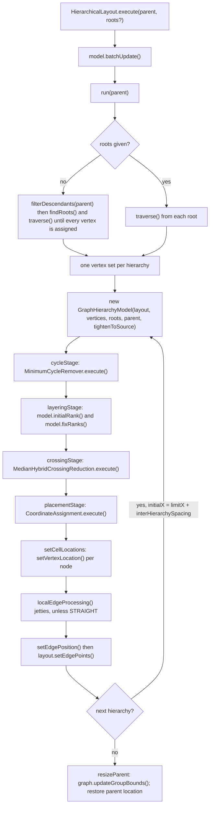
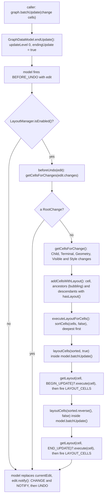

# Layout

- **Basis**: commit `a2e1bd3`, version `0.25.2`
- **Files**: `src/view/layout/GraphLayout.ts`, `src/view/layout/LayoutManager.ts`, `src/view/layout/SwimlaneManager.ts`,
  `src/view/layout/CircleLayout.ts`, `src/view/layout/CompactTreeLayout.ts`, `src/view/layout/CompositeLayout.ts`,
  `src/view/layout/EdgeLabelLayout.ts`, `src/view/layout/FastOrganicLayout.ts`, `src/view/layout/HierarchicalLayout.ts`,
  `src/view/layout/ParallelEdgeLayout.ts`, `src/view/layout/PartitionLayout.ts`, `src/view/layout/RadialTreeLayout.ts`,
  `src/view/layout/StackLayout.ts`, `src/view/layout/SwimlaneLayout.ts`, `src/view/layout/types.ts`,
  `src/view/layout/datatypes/*.ts`, `src/view/layout/hierarchical/*.ts`, `src/view/layout/util/*.ts`,
  `src/view/mixin/SwimlaneMixin.ts`, `src/view/mixin/SwimlaneMixin.type.ts` (all paths relative to `packages/core`)

The layout package computes positions of vertices and control points of edges for the children of one parent cell and
writes them back to the data model as geometry and style changes. It contains a small base class (`GraphLayout`), eleven
concrete layouts ported from mxGraph, the Sugiyama pipeline used by the two hierarchical layouts, and two event-driven
managers: `LayoutManager`, which re-runs layouts after every model transaction, and `SwimlaneManager`, which keeps the
sizes of sibling swimlanes in sync. Nothing here touches the DOM except through the graph view (cell states, label
bounding boxes, container size). The code is a close port of mxGraph, including most of its quirks, which are listed in
[Traps](#traps).

## Purpose and scope

In scope:

- the `GraphLayout` base contract and every concrete layout under `src/view/layout/`;
- the hierarchical pipeline under `src/view/layout/hierarchical/`, its internal datatypes under
  `src/view/layout/datatypes/` and the sorters under `src/view/layout/util/`;
- `LayoutManager` and `SwimlaneManager`, the two classes that drive layouts from graph and model events;
- the parts of `SwimlaneMixin` that the swimlane layout and manager depend on (`isSwimlane`, `getStartSize`).

Out of scope: edge styles applied at render time (`EdgeStyleRegistry`, `noEdgeStyle` handling in the view), the
`GroupingMixin.updateGroupBounds` implementation that several layouts call, the `Editor` wiring of the managers, and the
tree traversal helper `findTreeRoots` in `src/util/treeTraversal.ts`. They are referenced only where a layout depends on
them.

Every class of the slice is public, exported from `src/index.ts`, except the traversal argument interfaces of
`src/view/layout/types.ts`, the two sorters of `src/view/layout/util/`, and the `_mxCompactTreeLayoutNode` /
`_mxCompactTreeLayoutLine` interfaces of `CompactTreeLayout.ts`. `SwimlaneMixin` is not exported as such; its members
are mixed into `AbstractGraph`.

## Concepts

| Concept | Meaning in this code |
|---|---|
| Layout parent | The cell passed to `execute(parent)`. Layouts read its children; tree, hierarchical and swimlane layouts store it in `GraphLayout.parent` and express nested coordinates relative to it. |
| Ignored vertex / edge | A child that `isVertexIgnored` / `isEdgeIgnored` rejects. Base rules: not a vertex or not visible; not an edge, not visible or missing a terminal. Tree and organic layouts also ignore unconnected vertices. |
| Movable vertex | `isVertexMovable(cell)`, delegating to `graph.isCellMovable`. Non-movable vertices keep their geometry but may still be counted. |
| Bounding box | When `useBoundingBox` is `true` (default), `getVertexBounds` and `setVertexLocation` enlarge the vertex bounds with the label `state.text.boundingBox`, which only exists once the view has validated the cell. |
| Port | In the hierarchical layouts, a child whose geometry is `relative`. Edges attached to a port are treated as attached to the port's parent (`HierarchicalLayout.isPort`, `getVisibleTerminal`). |
| Hierarchy | A weakly connected set of vertices found by a directed traversal from roots. `HierarchicalLayout` lays out each hierarchy separately and places them side by side. |
| Rank | An integer layer of the Sugiyama layout. Rank `0` holds the sinks; `model.maxRank` holds the roots. In `north` orientation the highest rank is drawn at the top. |
| Virtual node | A `GraphHierarchyEdge` spanning more than one rank occupies a slot on every intermediate rank. Its per-rank values are stored in arrays indexed by `rank - minRank - 1`. |
| General purpose variable | `getGeneralPurposeVariable` / `setGeneralPurposeVariable`, the per-rank `temp` slot used first for the order inside a rank (crossing reduction) and then for the x coordinate (coordinate assignment). |
| Jetty | The short first and last segment of a hierarchical edge, offset from the vertex border so parallel edges fan out. Computed in `CoordinateAssignment.localEdgeProcessing`. |
| Swimlane | A non-edge cell, not a direct child of the root, whose current style has `shape: 'swimlane'` (`SwimlaneMixin.isSwimlane`). Its start size, the title band, comes from `getStartSize`: `style.startSize ?? StyleDefaultsConfig.startSize`, applied to the height when `style.horizontal ?? true`, otherwise to the width. |
| Managed layout | A layout returned by `LayoutManager.getLayout(cell, eventName)` for a cell; the manager runs it on that cell after model changes. |

## Contract

### GraphLayout base class

`GraphLayout` in `src/view/layout/GraphLayout.ts` has a concrete, mostly no-op implementation; subclasses override
`execute` and optionally `moveCell`, `resizeCell` and the filters.

| Member | Signature | Behaviour |
|---|---|---|
| `constructor` | `(graph: AbstractGraph)` | Stores `graph`. No listener, no model access. |
| `graph` / `getGraph()` | `AbstractGraph` | The graph whose model the layout writes to. |
| `parent` | `Cell \| null`, default `null` | Layout parent. Only `HierarchicalLayout`, `SwimlaneLayout`, `CompactTreeLayout` and `RadialTreeLayout` set it in `execute`. |
| `useBoundingBox` | `boolean`, default `true` | Include label bounds in vertex bounds. |
| `execute` | `(parent: Cell): void` | No-op in the base. Subclasses lay out the children of `parent`. Some subclasses add a second parameter (roots, swimlanes, edges). |
| `moveCell` | `(cell, x, y): void` | No-op. Called by `LayoutManager` when a child of a managed parent is dropped at screen point `(x, y)`; `StackLayout` and `PartitionLayout` reorder the child. |
| `resizeCell` | `(cell, bounds: Rectangle, prev?: Cell)` | No-op, and no built-in layout overrides it. |
| `getConstraint` | `(key, cell, edge?, source?): any` | Returns `graph.getCurrentCellStyle(cell)[key]`; `edge` and `source` are ignored. |
| `traverse` | `({ vertex, directed, func, edge, visited })` | Depth-first walk over visible terminals (`graph.view.getVisibleTerminal`), visiting each vertex once; `func(vertex, edge)` returning `false` stops the walk below that vertex. `directed` defaults to `true`. |
| `isAncestor` | `(parent, child, traverseAncestors?)` | Without `traverseAncestors`, direct child test only; with it, strict ancestor test. |
| `isVertexMovable` | `(cell): boolean` | `graph.isCellMovable(cell)`. |
| `isVertexIgnored` | `(vertex): boolean` | `!vertex.isVertex() \|\| !vertex.isVisible()`. |
| `isEdgeIgnored` | `(edge): boolean` | Not an edge, not visible, or either terminal missing. |
| `setEdgeStyleEnabled` | `(edge, value)` | `graph.setCellStyles('noEdgeStyle', !value, [edge])`, a `StyleChange`. |
| `setOrthogonalEdge` | `(edge, value)` | `graph.setCellStyles('orthogonal', value, [edge])`. |
| `getParentOffset` | `(parent): Point` | Sum of geometry `x`/`y` from `parent` up to, excluding, `this.parent`; `(0, 0)` when `parent` is `this.parent` or not below it. |
| `setEdgePoints` | `(edge, points \| null)` | Clones the edge geometry (or creates a relative one), translates the points by the parent offset when `this.parent` is set, and calls `model.setGeometry`. Mutates the passed points. |
| `setVertexLocation` | `(cell, x, y): Rectangle \| null` | Shifts for label overflow (when `useBoundingBox`), converts to the cell parent's coordinates, and writes a cloned geometry only if `x` or `y` changed. Returns the bounds at the requested location. |
| `getVertexBounds` | `(cell): Rectangle` | Geometry bounds, widened by the label box when `useBoundingBox`, translated into the layout parent's coordinates. |
| `arrangeGroups` | `(cells, border, topBorder, rightBorder, bottomBorder, leftBorder)` | `graph.updateGroupBounds(cells, border, true, ...)`, i.e. with `moveGroup` set. |

Transaction rule: every built-in `execute` writes inside a model transaction (`graph.batchUpdate`, `model.batchUpdate`
or `beginUpdate`/`endUpdate` in `try`/`finally`), so a single call produces at most one undoable edit when not nested.
Callers should still wrap `execute` in `graph.batchUpdate`, as the tests do, so the layout joins the surrounding edit;
this is mandatory for `SwimlaneLayout`, see [Traps](#traps). A custom layout must follow the same rule: all
`setGeometry` / `setCellStyles` calls inside one batch, reads of geometry before or inside it.

### Layout catalog

| Layout | Algorithm | Constructor and main options (defaults) | Expects | Edges |
|---|---|---|---|---|
| `CircleLayout` | Places the non-ignored children on a circle of radius `max(count * maxDimension / PI, radius)`, starting at the bounding top-left. | `(graph, radius = 100)`; `moveCircle = false`, `x0 = 0`, `y0 = 0`, `resetEdges = true`, `disableEdgeStyle = true`. | Any children; connections are not used. | Child edges of the parent: `graph.resetEdge` and `noEdgeStyle`. |
| `CompactTreeLayout` | Moen compact tree: depth-first tree build, contour merge per subtree, then horizontal or vertical placement. | `(graph, horizontal = true, invert = false)`; `levelDistance = 10`, `nodeDistance = 20`, `resizeParent = true`, `groupPadding = 10` (top/right/bottom/left `0`), `maintainParentLocation = false`, `moveTree = false`, `resetEdges = true`, `edgeRouting = true`, `sortEdges = false`, `alignRanks = false`, `prefHozEdgeSep = 5`, `prefVertEdgeOff = 4`, `minEdgeJetty = 8`. `execute(parent, root?)`. | A tree. Root is `root`, else `parent` if it has outgoing edges, else the first `findTreeRoots` result with outgoing edges. Unconnected vertices are ignored. | Traversed edges: points cleared; with `edgeRouting`, `noEdgeStyle` set and a 3-point orthogonal route written. |
| `CompositeLayout` | Runs `layouts` in order inside one `graph.batchUpdate`. | `(graph, layouts, master?)`. `moveCell` goes to `master ?? layouts[0]`. | Whatever the composed layouts expect. | Whatever the composed layouts do. |
| `EdgeLabelLayout` | For each edge label box intersecting a vertex state, shifts the edge `geometry.offset` along the shorter axis to clear it. | `(graph, radius)`; `radius` is unused. | A validated view: works on `CellState`s and `state.text.boundingBox`. | Only `geometry.offset` of edges. |
| `FastOrganicLayout` | Force-directed: pairwise repulsion, attraction along edges, displacement capped by a linearly decreasing temperature. | `(graph)`; `forceConstant = 50`, `minDistanceLimit = 2`, `maxDistanceLimit = 500`, `initialTemp = 200`, `maxIterations = 0` (auto `20 * sqrt(n)`), `useInputOrigin = true`, `resetEdges = true`, `disableEdgeStyle = true`, `allowedToRun = true`. | A connected graph; vertices without connections are ignored. | Connections of laid-out vertices: `resetEdge` and `noEdgeStyle`. |
| `HierarchicalLayout` | Sugiyama: hierarchy split, cycle removal, longest-path ranking, median/transpose crossing reduction, coordinate assignment, edge routing. | `(graph, orientation = 'north', deterministic = true)`; `intraCellSpacing = 30`, `interRankCellSpacing = 100`, `interHierarchySpacing = 60`, `parallelEdgeSpacing = 10`, `fineTuning = true`, `tightenToSource = true`, `disableEdgeStyle = true`, `traverseAncestors = true`, `edgeStyle = HierarchicalEdgeStyle.POLYLINE`, `resizeParent = false`, `moveParent = false`, `parentBorder = 0`, `maintainParentLocation = false`. `execute(parent, roots?)`. | Directed graph, cycles allowed. Nested descendants are included when `traverseAncestors`. | Every laid-out edge: `resetEdge`, and with `disableEdgeStyle`, `noEdgeStyle` plus `orthogonal = true`; control points written. |
| `ParallelEdgeLayout` | Groups edges by unordered pair of visible terminals and spreads each group around the midpoint, perpendicular to the terminal centres; loops are stacked to the right of the vertex. | `(graph)`; `spacing = 20`, `checkOverlap = false`. `execute(parent, cells?)` restricts to `cells` when given. | Edges whose terminals share the same coordinate space (geometry coordinates are compared directly). | One control point per parallel edge, if `graph.isCellMovable(edge)`. |
| `PartitionLayout` | Divides the parent area into equal slots, one per movable child, separated by `spacing` and inset by `border` and the swimlane start size. | `(graph, horizontal = true, spacing = 0, border = 0)`; `resizeVertices = true`. | Parent with geometry, or a layer without geometry / the current root, where the container size is used. | Untouched. |
| `RadialTreeLayout` | Runs `CompactTreeLayout` vertically, then maps each tree row to a circle around the root, angle from the row's horizontal extent, parents pulled towards the mean angle of their children. | `(graph)`; `levelDistance = 120`, `nodeDistance = 10`, `sortEdges = false`; `angleOffset`, `autoRadius`, `rootx`, `rooty` exist but are unused. Forces `useBoundingBox = false` and `edgeRouting = false`. `execute(parent, root?)`. | A tree with a findable root. | Traversed edges: points cleared (`resetEdges`). |
| `StackLayout` | Stacks movable children in child order along x (`horizontal`) or y, optionally wrapping into new rows/columns. | `(graph, horizontal = true, spacing = 0, x0 = 0, y0 = 0, border = 0)`; `marginTop/Left/Right/Bottom = 0`, `keepFirstLocation = false`, `fill = false`, `resizeParent = false`, `resizeParentMax = false`, `resizeLast = false`, `wrap = null`, `borderCollapse = true`, `allowGaps = false`, `gridSize = 0`. | Any children. Swimlane parents: start size from `style.startSize ?? DEFAULT_STARTSIZE`. | Untouched. |
| `SwimlaneLayout` | Sugiyama variant over an ordered list of lanes: each lane gets its own band of ranks, edges between lanes always point to higher lane indices. | `(graph, orientation \| null, deterministic = true)`; same spacing options as `HierarchicalLayout`, plus `dummyVertexWidth = 50`, `parentBorder = 30`. `execute(parent, swimlanes)`. | Ordered swimlane cells whose direct children are the vertices. | Same as `HierarchicalLayout`. |

### Hierarchical pipeline



Stage contract: `HierarchicalLayoutStage` in `src/view/layout/hierarchical/HierarchicalLayoutStage.ts` is an abstract
class with a single `abstract execute(parent: any): void`. Stages receive the layout in their constructor and read the
current model through `layout.getDataModel()`; they communicate only by mutating that model (node and edge
`temp`, `x`, `y`, `minRank`, `maxRank`, `model.ranks`). `HierarchicalLayout` instantiates each stage per hierarchy in
`cycleStage`, `crossingStage` and `placementStage`; ranking is not a stage class but `layeringStage()` calling the
model.

| Step | Owner | What it does |
|---|---|---|
| Vertex collection | `HierarchicalLayout.filterDescendants` | Collects visible vertices below `parent` (all depths when `traverseAncestors`, children only otherwise), skipping ports. |
| Edge set | `HierarchicalLayout.getEdges` (cached per run in `edgesCache`) | Edges of the cell, of its ports, and of its children when collapsed or hidden, kept when the other visible terminal is under `this.parent` (`isAncestor(..., traverseAncestors)`), plus self loops. |
| Roots | `findRoots` | Vertices with no incoming and at least one outgoing edge; if none, the vertex with the largest `fanOut - fanIn`. |
| Hierarchies | `traverse` | Directed DFS; follows an edge only if outgoing edges to that neighbour are at least as many as incoming ones; merges components that meet. |
| Internal model | `GraphHierarchyModel` constructor, `createInternalCells` | One `GraphHierarchyNode` per vertex, one `GraphHierarchyEdge` per vertex pair grouping all parallel edges in the majority direction; self loops dropped. Calls `graph.resetEdge` and, with `disableEdgeStyle`, `setEdgeStyleEnabled(edge, false)` and `setOrthogonalEdge(edge, true)` on every grouped edge. |
| Cycle removal | `MinimumCycleRemover.execute` | DFS from roots tracking ancestors with `hashCode` prefix arrays; an edge to an ancestor is `invert()`ed (sets `isReversed`) and moved between `connectsAsSource` / `connectsAsTarget`. A second DFS starts from every node the first one missed. |
| Ranking | `GraphHierarchyModel.initialRank` | Longest-path layering from the roots with a work queue, edges stamped `5270620` once scanned; ranks normalised so sinks are on rank `0`; roots then pulled down to one rank above their highest target. |
| Rank lists | `GraphHierarchyModel.fixRanks` | Builds `model.ranks[0..maxRank]` in DFS order from the roots and inserts every edge spanning more than one rank as a virtual node on each intermediate rank. |
| Crossing reduction | `MedianHybridCrossingReduction.execute` | Up to `maxIterations = 24` rounds, stopping after `maxNoImprovementIterations = 2` rounds without gain or at zero crossings. Each round: `weightedMedian` (sweep direction alternates), then `transpose` (adjacent swaps, at most 10 passes, ties swapped on odd rounds). Crossings counted per rank pair with an accumulator tree in `calculateRankCrossing`. The best order is written back to `model.ranks`. |
| Coordinates | `CoordinateAssignment.execute` | `initialCoords` (rank y values and widths from `calculateWidestRank`, ranks centred on the widest); with `fineTuning`, `minNode` (queue-based median relaxation, tolerance 1, at most `10 * nodes` pops) then `maxIterations = 8` rounds of `medianPos` + `minNode` keeping the round with the smallest `currentXDelta`, and `minPath` straightening virtual-node chains. |
| Placement and routing | `CoordinateAssignment.setCellLocations` | Writes vertex positions through `layout.setVertexLocation` (x and y swapped for `west`/`east`), computes jetties for `ORTHOGONAL`, `POLYLINE` and `CURVE`, then `setEdgePosition` writes per real edge: first jetty, two points per intermediate rank channel, last jetty, with `parallelEdgeSpacing` alternating offsets for grouped edges. `CURVE` adds one extra point next to each jetty. Ports use the port's state x or its relative geometry. `processReversedEdge(edge, realEdge)` is an empty hook called for reversed edges. |

`HierarchicalEdgeStyle` in `src/view/layout/datatypes/HierarchicalEdgeStyle.ts` is a plain object, not an enum:
`ORTHOGONAL: 1`, `POLYLINE: 2`, `STRAIGHT: 3`, `CURVE: 4`. It only changes which control points `CoordinateAssignment`
writes; it does not set any edge style on the cells. The cells always receive `noEdgeStyle` and `orthogonal = true`
when `disableEdgeStyle` is on, whatever the chosen value.

Datatypes:

| Class | Role |
|---|---|
| `GraphAbstractHierarchyCell` | Abstract base, `extends Cell`. Holds `minRank`, `maxRank` (default `-1`), `x[]`, `y[]`, `temp[]`, `width`, `height`, `swimlaneIndex`, cached neighbour lists. `setX` / `getX` / `setY` index `[0]` for nodes and `[layer - minRank - 1]` for edges. |
| `GraphHierarchyNode` | Wraps one vertex: `cell`, `id = ObjectIdentity.get(cell)`, `connectsAsSource`, `connectsAsTarget`, `hashCode` for ancestor tests (`isAncestor` is a prefix comparison of `hashCode`). |
| `GraphHierarchyEdge` | Wraps one or more parallel real edges: `edges`, `ids`, `source`, `target`, `isReversed`, `invert()`, `getCoreCell()`. |
| `MedianCellSorter` | `{ medianValue, cell }` with an instance `compare`, used by `medianRank`. |
| `WeightedCellSorter` | `{ weightedValue, nudge, visited, rankIndex, cell }` with a static `compare`, used by `CoordinateAssignment` and `CompactTreeLayout.processNodeOutgoing`. |

### SwimlaneLayout versus HierarchicalLayout

`SwimlaneLayout` reuses `MedianHybridCrossingReduction` and `CoordinateAssignment` but replaces the model and the cycle
stage.

| Aspect | `HierarchicalLayout` + `GraphHierarchyModel` + `MinimumCycleRemover` | `SwimlaneLayout` + `SwimlaneModel` + `SwimlaneOrdering` |
|---|---|---|
| Input | `execute(parent, roots?)` | `execute(parent, swimlanes)`; returns at once when `swimlanes` is empty; `parent` falls back to the first lane's parent. |
| Empty input | Nothing to lay out. | Inserts a dummy vertex (`dummyVertexWidth` x `0`) in every empty lane before the transaction, removes them with `graph.removeCells` at the end. |
| Vertices | Visible descendants of `parent`. | Visible descendants of the lanes, excluding direct children of `parent`. |
| Roots | Global `findRoots`. | `findRoots(lane, set)` lane by lane in order, counting only edges inside the lane. |
| Traversal | Directed with the net-direction rule. | Follows an edge when the other vertex is in a later lane, or in the same lane and the edge is outgoing; edges to vertices outside every lane are skipped. |
| Models | One per hierarchy, placed side by side. | One model for all vertices, one `placementStage(0, parent)`. |
| Lane of a node | Not used. | `swimlaneIndex` = index of the node's direct parent in `swimlanes`, `-1` otherwise. |
| Cycle stage | Inverts edges to DFS ancestors, plus a second pass over unvisited nodes. | Inverts edges to ancestors in the same lane, and edges going from a higher to a lower lane index. No second pass. |
| Ranking | Longest path, normalised, roots tightened. | `maxChainDfs` computes the longest intra-lane chain per lane (`ranksPerGroup`); each lane gets a disjoint rank band, lane 0 on top; a node's rank is clamped to its lane's upper rank. No normalisation, no tightening. |
| Edge set | `isAncestor(this.parent, other, traverseAncestors)` | `graph.isValidAncestor(other, this.parent, traverseAncestors)` |
| Lane geometry | n/a | Lanes are not resized or moved: `SwimlaneLayout.updateGroupBounds()` exists but nothing calls it. |

### LayoutManager

`LayoutManager` in `src/view/layout/LayoutManager.ts` extends `EventSource`. It is not registered with the graph: the
caller creates it, overrides `getLayout`, and must call `destroy()`.

| Member | Behaviour |
|---|---|
| `constructor(graph)` | Creates `undoHandler`, `moveHandler`, `resizeHandler`, then `setGraph(graph)`. |
| `setGraph(graph \| null)` | Removes the handlers from the previous graph and model, then adds `BEFORE_UNDO` on `graph.getDataModel()`, `MOVE_CELLS` and `RESIZE_CELLS` on the graph. |
| `getLayout(cell, eventName)` | Returns `null`. Override it. `eventName` is `InternalEvent.BEGIN_UPDATE` (first pass), `END_UPDATE` (second pass), `MOVE_CELLS`, `RESIZE_CELLS`, or `LAYOUT_CELLS` when called from `hasLayout`. |
| `hasLayout(cell)` | `!!getLayout(cell, LAYOUT_CELLS)`. Called for every visited ancestor and descendant, so it must be cheap. |
| `enabled` / `isEnabled` / `setEnabled` | Default `true`. All three handlers do nothing when disabled. |
| `bubbling` / `isBubbling` / `setBubbling` | Default `true`. When on, every ancestor of a changed cell that has a layout is scheduled, not only the nearest. |
| `beforeUndo(edit)` | `executeLayoutForCells(getCellsForChanges(edit.changes))`. |
| `getCellsForChanges(changes)` | Concatenates `getCellsForChange` over all changes; returns `[]` as soon as one change is a `RootChange`. |
| `getCellsForChange(change)` | `ChildChange`: `child` and `previous` (old parent). `TerminalChange`, `GeometryChange`, `VisibleChange`, `StyleChange`: `cell`. Anything else, `ValueChange` and `CollapseChange` included: none. Each cell goes through `addCellsWithLayout`. |
| `addCellsWithLayout(cell, result)` | `addAncestorsWithLayout` (the cell itself and, when bubbling, every ancestor with a layout) then `addDescendantsWithLayout` (children with a layout, recursively, only below a cell that has one). |
| `executeLayoutForCells(cells)` | `sortCells(cells, false)` (descending cell path, deepest first), `layoutCells(sorted, true)`, then `layoutCells(sorted.reverse(), false)`. |
| `layoutCells(cells, bubble)` | Inside `model.batchUpdate`: `executeLayout` for each cell except the root, skipping consecutive duplicates, then fires `LAYOUT_CELLS { cells }`. |
| `executeLayout(cell, bubble)` | `getLayout(cell, bubble ? BEGIN_UPDATE : END_UPDATE)?.execute(cell)`. Only one argument is passed. |
| `cellsMoved(cells, evt)` | Only when `evt` is set: converts the client point to container coordinates with `convertPoint`, then calls `getLayout(cell.getParent(), MOVE_CELLS)?.moveCell(cell, x, y)` per cell. |
| `cellsResized(cells, bounds, prev)` | Calls `getLayout(cell.getParent(), RESIZE_CELLS)?.resizeCell(cell, bounds[i], prev?.[i])`. |
| `destroy()` | `setGraph(null)` then `EventSource.destroy()`. |

### SwimlaneManager

`SwimlaneManager` in `src/view/layout/SwimlaneManager.ts` extends `EventSource`; same ownership rule as
`LayoutManager`.

| Member | Behaviour |
|---|---|
| `constructor(graph, horizontal = true, addEnabled = true, resizeEnabled = true)` | Creates `addHandler` and `resizeHandler`, then `setGraph`. |
| `setGraph` | Listens to `InternalEvent.ADD_CELLS` and `InternalEvent.CELLS_RESIZED` on the graph. |
| `enabled`, `addEnabled`, `resizeEnabled` | Default `true`, each with getter and setter; the add handler needs `enabled && addEnabled`, the resize handler `enabled && resizeEnabled`. |
| `horizontal` / `isHorizontal` / `setHorizontal` | Default `true`. Only used as the orientation of non-swimlane cells, inverted, in `isCellHorizontal`. |
| `isSwimlaneIgnored(cell)` | `!graph.isSwimlane(cell)`. |
| `isCellHorizontal(cell)` | Swimlane: `getCellStyle(cell).horizontal ?? true`. Other cell: `!isHorizontal()`. |
| `cellsAdded(cells)` | In `graph.batchUpdate`, `swimlaneAdded` for each added swimlane. |
| `swimlaneAdded(swimlane)` | Takes the geometry of the first sibling swimlane with a geometry and calls `resizeSwimlane(swimlane, w, h, isCellHorizontal(parent))`. |
| `cellsResized(cells)` | For each resized swimlane, adds the start sizes of its swimlane ancestors to its size, climbs to the top of the hierarchy (the model root) and calls `resizeSwimlane(top, w, h, horizontal)`. |
| `resizeSwimlane(swimlane, w, h, parentHorizontal)` | In `model.batchUpdate`: for a swimlane, sets `height = h` when `parentHorizontal`, else `width = w`, if different; subtracts its start size; recurses into every child with the swimlane's own orientation. |
| `destroy()` | `setGraph(null)` then `EventSource.destroy()`. |

### SwimlaneMixin members used here

`SwimlaneMixin` in `src/view/mixin/SwimlaneMixin.ts`, typed in `SwimlaneMixin.type.ts`, provides `isSwimlane` and
`getStartSize`, used by `SwimlaneManager`, `SwimlaneLayout`, `PartitionLayout` and `StackLayout`. Its other members
(`getSwimlane`, `getSwimlaneAt`, `hitsSwimlaneContent`, `getSwimlaneDirection`, `getActualStartSize`,
`isValidDropTarget`, `getDropTarget`, nesting and selection flags) serve interaction and are not called by the layout
package.

## Invariants

- A layout never fires graph events of its own and never adds listeners; it only changes the model through
  `model.setGeometry`, `model.add`, `graph.setCellStyles`, `graph.resetEdge`, `graph.moveCells`,
  `graph.updateGroupBounds`, and, for `SwimlaneLayout` only, `graph.insertVertex` / `graph.removeCells`.
- Geometries are cloned before modification; `setVertexLocation` and `StackLayout.setChildGeometry` skip the change
  when nothing differs, so a stable layout produces no `GeometryChange`.
- Coordinates written by `setVertexLocation` and `setEdgePoints` are relative to the cell's own parent, computed from
  layout-parent coordinates by `getParentOffset`, when `this.parent` is set.
- Inside `LayoutManager`, layout changes join the edit being closed. `GraphDataModel.endUpdate` fires `BEFORE_UNDO`
  while `endingUpdate` is `true` and before `currentEdit` is replaced, and nested `endUpdate` calls do not fire it
  again. So a managed layout never re-triggers the manager, and the user's change plus all layout changes form one
  undoable edit, notified with a single `CHANGE`.
- Ranks of the hierarchical model are dense integers from `0` to `maxRank`; every edge in `model.ranks[i]` has
  `minRank < i < maxRank`.
- The internal hierarchy model is rebuilt on every `execute`; only `HierarchicalLayout.roots` and the configuration
  survive between runs (see Traps).

## Workflows

### Run a layout once

```ts
const layout = new HierarchicalLayout(graph, 'west');
layout.edgeStyle = HierarchicalEdgeStyle.ORTHOGONAL;
graph.batchUpdate(() => {
  layout.execute(graph.getDefaultParent());
});
```

For `SwimlaneLayout`, pass the ordered lanes: `new SwimlaneLayout(graph, null).execute(parent, lanes)`, always inside
`graph.batchUpdate`.

### Automatic layout after every change



Layout changes made in `J` to `M` are appended to the edit being closed, because the nested `endUpdate` calls see
`endingUpdate` set and fire neither `END_UPDATE` nor `BEFORE_UNDO`.

The manager does not listen to `InternalEvent.CHANGE`; it acts on `BEFORE_UNDO` only, so it sees each transaction once,
before the view is notified.

```ts
const manager = new LayoutManager(graph);
const stack = new StackLayout(graph, false);
manager.getLayout = (cell, eventName) =>
  eventName !== InternalEvent.END_UPDATE && graph.isSwimlane(cell) ? stack : null;
// later
manager.destroy();
```

Returning `null` for one of the two passes, as above, avoids running every layout twice per transaction.

### Drag a child inside a managed parent

`MOVE_CELLS` fired by `graph.moveCells` with a mouse event reaches `LayoutManager.cellsMoved`, which calls the parent's
layout `moveCell(cell, x, y)` in container coordinates. `StackLayout.moveCell` converts with the parent state and the
view scale and reorders the child with `model.add(parent, cell, index)`; the resulting `ChildChange` then triggers the
layout of the parent through `BEFORE_UNDO`.

### Keep swimlanes the same size

Install `new SwimlaneManager(graph, horizontal)`. Adding a swimlane next to existing ones copies the first sibling's
height (or width); resizing one swimlane propagates its size, through every swimlane of the model, see Traps.
`Editor.createSwimlaneManager` in `src/editor/Editor.ts` creates it with `horizontal = false` and overrides
`isHorizontal` and `isEnabled`.

## Events

| Emitter | Event | When | Payload |
|---|---|---|---|
| `LayoutManager` | `InternalEvent.LAYOUT_CELLS` | At the end of each `layoutCells` call with a non-empty list, still inside its `model.batchUpdate`; twice per handled `BEFORE_UNDO`. | `cells`: the array passed to `layoutCells`. |
| `SwimlaneManager` | none | It fires no event. | |
| Layouts | none of their own | Model events (`CHANGE`, `UNDO`, ...) follow from their changes. `FastOrganicLayout` calls `graph.moveCells`, which fires `MOVE_CELLS` without a mouse event; `SwimlaneLayout` calls `graph.insertVertex` and `graph.removeCells`, which fire the graph's add and remove events. | |

Events consumed: `LayoutManager` listens to `BEFORE_UNDO` on the model and to `MOVE_CELLS` and `RESIZE_CELLS` on the
graph; `SwimlaneManager` listens to `ADD_CELLS` and `CELLS_RESIZED` on the graph. `ADD_CELLS` is fired by
`CellsMixin.addCells` inside its own `batchUpdate`, so swimlane resizing joins the add transaction.

## Extension points

| Extension | How |
|---|---|
| New layout | Subclass `GraphLayout`, override `execute(parent)`, write through `setVertexLocation`, `setEdgePoints` and `setEdgeStyleEnabled` inside one `batchUpdate`; override `moveCell` to support drag reordering under `LayoutManager`. |
| Filters | Override `isVertexIgnored`, `isEdgeIgnored` or `isVertexMovable` on an instance or subclass. `ParallelEdgeLayout`'s doc shows reassigning `isEdgeIgnored` per call. |
| Managed layouts | Override `LayoutManager.getLayout(cell, eventName)`; override `hasLayout` when building a layout is expensive. |
| Change selection | Override `LayoutManager.getCellsForChange` to react to more change types (for instance `CollapseChange` or `ValueChange`). |
| Hierarchical stages | Override `cycleStage`, `layeringStage`, `crossingStage` or `placementStage` on a `HierarchicalLayout` subclass; the crossing-reduction test does so to skip placement. A custom stage extends `HierarchicalLayoutStage`. |
| Reversed edges | Override `CoordinateAssignment.processReversedEdge(edge, realEdge)`, requires overriding `placementStage` to use the subclass. |
| Composition | `CompositeLayout` to chain layouts, for instance an organic layout then `ParallelEdgeLayout`. |
| Swimlane rules | Override `SwimlaneManager.isSwimlaneIgnored`, `isCellHorizontal`, `isHorizontal` or `isEnabled`. |

## Traps

Behaviour and performance:

- **`LayoutManager` runs a layout twice per transaction** when `getLayout` ignores `eventName`, as the class example
  does: once in the `BEGIN_UPDATE` pass, once in the `END_UPDATE` pass. Expensive layouts double their cost.
- **`hasLayout` is called for every ancestor and every descendant** of every changed cell on each transaction. A
  `getLayout` that allocates a layout per call allocates many per edit.
- **`LAYOUT_CELLS` carries an array that is mutated afterwards.** `sortCells` sorts in place and `sorted.reverse()`
  reverses the same array, so a listener keeping `cells` from the first event sees it reversed.
- **`RESIZE_CELLS` previous bounds are lost.** `CellsMixin.resizeCells` fires `{ cells, bounds, prev }` while
  `LayoutManager.resizeHandler` reads `previous`, so `resizeCell` always receives `undefined` as `prev`. No built-in
  layout overrides `resizeCell`, so nothing breaks today. `GraphLayout.resizeCell` also types `prev` as `Cell`.
- **Managed layouts receive one argument.** `executeLayout` calls `layout.execute(cell)`, so `SwimlaneLayout` (which
  needs `swimlanes`) returns immediately, and `HierarchicalLayout`, `CompactTreeLayout` and `RadialTreeLayout` find
  their roots themselves.
- **`HierarchicalLayout` keeps its roots between runs.** `execute` only overwrites `this.roots` when roots are passed,
  and `run` computes them only while `this.roots == null`. A reused instance (typical under `LayoutManager`) traverses
  from the roots of its first run, so vertices added later and not reachable from them are not laid out. Set
  `layout.roots = null` before `execute` to force a fresh search.
- **`CompactTreeLayout` keeps its root too**: when no root is found, `this.root` still holds the previous run's root.
  `RadialTreeLayout` dereferences `this.root` unconditionally after `super.execute`, so a first run without a root
  throws, and its `row` arrays are never cleared, so a smaller tree on a reused instance iterates stale rows.
  `RadialTreeLayout.execute` also sets `useBoundingBox` and `edgeRouting` to `false` permanently on the instance.
- **`FastOrganicLayout.maxIterations` is sticky.** When `0`, the first run sets it to `20 * sqrt(n)` and later runs
  reuse that value whatever the new vertex count. The repulsion is O(n^2) per iteration and uses `Math.random` for
  coincident vertices, so the result is not deterministic. Setting `allowedToRun = false` aborts mid-run, leaving the
  vertices unmoved but the edge resets already applied.
- **`SwimlaneLayout` must run inside a caller transaction.** It inserts the dummy vertices of empty lanes before its
  own `beginUpdate`; without an enclosing `batchUpdate` each insertion is a separate undoable edit and fires
  `BEFORE_UNDO`, which re-enters an installed `LayoutManager`.
- **`SwimlaneLayout` does not fit the lanes.** `updateGroupBounds()` is never called, so lanes keep their geometry and
  their children can end up outside them, as `__tests__/view/layout/SwimlaneLayout.test.ts` shows.
  `SwimlaneLayout.isPort` reads `cell.geometry.relative` without a null check, so a child without geometry throws.
- **`SwimlaneModel.maxChainDfs` clones the `seen` set on every branch**, which is exponential in the number of paths
  through a lane. Large, densely connected lanes are slow.
- **`SwimlaneManager.cellsResized` resizes every swimlane of the model.** The climb in `cellsResized` stops only past
  the root, so `resizeSwimlane` starts at the model root and recurses into every cell of the diagram, forcing the
  size on all swimlanes at every depth and costing O(total cells) per resize. The class comment mentions `siblings`
  and `bubbling` options that do not exist.
- **`SwimlaneManager.horizontal` is inverted for non-swimlanes.** `isCellHorizontal` returns `!isHorizontal()` for a
  cell that is not a swimlane, so with the default `true`, lanes under a plain parent get their width synchronised.
- **Hierarchy cells are full `Cell` instances.** `GraphAbstractHierarchyCell extends Cell`, so each internal node and
  edge allocates a complete cell; memory and construction cost scale with vertex and edge count.
- **Layouts read the view.** `useBoundingBox`, `EdgeLabelLayout`, `StackLayout.moveCell`, the port handling of
  `CoordinateAssignment` and the visible-terminal lookups use cell states; without a container or before validation,
  states are missing and the code silently falls back to geometry, giving different results.

Inherited mxGraph quirks:

- `GraphLayout.isVertexIgnored` and `isEdgeIgnored` are documented as "returns false for all vertices" while they
  reject invisible and non-vertex (non-edge) cells.
- `parent.isVertex() != null` in `HierarchicalLayout.execute`, `SwimlaneLayout.execute` and `CompactTreeLayout.execute`
  is always true; `maintainParentLocation` alone decides.
- `CompactTreeLayout.apply` accumulates the bounds by passing `Math.max(bounds.x + bounds.width, g.x + g.width)` and
  its vertical twin as the third and fourth arguments of `new Rectangle`, so `width` and `height` end up holding the
  right and bottom coordinates instead of sizes. In `processNodeOutgoing` the `newPoints` array is shared by all edges between the same two
  cells, so each further parallel edge gets the previous edges' points too.
- `PartitionLayout` doc says a horizontal layout partitions the height; the code gives each child a slot of the width
  and the full height. Its `moveCell` compares the screen point with geometry x without scale or translation, unlike
  `StackLayout.moveCell`.
- `StackLayout` uses the constant `DEFAULT_STARTSIZE` for swimlane start sizes while `SwimlaneMixin.getStartSize` uses
  `StyleDefaultsConfig.startSize`; they diverge once the configuration is changed.
- `EdgeLabelLayout` adds screen-space deltas (from cell states) to `geometry.offset` without dividing by the view
  scale, and its `radius` constructor parameter is required but unused.
- `ParallelEdgeLayout` never sets `this.parent`, so terminals in different parents are compared in mismatched
  coordinate spaces; the same holds for `CircleLayout`, `FastOrganicLayout`, `StackLayout` and `PartitionLayout`,
  which only make sense for direct children.
- `CompositeLayout` forwards `moveCell` but not `resizeCell`.
- Unused options kept for compatibility: `deterministic` and `tightenToSource` of both hierarchical layouts (stored,
  never read by the algorithm), `CoordinateAssignment.channelBuffer`, `groupPadding`, `nextLayerConnectedCache`,
  `previousLayerConnectedCache`, `CompactTreeLayout.channelBuffer`, `RadialTreeLayout.angleOffset`, `autoRadius`,
  `rootx`, `rooty`, and the `currentBestCrossings` / `iterationsWithoutImprovement` fields of
  `MedianHybridCrossingReduction` (shadowed by locals).
- `GraphHierarchyNode.getNextLayerConnectedCells(layer)` and `getPreviousLayerConnectedCells(layer)` cache their
  result on first call and ignore `layer` afterwards.
- `MedianHybridCrossingReduction.medianValue` divides by `leftMedian + rightMedian` for an even count of four or more
  connected cells, with no guard against `0`; that can only happen if positions in a rank are not distinct, and then
  yields `NaN`. When a round does not improve, the restore loop resets
  positions from the order of `model.ranks`, not from `nestedBestRanks`.
- `WeightedCellSorter.compare` never returns `0` for equal weights (it returns `1` unless `b.nudge`), an inconsistent
  comparator; the order of ties depends on the engine's sort.
- `CoordinateAssignment.initialCoords` skips `rankCoordinates` for the widest rank when it is `maxRank`; that rank
  keeps the positions computed in `calculateWidestRank`.
- `SwimlaneOrdering` clones `model.vertexMapper` (a `Map`) into `unseenNodes`, which is never used.

## Open items

- Decide whether `HierarchicalLayout.roots` and `CompactTreeLayout.root` should be reset at the start of `execute`;
  reused instances currently lay out stale subsets. Check what draw.io does before changing it.
- Fix the `previous` / `prev` property mismatch between `CellsMixin.resizeCells` and `LayoutManager.resizeHandler`, and
  retype `GraphLayout.resizeCell`'s third parameter.
- Decide whether `SwimlaneLayout.updateGroupBounds()` should be called at the end of `execute`, or removed.
- Confirm the intent of `SwimlaneManager.cellsResized` resizing from the model root; it matches mxGraph but touches
  the whole model.
- Wire `deterministic` and `tightenToSource` into the algorithm or deprecate them.
- `LayoutManager` ignores `CollapseChange`, so collapsing a group does not re-run the layout of its parent; check
  whether this is wanted.
- `GraphAbstractHierarchyCell` extending `Cell` is a candidate for a lighter base class; the public exports of the
  datatypes would change.
- Tests cover `destroy` and `cellsMoved` of `LayoutManager`, only `destroy` of `SwimlaneManager`, and nothing of
  `PartitionLayout`, `CircleLayout`, `getCellsForChanges` or the two-pass ordering.
