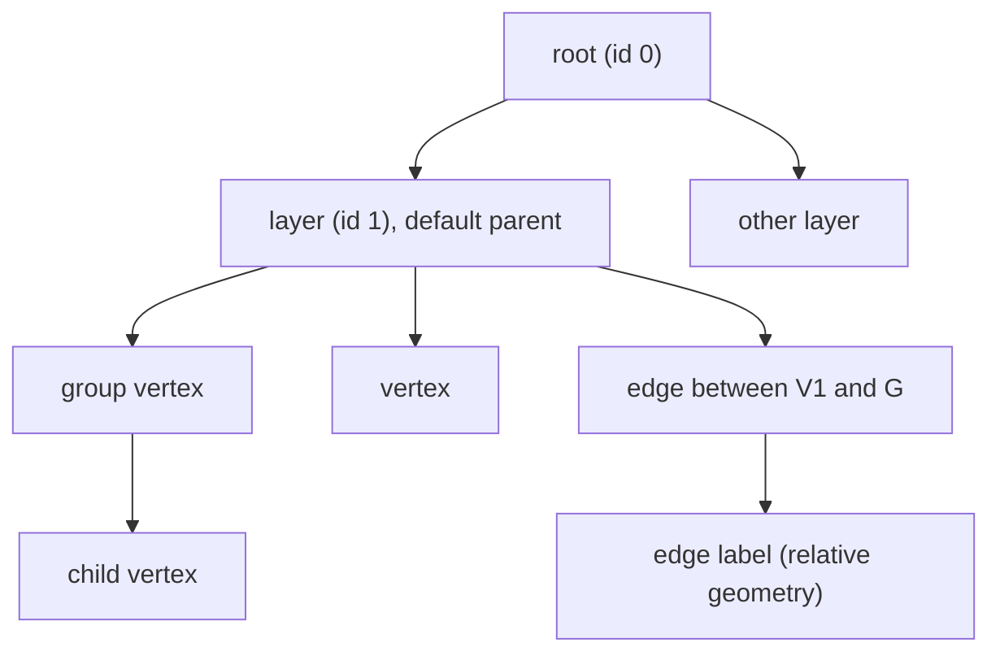
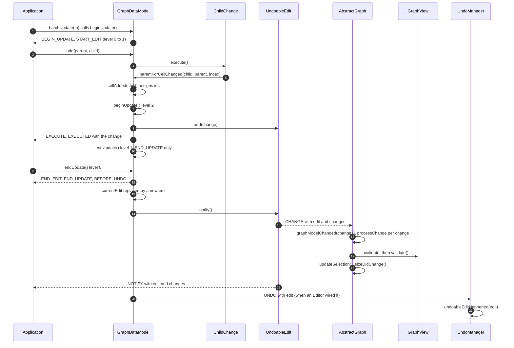

# Model, Transactions and Undo

- **Basis**: commit `a2e1bd3`, version `0.25.2`
- **Files**: `src/view/GraphDataModel.ts`, `src/view/GraphSelectionModel.ts`, `src/view/cell/Cell.ts`,
  `src/view/cell/CellPath.ts`, `src/view/geometry/Geometry.ts`, `src/view/geometry/Point.ts`,
  `src/view/geometry/Rectangle.ts`, `src/view/undoable-change/*.ts` (13 files), `src/util/cellArrayUtils.ts`,
  `src/util/treeTraversal.ts`, `src/util/Clipboard.ts`, `src/util/ObjectIdentity.ts`, `src/util/cloneUtils.ts`,
  `src/internal/clone-utils.ts`, `src/view/mixin/SelectionMixin.ts`, `src/view/mixin/SelectionMixin.type.ts`;
  change-producing flows only of `src/view/mixin/CellsMixin.ts`, `src/view/mixin/VertexMixin.ts`,
  `src/view/mixin/EdgeMixin.ts`

TensorDiagram keeps the diagram as a tree of `Cell` objects owned by a `GraphDataModel`. Every mutation of that tree
goes through an atomic change object (`ChildChange`, `GeometryChange`, ...) executed by `GraphDataModel.execute`,
collected into an `UndoableEdit` while a transaction is open, and dispatched as events when the outermost transaction
closes. The graph view listens to the dispatch to repaint, and an `UndoManager`, when one is wired, stores the edit
so that it can be replayed backwards. The selection follows the same change pattern but outside the model
transaction. This page specifies that machinery as it exists in the source, including the places where it behaves
differently from what its JSDoc claims.

## Purpose and scope

In scope:

- the cell data structure (`Cell`), its hierarchy and identity, and the helpers that walk or clone it
  (`CellPath`, `cellArrayUtils`, `treeTraversal`, `ObjectIdentity`, `cloneUtils`);
- the geometry types (`Point`, `Rectangle`, `Geometry`);
- the transaction model of `GraphDataModel` and the events it fires;
- the 11 change classes, `UndoableEdit` and `UndoManager`;
- the selection model (`GraphSelectionModel`, `SelectionChange`, `SelectionMixin`);
- the `Clipboard`;
- how the high-level graph API (`insertVertex`, `insertEdge`, `addCells`, `removeCells`, `moveCells`, ...) turns into
  model changes.

Out of scope: how the view computes `CellState`s from the model (`GraphView`), XML serialization of models and
changes (`Codec`), the plugins and handlers that call this API, and the full `CellsMixin` (alignment, sizing,
containment and lookup are only mentioned where they emit changes).

## Concepts

### Cell

`Cell` (`src/view/cell/Cell.ts`, public) is the single node type of the model. Vertices, edges, layers, groups and the
root are all `Cell` instances distinguished by flags and position in the tree.

| Field | Type, default | Meaning |
|---|---|---|
| `id` | `string \| null`, `null` | Identifier, assigned by the model on insertion when null (see [Ids](#ids)) |
| `value` | `any`, `null` | User object, usually the label string or an XML `Element` |
| `geometry` | `Geometry \| null`, `null` | Bounds of a vertex, points and label position of an edge |
| `style` | `CellStyle`, `{}` | Style object, merged with the stylesheet by the view |
| `vertex` / `edge` | `boolean`, `false` | Kind flags, meant to be set once at creation |
| `connectable` | `boolean`, `true` | Whether edges may connect to the cell |
| `visible` | `boolean`, `true` | Visibility, changed through `VisibleChange` |
| `collapsed` | `boolean`, `false` | Folding state, changed through `CollapseChange` |
| `parent` | `Cell \| null`, `null` | Parent in the tree |
| `children` | `Cell[]`, `[]` | Ordered children; order is the z-order inside the parent |
| `source` / `target` | `Cell \| null`, `null` | Terminals of an edge |
| `edges` | `Cell[]`, `[]` | Edges connected to this cell, incoming and outgoing; a loop is listed once |
| `overlays` | `CellOverlay[]`, `[]` | Overlays added by the graph, not part of the model state |
| `invalidating`, `onInit` | internal | Used by `GraphView.invalidate`; constructor hook |
| `mxTransient` | `string[]` | Fields skipped by `Cell.clone`: `id`, `value`, `parent`, `source`, `target`, `children`, `edges` |

`Cell` methods are raw, non-transactional mutators and queries. They never fire events and never record undo
information; the model calls them from inside change objects.

| Group | Methods |
|---|---|
| Accessors | `getId`/`setId`, `getValue`/`setValue`, `valueChanged`, `getGeometry`/`setGeometry`, `getStyle`/`setStyle`, `getClonedStyle`, `isVertex`/`setVertex`, `isEdge`/`setEdge`, `isConnectable`/`setConnectable`, `isVisible`/`setVisible`, `isCollapsed`/`setCollapsed`, `getParent`/`setParent`, `getTerminal`/`setTerminal` |
| Children | `getChildren`, `getChildCount`, `getIndex`, `getChildAt`, `insert(child, index?)`, `remove(index)`, `removeFromParent` |
| Edges | `getEdgeCount`, `getEdgeIndex`, `getEdgeAt`, `insertEdge(edge, isOutgoing)`, `removeEdge(edge, isOutgoing)`, `removeFromTerminal(isSource)` |
| XML user object | `hasAttribute`, `getAttribute(name, default?)`, `setAttribute` (no-op when the value is not an `Element`) |
| Cloning | `clone`, `cloneValue` |
| Tree queries | `getNearestCommonAncestor`, `isAncestor` (true for the cell itself), `getRoot`, `getOrigin`, `getDescendants`, `filterDescendants` |
| Typed children and edges | `getChildVertices`, `getChildEdges`, `getChildCells(vertices, edges)`, `getDirectedEdgeCount`, `getConnections`, `getIncomingEdges`, `getOutgoingEdges`, `getEdges(incoming, outgoing, includeLoops)` |

### Hierarchy: root, layers, default parent

The model holds one `root`. Its children are **layers**, and the diagram cells live in the layers and below.
`GraphDataModel.createRoot` builds a root with a single default layer, which `GraphDataModel.clear` and the
constructor install. `GraphDataModel.isLayer(cell)` is true when the parent of `cell` is the root.



`AbstractGraph.getDefaultParent` (outside this slice) returns, in order: the current root of the view when the view is
drilled down, `AbstractGraph.defaultParent` when set, otherwise `root.getChildAt(0)`. Both `insertVertex` and
`insertEdge` fall back to it when `parent` is omitted. `AbstractGraph.processChange` resets `defaultParent` to `null`
on every `RootChange`.

Child cells of an edge are edge labels. Their geometry is relative to the edge, see [Geometry](#geometry).

### Ids

The model maintains `cells`, a map from id to cell, for every cell reachable from the root.

- `GraphDataModel.cellAdded(cell)` runs recursively over the subtree of a newly attached cell. When `id` is null and
  `createIds` is true it assigns `createId(cell)`. When the id is already mapped to a different cell, it reassigns new
  ids until there is no collision, then stores the cell in `cells`. When the id is numeric, `nextId` becomes
  `max(nextId, parseInt(id))`, so that ids of deleted cells are not reused.
- `GraphDataModel.createId(cell)` returns `prefix + nextId + postfix` and increments `nextId`. The `cell` argument is
  unused by the default implementation and exists for overrides.
- `GraphDataModel.cellRemoved(cell)` deletes the subtree from `cells`, children first. It does not touch `nextId`.
- `GraphDataModel.rootChanged` resets `nextId` to 0 and `cells` to `null`, then calls `cellAdded(root)`; `cells` is
  recreated lazily.
- `GraphDataModel.getCell(id)` returns the mapped cell, `undefined` for an unknown id, or `null` when `cells` is null.

With the defaults, a fresh model has ids `"0"` (root) and `"1"` (default layer).

`ObjectIdentity` (`src/util/ObjectIdentity.ts`, public) is a different identity: a lazily assigned
`"<ConstructorName>#<counter>"` string stored in the `mxObjectId` field of any object or function. It is used as a map
key by `cellArrayUtils.cloneCells` and by other parts of the library, and it is never serialized as a cell id.

### Cell paths

`CellPath` (`src/view/cell/CellPath.ts`, public, static only) encodes the position of a cell as the dot-separated
child indices from the root: `""` for the root, `"0"` for the first layer, `"0.3.1"` below.

| Method | Behaviour |
|---|---|
| `CellPath.create(cell)` | Path of `cell` up to its topmost ancestor |
| `CellPath.getParentPath(path)` | Path without its last segment, `""` for a one-segment path, `null` for `""` |
| `CellPath.resolve(root, path)` | Follows each index from `root` |
| `CellPath.compare(p1, p2)` | Compares two paths already split into segments, numerically per segment, then by length |

Paths are positional and change whenever a sibling is inserted or removed. They are used by
`Cell.getNearestCommonAncestor` and by `GraphDataModel.mergeChildren` as mapping keys.

### Geometry

`Point` (`src/view/geometry/Point.ts`, public) stores `x` and `y` behind accessors over `_x`/`_y`; the setters throw
on `NaN`. It offers `equals` and `clone`.

`Rectangle extends Point` (`src/view/geometry/Rectangle.ts`, public) adds `width` and `height`, with the same `NaN`
guard.

| Method | Behaviour |
|---|---|
| `Rectangle.fromRectangle(rect)` | Static copy |
| `setRect(x, y, w, h)` | Sets the four values |
| `getCenterX`, `getCenterY` | Center coordinates |
| `add(rect)` | In-place union |
| `intersect(rect)` | In-place intersection, may leave a negative width or height when the rectangles are disjoint |
| `grow(amount)` | Grows by `amount` on each side |
| `getPoint` | Top-left corner as a new `Point` |
| `rotate90` | Rotates by 90 degrees around the center |
| `equals`, `clone` | Value comparison, copy |

`Geometry extends Rectangle` (`src/view/geometry/Geometry.ts`, public) is the geometry of a cell.

| Field | Default | Meaning |
|---|---|---|
| `x`, `y`, `width`, `height` | 0 | Vertex bounds relative to the origin of the parent. For an edge, label position and label size |
| `relative` | `false` | Switches `x`/`y` to relative coordinates, see below |
| `offset` | `null` | Absolute offset, meaning depends on the cell, see below |
| `points` | `null` | Control points of an edge |
| `sourcePoint`, `targetPoint` | `null` | Terminal points, used only when the edge has no terminal cell at that end |
| `alternateBounds` | `null` | Bounds kept aside for the other folding state, exchanged by `swap` |
| `TRANSLATE_CONTROL_POINTS` | `true` | Whether `translate` moves `points`; an instance field, not a global switch |

How `relative` and `offset` are read:

| Cell | `relative = false` | `relative = true` |
|---|---|---|
| Vertex | `x`/`y` absolute in the parent; `offset` moves the label | `x`/`y` are fractions of the parent bounds (ports); `offset` is an absolute shift of the origin |
| Edge label (edge geometry) | `offset` is the absolute vector from the edge center to the label; `x`/`y` ignored | `x` in `[-1, 1]` along the edge, 0 at the center; `y` the orthogonal distance in pixels; `offset` added on top |

`EdgeMixin.createEdge` creates edges with `relative = true`.

| Method | Behaviour |
|---|---|
| `setRelative(b)` | Sets `relative` |
| `swap()` | Exchanges `x`, `y`, `width`, `height` with `alternateBounds`, in place; no-op without `alternateBounds` |
| `getTerminalPoint(isSource)`, `setTerminalPoint(point, isSource)` | Access to `sourcePoint`/`targetPoint` |
| `translate(dx, dy)` | Moves `x`/`y` unless relative, both terminal points, and `points` when `TRANSLATE_CONTROL_POINTS` |
| `scale(sx, sy, fixedAspect)` | Scales terminal points and `points`; scales `x`, `y`, `width`, `height` unless relative; `fixedAspect` uses `min(sx, sy)` for the size |
| `rotate(angle, center)` | Rotates the center (unless relative), terminal points and `points`, rounding to integers |
| `equals(geo)` | Compares bounds, `relative`, terminal points, `points`, `alternateBounds` and `offset` |
| `clone()` | Deep copy through `cloneUtils.clone` |

All these methods mutate in place. `FoldingMixin.swapBounds` shows the intended use: clone, `swap`, then
`GraphDataModel.setGeometry`.

### Changes, edits and the undo history

- A **change** is an object implementing `UndoableChange` (`src/types.ts`): a required `execute()`, optional `undo()`
  and `redo()`. Every built-in change is self-inverse: `execute()` applies the value held in `previous` and stores
  the value it replaced back into `previous`, so the next `execute()` reverts it.
- An **edit** (`UndoableEdit`, public) is the ordered list of changes of one transaction, with a `significant` flag.
- The **history** (`UndoManager`, public) is a bounded list of edits with a cursor, `indexOfNextAdd`.

### Selection

`GraphSelectionModel` (public) holds the selected cells in `cells` (insertion order, no duplicates). It is an
`EventSource` separate from the data model, and its changes do not go through `GraphDataModel.execute`.
`SelectionMixin` exposes it on the graph (`getSelectionCells`, `setSelectionCell`, `selectAll`, ...).

## Contract

### GraphDataModel

`GraphDataModel` (`src/view/GraphDataModel.ts`, public, extends `EventSource`).

| Property | Default | Meaning |
|---|---|---|
| `root` | default root | Root cell |
| `cells` | `{}` | Id to cell map, `null` right after a root change until the first `cellAdded` |
| `maintainEdgeParent` | `true` | Move edges to the nearest common ancestor of their terminals after `add` and `setTerminal` |
| `ignoreRelativeEdgeParent` | `true` | Skip relative (port) ancestors of the target when computing that ancestor |
| `createIds` | `true` | Assign ids to cells inserted without one |
| `prefix`, `postfix` | `''` | Wrapped around generated ids |
| `nextId` | 0 | Next generated numeric id |
| `currentEdit` | new edit | Edit collecting the changes of the open transaction |
| `updateLevel` | 0 | Nesting depth of `beginUpdate` |
| `endingUpdate` | `false` | True while the outermost `endUpdate` dispatches the edit |

Transactional mutators. Each wraps one change into `execute`, so it joins the open transaction or forms its own.

| Method | Change | Guard (no change when) | Inner callback, called by the change | Extra behaviour |
|---|---|---|---|---|
| `setRoot(root)` | `RootChange` | none | `rootChanged(root)`: swaps the root, resets `nextId`, rebuilds `cells` | Returns `root` |
| `add(parent, child, index?)` | `ChildChange` | `child === parent`, or either null | `parentForCellChanged` | Appends when `index` is null; calls `updateEdgeParents(child)` when the parent changed and `maintainEdgeParent` |
| `remove(cell)` | `ChildChange` with null parent, or `RootChange(null)` for the root | cell has no parent | `parentForCellChanged` | Removes the whole subtree |
| `setTerminal(edge, terminal, isSource)` | `TerminalChange` | none | `terminalForCellChanged` | Calls `updateEdgeParent(edge, root)` when the terminal changed and `maintainEdgeParent` |
| `setTerminals(edge, source, target)` | 2 x `TerminalChange` | none | as above | Own transaction |
| `setValue(cell, value)` | `ValueChange` | none | `valueForCellChanged`, which calls `Cell.valueChanged` | |
| `setGeometry(cell, geo)` | `GeometryChange` | `geo === cell.getGeometry()` | `geometryForCellChanged` | |
| `setStyle(cell, style)` | `StyleChange` | `style === cell.getStyle()` | `styleForCellChanged` | Returns nothing |
| `setCollapsed(cell, b)` | `CollapseChange` | value unchanged | `collapsedStateForCellChanged` | |
| `setVisible(cell, b)` | `VisibleChange` | value unchanged | `visibleStateForCellChanged` | |
| `clear()` | `RootChange` | none | `rootChanged` | New root from `createRoot` |
| `mergeChildren(from, to, cloneAllEdges = true)` | none directly | | | Own transaction, see below |

Inner callbacks (`*Changed`, `cellAdded`, `cellRemoved`, `parentForCellChanged`, `terminalForCellChanged`) mutate the
cells directly and return the previous value. They are called by change objects and must not be called from
application code: they record nothing and fire nothing.

Queries: `getCell(id)`, `getRoot(cell?)` (topmost ancestor of `cell`, or `root`), `isRoot`, `isLayer`,
`contains(cell)` (`root.isAncestor(cell)`, throws when `root` is null), `getEdgesBetween(source, target, directed)`
(raw terminals, unlike `AbstractGraph.getEdgesBetween` which uses visible terminals), `filterCells(cells, filter)`,
`isCreateIds`/`setCreateIds`.

Transaction API:

| Method | Contract |
|---|---|
| `beginUpdate()` | `updateLevel += 1`; fires `BEGIN_UPDATE`; fires `START_EDIT` when the level becomes 1 |
| `endUpdate()` | `updateLevel -= 1`; see the sequence below; no guard against a negative level |
| `batchUpdate(fn)` | `beginUpdate`, `fn()`, `endUpdate` in `finally` |
| `execute(change)` | `change.execute()` first, then `beginUpdate`, `currentEdit.add(change)`, fires `EXECUTE` and `EXECUTED` with `{ change }`, `endUpdate` |
| `createUndoableEdit(significant = true)` | New `UndoableEdit` whose `notify` fires `CHANGE` then `NOTIFY` on the model with `{ edit, changes }` |

`endUpdate` in detail:

1. When the level reaches 0, fire `END_EDIT`.
2. If `endingUpdate` is false: set `endingUpdate = (updateLevel === 0)` and fire `END_UPDATE { edit: currentEdit }`.
   This happens at every nesting level, not only the outermost one.
3. If `endingUpdate` and `currentEdit` is not empty: fire `BEFORE_UNDO { edit }`, replace `currentEdit` with a new
   edit, call `notify()` on the old one (`CHANGE`, then `NOTIFY`), fire `UNDO { edit }`.
4. Reset `endingUpdate` to false in `finally`.

`AbstractGraph.batchUpdate(fn)` delegates to `GraphDataModel.batchUpdate`.



### Change classes

All in `src/view/undoable-change/`, all public. "Applied" names the field that holds the value currently applied
after an `execute()`; `previous` holds the value it replaced. Both are swapped on every `execute()`.

| Class | Constructor | Applied / previous | `execute()` calls |
|---|---|---|---|
| `RootChange` | `(model, root)` | `root` / `previous` | `model.rootChanged` |
| `ChildChange` | `(model, parent, child, index = 0)` | `parent`, `index` / `previous`, `previousIndex` | `model.parentForCellChanged`, plus `connect` |
| `TerminalChange` | `(model, cell, terminal, source)` | `terminal` / `previous`; `source` says which end | `model.terminalForCellChanged` |
| `ValueChange` | `(model, cell, value)` | `value` / `previous` | `model.valueForCellChanged` |
| `GeometryChange` | `(model, cell, geometry)` | `geometry` / `previous` | `model.geometryForCellChanged` |
| `StyleChange` | `(model, cell, style)` | `style` / `previous` | `model.styleForCellChanged` |
| `CollapseChange` | `(model, cell, collapsed)` | `collapsed` / `previous` | `model.collapsedStateForCellChanged` |
| `VisibleChange` | `(model, cell, visible)` | `visible` / `previous` | `model.visibleStateForCellChanged` |
| `CellAttributeChange` | `(cell, attribute, value)`, no model | `previous` only | `cell.setAttribute`, or `cell.value.removeAttribute` when `previous` is nullish |
| `CurrentRootChange` | `(view, root)` | `view.currentRoot` / `previous`; `isUp` | sets `view.currentRoot`, `view.translate`, clears and validates or refreshes the view, fires `UP` or `DOWN` on the view |
| `SelectionChange` | `(graph, added = [], removed = [])` | swaps `added` and `removed` | `selectionModel.cellRemoved` then `cellAdded`, fires `CHANGE` on the selection model |

`ChildChange.execute()` in detail. When the target parent (`previous`) is null, it first calls `connect(child, false)`.
That call recursively removes the child and its descendants from the `edges` arrays of their terminals, and then
writes `source`/`target` back on each cell. A removed edge therefore remembers its terminals and can reconnect on
undo. It then calls `parentForCellChanged`, which inserts or removes the child and calls `cellAdded` or `cellRemoved`
depending on whether the old and new parents are in the model. When the target parent is not null, it calls
`connect(child, true)` afterwards to re-register the edges with their terminals. Finally it swaps `parent` with
`previous` and `index` with `previousIndex`. After a removal, `parent` is `null`, `previous` is the old parent and
`previousIndex` the old position.

`CellAttributeChange` is not produced by any model method. It must be passed to `GraphDataModel.execute` explicitly.

`CurrentRootChange` is produced by `GraphView.setCurrentRoot`, which executes it directly, wraps it into a
**significant** `UndoableEdit` whose source is the view, and fires `UNDO` on the view. `SelectionChange` is produced by
`GraphSelectionModel.changeSelection`.

### UndoableEdit

`UndoableEdit` (`src/view/undoable-change/UndoableEdit.ts`, public).

| Member | Contract |
|---|---|
| `source` | `EventSource` on which events are fired |
| `changes` | Changes in execution order |
| `significant` | Default `true`. Insignificant edits are skipped over by `UndoManager` |
| `undone`, `redone` | State flags |
| `isEmpty()`, `isSignificant()`, `add(change)` | |
| `undo()` | If not `undone`: fire `START_EDIT` on `source`, then for each change in reverse order call `execute()` (or `undo()` when there is no `execute`) and fire `EXECUTED { change }`, then fire `END_EDIT` and set `undone`. Always call `notify()` |
| `redo()` | Same, in forward order, with `execute()` or `redo()` |
| `notify()` | Empty by default; the model's edits fire `CHANGE` and `NOTIFY` (see `createUndoableEdit`) |
| `die()` | Empty hook, called when the edit is trimmed from the history |

`undo` and `redo` do not touch `updateLevel` and fire none of `BEGIN_UPDATE`, `END_UPDATE`, `BEFORE_UNDO` or `UNDO`,
so replaying an edit never records a new one.

### UndoManager

`UndoManager` (`src/view/undoable-change/UndoManager.ts`, public, extends `EventSource`).

| Member | Contract |
|---|---|
| `constructor(size = 100)` | Calls `clear()` |
| `size` | Maximum history length, 0 for unlimited |
| `history`, `indexOfNextAdd` | Edits, and the cursor: edits before it can be undone, from it on redone |
| `isEmpty()` | `history` is empty, regardless of the cursor |
| `clear()` | Empties the history, fires `CLEAR` |
| `canUndo()`, `canRedo()` | Cursor above 0, cursor below the history length |
| `undo()` | Moves the cursor back and undoes edits until one is significant; fires `UNDO { edit }` for that one |
| `redo()` | Moves the cursor forward and redoes edits until one is significant; fires `REDO { edit }` for that one |
| `undoableEditHappened(edit)` | `trim()`; drops the oldest edit when full (without `die()`); pushes; moves the cursor to the end; fires `ADD { edit }` |
| `trim()` | Removes every edit from the cursor on and calls `die()` on each |

No graph class creates an `UndoManager`. `Editor` (`src/editor/Editor.ts`) creates one and, in
`Editor.installUndoHandler`, feeds it from the `UNDO` events of the model and of the view, and re-selects the cells
returned by `getSelectionCellsForChanges` after each `UNDO` and `REDO` of the manager. An application using `Graph` or
`BaseGraph` alone wires it itself:

```typescript
const undoManager = new UndoManager();
const listener = (_sender: EventTarget, evt: EventObject): void =>
  undoManager.undoableEditHappened(evt.getProperty('edit'));
graph.getDataModel().addListener(InternalEvent.UNDO, listener);
graph.getView().addListener(InternalEvent.UNDO, listener);
```

### GraphSelectionModel and SelectionMixin

`GraphSelectionModel` (`src/view/GraphSelectionModel.ts`, public). The constructor takes the graph; `Graph` creates it
through `Graph.createSelectionModel`, `BaseGraph` through its `selectionModel` option or a default instance.

| Member | Contract |
|---|---|
| `cells` | Selected cells |
| `singleSelection` | Default `false`; `isSingleSelection`/`setSingleSelection` |
| `doneResource`, `updatingSelectionResource` | `'done'` and `'updatingSelection'` when i18n is enabled, `''` otherwise |
| `isSelected(cell)`, `isEmpty()` | Queries |
| `getFirstSelectableCell(cells)` | First cell accepted by `graph.isCellSelectable`, or `null` |
| `setCell(cell)` / `setCells(cells)` | Replace the selection with the selectable cells; in single mode, with the first selectable cell |
| `addCell(cell)` / `addCells(cells)` | Add selectable cells not already selected; in single mode, replace with the first selectable cell |
| `removeCell(cell)` / `removeCells(cells)` | Remove the selected ones among `cells`; no selectability check |
| `clear()` | `changeSelection(null, cells)` |
| `changeSelection(added, removed)` | Drops null entries; when anything is left, builds a `SelectionChange`, executes it, wraps it in an insignificant `UndoableEdit` whose source is the graph, fires `UNDO { edit }` on the selection model |
| `cellAdded(cell)` / `cellRemoved(cell)` | Raw callbacks used by `SelectionChange`, no event |

`SelectionMixin` (`src/view/mixin/SelectionMixin.ts`, not exported; its members are typed on `AbstractGraph` by
`SelectionMixin.type.ts`):

| Group | Members |
|---|---|
| Model access | `selectionModel`, `getSelectionModel`, `setSelectionModel` |
| Delegates | `isCellSelected`, `isSelectionEmpty`, `clearSelection`, `getSelectionCount`, `getSelectionCell` (first cell, `undefined` when empty), `getSelectionCells` (copy), `setSelectionCell(s)`, `addSelectionCell(s)`, `removeSelectionCell(s)` |
| Navigation | `selectNextCell`, `selectPreviousCell`, `selectParentCell`, `selectChildCell`, `selectCell(isNext, isParent, isChild)` |
| Bulk | `selectAll(parent?, descendants?)`, `selectVertices`, `selectEdges`, `selectCells(vertices, edges, parent?, selectGroups?)` (leaf vertices unless `selectGroups`, only cells with a view state) |
| Events | `selectRegion(rect, evt)`, `selectCellForEvent`, `selectCellsForEvent` (toggle events add, others replace) |
| Sync | `isSiblingSelected`, `getSelectionCellsForChanges(changes, ignoreFn?)`, `updateSelection()` |

`getSelectionCellsForChanges` collects the cell of each `ChildChange` (`child`) or other change with a `cell`, skipping
`RootChange` and changes for which `ignoreFn` returns true. Only cells still in the model are kept, and a non-vertex,
non-edge cell (a layer) contributes its descendants instead. `updateSelection` deselects cells that left the model,
are invisible, or have a collapsed or invisible ancestor below the view's current root.
`AbstractGraph.graphModelChanged` calls it after every model `CHANGE`.

### Clipboard

`Clipboard` (`src/util/Clipboard.ts`, public) is a static singleton shared by every graph of the page.

| Member | Contract |
|---|---|
| `STEPSIZE` | 10, offset applied per paste |
| `insertCount` | Number of pastes since the last copy, starts at 1 |
| `cells` | Clipboard content, `undefined` until the first copy |
| `setCells`, `getCells` | Raw access; no event despite the JSDoc |
| `isEmpty()` | `!cells`, so an empty array counts as content |
| `copy(graph, cells?)` | `cells` defaults to the selection; stores `graph.cloneCells(getTopmostCells(graph.getExportableCells(cells)))`; sets `insertCount = 1`; returns the originals |
| `cut(graph, cells = [])` | `copy`, then `insertCount = 0`, then `removeCells(graph, cells)` |
| `removeCells(graph, cells)` | Hook, calls `graph.removeCells(cells)` |
| `paste(graph)` | `graph.importCells(graph.getImportableCells(cells), d, d, graph.getDefaultParent())` with `d = insertCount * STEPSIZE`; increments `insertCount`; selects the pasted cells; returns them, or `null` when empty |

`AbstractGraph.cloneCells` (in `CellsMixin`) translates the clones by the origin of their parent's view state, so the
clipboard holds geometry in absolute coordinates. `importCells` clones again, so the clipboard can be pasted
repeatedly, and the pasted cells cascade by `STEPSIZE`. After a cut, the first paste lands at the original position
because `insertCount` is 0.

### Cloning helpers

| Function | File | Contract |
|---|---|---|
| `clone(obj, transients?, shallow?)` | `src/util/cloneUtils.ts`, public as `cloneUtils` | `new obj.constructor()`, then copies every enumerable property except `mxObjectId` and `transients`. Object values are cloned recursively, with no transients, unless `shallow` |
| `Cell.clone()` | `src/view/cell/Cell.ts` | `clone(this, mxTransient)` then `setValue(cloneValue())`. The result has no id, parent, children, terminals or edges. Geometry, style and overlays are deep-copied |
| `Cell.cloneValue()` | same | Calls `value.clone()` when present, `cloneNode(true)` for DOM nodes, else returns the value |
| `cloneCell(cell, includeChildren)`, `cloneCells(cells, includeChildren, mapping)` | `src/util/cellArrayUtils.ts`, public as `cellArrayUtils` | Pure model copy: clones the subtrees, then reconnects each cloned edge to the clones of its terminals when those were cloned too, keyed by `ObjectIdentity` |
| `AbstractGraph.cloneCells(cells, allowInvalidEdges, mapping, keepPosition)` | `src/view/mixin/CellsMixin.ts` | `cellArrayUtils.cloneCells` plus view-dependent work: drops invalid edges unless allowed, sets terminal points for unconnected ends from the edge state, translates by the parent origin unless `keepPosition` |
| `shallowCopy(source, target)` | `src/internal/clone-utils.ts`, not public | Copies own properties, copying arrays one level; used to reset the global config objects |

### Other cell array and traversal helpers

`cellArrayUtils` also provides `getOpposites(edges, terminal, includeSources, includeTargets)`,
`getTopmostCells(cells)` (drops cells with an ancestor in the array) and `getParents(cells)` (distinct parents).

`treeTraversalUtils` (`src/util/treeTraversal.ts`, public) provides
`findTreeRoots(graph, parent, isolate, invert)`: visible child vertices without incoming edges, or else the one with
the greatest fan-out minus fan-in. It also provides `traverse(vertex, directed, func, edge, visited, inverse)`, a
depth-first walk that visits each vertex once and stops descending where `func` returns `false`. Both read the model
and change nothing.

### Graph API to model changes

High-level methods of `AbstractGraph` each open a transaction, call one `cells*` worker, and fire a graph event. The
workers produce the model changes.

| Graph method | Worker | Model calls | Graph events |
|---|---|---|---|
| `insertVertex(params)` | `createVertex`, then `addCell` | as `addCells` | as `addCells` |
| `insertEdge(params)` | `createEdge`, then `addEdge`, then `addCell` with source and target | as `addCells` | as `addCells` |
| `addCell`, `addCells(cells, parent?, index?, source?, target?, absolute?)` | `cellsAdded` | per cell: `setGeometry` (only when `absolute` and the parent changes), `add`, then size, `extendParent`, `constrainChild`, `cellConnected` (which calls `setTerminal`) | `CELLS_ADDED`, then `ADD_CELLS` |
| `removeCells(cells?, includeEdges = true)` | `cellsRemoved` | for each connected edge not removed: `setGeometry` with a terminal point, `setTerminal(edge, null, ...)`; then `remove(cell)` | `CELLS_REMOVED`, then `REMOVE_CELLS` |
| `moveCells(cells, dx, dy, clone?, target?, evt?, mapping?)`, `importCells` | `cloneCells` (when cloning), `cellsMoved`, `cellsAdded` (when `target`) | `translateCell` calls `setGeometry` per cell; optional `disconnectGraph`, `resetEdges`; then `add` into `target` | `CELLS_MOVED`, `MOVE_CELLS` |
| `resizeCells(cells, bounds, recurse?)` | `cellsResized`, `cellResized` | `setGeometry`, child scaling, `extendParent`, `constrainChild`, `resetEdges` | `CELLS_RESIZED`, `RESIZE_CELLS` |
| `toggleCells(show, cells, includeEdges)` | `cellsToggled` | `setVisible` per cell | `TOGGLE_CELLS` |
| `setCellStyle(style, cells?)` | | `setStyle` per cell, all sharing the same object | none |
| `flipEdge`, `resetEdge(s)`, `splitEdge` | | `setStyle`, `setGeometry` with emptied `points`, `cellsMoved` + `cellsAdded` + `cellConnected` | `FLIP_EDGE`, `SPLIT_EDGE` |

`insertVertex` and `insertEdge` accept two call forms:

- **Object form**: a single object argument, `VertexParameters` or `EdgeParameters` (`src/types.ts`). For a vertex,
  `x`/`y`/`width`/`height` take precedence over `position`/`size` when the key is present. `parent` falls back to the
  default parent. This is the form to use.
- **Positional form**: `(parent, id, value, x, y, width, height, style, relative, geometryClass)` for a vertex and
  `(parent, id, value, source, target, style)` for an edge. It is legacy, kept for code migrating from mxGraph.

```typescript
graph.batchUpdate(() => {
  const source = graph.insertVertex({ value: 'source', position: [20, 20], size: [80, 30] });
  const target = graph.insertVertex({ value: 'target', position: [200, 20], size: [80, 30] });
  graph.insertEdge({ value: 'link', source, target });
});
```

`createVertex` builds a `Cell` with `new geometryClass(x, y, width, height)`, `relative`, `vertex = true`,
`connectable = true` and the given id (`undefined` is allowed and replaced on insertion). `createEdge` builds a
`Cell` with an empty, relative `Geometry` and `edge = true`.

## Invariants

1. Every cell reachable from `root` with a non-null id is in `cells` under that id, and no other cell is.
2. `child.parent === p` if and only if `p.children` contains `child` exactly once. `Cell.insert` and `Cell.remove`
   maintain both sides.
3. For an attached edge `e` with source `s`, `s.edges` contains `e`, and likewise for the target. A loop appears once
   in `edges`. `Cell.insertEdge` and `Cell.removeEdge` maintain both sides.
4. Every built-in change is self-inverse: two calls to `execute()` restore the original state, which is what
   `UndoableEdit.undo` and `redo` rely on.
5. Within one outermost transaction, all changes go into one `UndoableEdit`, and `CHANGE`, `NOTIFY` and `UNDO` fire at
   most once, when `updateLevel` returns to 0 and the edit is not empty.
6. Changes are applied immediately on `execute`. A transaction batches only the notification, it neither isolates nor
   rolls back.
7. With `maintainEdgeParent`, after `add` or `setTerminal` an edge whose terminals are both attached sits in their
   nearest common ancestor. The exceptions are the layer case described in [Traps](#traps) and the use of the first
   non-relative ancestor of each terminal.
8. The selection only contains cells accepted by `isCellSelectable` at the time they were added, and after each model
   `CHANGE` only cells still in the model, visible and not below a collapsed ancestor.
9. Ids generated by `createId` are never reused within one root: `nextId` only grows until the next root change.

## Workflows

### Insert cells in one undoable step

Wrap the calls in `graph.batchUpdate` (or `model.batchUpdate`). Each `insertVertex` and `insertEdge` already opens a
nested transaction, so without the outer one each call becomes its own edit, its own repaint and its own undo step.

### Change a style or a geometry

`GraphDataModel.setStyle` and `setGeometry` skip a value that is the same instance as the current one. Always work on
a copy:

```typescript
graph.batchUpdate(() => {
  const style = cell.getClonedStyle();
  style.fillColor = 'red';
  graph.getDataModel().setStyle(cell, style);

  const geo = cell.getGeometry()?.clone();
  if (geo) {
    geo.translate(10, 0);
    graph.getDataModel().setGeometry(cell, geo);
  }
});
```

### Remove cells

Call `graph.removeCells(cells)`. It includes the connected edges by default and, for edges that stay, turns the
removed end into a terminal point before calling `model.remove`. Calling `model.remove(vertex)` directly leaves the
edges of the vertex pointing at a detached cell.

### Undo and redo

1. Wire an `UndoManager` to the model and view `UNDO` events (see [UndoManager](#undomanager)), or use `Editor`.
2. `undoManager.undo()` walks back to the previous significant edit. Each edit replays its changes in reverse order
   and calls `notify()`. For a model edit, `notify()` fires `CHANGE`, so `AbstractGraph.graphModelChanged` refreshes
   the view as for a forward change.
3. Optionally restore the selection from the `edit.changes` of the `UNDO` or `REDO` event with
   `graph.getSelectionCellsForChanges`, as `Editor` does.

### Synchronize with a remote model

Listen to `NOTIFY` and encode `evt.getProperty('edit').changes`. To apply remote changes without echoing them back,
decode them, set `change.model`, call `change.execute()` on each, and dispatch through an `UndoableEdit` whose
`notify` fires only `CHANGE`, as shown in the class JSDoc of `GraphDataModel`.

### Merge another model

`GraphDataModel.mergeChildren(from, to, cloneAllEdges)` clones the children of `from` into `to`. A cell whose id
already exists in this model is not cloned but reused, and edges are always cloned unless `cloneAllEdges` is false.
It reconnects the edges through a `CellPath`-keyed mapping. The clones are attached with `Cell.insert` and
`cellAdded`, which are not undoable. Only the final `setTerminal` calls produce `TerminalChange`s, so the merge cannot
be undone as a whole.

### Copy and paste

`Clipboard.copy(graph)` then `Clipboard.paste(graph)`; `Clipboard.cut(graph, graph.getSelectionCells())` to cut. Pass
the cells to `cut` explicitly, see [Traps](#traps).

## Events

All names are static members of `InternalEvent`. Properties are read with `evt.getProperty(name)`.

Fired on `GraphDataModel`:

| Event | When | Properties |
|---|---|---|
| `BEGIN_UPDATE` | Every `beginUpdate`, including the implicit one of each `execute` | none |
| `START_EDIT` | `updateLevel` goes from 0 to 1; also at the start of `UndoableEdit.undo`/`redo` of a model edit | none |
| `EXECUTE` | Every `execute`, after the change was applied | `change` |
| `EXECUTED` | Right after `EXECUTE`; also once per change during `UndoableEdit.undo`/`redo` | `change` |
| `END_EDIT` | `updateLevel` returns to 0; also at the end of `UndoableEdit.undo`/`redo` | none |
| `END_UPDATE` | Every `endUpdate` outside the final dispatch | `edit` (the current edit) |
| `BEFORE_UNDO` | Outermost `endUpdate`, non-empty edit, before dispatch | `edit` |
| `CHANGE` | `notify()` of a model edit: after a transaction, and after each undo and redo | `edit`, `changes` (deprecated alias of `edit.changes`) |
| `NOTIFY` | Right after `CHANGE` | `edit`, `changes` |
| `UNDO` | Outermost `endUpdate`, non-empty edit, after `CHANGE` and `NOTIFY`; not on undo or redo | `edit` |

Fired on `GraphSelectionModel`:

| Event | When | Properties |
|---|---|---|
| `CHANGE` | Each `SelectionChange.execute()` | `added`: the cells just **removed** from the selection; `removed`: the cells just **added**. The names are inverted |
| `UNDO` | After `changeSelection` applied a change, after `CHANGE` | `edit` (insignificant, source is the graph) |

Fired on `UndoManager`: `CLEAR` (none), `ADD` (`edit`), `UNDO` (`edit`), `REDO` (`edit`).

Fired on `GraphView` by `CurrentRootChange.execute`: `UP` or `DOWN` with `root` and `previous`.
`GraphView.setCurrentRoot` also fires `UNDO` with `edit`.

Fired on the graph by the workers of [Graph API to model changes](#graph-api-to-model-changes): `CELLS_ADDED`
(`cells`, `parent`, `index`, `source`, `target`, `absolute`), `ADD_CELLS` (`cells`, `p`, `i`, `source`, `target`),
`CELLS_REMOVED` (`cells`), `REMOVE_CELLS` (`cells`, `includeEdges`), `CELLS_MOVED` (`cells`, `dx`, `dy`,
`disconnect`), `MOVE_CELLS` (`cells`, `dx`, `dy`, `clone`, `target`, `event`), `CELLS_RESIZED` and `RESIZE_CELLS`
(`cells`, `bounds`, `prev`), `TOGGLE_CELLS` (`show`, `cells`, `includeEdges`), `FLIP_EDGE` (`edge`), `SPLIT_EDGE`
(`edge`, `cells`, `newEdge`, `dx`, `dy`). They fire inside the transaction, before the model `CHANGE`.

`EventSource.fireEvent` does nothing while `eventsEnabled` is false. Disabling events on the model therefore also
suppresses the view update and the undo recording, while the changes are still applied.

## Extension points

- **Custom change**: any object with `execute()` (or `undo()`/`redo()`) passed to `GraphDataModel.execute` joins the
  transaction and the undo history. Make `execute()` self-inverse. Add a `cell` property holding a `Cell` if
  `AbstractGraph.processChange` should drop its view state and `getSelectionCellsForChanges` should select it.
- **Id scheme**: override `GraphDataModel.createId(cell)`, or set `prefix`/`postfix`; `setCreateIds(false)` leaves
  ids to the application, and cells without an id are then not registered in `cells`.
- **Inner callbacks**: `valueForCellChanged` can be overridden to edit an attribute of an XML user object in place
  and return the previous value. The other `*ForCellChanged` callbacks, `cellAdded`, `cellRemoved` and `rootChanged`
  can be overridden the same way, keeping the "return the previous value" contract.
- **Root and layers**: override `GraphDataModel.createRoot`.
- **Edit notification**: override `GraphDataModel.createUndoableEdit` to change what `notify()` fires.
- **Edit disposal**: assign `UndoableEdit.die` to release resources when an edit is trimmed from the history.
- **User object cloning**: give the value a `clone()` method, which `Cell.cloneValue` calls, or override
  `Cell.cloneValue`.
- **Cell subclass**: override the accessors, for example `getChildCount` or `getEdgeCount`, which the model reads
  once per loop for that reason.
- **Selection**: subclass `GraphSelectionModel` and install it with `Graph.createSelectionModel` or the
  `selectionModel` option of `BaseGraph`; override `AbstractGraph.isCellSelectable` to filter.
- **Clipboard**: reassign `Clipboard.copy`, `Clipboard.paste` or `Clipboard.removeCells`, as the class JSDoc shows for
  keeping the original parents; override `AbstractGraph.canExportCell` and `canImportCell` to filter.
- **Geometry subclass**: pass `geometryClass` to `insertVertex`.

## Traps

- **`execute` applies the change before opening the transaction.** The JSDoc of `GraphDataModel.execute` says
  `EXECUTE` fires before the change. It fires after, and for a standalone call `BEGIN_UPDATE` and `START_EDIT` also
  fire after the model already changed.
- **No rollback.** An exception inside `batchUpdate` leaves the changes executed so far applied, and the `finally`
  dispatches them as a normal edit.
- **Changes made by a `CHANGE`, `NOTIFY` or `UNDO` listener are deferred.** While the final dispatch runs,
  `endingUpdate` is true. A change executed by a listener lands in the fresh `currentEdit`, and its own `endUpdate`
  dispatches nothing. That change reaches the view and the history only when the next transaction closes.
- **Unbalanced `endUpdate`.** Nothing prevents `updateLevel` from going negative. A negative level never equals 0,
  so no later transaction is ever dispatched. Use `batchUpdate`.
- **Same instance, no change.** `setStyle` and `setGeometry` compare by reference. Mutating `cell.getStyle()` or
  `cell.getGeometry()` in place and passing it back records nothing and does not repaint. Clone first with
  `getClonedStyle` or `Geometry.clone`. `setValue`, `setTerminal` and `setRoot` have no guard and always record a
  change.
- **`setCellStyle` shares one style object** between all the target cells. A later in-place mutation of that object
  affects all of them.
- **`model.remove(vertex)` does not disconnect the vertex's edges.** `ChildChange.connect` only detaches the removed
  subtree from its own terminals. Use `graph.removeCells`.
- **Silent id rewrite.** Inserting a cell whose explicit id is already used by another cell renames the new cell. No
  warning is emitted.
- **`nextId` follows the highest numeric id, not that id plus one.** The first generated id after loading `"5"` is
  `"5"`, which collides and is then bumped to `"6"`. The result is correct, but an override of `createId` that does
  not expect collisions should know about it.
- **Inverted selection event names.** In the `CHANGE` event of `GraphSelectionModel`, `added` holds the deselected
  cells and `removed` the newly selected ones.
- **Single-selection `addCells` bug.** With `singleSelection` on, `addCells` with the already-selected cell as first
  selectable candidate clears the selection instead of doing nothing. `GraphSelectionModel.test.ts` pins this current
  behaviour as a regression sentinel (issue #1055).
- **Graph-level selection flags are dead.** `SelectionMixin.type.ts` declares `singleSelection`, `doneResource` and
  `updatingSelectionResource` on `AbstractGraph`, but `SelectionMixin` implements none of them, and nothing reads them.
  Set `graph.getSelectionModel().setSingleSelection(true)` instead.
- **Selection changes are not undoable by default.** `changeSelection` fires `UNDO` on the selection model, but
  `Editor.installUndoHandler` does not listen to it.
- **The model `CHANGE` JSDoc example is wrong.** `GraphDataModel`'s class JSDoc tests `!change.change.previous`; the
  field is `change.previous` on the `ChildChange` itself.
- **Edge parent asymmetry.** `GraphDataModel.updateEdgeParent` always climbs out of relative (port) ancestors for the
  source, but only does so for the target when `ignoreRelativeEdgeParent` is true. It also never moves an edge into a
  layer unless the edge is already inside that layer, so an edge whose terminals sit in a layer while the edge sits in
  another layer stays where it is.
- **`Clipboard.cut(graph)` without cells does nothing useful.** `cells` defaults to `[]`, which is truthy, so `copy`
  does not fall back to the selection. Nothing is copied or removed, the clipboard becomes `[]`, which `isEmpty`
  reports as not empty, and a later `paste` clears the selection.
- **Clipboard state is global.** `Clipboard` is static, so two graphs on the same page share one clipboard and one
  `insertCount`.
- **`Cell.clone` deep-copies `overlays`.** `overlays` is not in `mxTransient`, so overlays are cloned with the cell.
- **`CellAttributeChange` assumes an `Element` value.** With a nullish `previous` it calls `cell.value.removeAttribute`
  without the `isElement` check that `Cell.setAttribute` performs, and throws for a string value.
- **Significance of view root changes.** The `UndoManager` JSDoc describes drill-down changes as insignificant, but
  `GraphView.setCurrentRoot` creates a significant edit, so each drill-down is a full undo step.
- **History overflow skips `die()`.** `undoableEditHappened` drops the oldest edit with `shift()` without calling its
  `die()`; only `trim()` calls it.
- **`ObjectIdentity.FIELD_NAME` is not configurable.** `ObjectIdentity.get` and `clear` use the `IDENTITY_FIELD_NAME`
  constant, while `cloneUtils.clone` skips `ObjectIdentity.FIELD_NAME`. Changing the static breaks the skip.
- **One-object positional call.** `insertVertex` and `insertEdge` treat any single object argument as the parameter
  object, so a positional call reduced to one argument (`insertVertex(parent)`) is misread.
- **Two `getEdgesBetween`.** `GraphDataModel.getEdgesBetween` compares raw terminals, `AbstractGraph.getEdgesBetween`
  compares visible terminals from the view.
- **`Rectangle.intersect` on disjoint rectangles** produces a negative width or height rather than an empty
  rectangle.

## Open items

- Decide whether `execute` should open the transaction before applying the change, and fix the JSDoc either way.
- Decide whether `updateEdgeParent` should honour `ignoreRelativeEdgeParent` for the source as well.
- Fix the single-selection `addCells` bug and flip the sentinel tests in `GraphSelectionModel.test.ts` (issue #1055).
- Remove or implement the dead `singleSelection`, `doneResource` and `updatingSelectionResource` declarations of
  `SelectionMixin.type.ts`.
- Make `Clipboard.cut` fall back to the selection when called without cells, and drop the stale event claim of
  `Clipboard.setCells`.
- Call `die()` on the edit dropped by `UndoManager.undoableEditHappened` when the history is full.
- Align the `UndoManager` JSDoc with the significance of the edit created by `GraphView.setCurrentRoot`, or the
  reverse.
- Guard `CellAttributeChange.execute` with the same `isElement` check as `Cell.setAttribute`.
- Fix the `change.change.previous` example in the class JSDoc of `GraphDataModel`.
- Consider a guard against `endUpdate` without a matching `beginUpdate`.
- The `changes` property of the model `CHANGE` and `NOTIFY` events is marked deprecated in the source with no removal
  plan.
- Test coverage of this slice is thin outside the selection model: no test of the transaction event order, of
  `ChildChange` undo/redo, of id collision handling or of `Clipboard`.
