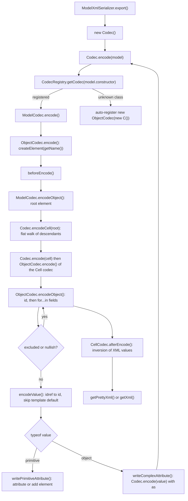
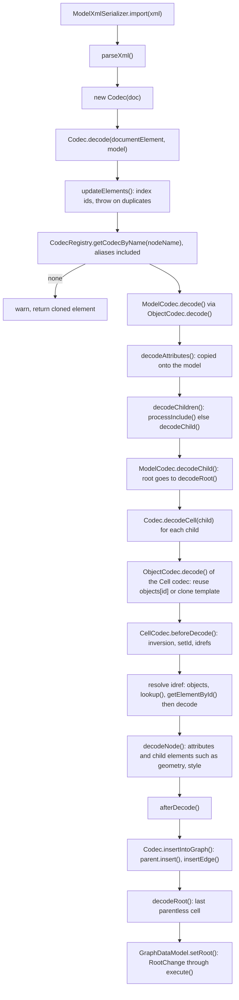

# Serialization

- **Basis**: commit `a2e1bd3`, version `0.25.2`
- **Files**: `src/serialization/Codec.ts`, `src/serialization/CodecRegistry.ts`, `src/serialization/ObjectCodec.ts`,
  `src/serialization/ModelXmlSerializer.ts`, `src/serialization/register-model-codecs.ts`,
  `src/serialization/register-other-codecs.ts`, `src/serialization/register-shared.ts`, `src/serialization/codec/*`
  (including `codec/editor/*` and `codec/mxGraph/*`), `src/util/xmlUtils.ts`, `src/util/xmlViewUtils.ts`,
  `src/util/MaxXmlRequest.ts`, `src/util/requestUtils.ts`, `src/util/UrlConverter.ts`. All paths are relative to
  `packages/core`.

The serialization layer turns JavaScript object graphs into XML DOM elements and back. It is the mxGraph codec
system almost unchanged: `Codec` drives one encode or decode operation and holds its state, `CodecRegistry` is a
global, static map from names to codecs, and `ObjectCodec` is the reflective default codec. It walks the enumerable
fields of an object and writes primitive values as attributes and object values as child elements. Subclasses of
`ObjectCodec` specialise cells, the data model, graphs, stylesheets, undoable changes and editor configuration.
`ModelXmlSerializer` is a small facade for the common case, importing and exporting a `GraphDataModel`, and it is
the only part that registers codecs by itself. The `util` files of this slice provide XML parsing and printing, a
view-to-XML export, and an `XMLHttpRequest` wrapper used for `<include>` and for the editor.

## Purpose and scope

In scope:

- the XML format of `GraphDataModel` and of the objects reachable from it (`Cell`, `Geometry`, `Point`, styles,
  user objects);
- the import of mxGraph and draw.io model XML (`mxGraphModel`, `mxCell`, `mxGeometry`, `mxPoint`, string styles);
- the configuration formats decoded into `Graph`, `BaseGraph`, `Stylesheet` and the `Editor` family;
- the encoding of undoable changes (`ChildChange`, `RootChange`, `TerminalChange` and six generic changes);
- the export of a rendered view (`GraphViewCodec`, `getViewXml`);
- the XML helpers (`parseXml`, `getXml`, `getPrettyXml`, `findNode`, `createXmlDocument`) and the request helpers
  (`MaxXmlRequest`, `load`, `get`, `getAll`, `post`, `submit`) plus `UrlConverter`.

Out of scope: JSON or any other format (none exists, the `XML` in `ModelXmlSerializer` is deliberate per its source
comment), the export of a mxGraph string style (TensorDiagram always writes its own format), and collaborative
sessions (mxGraph's `mxSession` has no counterpart in `src`, so the change codecs have no consumer in this package).

## Concepts

| Concept | Meaning |
|---|---|
| Codec | `Codec` in `src/serialization/Codec.ts`. One instance per operation. Owns the target `document`, the `objects` table (id to decoded object), the `elements` table (id to DOM element) and the `encodeDefaults` switch. |
| Object codec | An `ObjectCodec` (or subclass) bound to a `template` instance. Knows how to encode and decode one class. |
| Codec name | `ObjectCodec.getName()`: the name set with `setName`, else `template.constructor.name`. It is the XML element name written on encode and the key looked up on decode. |
| Alias | `CodecRegistry.aliases`: class name or foreign element name mapped to a codec name, for example `mxGraphModel` to `GraphDataModel`. |
| Template | The instance given to the `ObjectCodec` constructor. It is the source of default values (a field equal to the template value is not written) and of new instances (`cloneTemplate` calls `new template.constructor()` with no argument). |
| Exclude | Field names never written or read. `ObjectIdentity.FIELD_NAME` (`mxObjectId`) is always excluded. |
| Idrefs | Field names written as an id string rather than as a nested element, and resolved back to objects on decode. |
| Mapping / reverse | Field name to attribute name, and its inverse built in the constructor. |
| `as` attribute | On a child element, the name of the field the child belongs to. A child without `as` is an array element. Reserved: no field may be called `as`. |
| `add` element | An atomic array element, `<add value="..."/>`, or an expression in its text content (only evaluated when `allowEval` is true). |
| Inversion | A cell whose `value` is an XML element is written as that element wrapping the cell element, and the wrapper becomes the cell value on decode. |
| Include | `<include name="url"/>`: the referenced XML is fetched synchronously and decoded into the current object. |
| Registration state | `CodecRegistrationStates` in `src/serialization/register-shared.ts`, one flag per group (`base`, `model`, `core`, `editor`) making every `register*Codecs` idempotent unless `force` is passed. |

## Contract

### `Codec` (public)

| Member | Contract |
|---|---|
| `constructor(document?)` | Uses the given `XMLDocument`, or creates an empty one through the global `document.implementation`. A DOM is required. Pass the source document when decoding, otherwise forward references cannot be resolved. |
| `document` | Owner document used to create elements on encode and to index ids on decode. |
| `objects` | Id to decoded object. Filled by `putObject`, consulted first by `getObject` and by `ObjectCodec.decode`. Declared as `{ [key: string]: Element }` although it holds any object. |
| `elements` | Id to DOM element, filled once by `updateElements` from `document.documentElement` (recursively through `addElement`). Throws `Error("<id>: Duplicate ID")` when two different elements carry the same `id`. |
| `encodeDefaults` | `false` by default. When `true`, fields equal to the template value are written too. |
| `putObject(id, obj)` | Stores and returns `obj`. |
| `getObject(id)` | Resolution order: `objects[id]`, then `lookup(id)`, then decode of `getElementById(id)`. Returns `null` when nothing matches. |
| `lookup(id)` | Hook, returns `null`. Override to resolve ids against an existing model, as `ChildChangeCodec` expects. |
| `getElementById(id)` | Calls `updateElements` then reads `elements`. |
| `getId(obj)` | `reference(obj)`, else for a `Cell` its id, else `CellPath.create(cell)` (or `'root'` for an empty path). `null` for any other object. |
| `reference(obj)` | Hook, returns `null`. Override to give ids to non-cell objects. |
| `encode(obj)` | `CodecRegistry.getCodec(obj.constructor)` then `codec.encode(this, obj)`. A DOM node without codec is imported with `importNode`. Otherwise logs a warning and returns `null`. |
| `decode(node, into?)` | Calls `updateElements`, then `CodecRegistry.getCodecByName(node.nodeName)` and `codec.decode(this, node, into)`. With no codec, logs a warning and returns a deep clone of the element with its `as` attribute removed. |
| `encodeCell(cell, node, includeChildren = true)` | Appends the encoded cell, then each descendant, as a flat sequence of siblings under `node`. Hierarchy is carried by the `parent` idref, not by nesting. |
| `isCellCodec(codec)` | True when the codec has an `isCellCodec()` method returning true (`CellCodec` and `mxCellCodec`). |
| `decodeCell(node, restoreStructures = true)` | Finds a cell codec for `node.nodeName`, else for the first child whose name has one (inversion), else the `Cell` codec, decodes, then calls `insertIntoGraph` when `restoreStructures`. Returns `null` for a non-element. |
| `insertIntoGraph(cell)` | Clears `parent`, `source` and `target`, then calls `parent.insert(cell)`, `source.insertEdge(cell, true)` and `target.insertEdge(cell, false)`. Throws `"<id>: Self Reference"` when a cell is its own parent. Works on cells directly, no model change is recorded. |
| `setAttribute(node, attribute, value)` | Sets the attribute only when both name and value are non-null. |

### `ObjectCodec` (public)

Constructor: `new ObjectCodec(template, exclude = [], idrefs = [], mapping = {})`. The `reverse` map is computed once
in the constructor, so later edits to `mapping` are not reflected in it.

| Group | Members | Contract |
|---|---|---|
| Identity | `getName`, `setName`, `cloneTemplate` | See Concepts. |
| Naming | `getFieldName(attr)`, `getAttributeName(field)` | Look up `reverse` and `mapping` respectively, return the input when unmapped. |
| Filters | `isExcluded(obj, attr, value, write)`, `isReference(obj, attr, value, write)` | Default: `attr` is `mxObjectId` or in `exclude`; `attr` in `idrefs`. Subclasses override both, often depending on `write`. |
| Encode | `encode(enc, obj)` | Creates `<getName()>`, then `beforeEncode`, `encodeObject`, `afterEncode`. Returns the node from `afterEncode`. |
| | `encodeObject(enc, obj, node)` | Writes `id` from `enc.getId(obj)` first, then visits every key of `for (const i in obj)`. Skips nullish values and excluded fields. An integer-like key becomes an anonymous array element (name `null`). |
| | `encodeValue(enc, obj, name, value, node)` | For a reference, replaces the value by `enc.getId(value)` (warns and skips when there is none). Writes only when `name` is null, `encodeDefaults` is true, or `template[name] != value` (loose comparison, so objects other than the template's own instance are always written). Applies `getAttributeName`. |
| | `writeAttribute` | Non-object values go to `writePrimitiveAttribute`, objects to `writeComplexAttribute`. |
| | `writePrimitiveAttribute` | Calls `convertAttributeToXml`. Named value: attribute, except functions, which are dropped. Anonymous value: an `<add value="..."/>` child, or an `<add>` with the function source as text. |
| | `writeComplexAttribute` | `enc.encode(value)` appended as a child with `as="<name>"` when named. Warns when no node is produced. |
| | `convertAttributeToXml`, `isBooleanAttribute` | Values without a `length` that are `== true` or `== false` become `'1'` or `'0'`, which includes the numbers 1 and 0. |
| Decode | `decode(dec, node, into?)` | Reuses `dec.objects[id]` when the node has a known id (then `into` is ignored). Otherwise uses `into` or `cloneTemplate()` and registers it under the id. Then `beforeDecode`, `decodeNode`, `afterDecode`; returns what `afterDecode` returns. |
| | `decodeNode` | `decodeAttributes` then `decodeChildren`, skipped when `beforeDecode` returned `null`. |
| | `decodeAttributes`, `decodeAttribute`, `isIgnoredAttribute` | Every attribute but `as` and `id` is converted with `convertAttributeFromXml`, resolved through `dec.getObject` when `isReference(fieldname)`, then assigned as `obj[attributeName]`. |
| | `convertAttributeFromXml`, `isNumericAttribute` | A value is parsed with `parseFloat` when it passes `isNumeric` (NaN and infinite become `0`). `_x`, `_y`, `_width`, `_height` of a `Geometry` and `_x`, `_y` of a `Point` are always numeric. No boolean conversion. |
| | `decodeChildren` | For each element child: `processInclude`, else `decodeChild`. |
| | `decodeChild` | Field from the `as` attribute through `getFieldName`. An `add` child yields its `value` attribute as a string, or, when it has none and `ObjectCodec.allowEval` is true, `doEval` of its text. Any other child yields `dec.decode(child, template)`. Errors are rethrown with ` for <nodeName>` appended. |
| | `getFieldTemplate` | The current field value, or `null` when it is a non-empty array, so non-empty arrays are replaced rather than extended. |
| | `addObjectValue` | Ignores `null` and the template itself. Named: assignment. Anonymous: `obj.push?.(value)`, a silent no-op on non-arrays. |
| | `processInclude(dec, node, into)` | For an `include` element: `load(name).getDocumentElement()` then `dec.decode(xml, into)`. All errors are swallowed. Returns true for every `include` element. |
| Hooks | `beforeEncode`, `afterEncode`, `beforeDecode`, `afterDecode` | Identity by default. `beforeDecode` may return another node, or `null` to skip the generic decoding. |
| Security | `static allowEval = false` | Gates the evaluation of `add` text content in `decodeChild`. See Invariants. |

### `CodecRegistry` (public, static only)

| Member | Contract |
|---|---|
| `codecs` | Codec name to codec. Replaced by a new empty object in `unregisterAllCodecs`. |
| `aliases` | Class name or foreign name to codec name. |
| `register(codec, registerAlias = true)` | Stores the codec under `getName()`. When `registerAlias` and `template.constructor.name` differs from that name, adds an alias from the class name. Returns the codec. |
| `addAlias(className, codecName)` | Plain assignment. |
| `getCodec(constructorOrName)` | Name is the string itself or `constructor.name`, resolved through `aliases`, then `codecs`. When absent, tries `new ObjectCodec(new constructorOrName())` and registers it; a failure (a string, a constructor that throws) is swallowed and `null` returned. Used on encode and by `Codec.decodeCell`. |
| `getCodecByName(name)` | `codecs[name]`, else `codecs[aliases[name]]`, else `null`. Never registers anything. Used by `Codec.decode`. |

### Registration functions (public unless noted)

| Function | File | Registers | Needed for |
|---|---|---|---|
| `registerModelCodecs(force?)` | `register-model-codecs.ts` | Base codecs, `Cell`, `GraphDataModel`, `Geometry`, `Point`, `mxCell`, `mxGeometry`, aliases `mxGraphModel` and `mxPoint` | Model import and export. Called by the `ModelXmlSerializer` constructor. Since 0.10.0. |
| `registerCoreCodecs(force?)` | `register-other-codecs.ts` | Change codecs, `BaseGraph`, `Graph`, `GraphView`, `Stylesheet`, `Rectangle`, `ImageBox`, then `registerModelCodecs` | Graph and stylesheet configuration, `getViewXml`, change encoding. |
| `registerEditorCodecs(force?)` | `register-other-codecs.ts` | Base codecs and the four editor codecs | `Editor.configure`. Does not include the core codecs: any `Graph`, `Stylesheet` or change element of the configuration goes through the generic path and needs them. |
| `registerAllCodecs(force?)` | `register-other-codecs.ts` | `registerCoreCodecs` then `registerEditorCodecs` | Everything. |
| `unregisterAllCodecs()` | `register-other-codecs.ts` | Clears `codecs`, `aliases` and every registration flag | Tests and resets. Since 0.18.0. |
| `registerBaseCodecs(force?)` | `register-shared.ts`, not public | `Object` and `Array` codecs | Shared by the model and editor groups. |
| `createObjectCodec(template, name)` | `register-shared.ts`, not public | Nothing, returns a named `ObjectCodec` | Gives a minification-proof name to plain codecs. |

No code in `src` outside `src/serialization` calls a `register*Codecs` function. Nothing is registered at module load,
as stated by the `Codec` class comment since 0.6.0.

Tree-shaking: `package.json` declares only `**/*.css` as side effects, and every codec is a named export. An
application using only `ModelXmlSerializer` pulls in the model codecs. `registerCoreCodecs` references `GraphCodec`,
whose template is a full `Graph`, so calling it brings `Graph` and `BaseGraph` into the bundle; `registerEditorCodecs`
brings `Editor` and `MaxWindow`. These are deductions from the imports; no bundle was measured for this spec.

### All codecs

| Name (XML element) | Codec class | Encoded class | Group | Special handling |
|---|---|---|---|---|
| `Object` | `ObjectCodec` via `createObjectCodec({}, 'Object')` | plain object | base | Generic. Styles and plain user objects use it. |
| `Array` | `ObjectCodec` via `createObjectCodec([], 'Array')` | `Array` | base | Generic. Elements without `as`, atomic ones as `add`. |
| `Cell` | `CellCodec` | `Cell` | model | Excludes `children`, `edges`, `overlays`, `mxTransient`. Idrefs `parent`, `source`, `target`, resolved in `beforeDecode` (forward references decoded on the spot). `value` attribute never numeric. XML element values excluded on write and handled by inversion in `afterEncode` and `beforeDecode`. Sets the cell id from the XML. `isCellCodec()` true. |
| `GraphDataModel` | `ModelCodec` | `GraphDataModel` | model | `encodeObject` writes only a `root` element filled by `Codec.encodeCell(model.getRoot())`, no model field. `decodeChild` routes `root` to `decodeRoot`, which decodes each child with `decodeCell` and calls `model.setRoot` with the last parentless cell. Other children and attributes go through the generic path. |
| `Geometry` | `ObjectCodec` via `createObjectCodec` | `Geometry` | model | Fields `_x`, `_y`, `_width`, `_height` forced numeric. |
| `Point` | `ObjectCodec` via `createObjectCodec` | `Point` | model | Fields `_x`, `_y` forced numeric. |
| `mxCell` | `mxCellCodec` (extends `CellCodec`) | `Cell` | model | Import only: registered with `registerAlias = false` so exports keep `Cell`. The `style` attribute is converted by `convertStyleFromString`. |
| `mxGeometry` | `mxGeometryCodec` | `Geometry` | model | Import only, registered without alias. `x`, `y`, `width`, `height` go through the `Point` and `Rectangle` setters. `afterDecode` turns each element of `points` into a `Point`. |
| `ChildChange` | `ChildChangeCodec` | `ChildChange` | core | Excludes `model`, `child`, `previousIndex`. Idrefs `parent`, `previous`; `child` is a reference on read, and on write when the child was already in the model. Excludes `parent`/`previous` not contained in the model. Otherwise encodes the whole child hierarchy. `afterDecode` swaps previous and current state. Requires `obj.model` on encode. |
| `RootChange` | `RootChangeCodec` | `RootChange` | core | Excludes `model`, `previous`, `root`. Encodes the root hierarchy with `encodeCell`, decodes it with `decodeCell`. `afterDecode` sets `previous = root`. |
| `TerminalChange` | `TerminalChangeCodec` | `TerminalChange` | core | Excludes `model`, `previous`. Idrefs `cell`, `terminal`. `afterDecode` sets `previous = terminal`. |
| `CellAttributeChange`, `CollapseChange`, `GeometryChange`, `StyleChange`, `ValueChange`, `VisibleChange` | `GenericChangeCodec(template, variable)` | the six changes | core | Excludes `model`, `previous`; idref `cell`. `variable` is `value`, `collapsed`, `geometry`, `style`, `value`, `visible`. `afterDecode` decodes a `cell` that is still a DOM node and sets `previous = obj[variable]`. |
| `BaseGraph` | `BaseGraphCodec` | `BaseGraph` | core | Excludes `excludedFields` of `GraphCodec.ts`: `eventListeners`, `view`, `container`, `cellRenderer`, `selectionModel`, `plugins`. |
| `Graph` | `GraphCodec` | `Graph` | core | Same exclusions. Template built with an empty plugin list. |
| `GraphView` | `GraphViewCodec` | `GraphView` | core | Encode only. Writes `graph`, `layer`, `group`, `vertex`, `edge` elements with label, absolute bounds or `points`, offsets `dx`/`dy`, and every primitive style value; style functions are named through `getNameFromRegistries`. No decode override. |
| `Stylesheet` | `StylesheetCodec` | `Stylesheet` | core | Own `encode`/`decode`: `<add as="styleName" extend="base">` holding `<add as="key" value="..."/>` and `<remove as="key"/>`. Function values written by registry name, object values dropped. Own `static allowEval = false`. |
| `Rectangle` | `ObjectCodec` via `createObjectCodec` | `Rectangle` | core | Generic. |
| `ImageBox` | `ObjectCodec` via `createObjectCodec` | `ImageBox` | core | Generic. |
| `Editor` | `EditorCodec` | `Editor` | editor | Excludes `modified`, `lastSnapshot`, `ignoredChanges`, `undoManager`, `graphContainer`, `toolbarContainer`. `decodeChild` routes `<Array as="templates">` to `decodeTemplates` and `<ui>` to `decodeUi` (DOM containers, `MaxWindow`, stylesheet links, resource bundles). `afterDecode` resolves `defaultEdge` and `defaultGroup` from the templates. |
| `EditorKeyHandler` | `EditorKeyHandlerCodec` | `EditorKeyHandler` | editor | `encode` returns `null`. `decode` needs `into` and calls `bindAction(as, action, control)` for each `add`. |
| `EditorPopupMenu` | `EditorPopupMenuCodec` | `EditorPopupMenu` | editor | `encode` returns `null`. `decode` stores the node as `into.config`, or processes its first `include`. |
| `EditorToolbar` | `EditorToolbarCodec` | `EditorToolbar` | editor | `encode` returns `null`. `decode` needs `into` and builds items, modes, prototypes, combos and separators. Mode and insert functions are evaluated only when `EditorToolbarCodec.allowEval`, which resolves to `ObjectCodec.allowEval`. |
| aliases `mxGraphModel`, `mxPoint` | none | | model | Resolve to `GraphDataModel` and `Point`. |

That makes 27 codecs: 8 in the base and model groups, 15 added by the core group and 4 by the editor group.

### `ModelXmlSerializer` (public, `@experimental`, since 0.6.0)

| Member | Contract |
|---|---|
| `constructor(dataModel)` | Calls the protected `registerCodecs()`, which calls `registerModelCodecs()`. Override it to register replacement codecs. |
| `import(input: string \| Element)` | A string is parsed with `parseXml`. For an element, its `ownerDocument` is used. In both cases `new Codec(doc).decode(doc.documentElement, dataModel)` runs. |
| `export(options?: ModelExportOptions)` | `new Codec().encode(dataModel)`, printed with `getPrettyXml` when `options.pretty` is true or absent, else with `getXml`. |
| `ModelExportOptions.pretty` | Only option. Default `true`. |

`Editor.readGraphModel` and `Editor.writeGraphModel` in `src/editor/Editor.ts` use it; `writeGraphModel` calls
`export({ pretty: false })` and ignores its `linefeed` parameter.

### mxGraph and draw.io compatibility

Decoding a mxGraph document uses the aliases and the two `mx*` codecs. The cell flow is the `Cell` one, with
`CellCodec.beforeDecode` comparing the element name with `getName()`, `mxCell` here. So a draw.io `<UserObject>`
wrapping an `<mxCell>` is decoded by inversion, the wrapper becoming the cell value.

Style strings are converted by `convertStyleFromString` in `src/serialization/codec/mxGraph/utils.ts`, which is not
public:

- a leading `;` sets `ignoreDefaultStyle: true`;
- an entry without `=` is pushed to `baseStyleNames`;
- `key=value` is assigned after renaming through a one-entry map, `autosize` to `autoSize`; numeric values are
  converted with `parseFloat` (NaN and infinite become `0`), all others stay strings;
- empty entries are skipped.

Export always writes the TensorDiagram format (`GraphDataModel`, `Cell`, `Geometry`, `Object as="style"`). There is
no mxGraph export.

### XML utilities (`xmlUtils`, public as a namespace)

| Function | Contract |
|---|---|
| `createXmlDocument()` | Empty XML document from `document.implementation.createDocument('', '', null)`. `Codec.ts` has its own private copy. |
| `parseXml(xml)` | `new DOMParser().parseFromString(xml, 'text/xml')`. No error check: malformed input returns a document whose root is a `parsererror` element. The coding rules require it instead of a direct `DOMParser`. |
| `getXml(node, linefeed = '&#xa;')` | `XMLSerializer.serializeToString`, then every `\n` replaced by `linefeed`. |
| `getPrettyXml(node, tab = '  ', indent = '', newline = '\n', ns = null)` | Hand-written printer: attribute values through `htmlEntities`, text trimmed and escaped, empty elements as ` />`. Handles document, fragment, comment, text and CDATA nodes. |
| `findNode(node, attr, value)` | Depth-first search for the first element whose attribute equals `value`. |

`xmlViewUtils.getViewXml(graph, scale = 1, cells = null, x0 = 0, y0 = 0)` (public namespace) disables view events,
swaps `drawPane` and `overlayPane` for temporary ones, resets the translate to `(x0, y0)`, builds
`TemporaryCellStates` at `scale` for `cells` (default the model root), and returns `new Codec().encode(view)`. Every
change is reverted in a `finally`. It needs `GraphViewCodec`, so `registerCoreCodecs` must have run. Used by
`src/editor/Editor.ts`.

### Requests and URLs

| Symbol | Contract |
|---|---|
| `MaxXmlRequest(url, params = null, method = 'POST', async = true, username = null, password = null)` | Wraps `XMLHttpRequest`. `send(onload, onerror, timeout, ontimeout)` calls `onload(this)` once ready, whatever the status; `onerror` is documented as ignored and indeed never called. `setRequestHeaders` sets `application/x-www-form-urlencoded` when params exist. `binary` overrides the mime type, `withCredentials` is honoured. `getXml()` falls back to `parseXml(responseText)`. `simulate(doc, target)` posts through a hidden form, splitting params on `&` (or on spaces). |
| `requestUtils.load(url)` | Synchronous GET, returns the request. Used by `ObjectCodec.processInclude`, `Editor` and `Translations`. |
| `requestUtils.get(url, onload, onerror, binary, timeout, ontimeout, headers)` | Asynchronous GET with optional extra headers. |
| `requestUtils.getAll(urls, onload, onerror)` | Parallel `get`; `onload(requests)` once all returned 2xx, `onerror` once on the first non-2xx. |
| `requestUtils.post(url, params, onload, onerror)` | Asynchronous POST. |
| `requestUtils.submit(url, params, doc, target)` | `MaxXmlRequest.simulate`. |
| `UrlConverter` | Prefixes relative URLs with `baseUrl` (derived from `location` on first use) and root-relative ones with `baseDomain`. `isRelativeUrl` excludes `//`, `http://`, `https://`, `data:image` and `file://`. Created by `AbstractCanvas2D.createUrlConverter`; not used by the codecs. |

## Invariants

- **One `Codec` per document and per operation.** `elements` is built on the first `decode` or `getElementById` and
  never refreshed, and `objects` keeps every decoded object, so a reused codec returns stale objects for known ids.
- **Ids are unique in the whole decoded document**, user-object elements included, or `addElement` throws.
- **Field order is declaration order.** The root `tsconfig.json` targets `es2020` without `useDefineForClassFields`,
  so class fields are assigned in the constructor, base class first, in declaration order, and are own enumerable
  properties. `for...in` visits integer-like keys first, then string keys in insertion order, then enumerable
  inherited properties. The `id` attribute always comes first because `encodeObject` writes it before the loop. The
  `Cell` export test shows the result: attributes `id value vertex parent source target`, then the `geometry` and
  `style` child elements.
- **Only enumerable data properties are serialized.** Accessors live on the prototype and are skipped, hence `_x`
  rather than `x` in the XML. Fields without an initializer do not exist until assigned. Members installed by
  `mixInto` in `src/internal/utils.ts` use `Object.defineProperty` with `enumerable` left at `false`, so the graph
  mixins are not exported; the source comment there acknowledges it. Once a mixin property is assigned on an instance (including by
  a decode), it becomes an own enumerable property and is exported from then on.
- **Defaults are not written.** A value loosely equal to the template's is omitted (for example `Point _x="0"`),
  unless `encodeDefaults`.
- **No cycle detection.** `writeComplexAttribute` recurses through `enc.encode` with no visited set. Cycles must be
  cut with `exclude` or `idrefs`, as `CellCodec` does for `parent` and `children`.
- **Hierarchy is flat in model XML.** All cells are siblings under `root`, linked by `parent`, `source` and `target`
  idrefs. Children are re-inserted in document order by `insertIntoGraph`.
- **Evaluation is off by default.** `doEval` in `src/internal/utils.ts` is the only `eval` of the package. In this
  slice it is reached only when `ObjectCodec.allowEval` (also read as `EditorToolbarCodec.allowEval`) or
  `StylesheetCodec.allowEval` is true. No `new Function` exists in `src`.

## Workflows

### Encode (export)

### Decode (import)

### Register custom codecs

1. Subclass `ObjectCodec` (or `CellCodec`) with a template, `exclude` and `idrefs`, and call `setName` with a stable
   name.
2. `CodecRegistry.register(codec)`; pass `false` as second argument when the codec should only decode a foreign name
   (as `mxCellCodec` does) so that exports keep using the existing codec.
3. For a `Cell` subclass, the `CellCodec` comment recommends replacing the template and aliasing the subclass:
   `CodecRegistry.getCodec(Cell).template = new CustomCell(); CodecRegistry.addAlias('CustomCell', 'Cell');`.
4. With `ModelXmlSerializer`, override the protected `registerCodecs()`.

### Configure an editor

`Editor.configure(node)` runs `new Codec(node.ownerDocument).decode(node, this)` and then `resetHistory()`. The
application must have called `registerAllCodecs()` (or at least the editor and core groups) first; the editor does
not register anything.

## Events

The serialization classes fire no event and listen to none. An import fires model events indirectly:
`ModelCodec.decodeRoot` calls `GraphDataModel.setRoot`, which executes one `RootChange` through
`GraphDataModel.execute`. That fires `EXECUTE` and `EXECUTED`, then `endUpdate` fires `END_EDIT`, `END_UPDATE`,
`BEFORE_UNDO`, the `CHANGE` and `NOTIFY` events of the undoable edit, and `UNDO`. The import is therefore one
undoable step, which is why `Editor.readGraphModel` calls `resetHistory()` afterwards. Cells are linked before that
with `Cell.insert` and `Cell.insertEdge`, which record no change. `getViewXml` disables view events while it runs.

## Extension points

- `ObjectCodec` hooks: `beforeEncode`, `afterEncode`, `beforeDecode`, `afterDecode`, and overridable
  `isExcluded`, `isReference`, `isNumericAttribute`, `isBooleanAttribute`, `isIgnoredAttribute`, `encodeObject`,
  `decodeChild`, `decodeAttribute`, `getFieldTemplate`, `addObjectValue`, `processInclude`.
- `Codec.lookup(id)` to resolve ids against live objects, `Codec.reference(obj)` to give ids to non-cell objects,
  `Codec.encodeDefaults`.
- `CodecRegistry.register`, `addAlias`, and direct edits such as `CodecRegistry.getCodec(Cell).exclude.push(...)`.
- `ModelXmlSerializer.registerCodecs()` (protected).
- `MaxXmlRequest.setRequestHeaders` and `create`, `UrlConverter` fields and `createUrlConverter` in
  `AbstractCanvas2D`.

## Traps

- **Raw `Codec` use needs explicit registration.** Only `ModelXmlSerializer` registers codecs. With an empty
  registry, `Codec.encode(model)` auto-creates generic codecs for `GraphDataModel` and `Cell` with no exclusions, and
  the `parent`/`children` cycle recurses without bound (deduced from the code path, not run). `Codec.decode` simply
  returns a cloned element.
- **Lazy registration is one-way.** `getCodec` creates a codec for an unknown constructor on encode, by calling
  `new C()` with no argument and whatever side effect that has. `getCodecByName` never does, so a custom class
  exported this way comes back on import as a cloned `Element` unless its codec is registered first. A `Map` or
  `Set` gets a codec that sees no key and writes an empty element.
- **Booleans do not round-trip.** They are written as `1`/`0` and read back as the numbers `1` and `0` (the tests
  carry `FIX should be true` comments for `vertex`, `edge` and styles). `"true"` stays a string. The `ObjectCodec` class
  comment claims the decoder accepts `true` and `false`; the code does not.
- **Numeric-looking strings become numbers** on any attribute except a cell's `value` (`name="10"` gives `10`).
  Conversely, array elements written as `<add value="1"/>` are read back as strings.
- **Integer-like keys of plain objects are lost.** They are written as anonymous `add` children and `push?.` drops
  them on decode.
- **Functions are dropped** from named fields, including style functions such as `edgeStyle: EdgeStyle.ElbowConnector`
  (the export test shows it), except in `StylesheetCodec` and `GraphViewCodec`, which write registry names.
- **`ModelXmlSerializer.import(element)` decodes `element.ownerDocument.documentElement`**, not the element. Passing
  a nested node to it, or to `Editor.readGraphModel(node)` which forwards it, decodes the whole document.
- **Import replaces the root**, it does not merge, and the model attributes of the XML become fields of the model:
  draw.io's `dx`, `grid`, `pageWidth` and so on land on the `GraphDataModel` instance.
- **`decodeRoot` keeps the last parentless cell.** A cell whose `parent` id resolves to nothing ends with an
  `null` parent, so it can be taken as the root.
- **No allowlist on decode.** Any attribute or `as` name is written onto the object, shadowing methods if the names
  match. Combined with `allowEval`, XML can install functions.
- **`<include>` fetches URLs.** `processInclude` runs in every `decodeChildren`, model import included, and performs a
  synchronous `XMLHttpRequest` to any URL named in the XML, swallowing every error. It is not gated by `allowEval`.
- **Popup menu configuration is evaluated without gate.** `EditorPopupMenuCodec` stores the node as config, and
  `EditorPopupMenu` in `src/editor/EditorPopupMenu.ts` calls `doEval` on item text and `condition` nodes without
  checking any `allowEval`. `EditorCodec.decodeUi` also adds stylesheet links and resource bundles named in the XML.
- **`allowEval` is two switches.** `StylesheetCodec` declares its own static; `EditorToolbarCodec` declares none, so
  `ObjectCodec.allowEval = true` enables toolbar evaluation too.
- **mxGraph style values containing `=` are truncated.** `convertStyleFromString` keeps only the part between the
  first and second `=`, which breaks data URIs. Only `autosize` is renamed, and `0`/`1` flags stay numbers.
- **`getPrettyXml` writes broken CDATA** (`]]` then a newline, no `>`) and adds an `xmlns` attribute to namespaced
  input nodes it prints.
- **`parseXml` never fails.** Malformed XML imports nothing and only logs a `No codec found for node 'parsererror'`
  warning.
- **`StylesheetCodec.decode` drops falsy values.** `if (value)` skips `0` and the empty string.
- **Registering codecs builds objects.** `registerCoreCodecs` constructs a `Graph`, a `BaseGraph` and a `GraphView`
  as templates, and `registerEditorCodecs` an `Editor`. The graph constructor runs `view.init()` in
  `AbstractGraph`, and these instances are never destroyed.
- **`Codec.decodeCell` calls `getCodec` with element names**, relying on `new 'name'()` throwing inside the registry
  to return `null`.

## Open items

- `ObjectCodec.decodeAttribute` computes `fieldname` through `reverse` for `isReference`, but checks `isExcluded` and
  assigns with the raw attribute name, so `mapping` is not applied to attributes on decode. Latent: no codec in this
  slice passes a mapping.
- `Codec.objects` is typed as `Element` values while it stores arbitrary objects.
- `writePrimitiveAttribute` carries a `TODO` doubting the arguments passed to `convertAttributeToXml`.
- `EditorToolbarCodec.decode`, combo with icon branch: the change listener calls `funct()`, which is never assigned in
  that branch (the local `create` is defined but passed to `addPrototype` instead).
- The `ChildChangeCodec` comment lists `previous` as transient, the code declares it as an idref.
- `MaxXmlRequest.send` never calls `onerror`, so `requestUtils.get` and `getAll` report errors only through a non-2xx
  status in `onload`.
- To verify: importing a `Graph` XML into a live graph. `getFieldTemplate` replaces non-empty arrays, and the export
  fixture of `__tests__/serialization/codec/all-graph-classes.test.ts` contains
  `<Array as="mouseListeners"><Object/><Object/></Array>`, so such an import plausibly replaces the graph's mouse
  listeners with empty objects. The test only checks `pageFormat` and `options.collapsedImage`.
- To verify: element names under minification. Codecs without `setName` (`ChildChange`, `RootChange`,
  `TerminalChange`, the six generic changes, `Stylesheet` and the four editor codecs) take their XML name from
  `template.constructor.name`, which a minifier may rename. Codecs that call `setName` are protected by the alias
  from the runtime class name added in `CodecRegistry.register`.
- Booleans should decode as booleans (the `FIX` comments of the tests), and `mixInto` members are not serialized
  (the comment in `src/internal/utils.ts` suggests making them enumerable). Both are known and unresolved.
