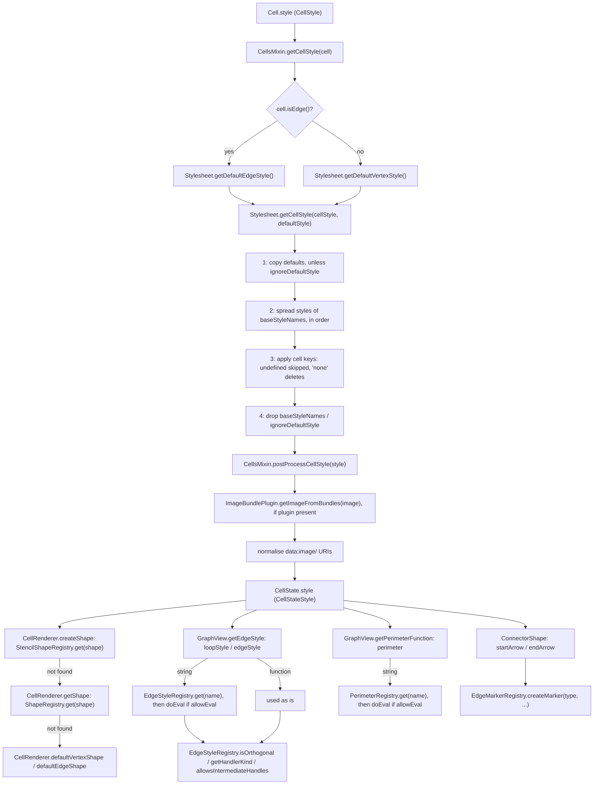

# Style and Registries

- **Basis**: commit `a2e1bd3`, version `0.25.2`
- **Files**: `src/view/style/Stylesheet.ts`, `src/view/style/config.ts`, `src/view/style/register.ts`,
  `src/view/style/builtin-style-elements.ts`, `src/view/style/edge/*` (`EdgeStyleRegistry.ts`, `Elbow.ts`,
  `EntityRelation.ts`, `Loop.ts`, `Manhattan.ts`, `Orthogonal.ts`, `Segment.ts`, `SideToSide.ts`, `TopToBottom.ts`,
  `shared.ts`, `index.ts`), `src/view/style/marker/*` (`edge-markers.ts`, `EdgeMarkerRegistry.ts`),
  `src/view/style/perimeter/*` (`PerimeterRegistry.ts`, `EllipsePerimeter.ts`, `HexagonPerimeter.ts`,
  `RectanglePerimeter.ts`, `RhombusPerimeter.ts`, `TrianglePerimeter.ts`, `index.ts`),
  `src/view/shape/ShapeRegistry.ts`, `src/view/shape/register-shapes.ts`, `src/view/shape/stencil/*`
  (`StencilShape.ts`, `StencilShapeRegistry.ts`, `register.ts`), `src/internal/BaseRegistry.ts`,
  `src/view/register-style-elements.ts`, `src/util/styleUtils.ts`, the style types of `src/types.ts`, the style
  constants of `src/util/Constants.ts`, `StyleDefaultsConfig` in `src/util/config.ts`; read for context:
  `CellsMixin.getCellStyle` / `postProcessCellStyle` in `src/view/mixin/CellsMixin.ts`, `ImageBundlePlugin` in
  `src/view/plugin/ImageBundlePlugin.ts`, the registry lookups of `src/view/GraphView.ts` and
  `src/view/cell/CellRenderer.ts`.

A cell carries a plain `CellStyle` object, not an mxGraph style string. The graph turns it into the `CellStateStyle`
stored on its `CellState` by merging the default vertex or edge style of the `Stylesheet`, the named styles listed in
`baseStyleNames`, and the cell's own properties, then post-processing image values. Several style properties are
*names* (`shape`, `edgeStyle`, `perimeter`, `startArrow`, `endArrow`) that are resolved lazily, at render or routing
time, against five global, module-level registries. Those registries start empty: `Graph` fills them with every
builtin when it is constructed, `BaseGraph` fills nothing, which is what makes the builtins tree-shakeable.

## Purpose and scope

The subsystem is responsible for:

- the style data model (`CellStyle`, `CellStateStyle` and their value types) and the named-style store
  (`Stylesheet`);
- the merge that produces the computed style of a cell (`Stylesheet.getCellStyle`), and the graph hook around it
  (`CellsMixin.getCellStyle`, `CellsMixin.postProcessCellStyle`);
- the registries mapping a style name to an implementation: `ShapeRegistry`, `StencilShapeRegistry`,
  `EdgeStyleRegistry`, `PerimeterRegistry`, `EdgeMarkerRegistry`, all built on `BaseRegistry`;
- the builtin implementations: 8 edge styles (connectors), 5 perimeters, 6 marker factories registered under 9
  names, 16 shapes, and the XML-driven `StencilShape`;
- the registration helpers (`registerDefault*`, `register*EdgeStyle`, `unregisterAll*`,
  `registerDefaultStyleElements`) and the global connector configuration (`*ConnectorConfig` with their reset
  functions), plus `StyleDefaultsConfig`;
- the style helpers of `styleUtils` that write cell styles (`setCellStyles`, `setCellStyleFlags`, `setStyleFlag`).
  The rest of `styleUtils` is DOM/CSS utilities (`getCurrentStyle`, `setPrefixedStyle`, `getOffset`,
  `getSizeForString`, `sortCells`, `getAlignmentAsPoint`, ...), unrelated to cell styles despite the file name.

Out of scope: when `CellState.style` is refreshed and how the view routes edges (see `view-and-rendering.md`), the
shape classes themselves, the edge handlers selected by `handlerKind` (see `cell-handlers.md`), and the XML codec of
the stylesheet (`StylesheetCodec`, see `serialization.md`).

## Concepts

| Term | Definition | Where |
|---|---|---|
| `CellStateStyle` | Interface of about 130 optional properties (appearance, label, routing, behaviour flags). It is the type of the computed style held by `CellState.style`, and of the named styles stored in a `Stylesheet`. | `src/types.ts` |
| `CellStyle` | `CellStateStyle` plus `baseStyleNames?: string[]` and `ignoreDefaultStyle?: boolean`. It is what `Cell.getStyle()` returns and what `GraphDataModel.setStyle` stores. | `src/types.ts` |
| `StyleValue` | `string \| number`, a loose alias, used only by `src/util/xmlUtils.ts`. | `src/types.ts` |
| Named style | A `CellStateStyle` stored under a name in `Stylesheet.styles`. Two names always exist: `defaultVertex` and `defaultEdge`. | `src/view/style/Stylesheet.ts` |
| Base style names | Ordered list of named styles merged before the cell's own properties. Later names override earlier ones; unknown names are ignored. No nesting: a named style's own `baseStyleNames` is not followed. | `Stylesheet.getCellStyle` |
| `NONE` (`'none'`) | Sentinel. A cell-level property equal to `'none'` deletes that key from the computed style. | `src/util/Constants.ts` |
| Registry | A `Map<string, V>` behind the `Registry<V>` interface (`add`, `get`, `getName`, `clear`). Global and shared by every graph in the page. | `src/internal/BaseRegistry.ts`, `src/types.ts` |
| Edge style (connector) | `EdgeStyleFunction(state, source, target, points, result): void`. Pushes the intermediate routed points into `result`. | `src/types.ts`, `src/view/style/edge/` |
| Edge style metadata | `EdgeStyleMetaData { handlerKind?, isOrthogonal?, allowIntermediateHandles? }`, attached to the *function* when it is registered. | `src/types.ts`, `EdgeStyleRegistry.ts` |
| Perimeter | `PerimeterFunction(bounds, vertex, next, orthogonal): Point \| null`. Projects `next` onto the outline of a vertex. | `src/types.ts`, `src/view/style/perimeter/` |
| Marker factory | `MarkerFactoryFunction(canvas, shape, type, pe, unitX, unitY, size, source, sw, filled): MarkerFunction`. Moves `pe` back to where the line must stop and returns a `() => void` that paints the marker. | `src/types.ts`, `src/view/style/marker/edge-markers.ts` |
| Shape constructor | `ShapeConstructor = Constructor<Shape>`, a class instantiated with `new` and no argument by `CellRenderer.createShape`. | `src/types.ts` |
| Stencil | A `StencilShape` (it extends `Shape`) built from an XML `<shape>` element and registered as an instance. The renderer does not use that instance as the cell shape: it creates `new Shape(stencil)`, whose paint delegates to `stencil.drawShape`. | `src/view/shape/stencil/StencilShape.ts` |
| Builtin value unions | `ShapeValue`, `EdgeStyleValue`, `PerimeterValue`, `ArrowValue` list the builtin names; `StyleShapeValue`, `StyleEdgeStyleValue`, `StyleArrowValue` add `(string & Record<never, never>)` so custom names type-check while keeping autocompletion. | `src/types.ts` |

`StyleEdgeStyleValue` is `EdgeStyleFunction | EdgeStyleValue | string | null`, and `CellStateStyle.perimeter` is
`PerimeterFunction | PerimeterValue | string | null`: both properties accept either a registered name or the function
itself. `CellStateStyle.loopStyle` only accepts an `EdgeStyleFunction`. `shape`, `indicatorShape`, `startArrow` and
`endArrow` only accept names.

## Contract

### Stylesheet (`src/view/style/Stylesheet.ts`, public)

| Member | Behaviour |
|---|---|
| `constructor()` | Creates `styles` and stores `createDefaultVertexStyle()` and `createDefaultEdgeStyle()` under `defaultVertex` / `defaultEdge`. |
| `styles: Map<string, CellStateStyle>` | The store. Public field, read directly by `Editor` and `StylesheetCodec`. |
| `createDefaultVertexStyle()` | `{ shape: 'rectangle', perimeter: 'rectanglePerimeter', verticalAlign: 'middle', align: 'center', fillColor: '#C3D9FF', strokeColor: '#6482B9', fontColor: '#774400' }`. Override in a subclass to change the defaults. |
| `createDefaultEdgeStyle()` | `{ shape: 'connector', endArrow: 'classic', verticalAlign: 'middle', align: 'center', strokeColor: '#6482B9', fontColor: '#446299' }`. |
| `putDefaultVertexStyle(style)` / `putDefaultEdgeStyle(style)` | `putCellStyle('defaultVertex' \| 'defaultEdge', style)`. |
| `getDefaultVertexStyle()` / `getDefaultEdgeStyle()` | Return the stored object itself (not a copy), so mutating it changes every cell that uses the default once its style is recomputed. |
| `putCellStyle(name, style)` | `styles.set(name, style)`, by reference, overwriting any previous entry. |
| `getCellStyle(cellStyle, defaultStyle)` | The merge, see below. Returns a new object every call; never mutates `defaultStyle`, the named styles or `cellStyle`. |

There is no `removeCellStyle` or `getCellStyleByName`; callers use `styles` directly.

Merge order of `getCellStyle`:

1. start from `{ ...defaultStyle }`, or `{}` when `cellStyle.ignoreDefaultStyle` is `true`;
2. for each name of `cellStyle.baseStyleNames`, in array order, spread `styles.get(name)` over the result (an unknown
   name spreads `undefined`, a no-op);
3. for each own key of `cellStyle` whose value is not `undefined`: delete the key if the value `== 'none'`, otherwise
   assign it;
4. delete `baseStyleNames` and `ignoreDefaultStyle` from the result.

### Computing the style of a cell (`src/view/mixin/CellsMixin.ts`, on every graph)

| Member | Behaviour |
|---|---|
| `getCellStyle(cell)` | `postProcessCellStyle(stylesheet.getCellStyle(cell.getStyle(), defaultStyle ?? {}))`, where `defaultStyle` is `getDefaultEdgeStyle()` for an edge, `getDefaultVertexStyle()` otherwise. |
| `getCurrentCellStyle(cell, ignoreState = false)` | Returns `view.getState(cell).style` when a state exists and `ignoreState` is false, else `getCellStyle(cell)`. |
| `postProcessCellStyle(style)` | Returns `style` unchanged when `style.image` is falsy. Otherwise: asks `getPlugin<ImageBundlePlugin>('image-bundle')?.getImageFromBundles(key)` and replaces `style.image` with the match; then, if the image (resolved or raw key) starts with `data:image/`, normalises it: `data:image/svg+xml,<...` gets everything after the comma URI-encoded, any other non-`;base64,` data URI (except an already encoded `data:image/svg+xml,%3C`) gets `;base64,` inserted before the comma. Mutates and returns the same object. |
| `setCellStyle(style, cells?)` | Calls `GraphDataModel.setStyle` for each cell (default: the selection) in one `batchUpdate`. |

The consumers of `getCellStyle` are `GraphView.createState`, `GraphView.validateCellState` (when `state.invalidStyle`),
`GraphView.getState(cell, true)` (when `view.updateStyle`), `VertexHandle`, `VertexHandler`, `SwimlaneManager`,
`StackLayout` and `ConnectionHandler`.

### Registries

All five are module-level singletons, exported from `src/index.ts` and typed by an interface, so the implementation
class is private.

| Registry | Value type | Key type | Interface | Extra API | File |
|---|---|---|---|---|---|
| `ShapeRegistry` | `ShapeConstructor` | `string` (`StyleShapeValue`) | `Registry<ShapeConstructor>` | none | `src/view/shape/ShapeRegistry.ts` |
| `StencilShapeRegistry` | `StencilShape` instance | `string` | `Registry<StencilShape>` | none | `src/view/shape/stencil/StencilShapeRegistry.ts` |
| `EdgeStyleRegistry` | `EdgeStyleFunction` | `string` (`EdgeStyleValue` + custom) | `EdgeStyleRegistryInterface` | `add(name, fn, metaData?)`, `isOrthogonal(fn)`, `getHandlerKind(fn)`, `allowsIntermediateHandles(fn)` | `src/view/style/edge/EdgeStyleRegistry.ts` |
| `PerimeterRegistry` | `PerimeterFunction` | `string` (`PerimeterValue` + custom) | `Registry<PerimeterFunction>` | none | `src/view/style/perimeter/PerimeterRegistry.ts` |
| `EdgeMarkerRegistry` | `MarkerFactoryFunction` | `string` (`StyleArrowValue`) | `EdgeMarkerRegistryInterface` | `createMarker(canvas, shape, type, pe, unitX, unitY, size, source, sw, filled)` | `src/view/style/marker/EdgeMarkerRegistry.ts` |

`Registry<V>` (`src/types.ts`), implemented by `BaseRegistry<V>` (`src/internal/BaseRegistry.ts`, not public):

| Method | Behaviour |
|---|---|
| `add(name, value)` | `Map.set`, overwrites silently. |
| `get(name)` | Accepts `null` / `undefined`; returns the value or `null`. |
| `getName(value)` | Linear scan, returns the *first* name whose value is `===` to `value`, or `null`. Used by `getNameFromRegistries` in `src/serialization/codec/utils.ts` (edge styles and perimeters only) to encode a function-valued style as its name. |
| `clear()` | Empties the map. Documented as private: call the matching `unregisterAll*` function instead, which also resets the "registered" flag. |

There is no single-entry removal method on any registry.

`EdgeStyleRegistry` keeps three extra maps keyed by the *function*, not the name:

| Query | Default when the function is unknown or the field was not given |
|---|---|
| `isOrthogonal(fn)` | `false` |
| `getHandlerKind(fn)` | `'default'` |
| `allowsIntermediateHandles(fn)` | `true` |

`add` only writes a metadata field when it is provided (`handlerKind` when truthy, the two booleans when not
nullish); `clear` empties all four maps. The consumers are `AbstractGraph.isOrthogonal` (when
`CellStateStyle.orthogonal` is nullish), `SelectionCellsHandler.createEdgeHandler` (`getHandlerKind` selects the entry
of `edgeHandlerFactories`, falling back to `'default'`) and `EdgeHandler.isHandleVisible`
(`allowsIntermediateHandles`).

`EdgeMarkerRegistry.createMarker` looks the factory up with `get(type)` and calls it with all its arguments, or
returns `null` when none is registered. It is called by `ConnectorShape` (`src/view/shape/edge/ConnectorShape.ts`)
with `size = startSize/endSize ?? StyleDefaultsConfig.markerSize` and `filled = startFill/endFill ?? true`.

### Registration functions

| Function | File | Effect | Since |
|---|---|---|---|
| `registerDefaultStyleElements()` | `src/view/register-style-elements.ts` | Calls `registerDefaultEdgeMarkers`, `registerDefaultEdgeStyles`, `registerDefaultPerimeters`, `registerDefaultShapes`. This is exactly `Graph.registerDefaults`. | 0.25.0 |
| `registerDefaultEdgeStyles()` | `src/view/style/register.ts` | Calls the 8 `register*EdgeStyle` helpers, once (module flag). | 0.18.0 |
| `registerElbowEdgeStyle()`, `registerEntityRelationEdgeStyle()`, `registerLoopEdgeStyle()`, `registerManhattanEdgeStyle()`, `registerOrthogonalEdgeStyle()`, `registerSegmentEdgeStyle()`, `registerSideToSideEdgeStyle()`, `registerTopToBottomEdgeStyle()` | `src/view/style/register.ts` | Registers one builtin with its metadata; not guarded by the flag. | 0.24.0 |
| `registerDefaultPerimeters()` | `src/view/style/register.ts` | Registers the 5 builtin perimeters, once. | 0.18.0 |
| `registerDefaultEdgeMarkers()` | `src/view/style/register.ts` | Registers the 9 builtin marker names, once. | 0.18.0 |
| `registerDefaultShapes()` | `src/view/shape/register-shapes.ts` | Registers the 16 builtin shapes, once. | 0.18.0 |
| `unregisterAllEdgeStyles()`, `unregisterAllPerimeters()`, `unregisterAllEdgeStylesAndPerimeters()`, `unregisterAllEdgeMarkers()`, `unregisterAllShapes()` | same files | `clear()` the registry and reset its "registered" flag. | 0.18.0 / 0.20.0 |
| `unregisterAllStencilShapes()` | `src/view/shape/stencil/register.ts` | `StencilShapeRegistry.clear()`; there is no flag and no default stencil. | 0.18.0 |

### Builtin catalog

The namespaces `EdgeStyle`, `Perimeter` and `EdgeMarker` are re-exports of `edge/index.ts`, `perimeter/index.ts`
and `marker/edge-markers.ts` (`src/view/style/builtin-style-elements.ts`).

Edge styles, registered by `registerDefaultEdgeStyles`:

| Name | Function | `isOrthogonal` | `handlerKind` | `allowIntermediateHandles` | Notes |
|---|---|---|---|---|---|
| `elbowEdgeStyle` | `EdgeStyle.ElbowConnector` (`Elbow.ts`) | `true` | `elbow` | default (`true`) | Delegates to `TopToBottom` when `style.elbow === 'vertical'` or the geometry is vertical, else `SideToSide`. |
| `entityRelationEdgeStyle` | `EdgeStyle.EntityRelation` (`EntityRelation.ts`) | `true` | default | `false` | Horizontal segment of `style.segment ?? EntityRelationConnectorConfig.segment`, scaled. |
| `loopEdgeStyle` | `EdgeStyle.Loop` (`Loop.ts`) | `false` | `elbow` | default | Also `AbstractGraph.defaultLoopStyle`; uses `style.segment ?? graph.gridSize` and `style.direction ?? 'west'`. |
| `manhattanEdgeStyle` | `EdgeStyle.ManhattanConnector` (`Manhattan.ts`) | `true` | `segment` | default | A* router avoiding vertices; configured by `ManhattanConnectorConfig`. |
| `orthogonalEdgeStyle` | `EdgeStyle.OrthConnector` = `OrthogonalConnector` (`Orthogonal.ts`) | `true` | `segment` | default | Pattern router with jetties; configured by `OrthogonalConnectorConfig`. |
| `segmentEdgeStyle` | `EdgeStyle.SegmentConnector` (`Segment.ts`) | `true` | `segment` | default | Orthogonal route through the control points. |
| `sideToSideEdgeStyle` | `EdgeStyle.SideToSide` (`SideToSide.ts`) | `true` | `elbow` | default | Horizontal elbow. |
| `topToBottomEdgeStyle` | `EdgeStyle.TopToBottom` (`TopToBottom.ts`) | `true` | `elbow` | default | Vertical elbow. |

Fallback chains between connectors: `ManhattanConnector` calls `SegmentConnector` when control points exist or a
terminal is missing, and `OrthogonalConnector` when a bounding box is missing or no route is found within
`maxLoops`. `OrthogonalConnector` calls `SegmentConnector` when the terminal points are closer than both jetties, when
`OrthogonalConnectorConfig.pointsFallback` is true and control points exist, or when a terminal is an edge.

Perimeters, registered by `registerDefaultPerimeters`:

| Name | Function | Uses `vertex.style` |
|---|---|---|
| `ellipsePerimeter` | `Perimeter.EllipsePerimeter` | no |
| `hexagonPerimeter` | `Perimeter.HexagonPerimeter` | `direction ?? 'east'` (north/south = vertical hexagon) |
| `rectanglePerimeter` | `Perimeter.RectanglePerimeter` | no |
| `rhombusPerimeter` | `Perimeter.RhombusPerimeter` | no |
| `trianglePerimeter` | `Perimeter.TrianglePerimeter` | `direction` |

Edge markers, registered by `registerDefaultEdgeMarkers`:

| Name | Factory | Notes |
|---|---|---|
| `classic` | `EdgeMarker.createArrow(2)` | Notched arrow: `createArrow` draws the notch when `type` is `classic` or `classicThin`. |
| `classicThin` | `EdgeMarker.createArrow(3)` | |
| `block` | `EdgeMarker.createArrow(2)` | Same factory as `classic`, no notch because of `type`. |
| `blockThin` | `EdgeMarker.createArrow(3)` | |
| `open` | `EdgeMarker.createOpenArrow(2)` | Stroke only, ignores `filled`. |
| `openThin` | `EdgeMarker.createOpenArrow(3)` | |
| `oval` | `EdgeMarker.oval` | |
| `diamond` | `EdgeMarker.diamond` | Thick variant when `type === 'diamond'`. |
| `diamondThin` | `EdgeMarker.diamond` | Same function, thin variant selected by `type`. |

`'none'` is part of `ArrowValue` but is not registered: it simply finds no factory.

Shapes, registered by `registerDefaultShapes` (classes under `src/view/shape/node/` and `src/view/shape/edge/`):

| Name | Class | Name | Class |
|---|---|---|---|
| `actor` | `ActorShape` | `hexagon` | `HexagonShape` |
| `arrow` | `ArrowShape` | `image` | `ImageShape` |
| `arrowConnector` | `ArrowConnectorShape` | `label` | `LabelShape` |
| `cloud` | `CloudShape` | `line` | `LineShape` |
| `connector` | `ConnectorShape` | `rectangle` | `RectangleShape` |
| `cylinder` | `CylinderShape` | `rhombus` | `RhombusShape` |
| `doubleEllipse` | `DoubleEllipseShape` | `swimlane` | `SwimlaneShape` |
| `ellipse` | `EllipseShape` | `triangle` | `TriangleShape` |

`PolylineShape` and `TextShape` are public but not registered. `CellRenderer.defaultVertexShape` (`RectangleShape`)
and `CellRenderer.defaultEdgeShape` (`ConnectorShape`) are used when the `shape` name resolves to nothing.

### Stencils (`src/view/shape/stencil/StencilShape.ts`, public)

`new StencilShape(desc: Element)` parses `w`/`h` (default 100), `aspect` (`'variable'` when absent, `'fixed'` keeps the
ratio), `strokewidth` (`'1'` when absent, or `'inherit'`), the `<background>` / `<foreground>` nodes and the
`<connections>` constraints. `drawShape(canvas, shape, x, y, w, h)` interprets the drawing nodes (`path`, `move`,
`line`, `quad`, `curve`, `arc`, `rect`, `roundrect`, `ellipse`, `image`, `text`, `include-shape`, `fillstroke`, `fill`,
`stroke`, colour, alpha, font, dash and line attributes, `save` / `restore`). `include-shape` looks another stencil up
in `StencilShapeRegistry`. `StencilShapeConfig` holds `allowEval` (default `false`) and `defaultLocalized` (default
`false`); `resetStencilShapeConfig()` restores them (since 0.23.0).

### Global configuration

| Object | File | Fields (default) | Reset |
|---|---|---|---|
| `EntityRelationConnectorConfig` | `src/view/style/config.ts` | `segment` (`ENTITY_SEGMENT` = 30) | `resetEntityRelationConnectorConfig()` |
| `OrthogonalConnectorConfig` | `src/view/style/config.ts` | `buffer` (10), `pointsFallback` (`true`) | `resetOrthogonalConnectorConfig()` |
| `ManhattanConnectorConfig: ManhattanConnectorConfigType` | `src/view/style/config.ts` | `maxAllowedDirectionChange` (90), `maxLoops` (2000), `startDirections` / `endDirections` (all four), `step` (12) | `resetManhattanConnectorConfig()` |
| `StencilShapeConfig` | `src/view/shape/stencil/StencilShape.ts` | `allowEval` (`false`), `defaultLocalized` (`false`) | `resetStencilShapeConfig()` |
| `StyleDefaultsConfig` | `src/util/config.ts` | `arrowSize` (30), `arrowSpacing` (0), `arrowWidth` (30), `fontFamily` (`'Arial,Helvetica,sans-serif'`), `fontSize` (11), `imageSize` (24), `lineArcSize` (20), `markerSize` (6), `roundingFactor` (0.15), `shadowColor` (`'gray'`), `shadowOffsetX` (2), `shadowOffsetY` (3), `shadowOpacity` (1), `startSize` (40) | `resetStyleDefaultsConfig()` |

All are marked `@experimental`. They are read at call time, so a change applies to the next routing or paint. The
resets go through `shallowCopy` (`src/internal/clone-utils.ts`), which copies arrays, so the Manhattan direction
arrays are restored even after an in-place mutation. `StyleDefaultsConfig` is not in `src/view/style/config.ts` but in
`src/util/config.ts`; its default values are the constants `ARROW_SIZE`, `ARROW_SPACING`, `ARROW_WIDTH`,
`DEFAULT_FONTFAMILY`, `DEFAULT_FONTSIZE`, `DEFAULT_IMAGESIZE`, `LINE_ARCSIZE`, `DEFAULT_MARKERSIZE`,
`RECTANGLE_ROUNDING_FACTOR`, `SHADOWCOLOR`, `SHADOW_OFFSET_X`, `SHADOW_OFFSET_Y`, `SHADOW_OPACITY`, `DEFAULT_STARTSIZE`
of `src/util/Constants.ts`. Other style constants there: `NONE`, `FONT_STYLE_MASK` (`BOLD` 1, `ITALIC` 2,
`UNDERLINE` 4, `STRIKETHROUGH` 8), `DIRECTION_MASK` (`NONE` 0, `WEST` 1, `NORTH` 2, `SOUTH` 4, `EAST` 8, `ALL` 15),
`DEFAULT_TEXT_DIRECTION`, `LINE_HEIGHT`, `WORD_WRAP`, `ABSOLUTE_LINE_HEIGHT`, `DEFAULT_FONTSTYLE`, `ENTITY_SEGMENT`.

### Style writing helpers (`src/util/styleUtils.ts`, public as `styleUtils`)

| Function | Behaviour |
|---|---|
| `setCellStyles(model, cells, key, value)` | In one `model.batchUpdate`, clones each cell style with `cell.getClonedStyle()`, sets `key` (or deletes it when `value` is nullish) and calls `model.setStyle`. |
| `setCellStyleFlags(model, cells, key, flag, value?)` | Same pattern with `setStyleFlag`. `key` is a `NumericCellStateStyleKeys`. |
| `setStyleFlag(style, key, flag, value?)` | Mutates `style[key]`: sets, clears, or toggles (when `value` is `undefined`) the bit `flag`. Unset key becomes `flag` or `0`. |

## Invariants

- `Stylesheet.styles` always holds `defaultVertex` and `defaultEdge` after construction, unless a caller deletes them
  through the public map; `getDefault*Style` then return `undefined` and `CellsMixin.getCellStyle` falls back to `{}`.
- `Stylesheet.getCellStyle` returns a fresh object; mutating it (as `postProcessCellStyle` does for `image`) never
  touches the stylesheet or the cell.
- The computed style never contains `baseStyleNames` or `ignoreDefaultStyle`.
- A cell-level `undefined` value never overrides anything; a cell-level `'none'` always removes the key.
- Registries are global: a registration affects every graph of the page, including graphs created earlier, at their
  next style lookup.
- A registry lookup never throws: unknown names yield `null`, and each consumer has a fallback (default shape, no edge
  style, no perimeter, no marker).
- `registerDefault*` are idempotent while their flag is set; `unregisterAll*` clears both registry and flag, so a
  later `registerDefault*` registers again.
- `EdgeStyleRegistry` metadata is keyed by function identity: the same function registered under two names shares one
  metadata record.
- Edge styles and perimeters are pure with respect to the model: they read the states and the global configs and only
  write into `result` (edge styles) or return a new `Point` (perimeters). Marker factories mutate the `pe` argument by
  contract.

## Workflows

### Style resolution and lookups

### Resolving `edgeStyle: 'orthogonalEdgeStyle'` versus a function

1. `GraphView.updatePoints` calls `GraphView.getEdgeStyle(edge, points, source, target)`.
2. If `GraphView.isLoopStyleEnabled` returns true, the candidate is `style.loopStyle ?? graph.defaultLoopStyle`
   (`EdgeStyle.Loop`, a function, so it works without registration). Otherwise it is `style.edgeStyle`, or `null`
   when `style.noEdgeStyle` is true.
3. A string candidate is looked up with `EdgeStyleRegistry.get`. If nothing is registered under that name and
   `GraphView.allowEval` is true (default `false`), the string is evaluated with `doEval`. A string that resolves to
   nothing becomes `null`.
4. A function candidate (given directly, or obtained in step 3) is returned; anything else returns `null`.
5. `updatePoints` calls the function only when it is non-null **and** the source state exists; otherwise the control
   points are transformed and used as is (straight segments).
6. The metadata used afterwards depends only on the function identity. So `edgeStyle: EdgeStyle.OrthConnector` routes
   exactly like `'orthogonalEdgeStyle'`, but its `isOrthogonal` and `handlerKind` are only known if that function was
   registered (under any name). Unregistered, the edge gets `isOrthogonal = false` (unless `style.orthogonal` is set)
   and the `'default'` edge handler.

`perimeter` follows the same string / function / `allowEval` path in `GraphView.getPerimeterFunction`. A `null`
perimeter makes `GraphView.getPerimeterPoint` fall back to `GraphView.getPoint(terminal)`.

### Registering only what an application uses (`BaseGraph`)

`AbstractGraph` calls `this.registerDefaults()` first in its constructor. `AbstractGraph.registerDefaults` does
nothing; `Graph.registerDefaults` calls `registerDefaultStyleElements()`; `BaseGraph` does not override it. A
`BaseGraph` application therefore:

1. registers the shapes its styles name: `ShapeRegistry.add('ellipse', EllipseShape)`. The default vertex and edge
   shapes (`rectangle`, `connector`) need no registration since they are the `CellRenderer` fallbacks;
2. registers each edge style through its helper (`registerOrthogonalEdgeStyle()`), so the metadata is right;
3. registers the perimeters, including `rectanglePerimeter` if it keeps the default vertex style:
   `PerimeterRegistry.add('rectanglePerimeter', Perimeter.RectanglePerimeter)`;
4. registers the markers, including `classic` if it keeps the default edge style:
   `EdgeMarkerRegistry.add('classic', EdgeMarker.createArrow(2))`;
5. adds `ImageBundlePlugin` to `plugins` if styles reference image bundle keys.

Registration is module state, so it can happen once at application start, before or after creating graphs. Each
import of a named builtin pulls only that module; importing the `EdgeStyle` / `Perimeter` / `EdgeMarker` namespaces or
calling any `registerDefault*` pulls all of their members. `register.ts` imports the three namespaces, so even a
single `register*EdgeStyle` helper pulls every builtin edge style, perimeter and marker into the bundle unless the
bundler tree-shakes namespace members.

### Adding a stencil

Parse the XML (with `parseXml` of `src/util/xmlUtils.ts`), create `new StencilShape(shapeElement)` for each `<shape>`
and `StencilShapeRegistry.add(name, stencil)`. A cell with `style.shape = name` is then painted by
`CellRenderer.createShape`, which returns `new Shape(stencil)`; `GraphView.updateBoundsFromStencil` uses the stencil
bounds during edge routing.

## Events

This subsystem fires no `InternalEvent`. Style changes reach the view through `GraphDataModel.setStyle` and its
`StyleChange` (see `model-and-transactions.md`); registry and stylesheet mutations fire nothing, so an already
rendered graph shows them only after its states are revalidated (for example `graph.refresh()`).

## Extension points

| Extension | How |
|---|---|
| Custom shape | Subclass `Shape` and `ShapeRegistry.add(name, Ctor)`; reference it with `style.shape`. |
| Custom stencil | `StencilShapeRegistry.add(name, new StencilShape(xml))`; takes precedence over a `ShapeRegistry` entry of the same name. |
| Custom edge style | Write an `EdgeStyleFunction` and `EdgeStyleRegistry.add(name, fn, { handlerKind, isOrthogonal, allowIntermediateHandles })`. A custom `handlerKind` string pairs with `SelectionCellsHandler.setEdgeHandlerFactory(kind, factory)`. |
| Custom perimeter | `PerimeterRegistry.add(name, fn)`, or set the function directly on `style.perimeter`. |
| Custom marker | `EdgeMarkerRegistry.add(name, factory)`; the factory must move `pe` to where the line stops and return the painter. |
| Named styles | `graph.getStylesheet().putCellStyle(name, style)`, referenced by `baseStyleNames`. |
| Different defaults | Mutate `getDefaultVertexStyle()` / `getDefaultEdgeStyle()`, call `putDefault*Style`, subclass `Stylesheet` and override `createDefault*Style`, or pass `stylesheet` in `GraphOptions` (`Graph` also has `createStylesheet()`). |
| Style post-processing | Override `postProcessCellStyle` (a mixin method of `AbstractGraph`) to rewrite computed styles, keeping the image handling. |
| Image keys | Register `ImageBundlePlugin` and `addImageBundle(bundle)`; bundles are searched in insertion order, first match wins. |
| Loop routing | Set `graph.defaultLoopStyle` or `style.loopStyle`. |
| Fallback shapes | Set `CellRenderer.defaultVertexShape` / `defaultEdgeShape`. |
| Custom style properties | Module-augment `CellStateStyle` (it is an interface); `Stylesheet.getCellStyle` merges unknown keys like any other. |
| Connector tuning | `EntityRelationConnectorConfig`, `OrthogonalConnectorConfig`, `ManhattanConnectorConfig` (global). |

## Traps

- **`undefined` behaves differently by level.** In the cell style an `undefined` value is skipped, so the default or
  base value shows through. In a named base style it is spread like any value and *does* overwrite the default with
  `undefined` (pinned by `__tests__/view/style/StyleSheet.test.ts`).
- **`'none'` only deletes at cell level.** A `'none'` inside a named style or the default style survives into the
  computed style as the string `'none'`. Deleting `endArrow` with `'none'` and storing `endArrow: 'none'` both end up
  with no marker, but only because `'none'` is not registered.
- **No nested inheritance.** A named style's own `baseStyleNames` is ignored.
- **`putCellStyle` and `getDefault*Style` share references.** Editing the object later edits the named style; nothing
  is notified, and states keep their cached style until revalidated.
- **`BaseGraph` renders with the default stylesheet but no registrations.** Vertices still draw as rectangles and
  edges as connectors (renderer fallbacks), but `rectanglePerimeter` and `classic` are unresolved, so edges end at the
  vertex point returned by `GraphView.getPoint` and have no arrow, without any warning.
- **Metadata follows the function, not the name.** Re-registering a function under an alias without metadata keeps
  its old metadata; registering it with other metadata changes it for every name. Using a function value in a style
  without having registered it silently loses `isOrthogonal` and `handlerKind`.
- **Bypassing `unregisterAll*`.** `XxxRegistry.clear()` empties the map but leaves the module flag set, so the next
  `registerDefault*` is a no-op and the builtins never come back.
- **Builtins are distinguished by `type`, not by the factory.** `classic`/`block` and `diamond`/`diamondThin` share a
  factory body; the variant comes from the `type` argument. Registering `EdgeMarker.diamond` under a custom name gives
  the thin variant, and `createArrow` under a custom name never draws the notch.
- **`getName` returns the first alias.** `EdgeMarker.diamond` registered twice encodes as `diamond`; for edge styles
  and perimeters this is what the codecs write.
- **`StencilShapeRegistry` shadows `ShapeRegistry`.** A stencil named `rectangle` replaces the builtin for every
  graph.
- **`eval` paths.** `GraphView.allowEval` lets unknown `edgeStyle` / `perimeter` strings be evaluated, and
  `StencilShapeConfig.allowEval` lets stencil text content be evaluated; both default to `false` and are a code
  injection risk with untrusted styles or stencils.
- **`postProcessCellStyle` rewrites data URIs.** A `data:image/png,xyz` value becomes `data:image/png;base64,xyz`,
  following the mxGraph short form; a URI that is already encoded differently may be altered.
- **Module-level scratch arrays in `OrthogonalConnector`.** `wayPoints1`, `limits` and `vertexSeparations` are shared
  across calls; the function is not reentrant (safe only because routing is synchronous).
- **`ManhattanConnector` cost.** Each call rebuilds an obstacle map from every vertex state of the view and runs up to
  `maxLoops` iterations with a sorted-array open set, so routing many Manhattan edges scales poorly.
- **`SegmentConnector` route depends on the scale** below about 0.15, see the comment in `pushPoint` and issue #1322.
- **`EllipsePerimeter` truncates** `dx` / `dy` with `Number.parseInt(String(...))`, so a `next` point within one unit
  of the centre axis is treated as on it.
- **`StencilShape` alpha nodes.** `fillalpha` and `strokealpha` both call `canvas.setAlpha`, so they set the global
  alpha rather than the fill or stroke alpha.
- **`StencilShape.aspect`** is initialised to `'auto'` but `parseDescription` sets `'variable'` when the attribute is
  absent; only `'fixed'` changes behaviour.
- **`styleUtils` is mostly not about cell styles**, and `setCellStyles` must clone the style
  (`cell.getClonedStyle()`) because `model.setStyle` with the same object does not fire a change (comment in the
  source).

## Open items

- `TODO: Figure out what to do when there are nulls in pts` in `OrthogonalConnector` (`Orthogonal.ts`) and
  `SegmentConnector` (`Segment.ts`); `TODO remove magic numbers` for the masks of `Orthogonal.ts`.
- `FIXME: First click in connect preview toggles orientation` in `SegmentConnector`.
- Issue #1322: `SegmentConnector.pushPoint` tolerance asymmetry inherited from mxGraph makes the route scale dependent.
- `BaseRegistry.getName` is a linear scan; the source suggests a reverse map if registries grow.
- No single-entry removal API on any registry, and no `Stylesheet` method to remove or list named styles
  (`Editor` reads `stylesheet.styles` directly, "as there is no public API to get styles").
- `HexagonPerimeter`, horizontal orthogonal branch, `py === y + h` case: the second test reads `py > cy` where the
  symmetric `py === y` case tests `px > cx`; it looks like a copy error (behaviour: any `px >= cx` returns the
  three-quarter corner).
- `StencilShape`: `LATER: Preprocess nodes for faster painting` and the long `TODO` in `drawShape`; `fillalpha` /
  `strokealpha` mapping to `setAlpha` (see Traps).
- `GraphView.isLoopStyleEnabled` (outside this slice): as written, `!(orthogonalLoop || (no source point && no target
  point))`, the loop style is used only when `orthogonalLoop` is false *and* at least one terminal has a
  connection-constraint point, so a plain self-loop without constraints is routed by `edgeStyle` instead. Its JSDoc is
  truncated mid-sentence. Worth checking against the mxGraph original.
- `register.ts` imports the whole `EdgeStyle`, `Perimeter` and `EdgeMarker` namespaces, so the per-element helpers
  depend on namespace tree-shaking to stay cheap; measuring it is left to the bundle-size tooling.
- All connector configs and `StyleDefaultsConfig` are `@experimental` global state; there is no per-graph override.
- Type looseness: `StyleValue` is used by none of the style interfaces (only by `src/util/xmlUtils.ts`),
  `Stylesheet.createDefault*Style` cast with
  `as CellStateStyle`, and `Stylesheet.getCellStyle` relies on `@ts-ignore` for the key loop.
