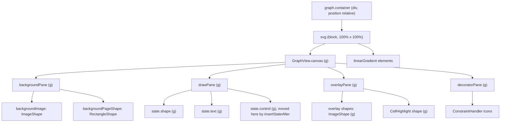
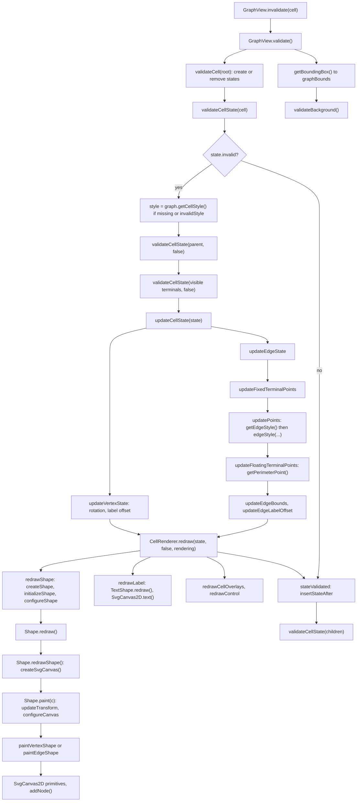

# View and Rendering

- **Basis**: commit `a2e1bd3`, version `0.25.2`
- **Files**: `src/view/GraphView.ts`; `src/view/cell/CellState.ts`, `CellRenderer.ts`, `CellOverlay.ts`,
  `CellHighlight.ts`, `TemporaryCellStates.ts`, `CellStatePreview.ts`; `src/view/shape/Shape.ts`,
  `src/view/shape/node/*`, `src/view/shape/edge/*`; `src/view/canvas/AbstractCanvas2D.ts`, `SvgCanvas2D.ts`,
  `XmlCanvas2D.ts`; `src/view/image/ImageBox.ts`, `ImageBundle.ts`, `ImageExport.ts`; `src/view/animate/Animation.ts`,
  `Effects.ts`, `Morphing.ts`. All paths are relative to `packages/core`.

The view turns the cell hierarchy of the data model into pixels. `GraphView` keeps one `CellState` per visible cell
and stores in it the absolute, scaled and translated geometry, the resolved style, the routed points of edges and the
label offset. `CellRenderer` creates, configures, orders and destroys the DOM shapes of every state. Each `Shape`
paints itself through an `AbstractCanvas2D`: an `SvgCanvas2D` for the live display, or an `XmlCanvas2D` for export
through `ImageExport`. This spec describes that pipeline as the source implements it, including the parts inherited
unchanged from mxGraph and the places where the code and its JSDoc disagree.

## Purpose and scope

The subsystem is responsible for:

- computing, caching and invalidating the view state of cells (`GraphView`, `CellState`);
- the coordinate transform from model to screen (`GraphView.scale`, `GraphView.translate`, `GraphView.currentRoot`);
- the routing of edges: terminal points, perimeter points, the call to the edge style function;
- the DOM structure of the display (the SVG panes) and the forwarding of native DOM events to the graph;
- creating and redrawing shapes, labels, overlays and folding controls (`CellRenderer`);
- painting shapes on a canvas (`Shape` and its subclasses, `AbstractCanvas2D` and its subclasses);
- export of states to a canvas (`ImageExport`, `XmlCanvas2D`) and temporary states for export (`TemporaryCellStates`);
- animation helpers (`Animation`, `Morphing`, `Effects`, `CellStatePreview`) and cell highlighting (`CellHighlight`).

Out of scope, covered by other specs: the stylesheet and the registries of shapes, stencils, edge styles, perimeters
and markers (`style-and-registries.md`); the model, `Cell`, `Geometry` and undoable changes
(`model-and-transactions.md`); the mouse event dispatch, handlers and plugins (`events-and-interaction.md`); the graph
class hierarchy and mixin composition (`graph-lifecycle.md`). `ShapeRegistry`, `registerDefaultShapes` and the stencil
files are only referenced here as collaborators.

Every file of this slice is public: each is exported from `src/index.ts`, with `GraphView` as a named export and the
others as default exports.

## Concepts

### Coordinate spaces

Three spaces coexist, and confusing them is the most common source of bugs.

| Space | Definition | Where it is used |
|---|---|---|
| Model, relative | `Geometry.x/y/width/height`, relative to the parent, or fractions of the parent size when `Geometry.relative` | `Cell.getGeometry()` |
| Model, absolute | relative coordinates accumulated along the parents: `CellState.origin` | `CellState.origin`, `CellState.cellBounds`, `Morphing.getOriginForCell` |
| View (screen) | `view = (absoluteModel + translate) * scale` | `CellState.x/y/width/height`, `absolutePoints`, `Shape.bounds`, `Shape.points`, `graphBounds` |

The rule is applied in `GraphView.updateCellState`: `state.x = scale * (translate.x + origin.x)`,
`state.width = scale * geo.width`. The inverse is applied in `CellState.updateCachedBounds`:
`cellBounds.x = state.x / scale - translate.x`. `GraphView.transformControlPoint` applies the same rule to the
control points of an edge, and `GraphView.getFixedTerminalPoint` to the terminal points stored in the geometry.

A shape paints in a fourth space, "unscaled view": `Shape.paint` divides `bounds` and `points` by `Shape.scale` and then
calls `c.scale(this.scale)` through `Shape.updateTransform`, so the paint hooks (`paintVertexShape`, `paintEdgeShape`)
receive coordinates that include the translate but not the scale. The canvas multiplies them back by its state scale
when writing the output (`AbstractCanvas2D.addOp`, `SvgCanvas2D.rect`).

### CellState fields

`CellState` extends `Rectangle`, so its `x`, `y`, `width` and `height` are the view bounds of the cell.

| Field | Space | Meaning | Written by |
|---|---|---|---|
| `x`, `y`, `width`, `height` | view | bounds of a vertex; bounding box of the points of an edge | `updateCellState`, `updateEdgeBounds` |
| `unscaledWidth`, `unscaledHeight` | model | `geo.width`, `geo.height` | `updateCellState` |
| `origin` | model, absolute | origin of the children of this cell | `updateCellState` |
| `absoluteOffset` | view | vertex: offset of the label from the top left corner, already scaled; edge: absolute label position | `updateCellState`, `updateVertexLabelOffset`, `updateEdgeLabelOffset` |
| `absolutePoints` | view | edge points, the first and last being the terminal points; `null` entries allowed while routing | `updateFixedTerminalPoints`, `updatePoints`, `updateFloatingTerminalPoints` |
| `segments`, `length`, `terminalDistance` | view | length of each segment, total length, distance between end points | `updateEdgeBounds` |
| `visibleSourceState`, `visibleTargetState` | n/a | cached states of the visible terminals | `validateCellState` |
| `style` | n/a | resolved `CellStateStyle` | `createState`, `getState`, `validateCellState` |
| `invalid` | n/a | the state must be recomputed, `true` on creation | `invalidate`, `validateCellState`, `removeState` |
| `invalidStyle` | n/a | the style must be re-resolved on next validation | `AbstractGraph.processChange` for a `StyleChange` |
| `cellBounds`, `paintBounds` | model, absolute | unscaled, untranslated bounds; `paintBounds` rotated by 90 degrees when the shape inverts its bounds | `updateCachedBounds` |
| `shape`, `text`, `control`, `overlays` | n/a | the shape, the label `TextShape`, the folding icon, the overlay shapes by `CellOverlay` | `CellRenderer` |
| `boundingBox`, `node`, `point`, `parentHighlight` | n/a | auxiliary; `node` is never assigned in this slice, see Traps | other subsystems |

### The DOM panes

`GraphView.createSvg`, called from `GraphView.init`, builds the following structure inside `graph.container` and
stores the panes on the view. `canvas` is the `g` that holds the four panes, not the `svg` root.

The order of the panes is the paint order: background, cells, overlays, decorators. Inside `drawPane` the order of
the shape nodes follows the order of validation, see `GraphView.stateValidated`. A folding control is first initialized
in `overlayPane` by `CellRenderer.initControl`, then moved into `drawPane` right after the label by
`CellRenderer.insertStateAfter`, because that method treats nodes of `overlayPane` like those of `drawPane`
(`__tests__/view/cell/CellRenderer.test.ts` pins this). Overlays are not part of `getShapesForState` and stay in
`overlayPane`. A gradient is appended to the `svg` element itself by `SvgCanvas2D.getSvgGradient` in the live display
(`defs` is only created for a root outside the live document, that is in export). `GraphView.createHtml` builds the
same panes as `div` elements; it is not called by `init`, only by `PrintPreview` (`src/view/other/PrintPreview.ts`).

### Main types

| Type | Role |
|---|---|
| `GraphView` | owns `states: Map<Cell, CellState>`, `scale`, `translate`, `currentRoot`, `graphBounds`, the panes |
| `CellState` | cached view state of one cell |
| `CellRenderer` | stateless factory and painter of the DOM shapes of a state; one instance per graph (`graph.cellRenderer`) |
| `Shape` | base class of every painted element; owns one SVG `g` node created in its constructor |
| `TextShape` | label shape, created by `CellRenderer.createLabel`, never through `ShapeRegistry` |
| `AbstractCanvas2D` | drawing API with a save/restore state stack; abstract primitives |
| `SvgCanvas2D` | writes SVG elements into a root node; HTML labels through `foreignObject` |
| `XmlCanvas2D` | records the drawing calls as XML elements, for server side rendering |
| `ImageExport` | walks states and paints their shapes and labels onto any canvas |
| `ImageBox` | plain value: `src`, `width`, `height` (aliased `Image` inside `GraphView`) |
| `ImageBundle` | key to data URI map, resolved through `ImageBundlePlugin` in `postProcessCellStyle` |
| `CellOverlay` | icon and tooltip attached to a cell, with its bounds computation |

## Contract

### GraphView: state and accessors

| Member | Contract |
|---|---|
| `scale`, `getScale()`, `setScale(value)` | scale factor, 1 is 100%; `setScale` revalidates when the value changes and events are enabled, then fires `SCALE` |
| `translate`, `getTranslate()`, `setTranslate(dx, dy)` | translation in model units, the negative of the origin; `setTranslate` mutates the existing `Point` |
| `scaleAndTranslate(scale, dx, dy)` | both at once, a single revalidation, fires `SCALE_AND_TRANSLATE` |
| `currentRoot`, `setCurrentRoot(root)` | root of the displayed hierarchy (drill down); executes a `CurrentRootChange`, fires `UNDO`, calls `graph.sizeDidChange` |
| `states`, `getStates()`, `setStates(map)` | the state cache, keyed by `Cell` |
| `graphBounds`, `getGraphBounds()`, `setGraphBounds(r)` | view bounds of all shapes and labels, set by `validate` |
| `getBounds(cells)` | union of the states of the given vertices and edges, view units, `null` if none |
| `getState(cell, create = false)` | returns the state; with `create`, creates it for a visible cell, or re-resolves the style when `updateStyle` is set |
| `getCellStates(cells?)` | states of the given cells, skipping the missing ones; all states without argument |
| `createState(cell)`, `removeState(cell)` | creation with `graph.getCellStyle(cell)`; removal destroys the shapes and marks the state invalid |
| `rendering`, `isRendering()`, `setRendering(v)` | when `false`, `CellRenderer.redraw` updates bounding boxes but does not paint |
| `updateStyle` | when `true`, `getState(cell, true)` re-resolves the style on every validation |
| `allowEval`, `isAllowEval()`, `setAllowEval(v)` | allows `doEval` of edge style and perimeter strings missing from the registries, default `false` |
| `captureDocumentGesture` | forwards `mousemove` and `mouseup` from `document` while the mouse is down, default `true` |
| `canvas`, `backgroundPane`, `drawPane`, `overlayPane`, `decoratorPane` and their getters | the DOM panes, see Concepts |
| `backgroundImage`, `backgroundPageShape` | shapes of the background image and of the page, in `backgroundPane` |
| `lastNode`, `lastHtmlNode`, `lastForegroundNode`, `lastForegroundHtmlNode` | DOM ordering cursors during a validation |
| `doneResource`, `updatingDocumentResource` | i18n keys, empty strings when i18n is disabled |

### GraphView: validation

| Method | Contract |
|---|---|
| `invalidate(cell = root, recurse = true, includeEdges = true)` | marks the state invalid, then the descendants and the connected edges; guarded by `Cell.invalidating` against cycles |
| `invalidateEdgesOfPort(port, recurse)` | protected, `@since 0.26.0`; invalidates the edges stored on the terminal of a port that reference it by `sourcePort`/`targetPort` |
| `validate(cell = currentRoot ?? root)` | `validateCell` then `validateCellState` from the root, sets `graphBounds`, calls `validateBackground` |
| `revalidate()` | `invalidate()` then `validate()` on the whole model |
| `refresh()` | `clear()` when a current root is set, then `revalidate()` |
| `clear(cell = root, force = false, recurse = true)` | removes the states of the cell and its descendants, stopping at `currentRoot` unless `force` |
| `validateCell(cell, visible = true)` | creates the states of visible cells and removes those of hidden ones, recursively |
| `validateCellState(cell, recurse = true)` | recomputes and repaints an invalid state, after its parent and its visible terminals |
| `updateCellState(state)` | computes `origin`, `absoluteOffset`, bounds; dispatches to `updateVertexState` or `updateEdgeState` |
| `updateVertexState(state, geo)` | applies the rotation of the parent to a relative child, then `updateVertexLabelOffset` |
| `updateEdgeState(state, geo)` | routes the edge or clears it when it cannot be routed |
| `stateValidated(state)` | reorders the DOM nodes of the state through `CellRenderer.insertStateAfter` |
| `resetValidationState()` | resets the four ordering cursors |
| `getBoundingBox(state, recurse = true)` | union of `shape.boundingBox` and `text.boundingBox`, recursively over the children |
| `getEmptyBounds()` | zero size rectangle at `translate * scale` |
| `validateBackground()`, `validateBackgroundImage()`, `validateBackgroundPage()` | create, redraw or destroy the background shapes from `graph.getBackgroundImage()` and `graph.pageVisible` |
| `createBackgroundPageShape(bounds)`, `getBackgroundPageBounds()`, `redrawBackgroundImage(shape, image)` | hooks of the background |

### GraphView: edge routing and geometry helpers

| Method | Contract |
|---|---|
| `updateFixedTerminalPoints(edge, source, target)`, `updateFixedTerminalPoint(...)`, `getFixedTerminalPoint(...)` | terminal point from a connection constraint, or from the geometry of a dangling end |
| `updatePoints(edge, points, source, target)` | applies the edge style function, or transforms the control points when there is none |
| `updateFloatingTerminalPoints(state, source, target)`, `updateFloatingTerminalPoint(...)`, `getFloatingTerminalPoint(...)` | fills the missing end points by intersecting the perimeter of the terminal |
| `getEdgeStyle(edge, points, source, target)` | resolves the style function: loop style, `edgeStyle` through `EdgeStyleRegistry`, or `null` |
| `isLoopStyleEnabled(edge, points, source, target)` | `true` for a loop with fewer than two control points and no constraint point, unless `orthogonalLoop` |
| `getPerimeterFunction(state)`, `getPerimeterBounds(terminal, border)`, `getPerimeterPoint(terminal, next, orthogonal, border)` | perimeter resolution through `PerimeterRegistry` and its application, honouring `flipH`/`flipV` |
| `getTerminalPort(state, terminal, source)` | the state of the port named by `sourcePort`/`targetPort`, if it has a state |
| `getVisibleTerminal(edge, source)` | the nearest visible ancestor of the terminal, or `null` for a layer, the current root or a cell outside the model |
| `getNextPoint(edge, opposite, source)` | the point after the terminal, or the center of the opposite terminal |
| `transformControlPoint(state, pt, ignoreScale)` | model control point to view point |
| `updateBoundsFromStencil(state)` | temporarily applies a fixed stencil aspect to the state bounds, returns the previous bounds |
| `updateEdgeBounds(state)` | `terminalDistance`, `segments`, `length`, bounding box of the points (minimum 1 x 1) |
| `getPoint(state, geometry)` | absolute point along an edge for a relative geometry (x in [-1, 1], y orthogonal distance) |
| `getRelativePoint(edgeState, x, y)` | inverse of `getPoint`, used to move edge labels |
| `updateVertexLabelOffset(state)`, `updateEdgeLabelOffset(state)` | label offset from `labelPosition`, `verticalLabelPosition`, `labelWidth`, `align`, the geometry offset |
| `getRoutingCenterX(state)`, `getRoutingCenterY(state)` | center shifted by `routingCenterX`/`routingCenterY` |

### GraphView: DOM and lifecycle

| Method | Contract |
|---|---|
| `init()` | `installListeners()` then `createSvg()`; called once by the `AbstractGraph` constructor |
| `installListeners()` | gesture listeners on the container (mouse down, move, up, dblclick, touch gestures), `document` move and end handlers, a graph mouse listener hiding the popup menu |
| `createSvg()`, `createHtml()`, `createHtmlPane(w, h)`, `updateHtmlCanvasSize(w, h)`, `updateContainerStyle(container)` | build the panes; the container gets `position: relative` when static and `touch-action: none` on pointer devices |
| `isContainerEvent(evt)`, `isScrollEvent(evt)` | event comes from the container or a pane; event is on a scrollbar |
| `destroy()` | clears the states, removes the document listeners, releases the container, removes the `svg`, nulls the panes, then `EventSource.destroy` |
| `moveHandler`, `endHandler` | the `document` listeners, kept for `destroy` |

### CellState

| Member | Contract |
|---|---|
| `constructor(view?, cell?, style?)` | `style` defaults to `{}`; `origin` and `absoluteOffset` start at (0, 0) |
| `getPerimeterBounds(border = 0, bounds = this)` | applies a fixed stencil aspect, then grows by `border` |
| `setAbsoluteTerminalPoint(point, isSource)` | sets the first or last entry of `absolutePoints`, padding with `null` |
| `getVisibleTerminal(source)`, `getVisibleTerminalState(source)`, `setVisibleTerminalState(state, source)` | cached visible terminals |
| `getCellBounds()`, `getPaintBounds()`, `updateCachedBounds()` | unscaled bounds |
| `setState(state)`, `clone()` | copy of the geometric fields (`clone` deep copies the points, shares `segments`) |
| `setCursor(cursor)` | on the shape and the label |
| `isLoop(state)` | `true` when both visible terminals are the same state |
| `getVerticalAlign()`, `isTransparentState()`, `getImageSrc()`, `getIndicatorColor()`, `getIndicatorGradientColor()`, `getIndicatorShape()`, `getIndicatorImageSrc()` | style readers |
| `destroy()` | `view.graph.cellRenderer.destroy(this)` |

### CellRenderer

| Group | Members | Contract |
|---|---|---|
| Options | `defaultEdgeShape` (`ConnectorShape`), `defaultVertexShape` (`RectangleShape`), `defaultTextShape` (`TextShape`), `legacyControlPosition` (`true`), `legacySpacing` (`true`), `antiAlias` (`true`), `minSvgStrokeWidth` (1), `forceControlClickHandler` (`false`) | defaults applied to new shapes |
| Shape | `createShape(state)`, `getShape(name)`, `getShapeConstructor(state)`, `createIndicatorShape(state)`, `initializeShape(state)`, `configureShape(state)`, `postConfigureShape(state)`, `resolveColor(state, field, key)`, `checkPlaceholderStyles(state)` | stencil from `StencilShapeRegistry` first, then `ShapeRegistry`, then the default; the constructor gets no argument; `inherit`, `swimlane`, `indicated`, `fillColor`, `strokeColor` placeholders resolved against other states |
| Label | `getLabelValue(state)`, `createLabel(state, value)`, `initializeLabel(state, shape)`, `redrawLabel(state, forced)`, `isTextShapeInvalid(state, shape)`, `redrawLabelShape(shape)`, `getTextScale(state)`, `getLabelBounds(state)`, `rotateLabelBounds(state, bounds)` | label from `graph.getLabel`; no `TextShape` for an empty value or `fontSize` 0 |
| Overlays | `createCellOverlays(state)`, `createOverlayShape(state, overlay)` (protected), `initializeOverlay(state, shape)`, `installCellOverlayListeners(state, overlay, shape)`, `configureOverlayShape(state, overlay, shape)` (protected), `redrawCellOverlays(state, forced)` | one `ImageShape` per `CellOverlay`, reused across redraws, in `overlayPane` |
| Control | `createControl(state)`, `createControlClickHandler(state)`, `initControl(state, control, handleEvents, clickHandler)`, `redrawControl(state, forced)`, `getControlBounds(state, w, h)` | folding icon from `graph.getFoldingImage`; the click calls `graph.foldCells` |
| Events | `installListeners(state)`, `isShapeEvent(state, evt)`, `isLabelEvent(state, evt)` | DOM gestures on the shape and label nodes forwarded to `graph.fireMouseEvent` and `graph.dblClick` |
| Redraw | `redraw(state, force = false, rendering = true)`, `redrawShape(state, force, rendering)`, `doRedrawShape(state)`, `isShapeInvalid(state, shape)` | see Workflows |
| Order | `insertStateAfter(state, node, htmlNode)`, `getShapesForState(state)` | moves `[shape, text, control]` after the cursor nodes, returns the new cursors |
| Cleanup | `destroy(state)` | destroys text, overlays, control and shape, only when the state has a shape |

### Shape

| Group | Members | Contract |
|---|---|---|
| Geometry | `bounds`, `points`, `scale`, `boundingBox`, `rotation`, `direction`, `flipH`, `flipV` | `bounds` for a vertex, `points` for an edge (bounds derived in `updateBoundsFromPoints`), both in view units |
| Style fields | `fill`, `gradient`, `gradientDirection`, `stroke`, `strokeWidth`, `opacity`, `fillOpacity`, `strokeOpacity`, `isShadow`, `isDashed`, `isRounded`, `glass`, `spacing`, `startSize`, `endSize`, `startArrow`, `endArrow`, image and indicator fields | filled by `apply(state)`, reset by `resetStyles()` / `initStyles()` |
| References | `state`, `style`, `stencil`, `overlay`, `indicator`, `indicatorShape`, `node`, `dialect` | `node` is an SVG `g` created by `create()` in the constructor |
| Events | `pointerEvents` (`true`), `svgPointerEvents` (`'all'`), `svgStrokeTolerance` (8), `shapePointerEvents`, `stencilPointerEvents`, `setCursor`, `getCursor` | hit testing configuration of the canvas |
| Lifecycle | `constructor(stencil?)`, `init(container)`, `redraw()`, `clear()`, `destroy()` | `init` appends `node` once; `destroy` releases listeners, removes the node, releases gradients |
| Paint pipeline | `redrawShape()`, `createCanvas()`, `createSvgCanvas()`, `destroyCanvas(c)`, `beforePaint(c)`, `paint(c)`, `afterPaint(c)`, `updateTransform(c, x, y, w, h)`, `configureCanvas(c, x, y, w, h)`, `getGradientBounds(...)` | see Workflows |
| Paint hooks | `paintVertexShape`, `paintBackground`, `paintForeground`, `paintEdgeShape`, `paintGlassEffect`, `addPoints` | override points for subclasses |
| Labels and bounds | `getLabelBounds(rect)`, `getLabelMargins(rect)`, `updateBoundingBox()`, `createBoundingBox()`, `augmentBoundingBox(bbox)`, `checkBounds()`, `isPaintBoundsInverted()` | `checkBounds` requires a positive finite scale and a positive size |
| Rotation | `getRotation()`, `getShapeRotation()` (adds 90, 180 or 270 for `direction`), `getTextRotation()` (adds `verticalTextRotation \|\| -90` when `horizontal` is `false`) | |
| Misc | `getArcSize(w, h)`, `getBaseArcSize()` (protected, `@since 0.21.0`), `isRoundable(...)`, `isHtmlAllowed()`, `getSvgScreenOffset()`, `createTransparentSvgRectangle(...)`, `setTransparentBackgroundImage(node)`, `releaseSvgGradients(map)`, `redrawHtmlShape()` | |

### Built-in shapes

Registered names come from `registerDefaultShapes` in `src/view/shape/register-shapes.ts`.

| Class | File | Base | Registered as | Specifics |
|---|---|---|---|---|
| `RectangleShape` | `shape/node/RectangleShape.ts` | `Shape` | `rectangle` | rect or roundrect via `getArcSize`; glass in the foreground; `pointerEvents: false` style disables events on unfilled shapes |
| `EllipseShape` | `shape/node/EllipseShape.ts` | `Shape` | `ellipse` | one ellipse |
| `DoubleEllipseShape` | `shape/node/DoubleEllipseShape.ts` | `Shape` | `doubleEllipse` | inner ellipse at `style.margin`; overrides `getLabelBounds` |
| `RhombusShape` | `shape/node/RhombusShape.ts` | `Shape` | `rhombus` | four points through `addPoints`, roundable |
| `CylinderShape` | `shape/node/CylinderShape.ts` | `Shape` | `cylinder` | `redrawPath(c, x, y, w, h, isForeground)`, stroke tolerance 0, cap height `min(40, h / 5)` |
| `AbstractPathShape` | `shape/node/AbstractPathShape.ts` | `Shape` | not registered | `@since 0.25.0`; abstract `redrawPath` wrapped in translate, begin, fillAndStroke |
| `ActorShape`, `CloudShape` | `shape/node/ActorShape.ts`, `CloudShape.ts` | `AbstractPathShape` | `actor`, `cloud` | Bézier paths |
| `HexagonShape`, `TriangleShape` | `shape/node/HexagonShape.ts`, `TriangleShape.ts` | `AbstractPathShape` | `hexagon`, `triangle` | closed `addPoints` polygons; `TriangleShape` is roundable |
| `ImageShape` | `shape/node/ImageShape.ts` | `RectangleShape` | `image` | see below |
| `LabelShape` | `shape/node/LabelShape.ts` | `RectangleShape` | `label` | see below |
| `SwimlaneShape` | `shape/node/SwimlaneShape.ts` | `Shape` | `swimlane` | see below |
| `TextShape` | `shape/node/TextShape.ts` | `Shape` | never | see below |
| `PolylineShape` | `shape/edge/PolylineShape.ts` | `Shape` | not registered | straight, rounded (`addPoints`) or `curved` (quadratic) line; no rotation, pointer events on the stroke only |
| `ConnectorShape` | `shape/edge/ConnectorShape.ts` | `PolylineShape` | `connector` | markers through `EdgeMarkerRegistry.createMarker`, see below |
| `LineShape` | `shape/edge/LineShape.ts` | `Shape` | `line` | a horizontal or vertical line through the middle of the bounds, painted as a vertex |
| `ArrowShape` | `shape/edge/ArrowShape.ts` | `Shape` | `arrow` | fixed geometry block arrow between the first and last point, using `ARROW_*` constants |
| `ArrowConnectorShape` | `shape/edge/ArrowConnectorShape.ts` | `Shape` | `arrowConnector` | see below |

`TextShape` is the label shape. Its constructor takes the value, the bounds and 19 style arguments, which is why it
cannot be a `shape` style value. `apply` copies the font, alignment, spacing (each directional spacing is stored as
`spacing + spacingX`), label background and border, `textDirection` and `textOpacity`, then resets `flipH`/`flipV`.
`paint` computes `realHtml = isNode(value) || dialect === 'strictHtml'` and calls `c.text` with format `'html'` or
`''`. `redraw` has a fast path for HTML labels whose value did not change (`cacheEnabled` and `lastValue`): it calls
`paint(canvas, true)`, which calls `c.updateText` to move the existing `foreignObject` instead of rebuilding it.
`updateBoundingBox` measures the second inner `div` of a `foreignObject`, or `getBBox()` for plain SVG text, unless
`ignoreStringSize`, or the label is clipped and centered with `ignoreClippedStringSize`. `getTextRotation` delegates to
`state.shape.getTextRotation()`, `getShapeRotation` returns 0, and `isPaintBoundsInverted` is `true` for a vertex
whose `horizontal` style is `false`. `getSpacing()` returns the alignment dependent offset used by
`CellRenderer.getLabelBounds`; `margin` is the alignment as a point from `getAlignmentAsPoint`. `getHtmlValue`,
`getTextCss`, `redrawHtmlShape`, `updateInnerHtml`, `updateValue`, `updateFont` and `updateSize` are HTML rendering
helpers kept from mxGraph.

`LabelShape` adds an image and an indicator to a rectangle. `init` creates `indicator` from `indicatorShape` inside its
own node; `redraw` pushes `indicatorColor`, `indicatorStrokeColor`, `indicatorGradientColor` and `indicatorDirection`
to it. `paintForeground` paints the image (`getImageBounds`, from `imageAlign`, `verticalAlign`, `imageWidth`,
`imageHeight`, `spacing`), then the indicator shape or the indicator image (`getIndicatorBounds`, from
`indicatorWidth`, `indicatorHeight`, default 10), then the glass effect.

`SwimlaneShape` paints a title region of `startSize` (`getTitleSize`) and a content region, horizontal unless the
`horizontal` style is `false`. `swimlaneFillColor` fills the content, `swimlaneLine` draws the divider,
`separatorColor` draws a dashed separator, `rounded` selects `paintRoundedSwimlane` with `getSwimlaneArcSize`.
`getLabelBounds` restricts the label to the title region, `getGradientBounds` restricts the gradient to it, and an
image is drawn in the top right corner (`getImageBounds`, size 16).

`ConnectorShape` creates the marker painters before painting the line, so that the markers can shorten the end
points, then paints them with shadows and dashes disabled, using `startStrokeColor`/`startFillColor` and
`endStrokeColor`/`endFillColor`. The marker size defaults to `StyleDefaultsConfig.markerSize`, `startFill`/`endFill`
default to `true`. `augmentBoundingBox` adds the marker size, and `updateBoundingBox` uses the SVG bounding box only
for `curved` edges.

`ArrowConnectorShape` paints a filled, outlined band of width `getEdgeWidth()` (`ARROW_WIDTH / 3`) along the points,
with bent joins, optional arrow heads (`isMarkerStart`, `isMarkerEnd`, width `getStartArrowWidth`/`getEndArrowWidth`)
and optional rounded bends (`isArrowRounded`). `apply` multiplies `startSize` and `endSize` by 3 when both are set.
`isOpenEnded` returns `false`; a subclass returning `true` paints an open band with `stroke` only. The
`getStartArrowWidth`, `getEndArrowWidth`, `getEdgeWidth`, `isOpenEnded`, `isMarkerStart`, `isMarkerEnd` and
`isArrowRounded` hooks are the customization points.

`ImageShape` paints `imageSrc` with `preserveImageAspect` (default `true`, overridden by `imageAspect`). `apply` forces
`fill`, `stroke` and `gradient` to `none`; `imageBackground` and `imageBorder` paint a rect behind and in front of the
image. Without `imageSrc`, it falls back to `paintBackground` of `RectangleShape`. It is also used, outside the
registry, for the background image, the overlays and the folding controls.

### AbstractCanvas2D

| Group | Members |
|---|---|
| State stack | `state` (`CanvasState`), `states`, `createState()`, `reset()`, `save()` (pushes and clones), `restore()` (pops) |
| Transform | `scale(value)` (multiplies `state.scale` and `strokeWidth`), `translate(dx, dy)` (accumulates `dx`/`dy`), `rotate(theta, flipH, flipV, cx, cy)` (no-op in the base class) |
| Paint state | `setAlpha`, `setFillAlpha`, `setStrokeAlpha`, `setFillColor` (also clears the gradient), `setGradient`, `setStrokeColor`, `setStrokeWidth`, `setDashed(value, fixDash)`, `setDashPattern`, `setLineCap`, `setLineJoin`, `setMiterLimit` |
| Text state | `setFontColor`, `setFontBackgroundColor`, `setFontBorderColor`, `setFontSize`, `setFontFamily`, `setFontStyle` |
| Shadow state | `setShadow`, `setShadowColor`, `setShadowAlpha`, `setShadowOffset` |
| Path | `begin`, `moveTo`, `lineTo`, `quadTo`, `curveTo`, `arcTo` (converted to curves by `arcToCurves`), `close`; `addOp` stores `(coord + d) * scale` through `format`; `lastX`, `lastY`, `moveOp`, `lineOp`, `quadOp`, `curveOp`, `closeOp` |
| Abstract primitives | `end`, `stroke`, `fill`, `fillAndStroke`, `rect`, `roundrect`, `ellipse`, `image`, `text`, `updateText` |
| Misc | `converter` (`UrlConverter`), `createUrlConverter()`, `format(value)` (rounds), `rotatePoint(...)`, `setLink(link)` (no-op), `pointerEvents` (`false`), `pointerEventsValue`, `rotateHtml` (`true`) |

The initial state is: scale 1, alphas 1, `fillColor`, `gradientColor`, `strokeColor`, `fontBackgroundColor`,
`fontBorderColor` all `none`, `strokeWidth` 1, dash pattern `'3 3'`, line cap `flat`, line join `miter`, miter limit
10, font color `#000000`, font size, family, shadow color, alpha and offset from `StyleDefaultsConfig`.

### SvgCanvas2D

| Group | Members | Contract |
|---|---|---|
| Construction | `constructor(root, styleEnabled)`, `root`, `defs`, `styleEnabled`, `createStyle()`, `createElement(tag, ns?)` | for a root outside the live `document`, finds the owner `svg` and creates `defs` (plus a `style` element when `styleEnabled`) |
| Options | `textEnabled`, `foEnabled`, `foAltText` (`'[Object]'`), `foOffset`, `textOffset`, `imageOffset`, `strokeTolerance`, `minStrokeWidth`, `lineHeightCorrection`, `pointerEventsValue` (`'all'`), `fontMetricsPadding`, `cacheOffsetSize`, `matchHtmlAlignment` | |
| Output | `node` (current element), `addNode(filled, stroked)`, `updateFill()`, `updateStroke()`, `updateStrokeAttributes()`, `getCurrentStrokeWidth()`, `createDashPattern(scale)`, `createTolerance(node)`, `createShadow(node)` | each primitive creates `node`; `stroke`/`fill`/`fillAndStroke` call `addNode`, which appends it to `root` with shadow and tolerance clones |
| Gradients | `gradients`, `createGradientId(...)`, `getSvgGradient(...)`, `createSvgGradient(...)` | gradients shared by id `mx-gradient-<start>-<end>-<dir>` and reference counted by `Shape.destroyCanvas` |
| Primitives | `rect`, `roundrect`, `ellipse`, `image`, `begin`, `end` (no-op), `rotate` (SVG `transform` with flips), `setLink` (wraps output in an `a` element), `format` (2 decimals) | |
| Text | `text(...)`, `plainText(...)`, `addForeignObject(...)`, `updateText(...)`, `updateTextNodes(...)`, `createDiv(str)`, `convertHtml(val)`, `getTextCss()`, `updateFont(node)`, `addTextBackground(...)`, `createClip(...)`, `getAlternateText(...)`, `createAlternateContent(...)`, `static createCss(...)`, `getBaseUrl()` | see below |

`text` with format `'html'` and `foEnabled` builds `g > foreignObject > div > div > div > content` through `createDiv`
and `addForeignObject`. `createDiv` converts a string to XHTML with `convertHtml` (a `DOMParser` in `text/html` mode
followed by an `XMLSerializer`) and assigns it with `innerHTML`; a DOM node is appended, or cloned in export.
`updateTextNodes` uses `createCss` to compute the flexbox CSS from the alignment, wrap, overflow (`fill`, `width`) and
clip, places the outer `div` with `margin-left` and `padding-top`, and applies scale and rotation as a transform on
the group. In export (`root` outside `document`), the `foreignObject` gets a `switch` with an alternate plain `text`
from `createAlternateContent`. Any other format goes to `plainText`, which writes one `text` element per line under a
`g` with font attributes, an optional `clipPath` (`createClip`) and a background rect (`addTextBackground`).

### XmlCanvas2D

`XmlCanvas2D(root)` writes the defaults (`fontfamily`, `fontsize`, `shadowcolor`, `shadowalpha`, `shadowoffset`) on
construction, then appends one child element of `root` per call: `save`, `restore`, `scale`, `translate`, `rotate`,
`alpha`, `fillalpha`, `strokealpha`, `fillcolor`, `gradient`, `strokecolor`, `strokewidth`, `dashed`, `dashpattern`,
`linecap`, `linejoin`, `miterlimit`, `fontcolor`, `fontbackgroundcolor`, `fontbordercolor`, `fontsize`, `fontfamily`,
`fontstyle`, `shadow`, `shadowcolor`, `shadowalpha`, `shadowoffset`, `rect`, `roundrect`, `ellipse`, `image`, `begin`,
`move`, `line`, `quad`, `curve`, `close`, `text`, `stroke`, `fill`, `fillstroke`. With `compressed` (default `true`),
a state setter whose value equals the current state is skipped. `textEnabled` (default `true`) suppresses text and
font calls. `updateText` and `end` are no-ops. `scale` and `translate` do not update the canvas state, they are only
recorded. Coordinates are written as given, rounded to 2 decimals by `format`.

### ImageExport

| Member | Contract |
|---|---|
| `includeOverlays` | default `false` |
| `drawState(state, canvas)` | visits the state and its descendants with `drawCellState`, then again with `drawOverlays` when enabled |
| `visitStatesRecursive(state, canvas, visitor)` | depth first, over the children that have a state |
| `drawCellState(state, canvas)` | optional link from `getLinkForCellState` (returns `null`), then `drawShape` and `drawText` |
| `drawShape(state, canvas)`, `drawText(state, canvas)` | `save`, `beforePaint`, `paint`, `afterPaint`, `restore`, when `checkBounds()` holds |
| `drawOverlays(state, canvas)` | paints each overlay shape between `save` and `restore` |

The output is in view coordinates, since `Shape.paint` scales the canvas by `Shape.scale`. A caller wanting another
scale or origin uses `TemporaryCellStates`, as `src/util/xmlViewUtils.ts` and `src/view/other/PrintPreview.ts` do.

### Other classes

| Class | Members | Contract |
|---|---|---|
| `CellOverlay` | `constructor(image, tooltip?, align = 'right', verticalAlign = 'bottom', offset = new Point(), cursor = 'help')`, `defaultOverlap` (0.5), `getBounds(state)`, `toString()` | vertex: anchored at the alignment point; edge: at the middle point or the middle of the middle segment; `getBounds` throws for an unknown alignment |
| `CellHighlight` | `constructor(graph, color?, strokeWidth?, dashed?)`, `highlight(state)`, `hide()`, `repaint()`, `drawHighlight()`, `createShape()`, `setHighlightColor(c)`, `getStrokeWidth(state)`, `isHighlightAt(x, y)`, `destroy()`, `keepOnTop`, `spacing` (2), `opacity` | outline copy of the state shape in `overlayPane`, repainted on view and model changes, hidden on root changes |
| `TemporaryCellStates` | `constructor(view, scale = 1, cells, isCellVisibleFn?, getLinkForCellState?)`, `destroy()` | swaps the state map and scale of the view, validates the given cells, restores on `destroy` |
| `CellStatePreview` | `constructor(graph)`, `moveState(state, dx, dy, add = true, includeEdges = true)`, `show(visitor?)`, `translateState(...)`, `revalidateState(...)`, `addEdges(state)`, `isEmpty()`, `deltas`, `count` | moves states without touching the model, then redraws |
| `Animation` | `constructor(delay = 20)`, `startAnimation()`, `updateAnimation()`, `stopAnimation()`, `isRunning()`, `thread` | `window.setInterval` driven, extends `EventSource` |
| `Morphing` | `constructor(graph, steps = 6, ease = 1.5, delay?)`, `cells`, `step`, `updateAnimation()`, `show(move)`, `animateCell(...)`, `stopRecursion(...)`, `getDelta(state)`, `getOriginForCell(cell)` | animates vertex states from their rendered to their model position through `CellStatePreview` |
| `Effects` | `static animateChanges(graph, changes, done?)`, `static cascadeOpacity(graph, cell, opacity)`, `static fadeOut(node, from, remove, step, delay, isEnabled)` | timer based fade and move of the shapes of changed cells (10 steps of 30 ms) |
| `ImageBox` | `constructor(src, width, height)`, `src`, `width`, `height` | plain value |
| `ImageBundle` | `constructor(alt = false)`, `images`, `alt`, `putImage(key, value, fallback?)`, `getImage(key)` | returns `fallback` when `alt`, `value` otherwise |

### Graph methods the view calls back

These live on `AbstractGraph` or its mixins (`src/view/mixin/`) and are the hooks through which an application changes
what the view computes.

| Method | File | Called by | Default behaviour |
|---|---|---|---|
| `getCellStyle(cell)` | `mixin/CellsMixin.ts` | `GraphView.createState`, `getState`, `validateCellState` | default vertex or edge style of the stylesheet merged with `cell.getStyle()`, then `postProcessCellStyle` |
| `postProcessCellStyle(style)` | `mixin/CellsMixin.ts` | `getCellStyle` | resolves `style.image` through `ImageBundlePlugin`, normalises short data URIs |
| `getCurrentCellStyle(cell)` | `mixin/CellsMixin.ts` | `getLabel`, `isWrapping`, `isLabelClipped`, `isCellFoldable` | state style when a state exists, else `getCellStyle` |
| `getLabel(cell)` | `mixin/LabelMixin.ts` | `CellRenderer.getLabelValue` | `''` when labels are hidden or `noLabel`, else `convertValueToString(cell)` |
| `isHtmlLabel(cell)` | `mixin/LabelMixin.ts` | `CellRenderer.createLabel`, `redrawLabel`, `initControl` | `graph.htmlLabels`, default `false` |
| `isWrapping(cell)`, `isLabelClipped(cell)` | `mixin/LabelMixin.ts` | `CellRenderer.createLabel`, `redrawLabel` | `whiteSpace === 'wrap'`, `overflow === 'hidden'` |
| `getFoldingImage(state)`, `isFoldingEnabled()` | `mixin/FoldingMixin.ts` | `CellRenderer.createControl`, `redrawControl` | `options.collapsedImage` or `expandedImage` for a foldable vertex, `null` for edges |
| `foldCells(...)` | `mixin/FoldingMixin.ts` | `CellRenderer.createControlClickHandler` | toggles the collapsed state |
| `getCellOverlays(cell)` | `mixin/OverlaysMixin.ts` | `CellRenderer.createCellOverlays` | `cell.overlays` |
| `getConnectionConstraint(edge, terminal, source)` | `mixin/ConnectionsMixin.ts` | `updateFixedTerminalPoints`, `isLoopStyleEnabled` | always a `ConnectionConstraint`, its `point` from `exitX/exitY` or `entryX/entryY`, `null` when unset |
| `getConnectionPoint(vertex, constraint, round)` | `mixin/ConnectionsMixin.ts` | `getFixedTerminalPoint` | `null` without `constraint.point` |
| `isOrthogonal(edge)` | `AbstractGraph.ts` | `getFloatingTerminalPoint` | `style.orthogonal`, else `EdgeStyleRegistry.isOrthogonal(view.getEdgeStyle(edge))` |
| `getChildOffsetForCell(cell)` | `AbstractGraph.ts` | `updateCellState` | `null` |
| `getTranslateForRoot(cell)` | `AbstractGraph.ts` | `CurrentRootChange.execute` | `null` |
| `getBackgroundImage()`, `pageVisible`, `pageFormat`, `pageScale` | `AbstractGraph.ts` | `validateBackground*`, `getBackgroundPageBounds` | no image, page hidden |
| `isPortsEnabled()`, `isPort(cell)`, `getTerminalForPort(port, source)` | `mixin/PortsMixin.ts` | `invalidate`, `invalidateEdgesOfPort` | `true`, `false`, `cell.getParent()` |
| `getSwimlane(cell)`, `swimlaneIndicatorColorAttribute` | `mixin/SwimlaneMixin.ts` | `CellRenderer.resolveColor` | nearest swimlane ancestor |
| `isNativeDblClickEnabled()`, `dblClick`, `fireMouseEvent`, `fireGestureEvent` | `mixin/EventsMixin.ts` | all DOM listeners of the view and the renderer | event dispatch |
| `sizeDidChange()` | `mixin/EventsMixin.ts` | `viewStateChanged`, `setCurrentRoot` | resizes the container from `graphBounds` |
| `keepEdgesInForeground`, `keepEdgesInBackground`, `defaultLoopStyle`, `dialect` | `AbstractGraph.ts` | `stateValidated`, `getEdgeStyle`, shape creation | `false`, `false`, `EdgeStyle.Loop`, `'svg'` |

There is no `graph.isCellVisible` and no `graph.isLoop`: visibility is `Cell.isVisible()` combined with the collapsed
state of the parents in `GraphView.validateCell`, and the loop test is `CellState.isLoop`.

## Invariants

- A cell has at most one state per view, keyed by the `Cell` object in `GraphView.states`.
- A state exists only for a cell that is visible and whose ancestors up to `currentRoot` are visible and expanded;
  `validateCell` removes the states of the others. `getState(cell, true)` never creates a state for a hidden cell.
- After `validate` returns, every state reachable from the validated root has `invalid === false`, except edges that
  could not be routed, whose state has been removed by `clear`.
- A state is validated after its parent and after the states of its visible terminals (`validateCellState` recurses
  on them with `recurse = false` first), so a vertex position is final before the edges connected to it are routed.
- `state.style` is re-resolved only when it is missing, when `invalidStyle` is set, or when `GraphView.updateStyle` is
  `true`.
- An edge state with a stored terminal has a visible terminal state; an edge without terminal has a terminal point in
  its geometry. Otherwise its state is cleared in `updateEdgeState`.
- After `updateEdgeState`, a routed edge has at least two `absolutePoints` and non-null first and last points.
- The edge style function is called only when a visible source state exists; the target state may be `null`.
- The root, the layers and `currentRoot` have a state but no shape: `CellRenderer.redrawShape` creates a shape only
  for a vertex or an edge other than `currentRoot`, and only when `graph.container` is set.
- `CellRenderer.redraw` paints the label, the overlays and the control only when the state has a shape and `rendering`
  is `true`.
- A shape is repainted only when forced, when its style changed (`equalEntries`), when a placeholder color is used, or
  when `isShapeInvalid` reports a change of bounds, points or scale.
- A shape constructed from `ShapeRegistry` receives no constructor argument; `apply(state)` is its first contact with
  the style.
- `Shape.node` exists from construction and is appended to a container at most once by `init`.
- `graphBounds` is in view units and covers the shape and label bounding boxes of every state under the validated
  root, or is the empty bounds at `translate * scale`.
- Every gradient created by `SvgCanvas2D` is reference counted through `Shape.destroyCanvas` and
  `Shape.releaseSvgGradients`, and removed when its count drops to 0.
- `GraphView` never listens to the model. It is driven by `AbstractGraph.graphModelChanged`, `GraphView.setScale`,
  `setTranslate`, `scaleAndTranslate`, `setCurrentRoot`, and by direct calls from handlers.

## Workflows

### From a model change to the screen

| Step | Symbol | File |
|---|---|---|
| 1 | the model fires `CHANGE` with an `edit` property holding the changes, see `model-and-transactions.md` | `src/view/GraphDataModel.ts` |
| 2 | `AbstractGraph.graphModelChangeListener` calls `graphModelChanged(edit.changes)` | `src/view/AbstractGraph.ts` |
| 3 | `processChange` per change: `RootChange` removes the previous states and may reset scale and translate; `ChildChange` invalidates the child and both parents, removes the states of a detached or collapsed child; `TerminalChange` or a changed `GeometryChange` invalidates the cell; `ValueChange` invalidates the cell without descendants or edges; `StyleChange` invalidates and sets `invalidStyle`; any other change with a `cell` (collapse, visibility) calls `removeStateForCell` | `src/view/AbstractGraph.ts`, `CellsMixin.removeStateForCell` in `src/view/mixin/CellsMixin.ts` |
| 4 | `updateSelection`, then `view.validate()`, then `sizeDidChange()` | `src/view/AbstractGraph.ts` |

`validate` walks the whole hierarchy from the root on every change; the invalid flags limit the recomputation, not the
traversal. `stateValidated` runs for every valid state with a shape, so the DOM order is rechecked on each validation.

### Validation and rendering pipeline

Step by step, for one invalid state:

1. `GraphView.validate` resets the ordering cursors, then calls `validateCell` on the root, which creates the missing
   states (`getState(cell, true)` and `createState`) and removes those of hidden or collapsed descendants.
2. `validateCellState` clears `invalid`, re-resolves the style if needed, validates the parent and the visible
   terminals (`getVisibleTerminal`) without recursion, and caches the terminal states with `setVisibleTerminalState`.
3. `updateCellState` resets `origin`, `absoluteOffset` and `length`, then accumulates the origin of the parent state,
   `graph.getChildOffsetForCell`, and the geometry: for a relative child of an edge, the point from `getPoint`; for a
   relative child of a vertex, `geo.x * parent.unscaledWidth + offset.x`; otherwise `geo.x`, with `absoluteOffset`
   set to the scaled geometry offset. The view bounds follow from the coordinate rule. `updateCachedBounds` ends it.
4. A vertex goes through `updateVertexState`: a relative child is rotated around the center of its parent by the
   parent `rotation`, then `updateVertexLabelOffset` shifts `absoluteOffset` by `labelPosition`, `labelWidth`, `align`
   and `verticalLabelPosition`.
5. An edge goes through `updateEdgeState`:
   1. edges with a missing visible terminal or terminal point are cleared;
   2. `updateFixedTerminalPoints` sets the end points from a connection constraint (`graph.getConnectionPoint`) or from
      the geometry of a dangling end;
   3. `updatePoints` keeps the first and last points, and either calls the edge style function with the port states
      (`getTerminalPort`, fixed stencil bounds applied temporarily by `updateBoundsFromStencil`) and the result array,
      or transforms each control point with `transformControlPoint`;
   4. `updateFloatingTerminalPoints` fills a still missing end point with `getFloatingTerminalPoint`: next point from
      `getNextPoint`, terminal rotation undone, `perimeterSpacing` plus `sourcePerimeterSpacing` or
      `targetPerimeterSpacing` as border, `getPerimeterPoint` (orthogonal projection when `graph.isOrthogonal` and no
      rotation), rotation reapplied;
   5. an edge left with fewer than two points or a `null` end is cleared; otherwise `updateEdgeBounds` and
      `updateEdgeLabelOffset` complete it.
6. Unless the cell is `currentRoot` or the state was invalidated again, `graph.cellRenderer.redraw(state, false,
   view.isRendering())` repaints it, and `updateCachedBounds` runs again since the shape may invert the paint bounds.
7. With recursion and a valid state, `stateValidated` moves the nodes of the state after the previous ones, in the
   background or foreground sequence depending on `keepEdgesInForeground` and `keepEdgesInBackground`, then the
   children are validated.
8. Back in `validate`, `getBoundingBox` of the root state becomes `graphBounds`, and `validateBackground` updates the
   background image and page shapes.

### CellRenderer.redraw

1. `redrawShape`:
   1. a shape whose `style.shape` differs from the state style is destroyed;
   2. a missing shape is created with `createShape` (stencil, then registry, then default), gets `minSvgStrokeWidth`
      and `antiAlias`, then `createIndicatorShape`, `initializeShape` (dialect, `configureShape`, `init` in
      `drawPane`), `createCellOverlays`, `installListeners`, and the `SelectionCellsHandler` plugin is refreshed;
   3. an existing shape whose style changed, or that uses a placeholder color, is reset and reconfigured, and the
      redraw is forced;
   4. a changed indicator shape is recreated;
   5. `createControl` adds or removes the folding icon;
   6. when forced or `isShapeInvalid`, `points` (edge) or `bounds` (vertex) and `scale` are copied from the state, then
      `doRedrawShape` calls `Shape.redraw`, or only `updateBoundingBox` when not rendering. The result tells whether
      the shape changed.
2. `redrawLabel(state, shapeChanged)`: recreates the `TextShape` when wrapping, clipping, overflow or dialect changed,
   creates or destroys it with the value, reapplies the style when forced, computes `getLabelBounds` (absolute offset,
   spacing, `Shape.getLabelBounds` for centered labels, `labelWidth`, `rotateLabelBounds`) and redraws only on a
   change, preserving the CSS visibility of the node.
3. `redrawCellOverlays(state, shapeChanged)`: `createCellOverlays` syncs the shapes with `graph.getCellOverlays`, then
   each shape is placed at `CellOverlay.getBounds`, rotated with the cell, and redrawn when needed.
4. `redrawControl(state, shapeChanged)`: places the folding icon at `getControlBounds` and redraws it when its bounds,
   scale or rotation changed.

### Shape.redraw

1. `updateBoundsFromPoints` derives `bounds` from `points` for an edge.
2. When `visible` and `checkBounds()`, the node is made visible, emptied by `clear`, then `redrawShape` runs; otherwise
   the node is hidden and `boundingBox` is `null`.
3. `redrawShape` creates the canvas with `createCanvas`: `createSvgCanvas` builds an `SvgCanvas2D` whose root is the
   shape node itself, sets the stroke tolerance, the pointer events value, a half pixel `translate` from
   `getSvgScreenOffset` for odd stroke widths, and integer rounding when `antiAlias` is `false`. An `outline` shape gets
   a canvas whose color, width, gradient, dash and text setters are disabled.
4. `beforePaint`, `paint`, `afterPaint`. `paint` divides the bounds by the scale, swaps width and height for inverted
   bounds, calls `updateTransform` (`c.scale`, `c.rotate` with `getShapeRotation`, `flipH`, `flipV`) and
   `configureCanvas` (alphas, shadow, dash, `dashPattern`, gradient over `getGradientBounds` or fill color, stroke
   color), adds a transparent hit rectangle when requested, then delegates to the stencil, `paintEdgeShape` (unscaled
   points) or `paintVertexShape` (`paintBackground` then `paintForeground` with the shadow off).
5. `destroyCanvas` increments the reference count of the gradients used, releases the previous ones, then
   `updateBoundingBox` uses `getBBox()` when `useSvgBoundingBox`, or `createBoundingBox` plus `augmentBoundingBox`
   rotated by `getShapeRotation`.

### Scale, translate and current root

`setScale`, `setTranslate` and `scaleAndTranslate` assign the new values, and when they changed and events are enabled,
call `viewStateChanged`, which runs `revalidate` (invalidate everything, then validate) and `graph.sizeDidChange`. The
event is fired afterwards, and only when events are enabled since `EventSource.fireEvent` checks `isEventsEnabled()`.
With events disabled, the values change silently and nothing is revalidated.

`setCurrentRoot(root)` creates a `CurrentRootChange` and executes it: the change sets `view.currentRoot`, applies
`graph.getTranslateForRoot` to `translate`, then either clears and validates (going up) or calls `refresh` (going
down), and fires `UP` or `DOWN` on the view. `setCurrentRoot` then wraps the change in an `UndoableEdit`, fires `UNDO`
and calls `sizeDidChange`.

### Export

1. `TemporaryCellStates` (optional) saves `validateCellState`, the states, the bounds and the scale of the view,
   installs a visibility filter and an optional link painter (by wrapping `CellRenderer.doRedrawShape`), replaces the
   state map, sets the scale, and validates the given cells, which creates new shapes in the current `drawPane`.
   Callers such as `src/util/xmlViewUtils.ts` disable the view events and swap `drawPane` and `overlayPane` for
   detached clones beforehand, and restore them after `destroy`.
2. `ImageExport.drawState(state, canvas)` paints each state shape and label on the given canvas, for instance an
   `XmlCanvas2D` whose XML is sent to a server renderer, or an `SvgCanvas2D` on a detached SVG document (which then
   gets `defs` and alternate text for `foreignObject`).
3. `TemporaryCellStates.destroy` restores the scale, the states, the bounds and the patched methods.

### Animation

`Morphing.updateAnimation` builds a `CellStatePreview`, computes for each vertex the delta between its rendered state
and its model origin (`getDelta`, `getOriginForCell`), moves the state by `-delta / ease` with `moveState`, then
`show` translates the vertices, updates the connected edges with `updateCellState` and redraws everything through
`CellRenderer.redraw`. It stops after `steps` steps or when nothing moves. The typical use keeps the model transaction
open and closes it in the `DONE` listener, so that the final validation happens after the animation.

## Events

Fired by `GraphView` on itself (`EventSource`), only when events are enabled:

| Event | Fired by | Properties | Notes |
|---|---|---|---|
| `InternalEvent.SCALE` | `setScale` | `scale`, `previousScale` | fired even when the value did not change, after the revalidation |
| `InternalEvent.TRANSLATE` | `setTranslate` | `translate` (the live `Point`), `previousTranslate` (a copy) | same |
| `InternalEvent.SCALE_AND_TRANSLATE` | `scaleAndTranslate` | `scale`, `previousScale`, `translate`, `previousTranslate` | same |
| `InternalEvent.UNDO` | `setCurrentRoot` | `edit` (`UndoableEdit` holding the `CurrentRootChange`) | listened to by the undo manager |
| `InternalEvent.UP`, `InternalEvent.DOWN` | `CurrentRootChange.execute` in `src/view/undoable-change/CurrentRootChange.ts`, on the view | `root`, `previous` | `UP` when the new root is an ancestor of the current one or `null` |

Fired by other classes of the slice:

| Event | Source | Properties | Trigger |
|---|---|---|---|
| `InternalEvent.CLICK` | `CellOverlay` | `event`, `cell` | `click` on the overlay shape, or `touchend` on touch devices, wired by `CellRenderer.installCellOverlayListeners` |
| `InternalEvent.EXECUTE` | `Animation` | none | each timer tick in `updateAnimation` |
| `InternalEvent.DONE` | `Animation` | none | `stopAnimation` while running |

`CellRenderer` and `Shape` fire no `EventSource` event. They forward native DOM events: shape, label and control nodes
call `graph.fireMouseEvent(MOUSE_DOWN | MOUSE_MOVE | MOUSE_UP, new InternalMouseEvent(evt, state))` and
`graph.dblClick(evt, cell)`; overlay nodes consume `mousedown` and forward `mousemove`. `GraphView.installListeners`
does the same for the container, the background page and `document`, and calls `graph.fireGestureEvent` for touch
gestures. `CellHighlight` uses `InternalEvent.redirectMouseEvents` on its shape.

Listened to in the slice: `CellHighlight` repaints on `SCALE`, `TRANSLATE`, `SCALE_AND_TRANSLATE` of the view and
`CHANGE` of the model, and hides itself on `UP` and `DOWN`. The graph fires `InternalEvent.ADD_OVERLAY` and
`REMOVE_OVERLAY` (`OverlaysMixin`), `ROOT` and `REFRESH` (`AbstractGraph`) around the view; they belong to
`events-and-interaction.md`.

## Extension points

| Extension | How | Notes |
|---|---|---|
| Custom shape | subclass `Shape`, `AbstractPathShape`, `CylinderShape`, `RectangleShape`, `EllipseShape` or an edge shape; register with `ShapeRegistry.add(name, ctor)`; use `style.shape = name` | constructor without arguments; read the style from `this.style` at paint time |
| Stencil | `StencilShapeRegistry`, checked before `ShapeRegistry` in `CellRenderer.createShape` | the shape is `new Shape(stencil)` |
| Edge routing | `EdgeStyleRegistry` names or an `EdgeStyleFunction` in `style.edgeStyle`; `loopStyle`, `graph.defaultLoopStyle` | the function mutates the `result` array between the two end points |
| Perimeter | `PerimeterRegistry` names or a `PerimeterFunction` in `style.perimeter` | `perimeterSpacing`, `sourcePerimeterSpacing`, `targetPerimeterSpacing` add a border |
| Custom renderer | subclass `CellRenderer`; `Graph.createCellRenderer()` or `new BaseGraph({ cellRenderer })` | override `createShape`, `getLabelBounds`, `isShapeEvent`, `isLabelEvent`, `createOverlayShape`, `configureOverlayShape`, `getControlBounds`, `getShapesForState`, `doRedrawShape` |
| Custom view | subclass `GraphView`; `Graph.createGraphView()` or `new BaseGraph({ view: (graph) => ... })` | override `getPerimeterBounds`, `getTerminalPort`, `getVisibleTerminal`, `createBackgroundPageShape`, `redrawBackgroundImage`, `isLoopStyleEnabled`, `updateVertexLabelOffset` |
| Graph hooks | override on the graph: `getCellStyle`, `postProcessCellStyle`, `getLabel`, `isHtmlLabel`, `isWrapping`, `isLabelClipped`, `getFoldingImage`, `getChildOffsetForCell`, `getTranslateForRoot`, `isOrthogonal`, `isPort`, `getTerminalForPort`, `getConnectionConstraint` | see the table in Contract |
| Edge markers | `EdgeMarkerRegistry.createMarker` from `ConnectorShape.createMarker` | |
| Overlay placement | override `CellOverlay.getBounds` | required for several overlays on one cell |
| Vertical text | `Shape.verticalTextRotation` on the cell shape, through a `CellRenderer.createShape` override | documented in the JSDoc of `TextShape` |
| Canvas | subclass `AbstractCanvas2D`, implement the abstract primitives | `ImageExport` accepts any canvas |
| Export links | `ImageExport.getLinkForCellState`, `TemporaryCellStates` `getLinkForCellState` argument | painted with `setLink` |
| Unsafe evaluation | `GraphView.setAllowEval(true)` | evaluates unregistered style strings, see Traps |

## Traps

- **Events fire after the work, and even without a change.** The JSDoc of `setScale`, `setTranslate` and
  `scaleAndTranslate` says the event is fired "before calling revalidate". It is fired after `viewStateChanged`, and
  it is fired when the value is unchanged. A listener cannot rely on the event to detect a change, and must compare
  `scale` with `previousScale`.
- **`translate` in the `TRANSLATE` event is the live point.** `setTranslate` mutates `view.translate` in place, so a
  listener that stores the property sees later changes. `CurrentRootChange` and `xmlViewUtils` replace the `Point`
  instead, so holding a reference to `view.translate` is not reliable either.
- **Disabling the view events disables revalidation.** `setScale` and friends call `viewStateChanged` only when
  `isEventsEnabled()`. `TemporaryCellStates` and `xmlViewUtils` rely on this; an application disabling events for
  another reason gets a view whose scale changed but whose states did not.
- **Edges vanish silently.** An edge whose terminal is not visible, or which cannot be routed, has its state removed
  by `clear` in `updateEdgeState`. No log, no event. `getState(edge)` returns `null` afterwards.
- **The whole tree is traversed on every model change.** `graphModelChanged` calls `view.validate()` from the root;
  only invalid states are recomputed, but `validateCellState` and `stateValidated` visit every state.
- **`rendering = false` still creates DOM.** `redrawShape` still creates and initializes the shapes, appending their
  empty nodes to `drawPane`, and computes their bounding boxes; only `Shape.redraw` and the labels, overlays and
  controls are skipped.
- **`CellState.node` is never assigned.** `CellRenderer.redrawShape` recreates a changed indicator with
  `state.shape.indicator.init(state.node as HTMLElement)`, which calls `appendChild` on `null` and throws when the
  `indicatorShape` style of an existing shape changes.
- **The folding control does not stay in `overlayPane`.** It is initialized there but moved into `drawPane` by
  `insertStateAfter` on the next ordered validation.
- **HTML labels are inserted as markup.** With `graph.htmlLabels`, the label shape uses the `strictHtml` dialect and
  `SvgCanvas2D.createDiv` assigns the converted string with `innerHTML`. The escaping branch of `TextShape.paint`
  (`!realHtml && fmt === 'html'`) can never be true. A label value coming from untrusted input can inject markup and
  event handler attributes; plain text labels use `write` and are safe.
- **`allowEval` evaluates style strings.** With `setAllowEval(true)`, an `edgeStyle` or `perimeter` string missing
  from its registry is passed to `doEval`. Styles loaded from untrusted XML then become code.
- **`NONE` is not converted to `null` in the canvas state.** The JSDoc of `AbstractCanvas2D` says "All color values
  of NONE will be converted to null in the state", but the setters map `null` to `'none'`. Consequences:
  `SvgCanvas2D.addTextBackground` tests `fontBackgroundColor != null` and therefore always adds a background `rect`
  (with `fill="none"`) to plain text labels; `updateTextNodes` passes `'none'` to `createCss`, producing
  `background-color: none` CSS; the compression of `XmlCanvas2D` compares the state with `null` after converting
  `'none'` to `null`, so `none` colors are never deduplicated.
- **`useSvgBoundingBox` is `true` by default.** Its JSDoc says `false` "for performance reasons". `getBBox()` runs on
  every shape redraw; `ConnectorShape.updateBoundingBox` sets it to `style.curved`.
- **Shape constructors with arguments are a legacy.** `RectangleShape(bounds, fill, stroke, strokeWidth)` and others
  declare arguments that `CellRenderer.createShape` never passes. They are only used when the class is instantiated
  directly, as the view does for the background and the renderer for overlays and controls.
- **`verticalTextRotation` of 0 means -90.** `Shape.getTextRotation` computes `verticalTextRotation || -90`, and the
  value declared on `TextShape` is never read for a cell label.
- **Placeholder colors force a reconfiguration on every redraw.** `checkPlaceholderStyles` returns `true` whenever a
  color is `inherit`, `swimlane` or `indicated`, so such shapes are always reset and repainted.
- **`TemporaryCellStates.destroy` calls `setScale` before `setStates`.** With events enabled, the restored scale would
  revalidate the temporary states, and the temporary shapes are created in the live `drawPane`. It is only safe the
  way `xmlViewUtils` uses it: events disabled and panes swapped.
- **`Effects` assumes every state has a shape.** `animateChanges` and `cascadeOpacity` use `state.shape!.node`, which
  throws for a state without shape, such as a layer or a child state not yet rendered.
- **Gradient ids depend on the page at load time.** `useAbsoluteIds` in `SvgCanvas2D.ts` is evaluated once when the
  module is loaded, from the presence of a `base` element in `document`.
- **`GraphView.destroy` is conditional.** When the `svg` root is not attached to a parent, nothing is done, including
  the removal of the `document` listeners and `EventSource.destroy`.
- **`removeState` destroys the shapes twice.** It calls `cellRenderer.destroy(state)` then `state.destroy()`, which
  calls it again; harmless because the second call finds no shape.
- **Relative children of edges are placed with `getPoint`**, which uses `geometry.x / 2` along the edge and
  `geometry.y` as an orthogonal distance in model units, then subtracts the parent origin and translate.

## Open items

- `GraphView.invalidateEdgesOfPort` carries `@since 0.26.0`, while the basis is 0.25.2: it is on `main` but not in any
  released version yet.
- `GraphView.getFixedTerminalPoint`: `FIXME Rounding introduced bugs when calculating label positions`; the rounding
  argument of `getConnectionPoint` is forced to `false`.
- `GraphView.updateEdgeBounds`: `TODO: include marker size`, the minimum edge size is hard coded to 1.
- `GraphView.getNextPoint` returns `null` when the edge has fewer than two points and no opposite terminal, behind a
  cast and the comment "shouldn't return null, but really?".
- `GraphView.setCurrentRoot` assigns `this.currentRoot = root` after `CurrentRootChange.execute` already did it.
- `GraphView`: `TODO: Document me!` on `backgroundImage`, `backgroundPageShape`; `CellState`: `TODO: Document me!!` on
  `cellBounds`; `ImageShape.shadow` and `CellHighlight` fields: `TODO: Document me!!`.
- `GraphView.createHtml`, `updateHtmlCanvasSize` and `createHtmlPane` are only reached from `PrintPreview`; the HTML
  dialects (`mixedHtml`, `preferHtml`) survive in `CellRenderer.initControl` and `initializeLabel` behind `Client.NO_FO`,
  which is `false` in any browser creating a real `SVGForeignObjectElement` other than Opera.
- `TextShape.redraw` tests `this.node.nodeName === 'DIV'`, which never holds since `Shape.create` returns an SVG `g`;
  `redrawHtmlShape`, `updateInnerHtml`, `updateValue`, `updateFont`, `updateSize` and `getContentNode` (its non-SVG
  branch) are not reached by the default pipeline.
- `TextShape.paint` contains an unreachable escaping branch, see Traps.
- `Shape.getTextRotation` carries a `WARNING WARNING!!!!` comment on the `verticalTextRotation || -90` fallback.
- `Shape.updateTransform`: "scale is implemented in state and canvas. This will move to canvas in a later version",
  never done; states are scaled and translated, so every zoom or pan revalidates every state.
- `Shape` JSDoc still describes SVG, VML and HTML implementations; only SVG exists. `Shape.dialect` is set everywhere
  but `Shape` itself always creates SVG nodes.
- `Shape.augmentBoundingBox` adds `shadowOffsetX` to both the width and the height (no `shadowOffsetY`).
- `LabelShape.isHtmlAllowed` requires `!!this.indicatorShape`, while its comment says "no indicator shape".
- `CellRenderer.getControlBounds`: both branches of the final ternary are identical, with `TODO: Factor out common
  code`.
- `CellRenderer.createLabel`: `TODO: Add handling for special touch device gestures`; `checkPlaceholderStyles`:
  `LATER: Check if the color has actually changed`; `redrawShape`: `LATER: Ignore update for realtime`.
- `CellState.isLoop(state)` ignores its parameter and tests the state itself.
- `CellHighlight.highlight` is documented as firing `InternalEvent.MARK`, which it does not.
- `Morphing.ease` is documented with "Default is 4", the constructor default is 1.5;
  `Morphing.getOriginForCell`: `TODO: Improve performance by using caching` and `TODO: Handle offsets`.
- `ImageBundle`: the `fallback` mechanism "is under review and will probably be removed in a future release".
- `AbstractCanvas2D.end` is "Empty implementation for backwards compatibility. This will be removed."
- `AbstractCanvas2D.rotateHtml` is documented "Default is false", initialized to `true`.
- `SvgCanvas2D.convertHtml` calls `DOMParser` directly, keeping the mxGraph null check "until we get more feedback".
- `SvgCanvas2D.addNode`: `LATER: Update existing DOM for performance`; `plainText`: `LATER: Remove spacing from clip
  rectangle` and `LATER: Match horizontal HTML alignment`; `XmlCanvas2D.image`: `LATER: Add option for embedding
  images as base64`.
- `SwimlaneShape.paintSeparator` draws the separator of a vertical swimlane from `(start, 0)` to `(w, 0)`, along the
  top edge, which looks inherited rather than intended.
- `Effects.animateChanges` and `cascadeOpacity` use `@ts-ignore` and non-null assertions on `state.shape`.
- Test coverage of the slice is thin: `__tests__/view/GraphView.test.ts` covers `getEdgeStyle`, `getPerimeterFunction`,
  `getBounds`, `destroy` and the port invalidation; `CellRenderer.test.ts` covers `checkPlaceholderStyles` and
  `insertStateAfter`; there is no test of `validateCellState`, `updateEdgeState`, `redrawShape` or `ImageExport`.
